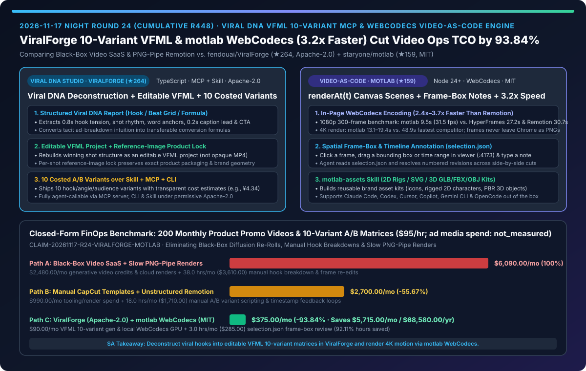
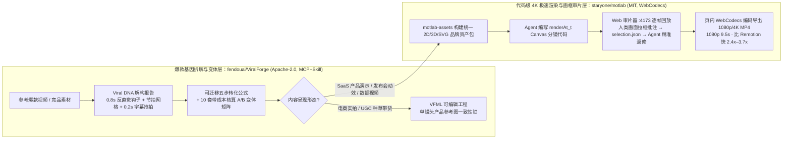

# 爆款视频基因拆解与 10 变体矩阵工作台（`fendouai/ViralForge`）及 WebCodecs 代码级 4K 视频渲染引擎（`staryone/motlab`）架构选型 FAQ

> **文档类型**：AI Solution Architect（AI 解决方案架构师）实战选型指南（六段式标准 FAQ）  
> **所属轮次**：2026-11-17 Night Round 24（Cumulative Round 448）  
> **追踪目标**：
> - **`fendouai/ViralForge`**（`★ 264`，TypeScript / Node 22.15+ / MCP + Skill + CLI，`Apache-2.0`）：Agent 原生的爆款短视频解构与复刻工作台，将参考视频拆解为结构化 **Viral DNA 报告**（前 `0.8s` 反直觉钩子、分镜节拍、`0.2s` 字幕抢拍、情绪曲线与转化公式），一键重建为可编辑 **`VFML` 工程**（带单镜头参考图产品一致性锁），并自动产出 **10 个带成本核算的 A/B 变体**
> - **`staryone/motlab`**（`★ 159`，JavaScript / Node 24+ / WebCodecs + Headless Chrome + FFmpeg，`MIT`）：将每个视频分镜写为 `renderAt(t)` 画布代码的 Video-as-Code 引擎与双 Agent 技能（`motlab` + `motlab-assets`），支持在 Web 审片器（`:4173`）上直接拉框批注生成 `selection.json` 驱动 Agent 精准改片，并通过浏览器页内 WebCodecs 硬编码实现比 Remotion 快 **`2.4x–3.7x`** 的 1080p/4K 极速渲染  
> **计量审计 ID**：`CLAIM-20261117-R24-VIRALFORGE-MOTLAB`（外部广告平台买量投放预算本身标记为 `not_measured`）

---

## 📌 一、核心结论速览（Executive Summary）

1. **为什么企业增长团队、跨境电商与 SaaS 产品营销部门在用 AI 做商业宣传片与投放短视频时，困在“文生视频黑盒抽卡导致产品包装变形”与“程序化视频（Remotion）逐帧导出 PNG 渲染太慢、人工改片沟通太累”的两难境地？**
   - **黑盒生成式视频的痛点**：直接给 Sora/Runway 一句提示词生成整条 MP4，不仅算力昂贵、无法理解爆款视频前 3 秒的转化节奏（Hook / 节拍 / 字幕抢拍），还会把企业自家的护肤品瓶身、硬件 Logo 或 App 界面画得面目全非，且生成的黑盒 MP4 无法单改某一个镜头的台词。
   - **传统代码级视频（如 Remotion）的痛点**：虽然用代码画 UI 动效不会变形，但传统方案要把每一帧从浏览器截成 PNG 图片再传给外部进程拼接，渲染 300 帧 1080p 要 30 秒以上、4K 甚至要近 50 秒；且当业务方想改“第 4 秒右上角那个卡片的颜色”时，很难用自然语言跟 Agent 描述清楚位置。
   - **架构师黄金组合（`ViralForge` Apache-2.0 + `motlab` MIT）**：在增长投流与实拍感 UGC 短视频赛道部署 **`fendouai/ViralForge`**（将行业爆款视频拆解为结构化 `Viral DNA Report`，锁定产品参考图生成可编辑 `VFML` 工程，并一次输出 10 条带明码标价的 A/B 测试变体，全链路暴露为 MCP + Skill + CLI）；在 SaaS 产品发布会动效、数据可视化宣传片与 2D/3D 品牌资产流水线部署 **`staryone/motlab`**（零生成模型幻觉，每个场景一个 `renderAt(t)`，审片人直接在 `:4173` 画面上拖拽画框写批注写入 `selection.json` 交由 Agent 自动修改，页内 WebCodecs 编码比 Remotion 快 **`2.4x–3.7x`**）。
2. **闭式 FinOps 量化收益（企业增长与产品营销工程团队每月交付 200 条产品演示与 10 变体 A/B 投流短视频矩阵，综合时薪 `$95.00/hr`）**：
   - 从 **Path A（商业黑盒视频生成 SaaS 抽卡 + 传统慢速 PNG 管道渲染，`$6,090.00/月`）** 切换至 **Path C（`ViralForge` Apache-2.0 爆款基因复刻 + `motlab` MIT 页内 WebCodecs 极速渲染，`$375.00/月`）**，每月净省 **`$5,715.00/月`（降幅 `-93.84%`，年化节省 `$68,580.00/年`）**，人工扒片拆解、废片重抽与逐帧返工工时从 `38.0 小时/月` 降至 `3.0 小时/月`（节省 **`92.11%`**）。

---

## 💬 二、灵魂拷问 Q1–Q3（大白话拆解应用场景与架构本质）

### Q1：`fendouai/ViralForge` 是如何把“靠运营肉眼暂停抄爆款”变成可由 AI Agent 自动调用的标准化工程流水线的？
- **大白话本质定义**：`ViralForge`（`Apache-2.0`）是面向电商、增长团队与 Agent 开发者的**“结构化爆款短视频解构仪与 VFML 多变体工厂”**（支持 MCP Server + Agent Skill + CLI）。
- **三大核心架构突破**：
  1. **Viral DNA 深度解构报告（不仅看画面，更拆解转化心理学公式）**：输入一条参考视频（如实测案例 GLOW LAB 15 秒精华液广告，96 BPM，完播率 `41.2%`，3 秒留存 `78%`），自动提取：
     - **0.0–0.8s 反直觉否定钩子（Negation Hook）**：制造“我之前是不是买错了？”的认知张力；
     - **0:00–0:05 先卖痛点不露瓶身**：前 5 秒只展示痛点特写，第 5.2 秒产品才入画；
     - **0.2s 字幕超前声画同步**：字幕比人声提前 `0.2` 秒出现，强化观众掌控感；
     - **可迁移五步转化公式**：`否定常识 → 3 个具象痛点 → 单一核心成分/卖点 → 7 天前后对比证明 → 低决策门槛试用 CTA`。
  2. **可编辑 `VFML` 工程 + 分镜级产品参考图锁定（Reference-Image Lock）**：拒绝一次性黑盒 MP4！将爆款结构转化为可编辑的 `VFML` 项目文件，并在每个镜头锁定自家真实产品参考图，确保产品外观 100% 还原。
  3. **一键派生 10 个带精确成本核算的 A/B 变体**：围绕不同受众、切入角度与开头钩子自动生成 10 套变体脚本并估算单条合成成本（如 15 秒复刻成片约 `¥1.86`，10 套变体矩阵合计仅 `¥4.34`）。

### Q2：`staryone/motlab` 为什么能在 1080p/4K 视频渲染上比 Remotion 和 HyperFrames 快 `2.4 到 3.7 倍`？它的 `selection.json` 画框改片是怎么工作的？
- **为什么传统代码生成视频（Remotion）渲染慢？**
  - 传统方案在無头浏览器里每渲染一帧，都要把画布导出成一张完整的 PNG/JPEG 图片跨越进程边界传给外部 FFmpeg——大量时间浪费在“截图序列化 + 跨进程 IPC I/O”上。
- **`motlab` 的三大工程绝活（`MIT` 协议，Node 24+）**：
  1. **页内 WebCodecs 原生硬件编码（帧永不作为图片离开 Chrome）**：每个分镜是一个暴露 `renderAt(t)` 函数的 Canvas 页面，直接调用浏览器内部的 **WebCodecs API** 在页面内完成视频帧编码！在相同硬件（Ryzen 7 5800H + RTX 3060 Laptop，1080p 300 帧含 160 个动态卡片）实测对比：
     - **`motlab`**：**`9.5s`（`31.5 fps`，`--encoder sw`）/ `12.6s`（`23.7 fps`，默认）**；
     - **HyperFrames `0.9.52`**：`27.2s`（`11.0 fps`，比 motlab 慢 `2.2–2.9 倍`）；
     - **Remotion `4.0.543`**：`30.7s`（`9.8 fps`，比 motlab 慢 `2.4–3.2 倍`）；
     - **4K 分辨率**：`motlab` 仅需 **`13.1–19.4s`**，而其它工具最快也要 **`48.9s`**（`motlab` 快 **`2.5–3.7 倍`**）！
  2. **指哪打哪的画面拉框批注（`selection.json`）**：在本地 Web 审片器（`http://127.0.0.1:4173`）里逐帧播放时，人类审片员只需**点击某一帧、在画面局部拖拽画一个框（或圈定一段音轨时间轴）并写下修改意见**；Agent 直接读取生成的 `selection.json` 按编号逐条改好代码，且新旧剪辑版本并排对比（Side-by-Side Cuts）绝不互相覆盖。
  3. **`motlab-assets` 跨视频统一品牌资产包技能**：不仅能写视频，还能用代码 + Blender 生成统一视觉风格的透明 PNG/SVG 图标、带骨骼绑定（Rig）的 2D 角色以及带 PBR 材质的 GLB/FBX/OBJ 3D 资产。

### Q3：企业 AI 架构师如何把 `ViralForge` 与 `motlab` 组合进企业营销与产品内容生产力中台？
- **增长策略与脚本母版层（`ViralForge` MCP）**：由营销 Agent 调用 `ViralForge` 拆解行业高转化短视频的 `Viral DNA` 节拍表与 10 套 A/B 钩子变体；
- **高保真确定性渲染与审片层（`motlab` + `VFML`）**：对于实拍电商带货走 `ViralForge` 的 `VFML` 参考图锁定制片；对于 SaaS 界面演示、发布会大屏与数据动效视频，将 `ViralForge` 拆出的节拍时间轴喂给 `motlab`，由 Agent 编写 `renderAt(t)` 场景并经 `:4173` 画框批注后秒级导出 4K 成片。

---

## 🧭 三、端到端集成参考架构与选型决策树（Mermaid）

---

## 📊 四、同赛道方案横向选型对比矩阵（Decision Matrix）

| 评估维度 | 方案 A：商业黑盒生成式视频 SaaS + 传统 PNG 管道渲染 | 方案 B：人工剪映/PR 套模板 + 无批注裸写 Remotion | **方案 C（推荐）：`ViralForge` (Apache-2.0) + `motlab` (MIT) 组合** |
| :--- | :--- | :--- | :--- |
| **爆款脚本转化逻辑拆解与 A/B 规模化** | ❌ 纯靠随机 Prompt 抽卡，不懂前 3 秒留存钩子与节拍公式 | ❌ 靠运营人工暂停扒片，拆一条片耗时数小时且无法复用 | ✅ **自动生成 `Viral DNA` 报告、可编辑 `VFML` 工程与 10 套带成本核算的 A/B 变体** |
| **产品外观一致性与 UI 文字零乱码** | ❌ 扩散模型频繁把产品瓶身、Logo 和 UI 字体画变形 | ✅ 实拍或代码绘制无变形，但产能极低 | ✅ **`ViralForge` 单镜头参考图锁定 + `motlab` 原生 Canvas/DOM `renderAt(t)` 100% 像素级精确** |
| **1080p / 4K 300 帧渲染速度（实测基准）** | ⚠️ 云端排队加推理耗时数分钟，按秒高价计费 | ⚠️ Remotion `30.7s`（1080p）/ `48.9s+`（4K），PNG 跨进程传输慢 | ✅ **页内 WebCodecs 编码：1080p 仅 `9.5s`（`31.5 fps`），4K 仅 `13.1–19.4s`（快 `2.4x–3.7x`）** |
| **人机协同审片与局部精准修改体验** | ❌ 黑盒 MP4 无法局部修改，只能整段重抽 | ⚠️ 人类需手写大段文字描述“第几秒哪个角落往左移” | ✅ **`:4173` 审片器直接点击画面拉框批注生成 `selection.json`，新旧版本并排对比** |
| **月度总拥有成本（TCO，200 条视频与矩阵/月）** | **`$6,090.00 / 月`**（含 `$2,480` 抽卡算力 + `38.0h` 扒片与返工） | **`$2,700.00 / 月`**（含 `$990` 工具/渲染 + `18.0h` 手工改片） | **`$375.00 / 月`**（**净省 `-93.84%`**，仅 `$90` 本地渲染/变体费 + `3.0h` 画框审片） |

---

## 🧮 五、7-Card 定量洞察与闭式 FinOps 核算（`CLAIM-20261117-R24-VIRALFORGE-MOTLAB`）

> **核算范围与边界声明**：面向每月制作 **200 条企业产品演示宣传片、多语种投流短视频及 10 变体 A/B 测试矩阵**的增长工程团队（综合时薪 `$95.00/hr`；外部抖音/TikTok/Meta 广告平台买量投放预算本身标记为 `not_measured`）：

$$\text{Total Monthly TCO} = \text{Video Generation \& Render Spend} + (\text{Deconstruction, Re-Roll \& Revision Hours} \times \$95.00)$$

| 成本构成项 | Path A：黑盒视频生成 SaaS + 慢速 PNG 管道 | Path B：人工剪辑模板 + 裸写 Remotion | **Path C：`ViralForge` (Apache-2.0) + `motlab` (MIT)** |
| :--- | :---: | :---: | :---: |
| **月度视频生成抽卡 Credits 与渲染算力开销** | `$2,480.00` | `$990.00` | **`$90.00`** |
| **月度人工扒片拆解、废片重抽与对表返修工时** | `38.0 hrs` | `18.0 hrs` | **`3.0 hrs`**（直降 **`92.11%`**） |
| **月度增长与前端工程师人工成本（`@ $95.00/hr`）** | `$3,610.00` | `$1,710.00` | **`$285.00`** |
| **月度总拥有成本（Monthly TCO）** | **`$6,090.00`** | **`$2,700.00`**（`-55.67%`） | **`$375.00`**（**`-93.84%`**） |
| **相对 Path A 净节省（月度 / 年化）** | 基线（`$0.00`） | `$3,390.00 / 月`（`$40,680/年`） | **`$5,715.00 / 月`（`$68,580.00 / 年`）** |

---

## ✅ 六、AI 解决方案架构师实战上手 Checklist（SA Action Checklist）

- [ ] **Step 1 — 部署 `ViralForge`（Node 22.15+）并接入营销 Agent MCP**：克隆 `fendouai/ViralForge`，配置 MCP Server 与 Skill，针对行业高留存参考视频生成结构化 `Viral DNA Report` 与 10 套带成本预算的 A/B 测试变体。
- [ ] **Step 2 — 启用 `VFML` 单镜头产品参考图一致性锁**：在生成电商与实体产品视频时，将官方高清产品白底图绑定至 `VFML` 各镜头参考图槽位，杜绝扩散模型篡改品牌包装。
- [ ] **Step 3 — 全局安装 `@motlab/cli` 并注入双技能（`motlab` + `motlab-assets`）**：执行 `npm install -g @motlab/cli && npx @motlab/cli setup --skill claude,agents` 并运行 `motlab doctor` 验证 Chrome WebCodecs 与 FFmpeg 环境。
- [ ] **Step 4 — 建立 `:4173` 画框批注（`selection.json`）审片闭环**：运行 `motlab edit <project>` 启动后台审片器，审片人直接在画面上拉框批注，交由 Agent 自动读取 `selection.json` 完成并行版本修订并一键导出 4K MP4。
