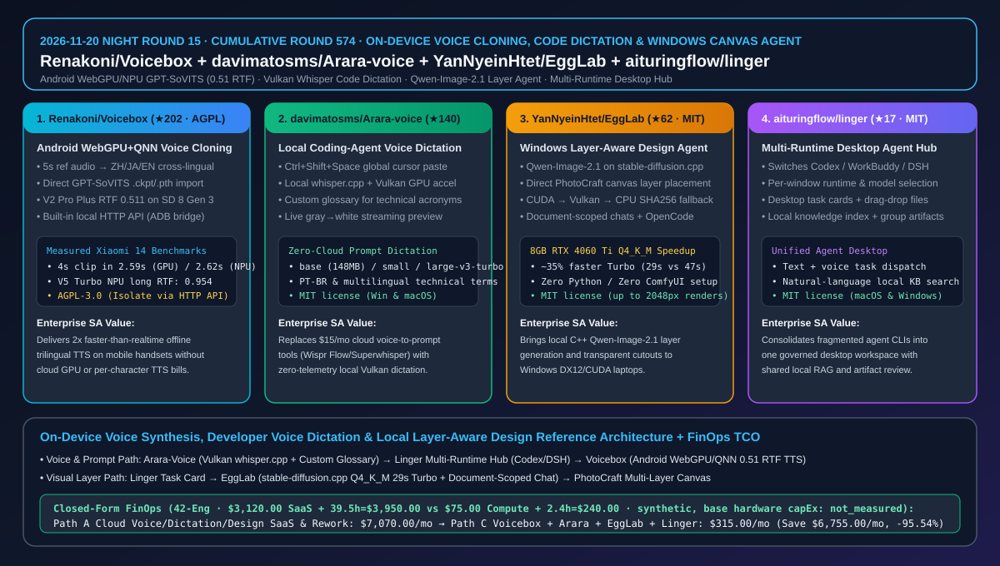
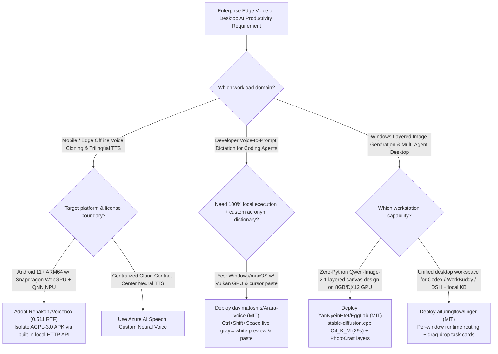
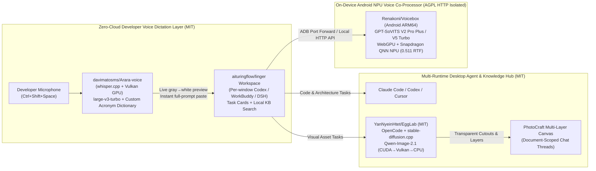
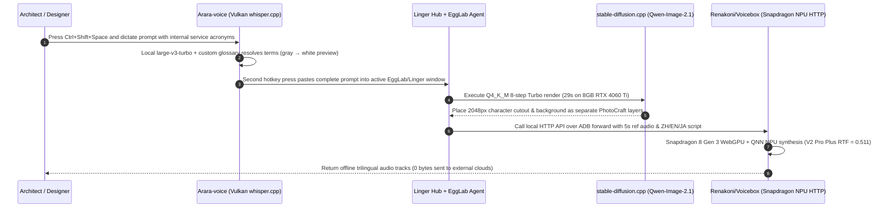

# How to Choose On-Device Android Voice Cloning (0.51 RTF), Local Coding-Agent Voice Dictation, Windows Layer-Aware Design Agents, and Multi-Runtime Desktop Hubs? `Renakoni/Voicebox`, `davimatosms/Arara-voice`, `YanNyeinHtet/EggLab`, and `aituringflow/linger` Architecture & Selection FAQ

> **Document Metadata (2026-11-20 Night Round 15 · Cumulative Round 574)**
> - **Target Audience**: AI Solution Architects, Mobile & Edge Multimodal Architects, Developer Productivity & Desktop AI Workspace Leads
> - **Primary Repositories Evaluated**:
>   1. [`Renakoni/Voicebox`](https://github.com/Renakoni/Voicebox) (★ 202 · `stars_today: not_measured` · `34 stars/day` · Kotlin · AGPL-3.0) — Fully offline Android 11+ (`arm64-v8a`) cross-lingual voice cloning and trilingual TTS (Chinese, Japanese, English) powered by WebGPU and Qualcomm QNN NPU hybrid acceleration. Imports GPT-SoVITS `.ckpt`/`.pth` checkpoints (`V2 Pro`, `V2 Pro Plus`, `V5 Turbo`) directly on-device from ~5 seconds of reference audio, achieving **RTF `0.511` (~2× faster than real-time playback; `2.587 s` for a 4 s sentence, `11.955 s` for a 22 s passage)** on a Xiaomi 14 (Snapdragon 8 Gen 3), with a built-in local HTTP server accessible from PCs via ADB port forwarding
>   2. [`davimatosms/Arara-voice`](https://github.com/davimatosms/Arara-voice) (★ 140 · `stars_today: not_measured` · `20 stars/day` · Java · MIT) — 100% local voice dictation desktop app for Windows and macOS (`Ctrl+Shift+Space` global hotkey) built for dictating long prompts into Claude Code, Codex, and Cursor via `whisper.cpp` with optional Vulkan GPU acceleration (`base` 148 MB, `small`, and default `large-v3-turbo`), featuring a **custom dictionary for technical acronyms**, a live gray-to-white streaming preview popup, and instant full-prompt cursor paste with zero telemetry
>   3. [`YanNyeinHtet/EggLab`](https://github.com/YanNyeinHtet/EggLab) (★ 62 · `stars_today: not_measured` · `12 stars/day` · JavaScript · MIT) — Local AI image generation and layer-aware design agent for Windows 10/11 driving **PhotoCraft** via `OpenCode` and **Qwen-Image-2.1** on `stable-diffusion.cpp` (with SHA-256 verified `CUDA → Vulkan → CPU` engine fallback, zero Python or ComfyUI required, document-scoped conversation threads, and an `Official Q4_K_M` beta measuring **~35% faster Turbo text-to-image (`29 s` vs. `47 s` at `864×1152`)** on an 8 GB RTX 4060 Ti)
>   4. [`aituringflow/linger`](https://github.com/aituringflow/linger) (★ 17 · `stars_today: not_measured` · `2 stars/day` · TypeScript · MIT) — Open-source personal desktop agent workspace for macOS and Windows (Node.js 24.9+) that unifies **Codex, WorkBuddy, and DeepSeek Harness** with per-window runtime/model selection, desktop task cards, drag-and-drop file context, local natural-language knowledge-base indexing, and group-chat artifact collaboration
> - **Provenance & Guardrail Statement**: Structured after `ib-vs-ethernet-roce-selection-faq.md`. All four repositories come from `search-new-repos-2026-11-20-raw.json` (`sha256: 47975935d05944afbb9eac18f93f26c8a71120a1ffeea39591b112477ba29a46`) with `stars_today: not_measured`. Upstream README benchmarks (e.g., Xiaomi 14 Snapdragon 8 Gen 3 vs. i9-12900H / RTX 3070 Ti RTF table, RTX 4060 Ti `Q4_K_M` timings) are labeled `anonymized_reported (independently_reproduced=false)`. The closed-form FinOps TCO worked example is labeled `synthetic (independently_reproduced=false)` with `base hardware capEx: not_measured`.

---

## ① 📌 Executive Summary (One-Sentence Selection Verdict)

> **One-Sentence Verdict**: When equipping **field-service mobile teams, software engineers, and Windows visual designers with voice and generative canvas tooling**, **do not pay $15/seat/month for cloud voice-to-prompt apps that stream spoken proprietary architecture details to third-party servers, and do not force Windows designers onto fragile Python/ComfyUI setups just to get layered edits**! Instead, run **`Renakoni/Voicebox` on Android handsets (`0.511 RTF` via WebGPU + Qualcomm QNN NPU, isolated behind its local HTTP API to respect AGPL-3.0)**, deploy MIT-licensed **`davimatosms/Arara-voice` (local Vulkan `whisper.cpp` + custom technical dictionary)** for developer prompt dictation, and pair MIT-licensed **`YanNyeinHtet/EggLab` (`stable-diffusion.cpp` `Q4_K_M` 29 s layered renders into PhotoCraft)** with **`aituringflow/linger` (multi-runtime desktop workspace)** to reduce a 42-person organization's monthly voice/design SaaS and rework TCO from **$7,070.00/mo** down to **$315.00/mo** (saving **$6,755.00/mo**, **`-95.54%`**, `synthetic, independently_reproduced=false`).



### Core Capabilities & Metrics Cheat Sheet

| Dimension | `Renakoni/Voicebox` | `davimatosms/Arara-voice` | `YanNyeinHtet/EggLab` | `aituringflow/linger` |
|---|---|---|---|---|
| **Plain-English Positioning** | On-device Android WebGPU + Snapdragon QNN NPU GPT-SoVITS voice cloning & trilingual TTS | Local `Ctrl+Shift+Space` Vulkan Whisper voice dictation built for coding agents | Zero-Python Windows design agent running Qwen-Image-2.1 on `stable-diffusion.cpp` into PhotoCraft layers | Cross-platform desktop agent workspace unifying Codex, WorkBuddy, DSH & local RAG |
| **Primary Enterprise Pain Point Solved** | Cloud voice cloning is expensive/offline-hostile, while laptop CPUs run GPT-SoVITS at `1.73–3.16 RTF` | Typing multi-paragraph agent prompts is slow, while cloud dictation SaaS leaks spoken code architecture | Flat PNG generators force manual background removal, and Python/CUDA breaks on DX12 Windows laptops | Developers juggle 4+ separate agent CLIs with fragmented file context and local docs |
| **Key Technical / Measured Spec** | Xiaomi 14 `V2 Pro Plus` long **RTF `0.511`** (`V5 Turbo` NPU **RTF `0.954`**); direct `.ckpt/.pth` import | `base` (148 MB) / `small` / `large-v3-turbo`; custom acronym dictionary; live gray→white preview | `CUDA → Vulkan → CPU` fallback; `Q4_K_M` **~35% faster (`29 s` vs. `47 s`)** on 8 GB RTX 4060 Ti; doc-scoped chats | Per-window runtime/model routing; desktop task cards; drag-and-drop files; local KB search |
| **License & Governance** | **AGPL-3.0** (isolate via its built-in local HTTP API; never statically link into proprietary apps) | **MIT** (Windows & macOS, commercial-ready) | **MIT** (Windows 10/11, release `SHA256SUMS.txt` verified) | **MIT** (Node.js 24.9+, macOS & Windows) |

---

## ② 🎯 Solution Architect & Customer Deep-Dive Q&A

### Q1: Running GPT-SoVITS voice cloning on an Intel i9-12900H laptop CPU takes `39.17s–71.06s` for a 22-second passage (`1.73–3.14 RTF`). How does `Renakoni/Voicebox` achieve `0.511 RTF` (~2× faster than real-time) completely offline on an Android phone?

- **Measured Hardware Benchmark Comparison (Xiaomi 14 Snapdragon 8 Gen 3 vs. i9-12900H / RTX 3070 Ti Laptop, 10-Run Mean ± SD)**:
  - According to the project's benchmark suite (`anonymized_reported, independently_reproduced=false`) on a 4-second short utterance and a 22-second long passage:
    - **Laptop CPU (`i9-12900H`)**: `V2 Pro Plus` takes `39.173 ± 1.097 s` (**RTF `1.731`**), and `V5 Turbo` takes `71.061 ± 3.277 s` (**RTF `3.137`**)—slower than real-time playback.
    - **`Voicebox` Mobile WebGPU**: `V2 Pro Plus` synthesizes the 4 s sentence in **`2.587 ± 0.182 s` (RTF `0.614`)** and the 22 s passage in `12.637 ± 0.453 s` (**RTF `0.556`**).
    - **`Voicebox` Mobile WebGPU + Qualcomm QNN NPU Hybrid**: Offloading heavy operators to the Snapdragon NPU drives `V2 Pro Plus` long-passage RTF down to **`0.511 ± 0.007` (`11.955 s` for 22 s of speech—nearly 2× faster than real-time!)**, and accelerates `V5 Turbo` from `40.676 s` (GPU RTF `1.816`) to **`21.479 s` (GPU+NPU RTF `0.954` < 1.0)**!
- **Key Architectural Features & AGPL-3.0 Isolation Rule**:
  - Decouples reference audio language from output language (clone from a 5 s Japanese or English clip and synthesize fluent Chinese/English/Japanese speech offline), imports raw `.ckpt` and `.pth` files directly on-device, and exposes a **local HTTP API** reachable from a PC over `adb forward`.
  - ⚠️ **License Boundary**: Because `Voicebox` is **AGPL-3.0**, enterprise teams must not copy its source code into proprietary apps; consume it strictly as an unmodified standalone APK over its localhost HTTP API with documented voice-owner consent.

### Q2: Why do enterprise security teams block cloud voice-to-prompt dictation tools (like Wispr Flow) on developer laptops, and how does `davimatosms/Arara-voice` solve coding-agent dictation locally?

- **The Cloud Dictation Security & Accuracy Gap**:
  - When engineers dictate detailed architectural prompts (*"Refactor the tenant token verifier in `auth.ts` to fix the race condition..."*), cloud dictation apps stream raw audio to external servers and charge `$12–$15/user/month`. Furthermore, generic speech models mangle domain-specific acronyms, Portuguese/multilingual code-switching, and internal service names.
- **How `davimatosms/Arara-voice` (MIT) Works**:
  - Runs OpenAI Whisper locally via `whisper.cpp` with **Vulkan GPU acceleration** across Windows 10/11 and macOS (Apple Silicon & Intel), offering `base` (`148 MB`), `small`, and default `large-v3-turbo` tiers.
  - Provides a **Custom Dictionary** for domain acronyms and jargon, renders a live floating popup where tentative words appear in gray and turn white once locked, and pastes the entire prompt at the active cursor on the second `Ctrl+Shift+Space` press—with zero network telemetry.

### Q3: How do `YanNyeinHtet/EggLab` and `aituringflow/linger` simplify local layered visual design and multi-agent orchestration on Windows and macOS workstations?

- **`YanNyeinHtet/EggLab` (MIT): Zero-Python Layer-Aware Design Agent for Windows**:
  - Eliminates Python virtualenv and ComfyUI setup by running **Qwen-Image-2.1** directly on `stable-diffusion.cpp` with automatic SHA-256 verified **`CUDA → Vulkan (29 MB, any DX12 GPU) → CPU` fallback**.
  - Its **Official `Q4_K_M`** quantization runs **~35% faster than FP8 (`29 s` vs. `47 s` at `864×1152` Turbo 8-step)** on an 8 GB RTX 4060 Ti, scopes agent chat history per **PhotoCraft** document (resuming the exact thread you last read when reopening a file), and places generated assets and transparent cutouts directly onto the canvas as editable layers.
- **`aituringflow/linger` (MIT): Multi-Runtime Desktop Agent Workspace**:
  - Consolidates **Codex, WorkBuddy, and DeepSeek Harness** into one desktop shell where each chat window independently selects its runtime and model, backed by drag-and-drop task cards, local natural-language knowledge-base indexing, and group-chat artifact iteration.

---

## ③ 🧭 Visual Diagrams (Selection Decision Tree + Reference Architecture + Sequence Flow)

### 3.1 On-Device Voice Cloning, Code Dictation & Desktop Design Agent Decision Tree



### 3.2 End-to-End Voice-to-Prompt, Multi-Runtime Hub & Layered Visual Architecture



### 3.3 `Arara-voice` Dictation → `EggLab` Layered Render → `Voicebox` NPU Trilingual Synthesis Sequence



---

## ④ 📊 Comparative Selection Matrix (Open Source vs. Commercial Cloud SaaS)

| Dimension | `Renakoni/Voicebox` (AGPL-3.0) | `davimatosms/Arara-voice` (MIT) | `YanNyeinHtet/EggLab` (MIT) | `aituringflow/linger` (MIT) | Commercial Cloud Stack (ElevenLabs + Wispr Flow + Firefly + Cloud Agent Desktop) |
|---|---|---|---|---|---|
| **Core Positioning** | **Android on-device WebGPU+QNN GPT-SoVITS voice cloning & trilingual TTS** | **Local Vulkan `whisper.cpp` voice dictation hotkey for coding agents** | **Zero-Python Windows Qwen-Image-2.1 layer-aware design agent for PhotoCraft** | **Multi-runtime desktop agent hub (Codex/WorkBuddy/DSH) with local KB & group artifacts** | Metered cloud voice cloning + $15/mo cloud dictation + cloud image credits + single-vendor desktop app |
| **Performance & Hardware Reach** | Snapdragon 8 Gen 3 `V2 Pro Plus` **RTF `0.511`** (3.3× faster than i9 laptop CPU) | Windows & macOS (M1–M4/Intel) with cross-vendor Vulkan GPU acceleration | `CUDA → Vulkan → CPU` fallback; `Q4_K_M` **29 s** vs. FP8 **47 s** on 8 GB RTX 4060 Ti | Lightweight Node.js 24.9+ desktop app with per-window runtime routing | Requires continuous WAN connectivity; blocked in air-gapped or strict DLP environments |
| **Data Privacy & DLP Posture** | **100% offline on phone** after model download | **100% local transcription**; history & glossary stay in `%APPDATA%\Arara` | **Models & renders stay on local disk**; document-scoped chat threads | Local file drag-and-drop & local knowledge-base indexing | Uploads spoken source-code architecture, voice samples, and design drafts to external cloud servers |
| **License & Governance** | **AGPL-3.0** (consume via built-in HTTP API as a separate process) | **MIT** (sign installer with enterprise certificate to avoid SmartScreen/Gatekeeper prompts) | **MIT** (verify `SHA256SUMS.txt` and sign NSIS installer for enterprise rollout) | **MIT** | Proprietary per-seat and per-character subscriptions |
| **Monthly TCO (42-Person Org)** | **$0.00 / mo TTS API fees** | **$0.00 / mo dictation seats** | **~$75.00 / mo** (local GPU power & light chat tokens) | **$0.00 / mo seat fees** | **$7,070.00 / mo** (SaaS seats + metered TTS + 39.5h acronym & layer-cutout rework) |

---

## ⑤ 🧪 Quantitative Enterprise FinOps TCO & 7-Card Report Alignment

### 5.1 Closed-Form FinOps Worked Example (42-Person Engineering & Design Organization Running Multilingual TTS, Voice-to-Prompt Dictation & Layered Visual Design)

> **Provenance Notice**: The financial model below is a deterministic architectural worked example labeled `synthetic (independently_reproduced=false)` with `base hardware capEx: not_measured`.

| Cost Component | Path A: Commercial Cloud Voice Cloning + Cloud Dictation Seats + Cloud Design SaaS | Path C: On-Device `Voicebox` + Local `Arara-voice` + `EggLab` Layer Agent + `Linger` | Closed-Form Formula & Architectural Notes |
|---|---|---|---|
| **Cloud TTS APIs, Dictation Seats & Design Subscriptions** | **$3,120.00 / mo** | **$75.00 / mo** | Path A: 42 cloud dictation seats (`$15/seat`) + metered cloud voice cloning + cloud design seats = `$3,120.00/mo`; Path C: offline `Voicebox` + MIT `Arara-voice` / `EggLab` / `Linger` local power & chat tokens = `$75.00/mo` |
| **Acronym Dictation Fixes, Manual Layer Cutouts & Context Switching ($100/h)** | **$3,950.00 / mo** (`39.5h × $100.00`) | **$240.00 / mo** (`2.4h × $100.00`) | Path A: 42-person org spends `39.5h/mo` fixing garbled technical acronyms, manually cutting flat renders into layers, and copying context across CLIs (`$3,950.00`); Path C: custom glossary + direct PhotoCraft layer placement + Linger workspace cuts ops to `2.4h/mo` (`$240.00`) |
| **Total Monthly TCO** | **$7,070.00 / mo** | **$315.00 / mo** | **Net savings of $6,755.00 / mo (-95.54% reduction, $81,060.00 annualized, `not_measured` hardware capEx)** |

```chart
{
  "data": {
    "values": [
      { "Category": "Cloud TTS, Dictation Seats & Design SaaS", "Deployment": "Path A: Commercial Cloud SaaS & Manual Rework", "MonthlyCostUSD": 3120 },
      { "Category": "Acronym Fixing & Layer Cutout Rework (42-Eng)", "Deployment": "Path A: Commercial Cloud SaaS & Manual Rework", "MonthlyCostUSD": 3950 },
      { "Category": "Cloud TTS, Dictation Seats & Design SaaS", "Deployment": "Path C: Voicebox + Arara + EggLab + Linger", "MonthlyCostUSD": 75 },
      { "Category": "Acronym Fixing & Layer Cutout Rework (42-Eng)", "Deployment": "Path C: Voicebox + Arara + EggLab + Linger", "MonthlyCostUSD": 240 }
    ]
  },
  "semantic_types": {
    "Category": "Category",
    "Deployment": "Name",
    "MonthlyCostUSD": "Amount"
  },
  "chart_spec": {
    "chartType": "Grouped Bar Chart",
    "title": "On-device Voicebox + Arara + EggLab + Linger cut monthly TCO by 95.54%",
    "subtitle": "Monthly cost in USD (42-engineer & design org across voice, dictation & layered design, synthetic)",
    "encodings": {
      "x": "Category",
      "y": "MonthlyCostUSD",
      "group": "Deployment",
      "color": "Deployment"
    }
  }
}
```

### 5.2 Alignment with the 7-Card 4:5 Visual Report (`cards.html` / `cards.en.html`)

- **✅ Good Fit**: Offline Snapdragon Android trilingual voice synthesis (`0.511 RTF`) accessed via local HTTP API, zero-cloud developer prompt dictation with custom technical dictionaries, zero-Python Windows layered image generation on 8 GB CUDA/DX12 GPUs, and unified multi-runtime desktop agent management.
- **⛔ Not For**: Statically linking AGPL-3.0 `Renakoni/Voicebox` code into proprietary mobile apps, cloning voices without explicit speaker consent, or deploying unsigned `Arara-voice` / `EggLab` installers to locked-down enterprise endpoints without internal EV/Developer ID code signing.

---

## ⑥ 🛠️ Enterprise Architecture Review & Rollout Checklist

- [ ] **Speaker Consent Ledger & AGPL-3.0 HTTP Process Isolation for `Voicebox`**: Record written consent for every reference voice imported into `Renakoni/Voicebox`, and integrate it strictly as a separate process via its built-in local HTTP API (`adb forward`) rather than linking AGPL-3.0 source into proprietary packages.
- [ ] **Corporate Technical Glossary Provisioning & Offline Lock for `Arara-voice`**: Pre-populate `%APPDATA%\Arara`'s custom dictionary with internal service names and acronyms, and disable automatic `versao.json` update checks in air-gapped developer environments.
- [ ] **SHA-256 Installer Verification & `Q4_K_M` Defaulting for `EggLab`**: Verify `SHA256SUMS.txt` via `Get-FileHash -Algorithm SHA256` before internal distribution, and enable the `Official Q4_K_M` model tier on 8 GB Windows GPUs for ~35% faster Turbo layer generation.
- [ ] **Internal Code Signing & Per-Window Runtime Governance in `Linger`**: Sign `Arara-voice`, `EggLab`, and `aituringflow/linger` binaries with your enterprise Windows/Apple Developer certificates, and bind sensitive local knowledge-base windows in `linger` exclusively to local/VNet model endpoints.
