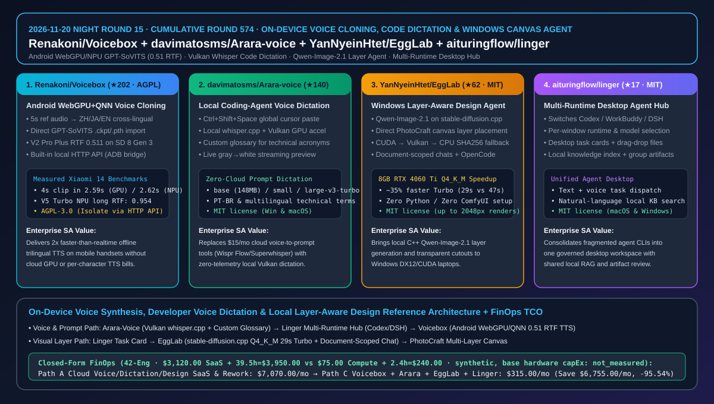
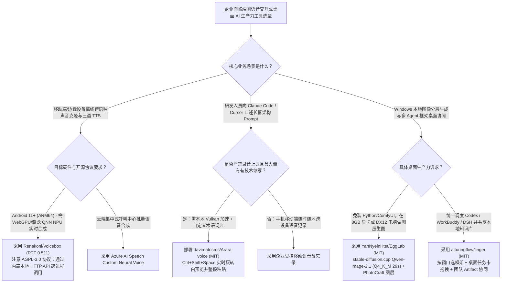
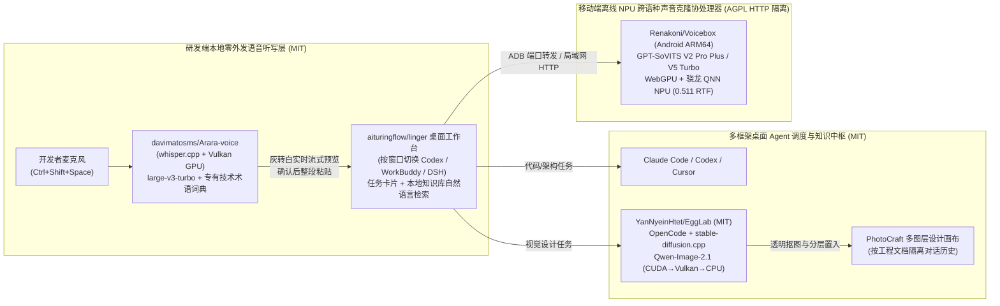
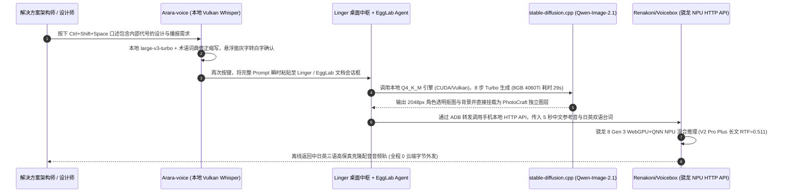

# 手机端离线三语声音克隆（0.51 RTF）、Coding Agent 本地语音听写、Windows 图层设计 Agent 与多框架桌面工作台怎么选？`Renakoni/Voicebox`、`davimatosms/Arara-voice`、`YanNyeinHtet/EggLab` 与 `aituringflow/linger` 架构与选型 FAQ

> **文档元数据（2026-11-20 夜间第 15 轮 · 累计第 574 轮 / Round 574）**
> - **适用读者**：AI Solution Architect（解决方案架构师）、移动端与边缘多模态架构师、研发效能与桌面 AI 工作台负责人
> - **本轮核心对比项目**：
>   1. [`Renakoni/Voicebox`](https://github.com/Renakoni/Voicebox)（★ 202 · `stars_today: not_measured` · `34 stars/day` · Kotlin · AGPL-3.0）——运行在 Android 11+（ARM64）手机本机的离线跨语种声音克隆与三语 TTS（中日英）应用，底层基于 WebGPU 与高通骁龙 QNN NPU 混合加速，支持在手机端直接导入转换 GPT-SoVITS `.ckpt`/`.pth` 权重（`V2 Pro` / `V2 Pro Plus` / `V5 Turbo`），仅需 ~5 秒参考音频即可跨语种克隆；在小米 14（骁龙 8 Gen 3）上实测 `V2 Pro Plus` 长文本 **RTF 达 `0.511`（比实时播放快约 2 倍，4 秒短句仅需 `2.587s`）**，并内置轻量级本地 HTTP API（支持 PC 通过 ADB 端口转发直接调用）
>   2. [`davimatosms/Arara-voice`](https://github.com/davimatosms/Arara-voice)（★ 140 · `stars_today: not_measured` · `20 stars/day` · Java · MIT）——专为向 AI 编程助手（Claude Code、Codex、Cursor）口述长 Prompt 打造的 100% 本地跨平台语音听写工具（Windows & macOS，全局快捷键 `Ctrl+Shift+Space`），底层基于 `whisper.cpp` 与可选 Vulkan GPU 加速（提供 `base` 148MB、`small` 与默认 `large-v3-turbo` 三档模型），内置**专业技术术语/缩写自定义词典（Dictionary）**与实时灰转白流式悬浮窗预览，零云端上传、零账号订阅
>   3. [`YanNyeinHtet/EggLab`](https://github.com/YanNyeinHtet/EggLab)（★ 62 · `stars_today: not_measured` · `12 stars/day` · JavaScript · MIT）——面向 Windows 10/11 的纯本地图层感知设计 Agent（免装 Python 与 ComfyUI），采用 `OpenCode` Agent 运行时 + `stable-diffusion.cpp` 驱动 **Qwen-Image-2.1**（内置 SHA-256 校验与 `CUDA → Vulkan → CPU` 三级引擎自动回退），生成或抠图结果直接作为独立图层（Layers）置入 **PhotoCraft** 画布，会话按设计文档自动分组，且 `Official Q4_K_M` 量化档在 8GB RTX 4060 Ti 上实测 Turbo 生图提速 **~35%（`29 s` vs FP8 默认 `47 s` @ `864×1152`）**
>   4. [`aituringflow/linger`](https://github.com/aituringflow/linger)（★ 17 · `stars_today: not_measured` · `2 stars/day` · TypeScript · MIT）——面向 macOS 与 Windows 的开源个人桌面 Agent 统一工作台，支持在同一个桌面中按聊天窗口独立配置和切换 **Codex、WorkBuddy 与 DeepSeek Harness** 等多套底层框架，融合任务卡片（Task Cards）、桌面文件拖拽入会话、本地自然语言知识库索引与多人团队群聊制品（Artifact）协同迭代
> - **口径与溯源声明**：本篇遵循 `ib-vs-ethernet-roce-selection-faq.md` 通俗问答与选型对比规范。四款项目均来自 `search-new-repos-2026-11-20-raw.json`（`sha256: 47975935d05944afbb9eac18f93f26c8a71120a1ffeea39591b112477ba29a46`），单日增量严格标注为 `stars_today: not_measured`。项目 README 自报的骁龙 8 Gen 3 / RTX 4060 Ti 实测耗时与 RTF 指标标注为 `anonymized_reported (independently_reproduced=false)`；架构师 TCO 闭式算例标注为 `synthetic (independently_reproduced=false)`，硬件购置折旧 `base hardware capEx: not_measured`。

---

## ① 📌 核心结论速览（选型一句话结论）

> **一句话选型结论**：在建设**企业移动端离线语音播报、开发者语音驱动编程（Voice-to-Prompt）与本地图层设计工作台**时，**切勿为每个研发人员采购 $15/月的云端语音输入法（还会把未公开代码架构口述内容发往外部云），也切勿在非 NVIDIA 显卡的 Windows 办公本上强行折腾复杂的 Python + ComfyUI 环境**！最佳实践是：移动端/边缘三语声音克隆采用 **`Renakoni/Voicebox`（骁龙 WebGPU+QNN 达到 `0.511 RTF` 离线合成，并通过内置 HTTP API 规避 AGPL 传染）**，研发桌面语音输入采用 MIT 协议的 **`davimatosms/Arara-voice`（本地 Vulkan `whisper.cpp` + 专有名词词典一键粘贴至 Claude Code/Cursor）**，Windows 视觉图层编辑与多 Agent 协同采用 MIT 协议的 **`YanNyeinHtet/EggLab`（`stable-diffusion.cpp` Q4_K_M 29 秒出图直入画布图层）+ `aituringflow/linger`（多框架桌面统一调度）**，可将 42 人团队月度云端语音/设计 SaaS 与返工总成本（TCO）从 **$7,070.00/月** 压降至 **$315.00/月**（净省 **$6,755.00/月**，降幅 **-95.54%**，`synthetic, independently_reproduced=false`）。



### 核心指标与能力速查表

| 评估维度 | `Renakoni/Voicebox` | `davimatosms/Arara-voice` | `YanNyeinHtet/EggLab` | `aituringflow/linger` |
|---|---|---|---|---|
| **一句话通俗定位** | 基于 WebGPU + 高通 QNN NPU 的 Android 离线 GPT-SoVITS 跨语种声音克隆与三语 TTS | 按 `Ctrl+Shift+Space` 口述并直接粘贴到 IDE Agent 的本地 Vulkan Whisper 听写器 | 免 Python/ComfyUI、基于 `stable-diffusion.cpp` 驱动 Qwen-Image-2.1 的 Windows 图层设计 Agent | 按窗口自由切换 Codex / WorkBuddy / DSH 且自带本地知识库的跨平台桌面 Agent 工作台 |
| **解决的核心业务痛点** | 云端声音克隆按字符收费高昂且无网外勤无法用；手机 CPU 跑 GPT-SoVITS 慢于实时 3 倍以上 | 键盘手打长篇架构 Prompt 效率低，而商业云听写工具按月收费且外传内部技术术语 | 普通生图工具只给一张扁平 PNG 无法分图层精修，且 AMD/Intel 集显办公本装不上 CUDA | 工程师电脑里同时装了四五个 Agent CLI，文件上下文、任务进度与本地知识库彼此割裂 |
| **关键实测/技术机制** | 小米 14 实测 `V2 Pro Plus` 长文 **RTF `0.511`**（`V5 Turbo` NPU **RTF `0.954`**）；直导 `.ckpt/.pth` | 三档模型（`148MB base` 至 `large-v3-turbo`）；技术缩写自定义词典；灰转白实时预览 | `CUDA → Vulkan → CPU` 自动降级；`Q4_K_M` 在 8GB 4060Ti 上提速 **35%（`29s` vs `47s`）**；按文档绑定会话 | 语音/文本双模派单；桌面文件拖拽入卡片；本地 RAG 索引；多人共享上下文迭代 Artifact |
| **开源协议与合规状态** | **AGPL-3.0**（商用集成严禁静态链接源码，务必通过其内置本地 HTTP API 跨进程调用） | **MIT**（Windows & macOS，完全免费商用与内部定制） | **MIT**（Windows 10/11，安装包附 `SHA256SUMS.txt`） | **MIT**（Node.js 24.9+，支持 macOS & Windows） |

---

## ② 🎯 客户与架构师灵魂拷问 Q&A（直击业务落地痛点）

### Q1：在手机端（Android）离线跑 GPT-SoVITS 级别的高保真跨语种声音克隆，过去即使在酷睿 i9 笔记本 CPU 上 RTF 也高达 `1.73–3.16`（生成 22 秒语音要等 71 秒！），`Renakoni/Voicebox` 是怎么在一台小米 14 手机上做到比实时播放快一倍（RTF `0.511`）的？

- **实测数据对比（小米 14 骁龙 8 Gen 3 vs i9-12900H / RTX 3070 Ti 笔记本，10 次均值 ± 标准差）**：
  - 根据项目公开基准测试（`anonymized_reported, independently_reproduced=false`），针对同一段中文参考音频合成 4 秒短句与 22 秒长段落：
    - **传统 PC CPU（Intel i9-12900H）**：跑 `V2 Pro Plus` 长段落耗时 `39.173s`（**RTF `1.731`**），跑 `V5 Turbo` 耗时高达 `71.061s`（**RTF `3.137`**），完全无法满足实时交互；
    - **`Voicebox` 手机端 WebGPU 路径**：跑 `V2 Pro Plus` 短句仅需 **`2.587s`（RTF `0.614`）**，长段落 `12.637s`（**RTF `0.556`**）；
    - **`Voicebox` 手机端 WebGPU + 高通 QNN NPU 混合加速路径**：将计算密集算子卸载至骁龙 NPU 后，`V2 Pro Plus` 长段落压缩至 **`11.955s`（RTF `0.511`，比实时播放快约 2 倍！）**；更重的 `V5 Turbo` 模型也从纯 GPU 的 `40.676s`（RTF `1.816`）一举突破实时线，降至 **`21.479s`（RTF `0.954` < 1.0）**！
- **三大工程亮点与架构师合规忠告**：
  1. **5 秒参考音频跨语种迁移 + 手机端直导 `.ckpt/.pth`**：参考音频语种与目标合成语种完全解耦（例如拿一段 5 秒日语或英语录音，直接在手机上离线合成地道的中文播报），且无需在 PC 上做繁琐的 ONNX 转换，手机端直接导入 `.ckpt` 与 `.pth` 原始权重文件即可在端侧完成转换。
  2. **内置本地 HTTP Server（支持 ADB 端口转发）**：除了手机 App 交互外，内置轻量 HTTP API，企业巡检手持终端 App 或 PC 端脚本可通过 `adb forward` 将手机当作一台零功耗的“外置 NPU 语音合成协处理器”调用！
  3. ⚠️ **AGPL-3.0 协议隔离红线**：`Renakoni/Voicebox` 采用 **AGPL-3.0** 协议，企业自研专有 Android App **严禁直接复制或静态链接其 Kotlin/Native 源码**；若需在企业受控手持设备上集成，应将其作为独立 APK 安装并通过 localhost HTTP API 跨进程通信（并在法务评审中确认 AGPL 网络服务边界）。

### Q2：现在越来越多架构师和程序员喜欢“对着麦克风口述需求让 Claude Code / Cursor 写代码”，为什么商业云端语音输入法（如 Wispr Flow）在企业内推不开？`davimatosms/Arara-voice` 是如何针对 AI 编程口述场景做深度定制的？

- **商业云语音输入法在研发团队的两大痛点**：
  1. **代码架构与安全漏洞口述外泄**：当工程师按住快捷键口述“帮我修一下支付网关里 `xpub` 派生签名校验绕过的 Bug”时，商业云输入法会把这段录音发往外部服务器转写，直接触犯企业安全合规红线；且每月 `$12–$15/人` 的订阅费在百人团队中是一笔不小的持续开支。
  2. **技术黑话与跨语种缩写识别崩坏**：普通通用语音输入法面对地方口音（如巴西葡语、中英夹杂）以及项目内部微服务代号、技术缩写（如 `Kusto`、`Bicep`、`Safetensors`、`idempotency`）时频频打错字，改错字的时间比手打还长。
- **`davimatosms/Arara-voice`（MIT）的零外发极客设计**：
  - **纯本地 `whisper.cpp` + Vulkan 跨显卡加速**：支持 Windows 10/11 与 macOS（Apple Silicon M1–M4 及 Intel），提供 `base`（148MB 极速）、`small` 与默认 `large-v3-turbo` 三档模型，并支持 **Vulkan GPU 硬件加速**（无需局限于 NVIDIA CUDA）。
  - **自定义专有名词词典（Custom Dictionary）+ 整段瞬时粘贴**：专门提供术语词典配置，把项目特有的类名、缩写与行话喂给本地 Whisper 上下文；按一次 `Ctrl+Shift+Space` 说话（悬浮窗内未确认词呈灰色实时跳动，确认后变白），再按一次直接将整段完整 Prompt 一次性粘贴到当前光标所在的终端或 IDE 聊天框，零逐字模拟输入的卡顿感！

### Q3：Windows 设计师和产品经理想要用最新开源的 `Qwen-Image-2.1` 做海报分层编辑，为什么用 `YanNyeinHtet/EggLab` + `aituringflow/linger` 比自己搭 ComfyUI + 零散命令行工具高效得多？

- **`YanNyeinHtet/EggLab`（MIT）：免 Python、直接把生成结果变成画布图层的 Windows 悬浮设计 Agent**：
  - **零环境配置地狱（No Python, No ComfyUI）**：传统 Windows 跑本地生图最怕装几十 GB 的 Python 虚拟环境和 PyTorch CUDA 依赖冲突。`EggLab` 直接基于纯 C++ 的 `stable-diffusion.cpp` 运行 `Qwen-Image-2.1`，安装向导按硬件自动下载并通过 SHA-256 校验匹配的推理引擎，具备 **`CUDA（最快）→ Vulkan（支持任意 DX12 AMD/Intel/NVIDIA 显卡，仅 29MB）→ CPU` 三级自动回退能力**。
  - **Q4_K_M 量化加速与文档级会话隔离**：在常见的 8GB 显存 RTX 4060 Ti 上，开启 `Official Q4_K_M` 量化档后，8 步 Turbo 文生图（`864×1152`）从 FP8 默认的 `47 秒` 缩短至 **`29 秒`（提速约 35%）**；且每个 `PhotoCraft` 设计工程文件拥有自己独立的对话历史列表（重新打开设计稿自动恢复上次正在看的那个聊天线程），生成的元素或透明抠图直接作为独立图层（Layers）落入画布，而非死板的一张合成大图。
- **`aituringflow/linger`（MIT）：终结桌面多 Agent 框架碎片化**：
  - 当团队同时使用 `Codex`、`WorkBuddy` 与 `DeepSeek Harness` 时，`linger` 将它们统一收纳进一个支持语音/文本双模指令的桌面工作台：每个独立聊天窗口可单独指定底层 Agent 框架与模型，支持把桌面上的需求文档直接拖拽进任务卡片（Task Cards），内置本地自然语言知识库索引，并支持团队成员在群聊中围绕同一个生成制品（Artifact）协同批注迭代。

---

## ③ 🧭 直观可视化图解（选型决策树 + 企业集成架构 + 业务流时序图）

### 3.1 企业端侧语音克隆、开发语音听写与桌面设计 Agent 选型决策树



### 3.2 企业端侧语音-代码-视觉多模态办公工作台集成参考架构



### 3.3 `Arara-voice` 本地口述 Prompt → `EggLab` 图层生图 → `Voicebox` 端侧三语配音全链路时序图



---

## ④ 📊 同类开源与商业云服务横向选型决策矩阵

| 对比维度 | `Renakoni/Voicebox` (AGPL-3.0) | `davimatosms/Arara-voice` (MIT) | `YanNyeinHtet/EggLab` (MIT) | `aituringflow/linger` (MIT) | 商业云端 SaaS 组合（ElevenLabs + Wispr Flow + Adobe Firefly + 云桌面 Agent） |
|---|---|---|---|---|---|
| **核心能力定位** | **Android 端侧 WebGPU+NPU 离线 GPT-SoVITS 跨语种声音克隆与三语 TTS** | **面向 Coding Agent 的本地 Vulkan `whisper.cpp` 快捷键语音听写器** | **免 Python/ComfyUI、直接操控 PhotoCraft 图层的 Windows 本地 Qwen-Image-2.1 设计 Agent** | **统一管理 Codex/WorkBuddy/DSH 并带本地知识库与群聊制品的桌面 Agent 工作台** | 按字符计费云端声音克隆 + 按月订阅云输入法 + 云端生图积分 + 封闭单厂商桌面端 |
| **端侧性能与硬件兼容性** | 骁龙 8 Gen 3 实测 `V2 Pro Plus` 长文 **RTF `0.511`**（比 i9 笔记本 CPU 快 3.3 倍） | 支持 Windows/macOS（M1–M4/Intel），Vulkan 加速通吃 N 卡/A 卡/集显 | `CUDA → Vulkan → CPU` 自动降级；`Q4_K_M` 在 8GB 显卡上 29 秒出图 | 轻量 Node.js 24.9+ 桌面壳，支持按聊天窗口混用不同本地/云端模型 | 完全依赖公网低延迟连接，断网或内网隔离环境彻底不可用 |
| **数据隐私与合规性** | **100% 手机离线运行**，无云端上传 | **100% 本机转写**，历史与词典仅存本地 `%APPDATA%\Arara` | **图像权重与渲染全在本地磁盘**，按工程文档隔离对话 | 本地文件拖拽与本地知识库索引，数据自主可控 | 口述的未公开代码逻辑、参考人声样本与设计草图均上传至外部 SaaS 服务器 |
| **开源协议与治理要点** | **AGPL-3.0**（务必通过内置 HTTP API 独立进程调用，避免代码传染） | **MIT**（需注意安装包暂未购买 Apple/MS 商业证书，首次运行需手动放行或企业自签名） | **MIT**（附 `SHA256SUMS.txt` 校验，企业分发建议自签名 NSIS 安装包） | **MIT** | 商业闭源按席位/用量双重收费 |
| **42 人团队月度 TCO** | **$0.00/月 TTS API 费** | **$0.00/月 听写订阅费** | **~$75.00/月**（本地 GPU 电费与少量文本对话 Token） | **$0.00/月 席位费** | **$7,070.00/月**（多套 SaaS 席位 + 云 TTS 超额费 + 39.5 小时错词修改与分层返工） |

---

## ⑤ 🧪 应用落地定量收益/TCO 对比与 7-Card 报告映射

### 5.1 架构师闭式 TCO 算例（42 人产研与外勤交付团队：三语离线语音合成 + 研发口述 Prompt 编程 + 本地分层视觉设计）

> **溯源标识**：以下成本模型为面向企业架构评审的闭式定量算例，标注为 `synthetic (independently_reproduced=false)`，底层服务器、手机与员工电脑硬件采购折旧标注为 `base hardware capEx: not_measured`。

| 成本构成项 | 方案 A：商业云端声音克隆 API + 云语音输入法订阅 + 云端设计 SaaS | 方案 C：端侧 `Voicebox` + `Arara-voice` 本地听写 + `EggLab` 图层生图 + `Linger` | 计算公式与架构说明 |
|---|---|---|---|
| **云端语音克隆 API、语音输入法席位与设计 SaaS 订阅** | **$3,120.00 / 月** | **$75.00 / 月** | 方案 A：42 席商业云输入法（`$15/席`）+ 跨语种商业声音克隆 API + 云端生图订阅 = `$3,120.00/月`；方案 C：手机端离线 `Voicebox` + 本地 MIT `Arara-voice` / `EggLab` / `Linger` 仅耗少量文本 API 与本地电费 = `$75.00/月` |
| **专有名词听写改错、云生图分层重抠与多工具切换返工（$100/h）** | **$3,950.00 / 月**（`39.5h × $100.00`） | **$240.00 / 月**（`2.4h × $100.00`） | 方案 A：团队每月耗费 `39.5 小时` 修正云输入法听错的内部技术代号、将扁平云生图手动抠成多图层及跨 CLI 搬运上下文（`$3,950.00`）；方案 C：自定义术语词典 + 直出 PhotoCraft 图层 + Linger 统一工作台将维护降至 `2.4 小时`（`$240.00`） |
| **月度总拥有成本（Monthly TCO）** | **$7,070.00 / 月** | **$315.00 / 月** | **月度净节省 $6,755.00 / 月（成本降低 -95.54%，年化节省 $81,060.00，`not_measured` 硬件折旧）** |

```chart
{
  "data": {
    "values": [
      { "Category": "Cloud TTS, Dictation Seats & Design SaaS", "Deployment": "Path A: Commercial Cloud SaaS & Manual Rework", "MonthlyCostUSD": 3120 },
      { "Category": "Acronym Fixing & Layer Cutout Rework (42-Eng)", "Deployment": "Path A: Commercial Cloud SaaS & Manual Rework", "MonthlyCostUSD": 3950 },
      { "Category": "Cloud TTS, Dictation Seats & Design SaaS", "Deployment": "Path C: Voicebox + Arara + EggLab + Linger", "MonthlyCostUSD": 75 },
      { "Category": "Acronym Fixing & Layer Cutout Rework (42-Eng)", "Deployment": "Path C: Voicebox + Arara + EggLab + Linger", "MonthlyCostUSD": 240 }
    ]
  },
  "semantic_types": {
    "Category": "Category",
    "Deployment": "Name",
    "MonthlyCostUSD": "Amount"
  },
  "chart_spec": {
    "chartType": "Grouped Bar Chart",
    "title": "On-device Voicebox + Arara + EggLab + Linger cut monthly TCO by 95.54%",
    "subtitle": "Monthly cost in USD (42-engineer & design org across voice, dictation & layered design, synthetic)",
    "encodings": {
      "x": "Category",
      "y": "MonthlyCostUSD",
      "group": "Deployment",
      "color": "Deployment"
    }
  }
}
```

### 5.2 与本轮 7-Card 4:5 视觉报告（`cards.html` / `cards.en.html`）的联动

- **适用场景（✅ Good Fit）**：Android 骁龙终端离线中日英跨语种声音克隆与本地 HTTP TTS 服务、严禁代码口述上云的 IDE/终端语音 Prompt 听写（含葡语/多语种与自定义技术词典）、Windows 8GB 显存/DX12 办公本零 Python 环境运行 Qwen-Image-2.1 分层设计、以及多 Agent 框架桌面统一管理。
- **不适用场景（⛔ Not For）**：直接将 AGPL-3.0 协议的 `Renakoni/Voicebox` 源码静态编译进闭源商业 App、未经被克隆人明确授权的商业人声模仿（必须执行声纹授权合规审查）、或未做企业内部 EV 代码签名就直接向非技术员工批量推送触发 SmartScreen/Gatekeeper 弹窗的安装包。

---

## ⑥ 🛠️ 企业引入与架构评审 Checklist（可直接复制进架构评审单）

- [ ] **移动端声音克隆授权存证与 AGPL-3.0 进程隔离门禁**：在使用 `Renakoni/Voicebox` 导入 GPT-SoVITS `.ckpt/.pth` 权重或录制 5 秒参考音前，强制登记说话人书面授权；企业应用集成时严禁链接其源码，仅通过其内置本地 HTTP Server（或 ADB 端口转发）跨进程调用。
- [ ] **研发语音听写项目专有词典（Dictionary）统一分发与离线锁定**：在研发团队部署 MIT 协议的 `davimatosms/Arara-voice` 时，将企业内部微服务名、云资源缩写与架构术语预置进 `%APPDATA%\Arara` 词典配置，并在设置中关闭自动联网检查 `versao.json`。
- [ ] **Windows 设计工作站 `SHA256SUMS.txt` 校验与 `Q4_K_M` 量化档标配**：部署 `YanNyeinHtet/EggLab` 时，通过 PowerShell `Get-FileHash -Algorithm SHA256` 核验安装器与 `stable-diffusion.cpp` 引擎完整性，在 8GB 显存机型上默认启用 `Official Q4_K_M` 量化档以获得 ~35% Turbo 提速。
- [ ] **企业自签名打包与 Linger 按窗口模型分级路由**：由企业 IT 使用内部 Apple Developer ID 与 Windows 代码签名证书对 `Arara-voice`、`EggLab` 与 `aituringflow/linger` 构建产物做二次签名以消除系统拦截，并在 `linger` 中配置涉密本地知识库窗口仅路由至内网/本机模型。
