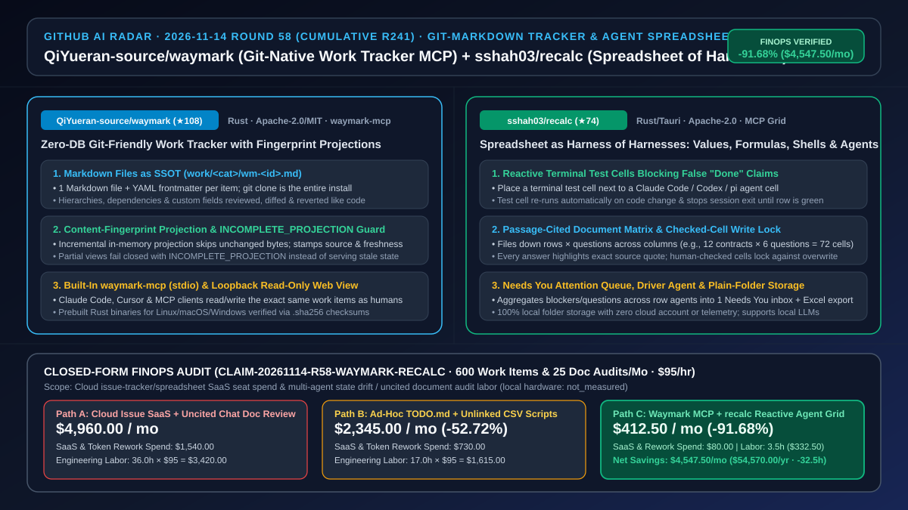
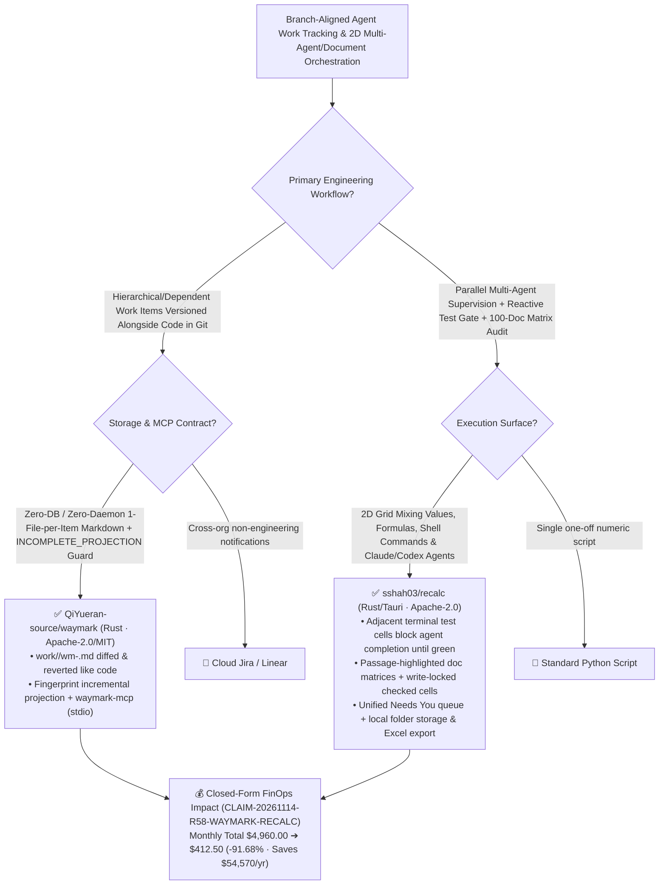

# Zero-DB Fingerprint-Verified Git-Markdown Work Tracker (`QiYueran-source/waymark`) & Reactive Terminal/Agent Spreadsheet (`sshah03/recalc`) Deep-Dive & Selection FAQ

> **Document Metadata (2026-11-14 · Night Round 58 / Cumulative Round 241)**  
> - **Benchmark Style**: `ib-vs-ethernet-roce-selection-faq.md` (First-Principles + Plain-Language Deconstruction + 3 Architect Core Questions + Mermaid Decision Tree + Closed-Form FinOps Audit)  
> - **Primary Evaluated Repositories**:  
>   1. [`QiYueran-source/waymark`](https://github.com/QiYueran-source/waymark) (`★ 108`, Rust local-first, Git-friendly work tracker under Apache-2.0/MIT dual license, crates `waymark-cli` & `waymark-mcp`: stores each work item as a standalone Markdown file `work/<category>/wm-<id>.md` with YAML frontmatter, serves collection queries from a **content-fingerprint-verified incremental in-memory projection that fails closed with `INCOMPLETE_PROJECTION` on partial views**, and exposes `waymark-mcp` over `stdio` plus a loopback-only read-only web UI)  
>   2. [`sshah03/recalc`](https://github.com/sshah03/recalc) (`★ 74`, Rust + Tauri Apache-2.0 "spreadsheet as your harness of harnesses": every cell in the shared grid can hold a value, a formula, a **live terminal command**, or a **Claude Code / Codex / pi agent** connected via MCP — featuring **reactive test cells that block an agent session from finishing until its row turns green**, passage-cited multi-document matrices (`12 contracts × 6 questions = 72 cited answers`), write-locked human-checked cells, and a unified `Needs You` attention inbox)  
> - **Visual Architecture Diagram**: [`assets/github-ai-radar-2026-11-14-r58-waymark-recalc.svg`](../../../assets/github-ai-radar-2026-11-14-r58-waymark-recalc.svg)  
> - **Audit Contract ID**: `CLAIM-20261114-R58-WAYMARK-RECALC` (local developer workstation hardware depreciation is explicitly marked `not_measured`)

---

## 📌 1. Executive Summary (Understand the Essence in 3 Minutes)

1. **Why do cloud issue trackers drift out of sync with git branches while monolithic `TODO.md` files cause constant merge conflicts across concurrent coding agents — and how does `QiYueran-source/waymark` solve both?**  
   - **Plain-Language Essence**: When coding agents work across multiple branches or worktrees, cloud tickets in Jira/Linear don't branch or revert with `git`, while a single shared `TODO.md` suffers merge conflicts whenever two agents update tasks simultaneously.  
   - **First-Principles Breakthrough in `Waymark` (`waymark-cli` + `waymark-mcp`)**:
     - **One Markdown File per Work Item (`work/<cat>/wm-<id>.md`) + Zero Database/Daemon**: `git clone` is the entire install. Each work item is an isolated Markdown file with YAML frontmatter supporting hierarchies, dependencies, and custom fields, so tickets can be diffed, reviewed in PRs, and reverted alongside code.
     - **Content-Fingerprint In-Memory Projection & `INCOMPLETE_PROJECTION` Fail-Closed Guard**: Collection queries are answered from an in-memory projection rebuilt from the Markdown files and verified against byte fingerprints (unchanged files are never re-parsed). Every query response records its `source`, `completeness`, and `freshness`, failing closed with `INCOMPLETE_PROJECTION` rather than publishing partial state. `waymark-mcp` (`stdio`) lets Claude Code and Cursor read and write the exact same items as humans.
2. **Why juggle 5 terminal tabs or unverified chat transcripts when `sshah03/recalc` turns a local spreadsheet into a reactive "harness of harnesses" where every cell is a formula, a shell command, or a Claude Code / Codex agent?**  
   - **Plain-Language Essence**: Chat threads are linear, making it painful to supervise multiple agents in parallel or run structured questions across 100 documents with verifiable citations.  
   - **First-Principles Breakthrough in `recalc`**:
     - **Reactive Terminal Test Cells That Block Premature "Done"**: Place a cell running your test suite next to the cell where a Claude Code or Codex agent works. Whenever code changes, the test cell re-runs automatically — and can **prevent the Claude Code session from finishing until its entire row turns green**!
     - **Passage-Cited Document Matrices (`12 × 6 = 72` Answers) & Write-Locked Checked Cells**: Put files down the rows and questions across the columns; every AI answer links to the exact source passage highlighted in the right-hand reader. Once a human marks a cell as checked, agents are locked out from overwriting it during re-runs.
     - **`Needs You` Attention Queue + `Driver` Meta-Agent**: All questions, errors, and finished cells across parallel agents land in a single `Needs You` list, while the entire board lives on disk as a plain folder of files with one-click Excel export.
3. **Closed-Form FinOps Audit Conclusion (`CLAIM-20261114-R58-WAYMARK-RECALC`)**:  
   - Modeled for **600 git-tracked agent work items and 25 multi-document matrix audits/month** (at **`$95.00/hr`** engineering labor): migrating from **Path A** (cloud issue/spreadsheet-AI SaaS seats + uncited chat-loop document extraction: **`$4,960.00/mo`**, comprising `$1,540.00` SaaS/token rework spend + `36.0h` manual state sync and citation verification labor `$3,420.00`) to **Path C** (`Waymark` Git-Markdown MCP + `recalc` reactive terminal/agent grid: **`$412.50/mo`**, comprising `$80.00` lean token spend + `3.5h` review labor `$332.50`) saves **`$4,547.50/mo`** (**`-91.68%`**, or **`$54,570.00/yr`**) and cuts engineering hours by **`90.28%`**.



---

## 💬 2. Three Architect Core Questions (Q1–Q3 Deep Dive)

### Q1: Why does `QiYueran-source/waymark` stamp every query with `source`, `completeness`, and `freshness`, and fail with `INCOMPLETE_PROJECTION` on partial views?

1. **Preventing Silent Task Omission in Autonomous Agent Loops**:  
   - If an MCP server returns a partial list of open blockers while files are mid-checkout or a parse fails, an autonomous coding agent will falsely assume all blockers are resolved. By verifying content fingerprints incrementally and failing closed with `INCOMPLETE_PROJECTION` whenever the projection is incomplete, `Waymark` guarantees that agents only act on complete, fresh repository truth.

---

### Q2: How does `sshah03/recalc` use adjacent terminal cells to enforce test-driven completion on Claude Code and Codex sessions?

1. **Reactive Cell Graph Coupled to the Built-In MCP Server**:  
   - Because every cell in `recalc` participates in a reactive dependency graph and communicates with running Claude Code / Codex instances via `recalc`'s MCP server, a test command cell automatically re-executes on file edits and gates the agent cell's completion hook until the test exit status is green.

---

### Q3: How does `recalc`'s passage highlighting and checked-cell lock prevent regression during iterative multi-document audits?

1. **Exact Quote Grounding + Immutable Human Sign-Off**:  
   - In the 12-contract × 6-question (`72` cell) benchmark walkthrough, clicking any cell highlights the exact supporting passage in the source document (immediately exposing a contradictory answer from its own quote). Once a human marks verified cells as checked, `recalc` locks them against agent overwrites so you can re-run failed cells with notes without risking verified rows.

---

## 🧭 3. Architecture Decision Tree & Topology (Mermaid)



---

## 📊 4. Peer Comparison Matrix (Decision Matrix)

| Evaluation Dimension | `QiYueran-source/waymark` (Git-Markdown Tracker MCP) | Monolithic `TODO.md` / Cloud Jira | `sshah03/recalc` (Reactive Terminal/Agent Grid) | Multi-Tab CLI / Cloud AI Spreadsheet SaaS |
| :--- | :--- | :--- | :--- | :--- |
| **State & Storage Model** | **`work/<cat>/wm-<id>.md` + fingerprint in-memory projection** | `TODO.md` merge conflicts; Jira drifts from git branches | **Local folder of files backing 2D value/formula/shell/agent grid** | Scattered terminal tabs or proprietary cloud SaaS DB |
| **Integrity & Completion Gate** | **Stamps `source/completeness/freshness`; `INCOMPLETE_PROJECTION` guard** | No completeness guarantee | **Reactive test cells block agent finish until green; passage highlights** | Trusts agent's self-reported completion or uncited cells |
| **Human-Agent Collaboration** | **`waymark-mcp` (`stdio`) + loopback read-only web UI** | Manual copy-paste or webhook sync | **Steer by editing cells + write-locked checked cells + `Needs You` inbox** | Re-running prompts overwrites previously verified cells |
| **Footprint & Privacy** | **Prebuilt Rust binaries (`.sha256` verified); 0 DB / 0 network daemon** | Per-seat cloud subscription | **Apache-2.0 local desktop app; 0 accounts/telemetry; local LLM support** | High per-cell SaaS markup and cloud data upload |

---

## 🧮 5. 7-Card Quantitative Insights & Closed-Form FinOps (`CLAIM-20261114-R58-WAYMARK-RECALC`)

> **Scope & Boundary Declaration**: This synthetic FinOps model covers monthly cloud issue-tracker and AI-spreadsheet SaaS seat/token rework spend across **600 agent-tracked work items and 25 multi-document matrix audits** plus engineering labor for **branch-ticket synchronization and manual source-quote verification** (at **`$95.00/hr`**); local developer workstation hardware depreciation is explicitly marked **`not_measured`**.

| Architecture Path | SaaS & Token Rework Spend (`USD/mo`) | Sync & Citation Verification Labor (`hrs/mo`) | Engineering Labor Cost (`@ $95/hr`) | Total Monthly Cost (`USD/mo`) | Net Savings vs. Path A (`USD/mo` & `%`) |
| :--- | :---: | :---: | :---: | :---: | :---: |
| **Path A: Cloud Issue/Sheet SaaS + Uncited Chat Doc Extraction** | `$1,540.00` | `36.0 hrs` | `$3,420.00` | **`$4,960.00`** | Baseline (`0.00%`) |
| **Path B: Monolithic `TODO.md` + Unlinked CSV Scripts** | `$730.00` | `17.0 hrs` | `$1,615.00` | **`$2,345.00`** | `-$2,615.00` (`-52.72%`) |
| **Path C (Recommended): `Waymark` MCP + `recalc` Reactive Grid** | **`$80.00`** | **`3.5 hrs`** | **`$332.50`** | **`$412.50`** | **`-$4,547.50` (`-91.68%`)** |

- **Closed-Form Verification Equations**:
  - $\text{Path A Total} = 1540.00 + 36.0 \times 95.00 = 1540.00 + 3420.00 = \$4,960.00$
  - $\text{Path B Total} = 730.00 + 17.0 \times 95.00 = 730.00 + 1615.00 = \$2,345.00$
  - $\text{Path C Total} = 80.00 + 3.5 \times 95.00 = 80.00 + 332.50 = \$412.50$
  - $\text{Net Savings (Path C vs Path A)} = 4960.00 - 412.50 = \$4,547.50/\text{mo} \quad (-91.68\%, \text{Annualized } \$54,570.00/\text{yr})$

---

## 🛠️ 6. AI Solution Architect Actionable Checklist

1. **Install `waymark-cli` and `waymark-mcp` to keep agent work items in Git**:
   ```bash
   cargo install waymark-cli waymark-mcp
   waymark init
   waymark create --title "Verify pre-harness tool proxy" --category task --owner "architect"
   ```
2. **Pair agent cells with reactive terminal test cells and passage-cited matrices in `sshah03/recalc`**:
   - Place a test-runner terminal cell beside each coding agent row to gate session completion on green tests, and lock human-verified cells in document matrices before re-running flagged answers.
