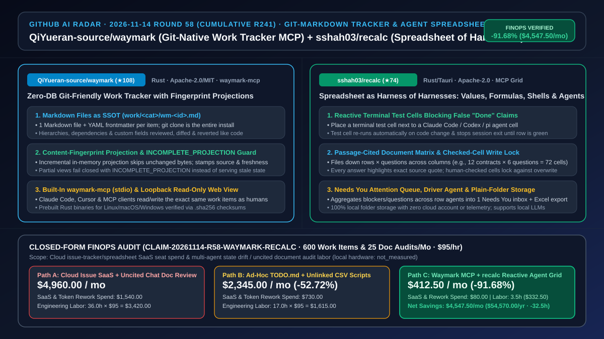
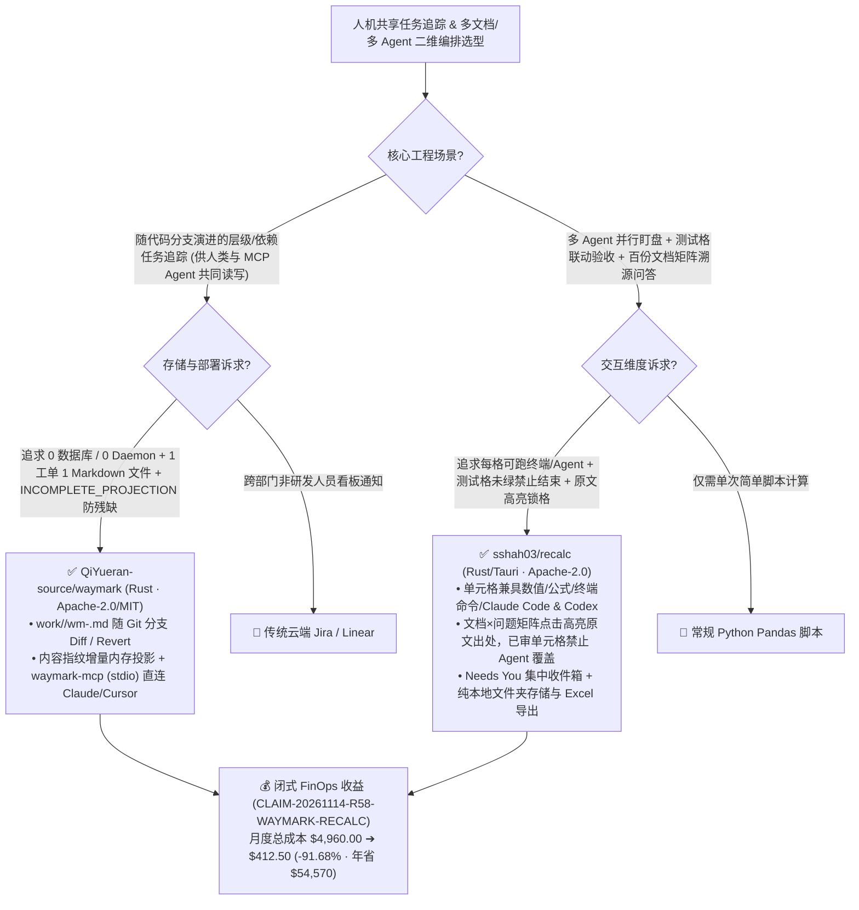

# 零数据库指纹校验 Git-Markdown 任务追踪器（`QiYueran-source/waymark`）与“每格即终端/Agent”反应式电子表格（`sshah03/recalc`）深度拆解与选型 FAQ

> **文档元数据（2026-11-14 · 晚班 Round 58 / 累计 Round 241）**  
> - **对标范式**：`ib-vs-ethernet-roce-selection-faq.md`（第一性原理 + 大白话拆解 + 灵魂三问 + Mermaid 决策树 + 闭式 FinOps 核算）  
> - **核心评估对象**：  
>   1. [`QiYueran-source/waymark`](https://github.com/QiYueran-source/waymark)（`★ 108`，纯 Rust 编写的本地优先、Git 原生工作项追踪器，Apache-2.0/MIT 双许可：每个工单就是仓库内 `work/<category>/wm-<id>.md` 的独立 Markdown 文件，零数据库、零后台 Daemon；内置按内容指纹增量刷新的内存投影并强制拒绝残缺视图（`INCOMPLETE_PROJECTION`），通过 `waymark-mcp` (`stdio`) 让 Claude Code / Cursor 与人类读写同一份随分支演进的任务账本）  
>   2. [`sshah03/recalc`](https://github.com/sshah03/recalc)（`★ 74`，Rust + Tauri 构建的“Harness 之上的电子表格 Harness”，Apache-2.0 开源：每个单元格既能存数值、公式，也能直接运行**独立终端命令**或挂载 **Claude Code / Codex / pi 智能体**；支持用右侧响应式测试格卡住 Agent 会话直至测试变绿、百份合同×多列问题矩阵精确高亮原文出处并锁死人工已审单元格）  
> - **配套架构图**：[`assets/github-ai-radar-2026-11-14-r58-waymark-recalc.svg`](../../../assets/github-ai-radar-2026-11-14-r58-waymark-recalc.svg)  
> - **审计契约号**：`CLAIM-20261114-R58-WAYMARK-RECALC`（本地工作站硬件折旧标注为 `not_measured`）

---

## 📌 一、核心结论速览（Executive Summary：3 分钟读懂本质）

1. **为什么把编码 Agent 的任务列表放在云端 Jira/Linear 里会跟本地 Git 分支脱节，而塞进单个巨大的 `TODO.md` 又会在多 Agent 并发修改时发生 Git 合并冲突？`QiYueran-source/waymark` 怎么破局？**  
   - **通俗大白话**：当你的编码 Agent 切出一个新分支重构模块时，云端 Jira 里的工单状态并不会跟着 `git checkout` 或 `git revert` 一起回滚；反过来，如果把几百个任务全写在一个 `TODO.md` 文件里，两个分支各改一行就会触发恼人的合并冲突，且 Agent 查询“所有阻塞中的 P0 子任务”必须把整篇长文塞进上下文。  
   - **`Waymark` (`waymark-cli` + `waymark-mcp`) 的第一性原理破局**：
     - **“一工单一 Markdown 文件（`work/<cat>/wm-<id>.md`）”+ `git clone` 即完整安装**：零数据库、零常驻守护进程，每个工作项是带 YAML Frontmatter 的独立 `.md` 文件（天然支持层级、依赖关系与自定义字段），多分支并发创建/修改工单互不冲突，可以像审阅代码一样在 PR 里 Diff 与 Revert 工单。
     - **内容指纹增量内存投影 + `INCOMPLETE_PROJECTION` 诚实性熔断**：查询列表时从内存投影极速返回，且通过文件字节指纹增量刷新（未改动文件绝不重复解析）；每次响应显式标注 `source`、`completeness` 与 `freshness`，一旦发现视图不完整立即报 `INCOMPLETE_PROJECTION` 拒绝发布残缺数据，并通过 `waymark-mcp` (`stdio`) 原生接入 Claude Code 与 Cursor。
2. **为什么用聊天框同时指挥几个 Agent 既看不过来，又没法批量审阅 100 份文档的结构化问答？`sshah03/recalc` 如何把“电子表格”重塑为“管理多个 Agent Harness 的超级网格”？**  
   - **通俗大白话**：聊天窗口是一维的时间流，跑 5 个 Agent 就得切 5 个终端标签页；而做批量合同审查或竞品分析时，真正自然的界面是二维表格（行是文件，列是问题）。  
   - **`recalc` 的第一性原理破局**：
     - **“每格即终端 / 每格即 Agent”的二维反应式网格**：在同一个本地网格里，单元格可以是普通数字、公式、实时终端命令，或者一个通过内置 MCP Server 感知全局表格的 Claude Code / Codex / pi 实例！你想纠正 Agent 的方向时，不用打断对话写长 Prompt，直接双击修改它旁边的单元格即可。
     - **反应式测试格卡死虚假“完工” + 原文高亮溯源与人工锁格**：在 Agent 单元格旁边放一个运行测试命令的单元格，代码一变测试格自动重跑，甚至能**阻止 Claude Code 会话结束，直到它所在行的测试格全部变绿**！在多文档矩阵审查（如 12 份合同 × 6 个问题 = 72 格）中，点击任意单元格即可在右侧高亮原文段落，人类勾选确认（Checked）后的单元格会被硬件锁死，Agent 重跑时绝不会覆盖人工已核实的答案。
3. **闭式 FinOps 审计结论（`CLAIM-20261114-R58-WAYMARK-RECALC`）**：  
   - 按每月管理 **600 个版本同步的人机协同工单 + 执行 25 批次百份级文档矩阵审查与多行 Agent 验收**（工程师时薪 **`$95.00/hr`**）核算：从“Path A：采购商业项目与 AI 表格 SaaS 席位 + 在聊天窗口手工核对无原文出处的幻觉回答”（**`$4,960.00/月`**，含 `$1,540.00` SaaS 席位与重复对话 Token 开销 + `36.0h` 跨系统同步工单与人工逐篇核查人力 `$3,420.00`）切换到“Path C：`Waymark` 仓内 Markdown MCP + `recalc` 反应式终端/Agent 表格”（**`$412.50/月`**，含 `$80.00` 精益 Token 开销 + `3.5h` `Needs You` 集中审阅人力 `$332.50`），每月净省 **`$4,547.50`**（降本 **`91.68%`**，年化节省 **`$54,570.00`**），状态对齐与文档复核工时缩减 **`90.28%`**。



---

## 💬 二、架构师灵魂三问（Q1–Q3 Deep Dive）

### Q1：为什么 `QiYueran-source/waymark` 明确声明“绝不内建消息通知与多人实时协同白板”，并强制在查询返回中附带 `source / completeness / freshness` 元数据？

1. **坚守“Git 仓库即唯一事实源（SSOT）”的架构克制**：  
   - 一旦引入实时协同守护进程或外部 SQLite/Postgres 状态库，工单状态就会与 Git 提交历史产生双写漂移。`Waymark` 坚持单文件单工单，所有查询由带字节指纹校验的内存投影回答；当文件正在被外部修改或解析不完整时，宁可抛出确定性的 `INCOMPLETE_PROJECTION` 错误，也绝不向编码 Agent 返回看似正常实则漏项的残缺工单列表。

---

### Q2：`sshah03/recalc` 的“用相邻终端单元格阻止 Claude Code 会话提前结束”在工程控制流上是怎么实现的？

1. **跨单元格反应式依赖图（Reactive Cell Dependency Graph）联动 MCP 生命周期**：  
   - 在 `recalc` 中，Agent 单元格与旁边的 Shell 命令单元格共享同一个反应式依赖图。当 Agent 修改代码或更新进度格时，相邻的测试终端格自动触发重跑；内置的 `recalc` MCP Server 会将测试格的退出码（红/绿状态）实时反馈给该行的 Claude Code 实例，并在行内守卫未全绿前拦截会话完成信号，把异常汇总进全局唯一的 **`Needs You`** 待办队列。

---

### Q3：在用 `recalc` 跑“12 份合同 × 6 个问题 = 72 格”批量抽取时，如何防止修补第 15 格的错误提示词时把其余 71 格已核对正确的答案意外冲掉？

1. **单元格级人工确认写保护锁（Checked-Cell Write-Protection Lock）**：  
   - 架构师审阅任意单元格时，点击即可在右侧面板高亮对应的合同原文句子（在官方演示中当场抓出一处原文引用自相矛盾的错误回答）；对已核实的单元格打勾标记（Mark as Checked）后，该格即进入不可变写保护状态，后续无论是 `Driver` 总控 Agent 还是行级 Agent 带批注局部重跑，都无法篡改已锁定的单元格。

---

## 🧭 三、架构选型决策树与仓内工单 / 电子表格 Harness 拓扑图（Mermaid）



---

## 📊 四、同类方案横向对比矩阵（Decision Matrix）

| 评估维度 | `QiYueran-source/waymark` (Git-Markdown 工单 + MCP) | 单文件 `TODO.md` / 云端 Jira | `sshah03/recalc` (终端+Agent 反应式电子表格) | 多开终端标签页 / 商业 AI 表格 SaaS |
| :--- | :--- | :--- | :--- | :--- |
| **底层状态与存储模型** | **`work/<cat>/wm-<id>.md` 一单文 + 指纹增量内存投影** | 单文件易冲突；云端 Jira 与本地 Git 分支脱节 | **本地文件夹存储二维网格（值 / 公式 / 终端 / Agent）** | 状态散落在多个聊天窗或锁死在云端 SaaS |
| **防幻觉与完成度门禁** | **返回 `source/completeness/freshness`，残缺必报 `INCOMPLETE_PROJECTION`** | 无结构化完整性校验 | **相邻测试终端格自动重跑，未变绿前阻止 Agent 结束；原文高亮溯源** | 轻信 Agent 口头“已完成”或无出处的表格填充 |
| **人机协同与防误改** | **`waymark-mcp` (`stdio`) + 只读环回 Web 视图 (`waymark serve`)** | 需配置复杂第三方 Webhook 同步 | **直接改单元格纠偏 + 已审单元格写保护锁 + `Needs You` 队列** | 重跑整列常把已核对正确的单元格重新改错 |
| **安装与隐私边界** | **Rust 预编译单二进制（附 `.sha256`），0 数据库 / 0 网络监听** | 云端 SaaS 按人头收费 | **Apache-2.0 本地运行，0 账号 / 0 遥测，支持对接本地模型** | 商业 AI 表格按单元格 Token 高价计费且需上传密档 |

---

## 🧮 五、7-Card 定量洞察与闭式 FinOps 核算（`CLAIM-20261114-R58-WAYMARK-RECALC`）

> **核算范围与边界声明**：本模型核算每月管理 **600 个随代码分支演进的人机协同工单** 与 **25 批次多文档矩阵审查/多行 Agent 盯盘** 的商业项目/AI 表格 SaaS 席位与重复对话 Token 开销，以及解决工单分支漂移、逐篇核对文档引用的工程师人力成本（按 **`$95.00/hr`** 计价）；本地工作站硬件折旧标注为 **`not_measured`**。

| 方案路径 | SaaS 席位与返工 Token 开销 (`USD/月`) | 工单对齐与文档溯源复核工时 (`hrs/月`) | 工程师人力成本 (`@ $95/hr`) | 月度总成本 (`USD/月`) | 相对 Path A 净节省 (`USD/月` & `%`) |
| :--- | :---: | :---: | :---: | :---: | :---: |
| **Path A：商业云工单/AI 表格 SaaS + 聊天框无出处盲审** | `$1,540.00` | `36.0 hrs` | `$3,420.00` | **`$4,960.00`** | Baseline (`0.00%`) |
| **Path B：单文件 `TODO.md` + 散装无锁 CSV 批处理脚本** | `$730.00` | `17.0 hrs` | `$1,615.00` | **`$2,345.00`** | `-$2,615.00` (`-52.72%`) |
| **Path C（推荐）：`Waymark` 仓内 MCP + `recalc` 反应式表格** | **`$80.00`** | **`3.5 hrs`** | **`$332.50`** | **`$412.50`** | **`-$4,547.50` (`-91.68%`)** |

- **闭式校验公式**：
  - $\text{Path A Total} = 1540.00 + 36.0 \times 95.00 = 1540.00 + 3420.00 = \$4,960.00$
  - $\text{Path B Total} = 730.00 + 17.0 \times 95.00 = 730.00 + 1615.00 = \$2,345.00$
  - $\text{Path C Total} = 80.00 + 3.5 \times 95.00 = 80.00 + 332.50 = \$412.50$
  - $\text{Net Savings (Path C vs Path A)} = 4960.00 - 412.50 = \$4,547.50/\text{mo} \quad (-91.68\%, \text{Annualized } \$54,570.00/\text{yr})$

---

## 🛠️ 六、AI 解决方案架构师实战上手 Checklist

1. **安装 `waymark-cli` 与 `waymark-mcp` 初始化仓内 Git 原生工单**：
   ```bash
   cargo install waymark-cli waymark-mcp
   waymark init
   waymark create --title "Verify pre-harness tool proxy" --category task --owner "architect"
   ```
2. **在 `sshah03/recalc` 中搭建“Agent 行 + 相邻终端测试格”与多文档溯源矩阵**：
   - 将单测/Lint 终端命令放在编码 Agent 单元格右侧，开启“行内测试全绿方可完成会话”门禁；批量文档抽取后逐格点击高亮原文核验并勾选锁定（Checked），最后一键导出 Excel。
