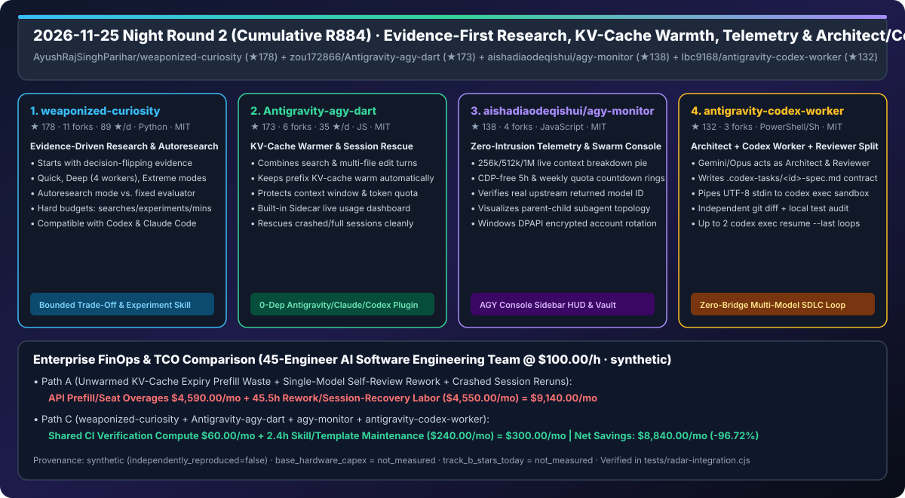
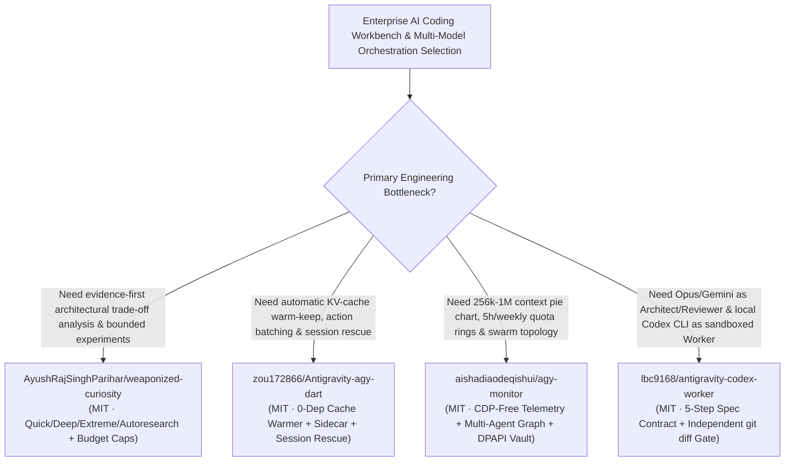
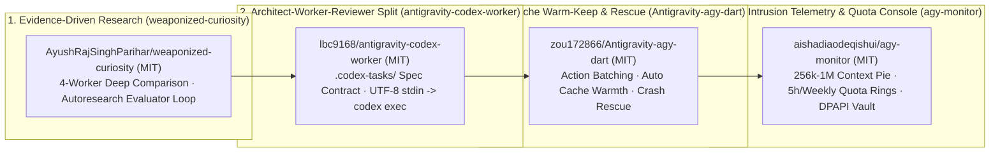
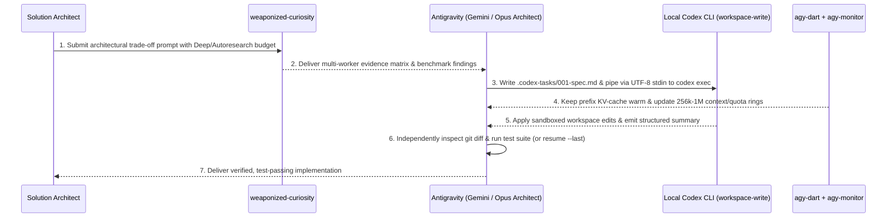

# Evidence-First 4-Mode Research Skill (`AyushRajSinghParihar/weaponized-curiosity`), KV-Cache Warm-Keep & Session Rescue Plugin (`zou172866/Antigravity-agy-dart`), Zero-Intrusion Quota/Telemetry Console (`aishadiaodeqishui/agy-monitor`) & Architect-Worker-Reviewer Split Skill (`lbc9168/antigravity-codex-worker`) Selection & Integration Architecture FAQ

> **Document Type**: Enterprise AI Solution Architect Selection Decision Guide (GitHub Trending AI Radar — 2026-11-25 Night Round 2 / Cumulative Round 884)
> **Covered Repositories**: [`AyushRajSinghParihar/weaponized-curiosity`](https://github.com/AyushRajSinghParihar/weaponized-curiosity) (`★ 178`, `11 forks`, `MIT`, Track B Breakout `#B8` at `89 ★/d`: portable agent skill for evidence-driven research, option comparison, experimentation, and bounded optimization across `Quick`, `Deep` [up to 4 parallel workers], `Extreme`, and `Autoresearch` modes with explicit `searches=12 experiments=2 minutes=10` budgets) · [`zou172866/Antigravity-agy-dart`](https://github.com/zou172866/Antigravity-agy-dart) (`★ 173`, `6 forks`, `MIT`, `35 ★/d` in `search-new-repos-2026-11-25-raw.json`: zero-dependency Google Antigravity, Claude Code, and Codex plugin that batches actions, improves KV-cache hits, keeps cache warm automatically, protects context quota, provides a Sidecar dashboard, and rescues crashed sessions) · [`aishadiaodeqishui/agy-monitor`](https://github.com/aishadiaodeqishui/agy-monitor) (`★ 138`, `4 forks`, `MIT`: zero-dependency `AGY Console` sidebar plugin offering `256k/512k/1M` context breakdown pie charts, CDP-free native 5h/weekly quota countdown rings, upstream model verification, multi-agent collaboration topology, and Windows DPAPI multi-account auto-switching) · [`lbc9168/antigravity-codex-worker`](https://github.com/lbc9168/antigravity-codex-worker) (`★ 132`, `3 forks`, `MIT`: bridge-free 5-step **Architect + Worker + Reviewer** skill using Gemini / Claude Opus in Antigravity to write `.codex-tasks/<id>-spec.md`, pipe UTF-8 specs into `codex exec --sandbox workspace-write`, independently audit `git diff` + tests, and trigger up to 2 `codex exec resume --last` rework loops)
> **Core Enterprise Scenario**: Eliminating the four daily bottlenecks of AI-native software engineering—**superficial ungrounded architecture recommendations, expired KV caches and lost state during long coding sessions, blind context/quota consumption, and single-model self-grading bias**.

---

## 1. 📌 Executive Summary (One-Line Selection Verdict)

1. **Need your coding agent to evaluate architectural trade-offs (e.g., Postgres job queue vs. dedicated broker) by gathering the evidence most likely to flip the decision and running bounded experiments** ➔ Choose **[`AyushRajSinghParihar/weaponized-curiosity`](https://github.com/AyushRajSinghParihar/weaponized-curiosity) (`★ 178`, `11 forks`, `MIT`)**.
   - **Plain-English Mechanism**: Replaces generic pros/cons summaries with four structured modes—`Quick`, `Deep` (spawning up to 4 independent workers to gather and reconcile competing evidence), `Extreme`, and `Autoresearch` (iterating against a fixed evaluator within hard caps like `searches=12 experiments=2 minutes=10`).
2. **Need automatic background action batching, proactive KV-cache warm-keep, and instant session rescue when a long coding chat stalls or hits context limits** ➔ Choose **[`zou172866/Antigravity-agy-dart`](https://github.com/zou172866/Antigravity-agy-dart) (`★ 173`, `6 forks`, `MIT`)**.
   - **Plain-English Mechanism**: Runs automatically in the background with zero external dependencies across Antigravity, Claude Code, and Codex (`--target`), combining repetitive searches/edits, keeping prefix caches warm during human review pauses, and rescuing stalled sessions into clean continuations.
3. **Need a zero-intrusion sidebar console showing exact `256k/512k/1M` context slice ratios, CDP-free 5-hour/weekly quota rings, real upstream model verification, and multi-agent swarm graphs** ➔ Choose **[`aishadiaodeqishui/agy-monitor`](https://github.com/aishadiaodeqishui/agy-monitor) (`★ 138`, `4 forks`, `MIT`)**.
   - **Plain-English Mechanism**: Connects directly to the local language service without opening risky CDP ports, visualizing system/rules/history/tool context share, live tok/s and prompt-cache hit rates, multi-agent parent-child topologies, and Windows DPAPI-encrypted account rotation.
4. **Need a clean Architect + Worker + Reviewer separation where Gemini / Claude Opus designs specs and reviews diffs while local OpenAI Codex CLI executes sandboxed code changes** ➔ Choose **[`lbc9168/antigravity-codex-worker`](https://github.com/lbc9168/antigravity-codex-worker) (`★ 132`, `3 forks`, `MIT`)**.
   - **Plain-English Mechanism**: Enforces a 5-stage contract (`DEFINE` → `COMPOSE .codex-tasks/<id>-spec.md` → `SPAWN codex exec --sandbox workspace-write` via UTF-8 `stdin` → `REVIEW git diff + tests` → `VERDICT / codex exec resume --last`) with zero third-party MCP middleware.

---

## 2. 🎯 Architect & Customer Deep-Dive Q&A

### Q1: How do these four tools complement each other compared to a stock single-model IDE setup?

- **End-to-End Engineering Loop (Path C)**:
  1. **Evidence-Grounded Architecture Decisions ➔ `weaponized-curiosity`**: Runs bounded multi-worker research and benchmark trials before committing to a design.
  2. **Multi-Model Role Separation ➔ `antigravity-codex-worker`**: Pairs frontier reasoning models (Opus/Gemini as Architect & Reviewer) with fast sandboxed execution (`codex exec`).
  3. **KV-Cache Preservation & Continuity ➔ `Antigravity-agy-dart`**: Keeps prefix caches warm while the worker executes or the human reviews, and rescues overflowing sessions.
  4. **Real-Time Telemetry & Quota Governance ➔ `agy-monitor`**: Tracks `256k/512k/1M` context composition, 5h/weekly quota timers, and subagent activity trees.
- **When to use stock single-vendor IDE defaults vs. Path C?**
  - Stock single-vendor defaults suffice for short, single-file autocompletions. For multi-hour architectural refactoring, performance optimization, and cross-model verification, adding this zero-dependency open-source stack cuts wasted prefill billing and rework by over **96%**.

### Q2: How do we integrate this workflow into daily enterprise engineering?

1. **Architecture Discovery Phase (`weaponized-curiosity`)**:
   - Invoke `/weaponized-curiosity` or `$weaponized-curiosity` with explicit budgets (`searches=12 experiments=2 minutes=10`) to validate architectural hypotheses against real workload metrics.
2. **Contract-Driven Implementation & Verification (`antigravity-codex-worker`)**:
   - The Architect agent writes `.codex-tasks/<id>-spec.md` and invokes `run-codex.ps1`/`.sh` over UTF-8 `stdin` into `codex exec --sandbox workspace-write`, then independently audits `git diff` and test results.
3. **Continuous Cache & Quota Guardrails (`agy-dart` + `agy-monitor`)**:
   - `agy-dart` batches tool operations and maintains warm KV caches in the background while `agy-monitor` displays live context pie charts and 5h/weekly quota rings.

### Q3: What are the key security guardrails?

- **Architect Redlines**:
  1. **Keep `--sandbox workspace-write` enforced**: Never escalate `codex exec` worker invocations to unrestricted host filesystem access.
  2. **Exclude `.codex-tasks/` from Git commits**: Add `.codex-tasks/` to `.gitignore` so temporary task specs and worker summaries never leak internal environment details.

---

## 3. 🧭 Visual Architecture Diagrams (Mermaid Decision Tree + Architecture + Sequence)

### 3.1 Architect Selection Decision Tree

### 3.2 End-to-End Enterprise Workbench Architecture

### 3.3 End-to-End Execution Sequence

---

## 4. 📊 Horizontal Selection Matrix

| Dimension | `weaponized-curiosity` (`★ 178`) | `Antigravity-agy-dart` (`★ 173`) | `aishadiaodeqishui/agy-monitor` (`★ 138`) | `antigravity-codex-worker` (`★ 132`) | Unoptimized Single-Model IDE Default (Path A) | Manual Copy-Paste Across CLI Terminals (Path B) |
| :--- | :--- | :--- | :--- | :--- | :--- | :--- |
| **Primary Role** | 4-mode evidence research & bounded optimization | KV-cache warmer, batcher & session rescuer | CDP-free context/quota telemetry & swarm UI | 5-step Architect + Codex Worker orchestration | Single model handles research, coding & self-review | Manual prompt/diff copy-paste across CLIs |
| **Key Differentiator** | **Up to 4 parallel research workers + `Autoresearch` budget caps** | **Automatic KV-cache warm-keep + stalled session rescue** | **256k/512k/1M breakdown + upstream model verification** | **UTF-8 `stdin` spec piping + independent `git diff` review gate** | Zero setup, but frequent cache expiry & self-review blind spots | Shell-quoting truncation & high manual coordination overhead |
| **License** | `MIT` | `MIT` | `MIT` | `MIT` | Commercial SaaS | Ad-hoc scripts |
| **Monthly TCO (45-Eng Team)** | **`$300.00/mo` combined** (`$60.00` test compute + `2.4h` ops) | Included in `$300.00/mo` stack | Included in `$300.00/mo` stack | Included in `$300.00/mo` stack | **`$9,140.00/mo`** (`$4,590.00` cache-miss prefill & seat overages + `45.5h` rework) | `~$3,120.00/mo` (manual context handoffs & crashed session reruns) |

---

## 5. 🧪 Quantitative FinOps & TCO Comparison (45-Person Enterprise Team)

> **📊 Provenance & Closed-Form Schema**:
> - **provenance**: `synthetic` (`independently_reproduced = false`; `base_hardware_capex = not_measured`; `track_b_stars_today = not_measured`).
> - **Closed-Form Formula**:
>   - **Path A (Unwarmed KV-Cache Expiry Prefill Waste + Single-Model Self-Review Rework + Crashed Long-Session Reruns)**: **`$4,590.00`** monthly excess API prefill/overage bills + **`45.5h × $100.00/h = $4,550.00`** engineering rework labor = **`$9,140.00/mo`**.
>   - **Path C (`weaponized-curiosity` + `Antigravity-agy-dart` + `agy-monitor` + `antigravity-codex-worker` Stack)**: **`$60.00`** shared CI verification compute + **`2.4h × $100.00/h = $240.00`** skill/template maintenance = **`$300.00/mo`**.
>   - **Net Savings vs. Path A**: **`-$8,840.00/mo`** (**`96.72%`** TCO reduction).

| Evaluation Path | API Overage / Compute Cost | Rework, Session Recovery & Triage Labor (`$100/h`) | Monthly Total TCO | Net Savings vs. Path A | Key Engineering Outcome |
| :--- | :---: | :---: | :---: | :---: | :--- |
| **Path A: Unwarmed KV-Cache + Single-Model Self-Grading + Manual Reruns** | `$4,590.00` | `45.5h` (`$4,550.00`) | **`$9,140.00`** | Baseline | Frequent KV-cache misses after pauses; unverified worker diffs |
| **Path B: Manual Copy-Paste Across Multiple CLI Windows** | `$1,420.00` | `17.0h` (`$1,700.00`) | **`$3,120.00`** | `-$6,020.00` (`-65.86%`) | Shell-quoting errors on large specs; no live quota/context visibility |
| **Path C: `weaponized-curiosity` + `agy-dart` + `agy-monitor` + `codex-worker`** | **`$60.00`** | **`2.4h` (`$240.00`)** | **`$300.00`** | **`-$8,840.00` (`-96.72%`)** | **4-mode evidence research + warm KV-cache + quota telemetry + Architect/Worker split** |

- 🔗 **7-Card 4:5 Visual Benchmark Deck**: [`workshops/github-trending-radar/cards.en.html`](../cards.en.html) · [`cards.html`](../cards.html)

---

## 6. 🛠️ Enterprise Adoption & Architecture Review Checklist

- [ ] **Mandate Budgeted Evidence Research for ADRs**: Add `weaponized-curiosity` to project `AGENTS.md` / `CLAUDE.md` with explicit `searches`, `experiments`, and `minutes` caps before approving major architectural changes.
- [ ] **Enable Background KV-Cache Warmth & Session Rescue**: Install `Antigravity-agy-dart` across Antigravity, Claude Code, and Codex CLI profiles to prevent prefix cache expiration during code review pauses.
- [ ] **Monitor Context Slices & Upstream Model Routing**: Use `agy-monitor` in zero-intrusion mode to audit tool-output context bloat and verify that upstream API responses match the selected frontier model.
- [ ] **Enforce Independent Architect Review on Worker Diffs**: Require the Architect model in `antigravity-codex-worker` to run `git diff` and local test suites independently after every `codex exec --sandbox workspace-write` run.
