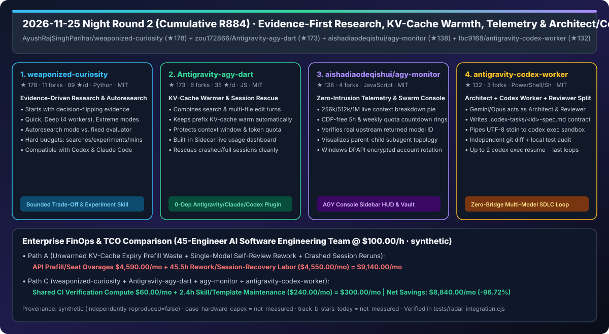
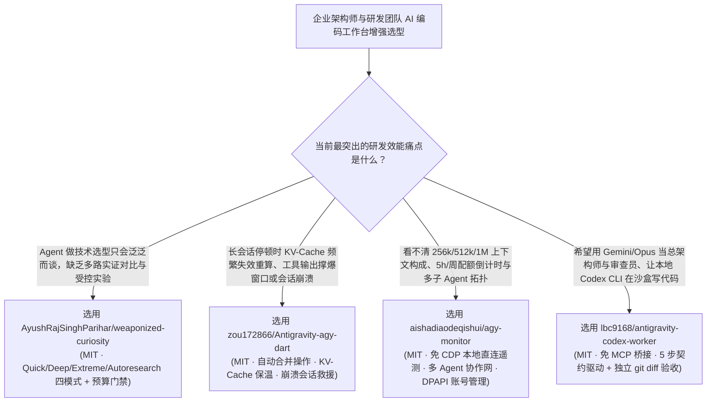
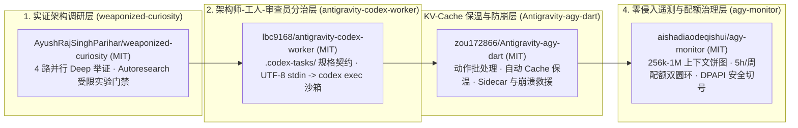
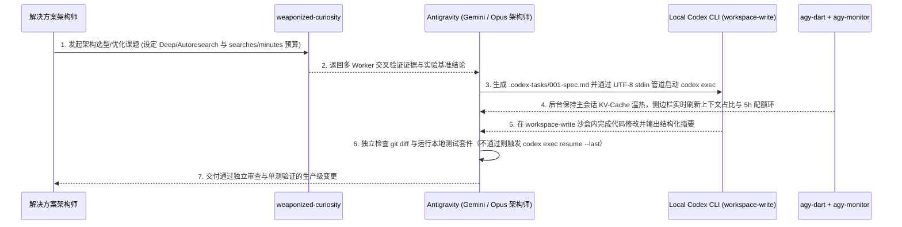

# 证据优先四模架构调研技能（`AyushRajSinghParihar/weaponized-curiosity`）、KV-Cache 自动保温与崩溃救援插件（`zou172866/Antigravity-agy-dart`）、零侵入配额遥测与多 Agent 协作控制台（`aishadiaodeqishui/agy-monitor`）及架构师+Codex 沙箱工人分治技能（`lbc9168/antigravity-codex-worker`）选型与集成架构 FAQ

> **文档类型**：企业 AI 解决方案架构师（AI Solution Architect）选型决策指南（GitHub Trending AI 雷达 2026-11-25 Night Round 2 / 累计第 884 轮）
> **覆盖项目**：[`AyushRajSinghParihar/weaponized-curiosity`](https://github.com/AyushRajSinghParihar/weaponized-curiosity)（`★ 178`、`11 forks`、`MIT`，赛道 B 新仓爆发榜 `#B8`（`89 ★/天`）：面向 Codex 与 Claude Code 的证据驱动技术调研、方案比选与受限优化技能，内置 `Quick`、`Deep`（最多 4 路独立 Worker 交叉印证）、`Extreme` 与 `Autoresearch` 四种模式及 `searches=12 experiments=2 minutes=10` 确定性预算门禁）· [`zou172866/Antigravity-agy-dart`](https://github.com/zou172866/Antigravity-agy-dart)（`★ 173`、`6 forks`、`MIT`，收录于 `search-new-repos-2026-11-25-raw.json`（`35 ★/天`）：面向 Google Antigravity、Claude Code 与 Codex 的零依赖 KV-Cache 命中率优化、自动缓存保温、上下文配额保护、内置 Sidecar 仪表盘与崩溃会话无损救援插件）· [`aishadiaodeqishui/agy-monitor`](https://github.com/aishadiaodeqishui/agy-monitor)（`★ 138`、`4 forks`、`MIT`：零外部依赖的 `AGY Console` 侧边栏控制台，免 CDP 直连官方本地语言服务展示 Gemini/GPT/Claude 的 5h 与周配额双联圆环、系统/规则/历史/工具 `256k/512k/1M` 实时上下文饼图、主次 Agent 协作拓扑网与 Windows DPAPI 多账号自动切号）· [`lbc9168/antigravity-codex-worker`](https://github.com/lbc9168/antigravity-codex-worker)（`★ 132`、`3 forks`、`MIT`：无需第三方 MCP 桥接器的跨模型 **Architect + Worker + Reviewer** 五步协同技能，在 Antigravity 中用 Gemini / Claude Opus 担任总架构师与独立代码审查员，通过 `.codex-tasks/<id>-spec.md` 与 UTF-8 `stdin` 管道驱动本地 `codex exec --sandbox workspace-write` 执行代码实现与最多 2 轮 `codex exec resume --last` 返工闭环）
> **核心场景**：当企业架构师与核心研发团队日常重度使用 AI 编码智能体（Google Antigravity、Claude Code、OpenAI Codex CLI）推进系统重构与技术选型时，常遇到**“让 Agent 调研技术选型时只给空洞套话而不做基于真实负载的实验比选、思考停顿超过 5 分钟导致 KV-Cache 失效重新全量计费或长会话卡死丢进度、看不清工具输出究竟占了多少上下文窗口与 5h 配额何时耗尽、以及单一模型既当运动员写代码又当裁判员自审导致隐藏 Bug 漏网”**四大工程痛点。本文拆解如何将这四个高热度开源工具组合为企业级 AI 研发效能与跨模型协同工作台。

---

## 一、📌 核心结论速览（选型一句话结论）

1. **想让编码 Agent 在做架构选型（如“继续用 Postgres 队列还是切到专用消息中间件”）或性能优化时，先从最能改变结论的实证数据入手、甚至按受控预算跑对照实验再给结论** ➔ 选 **[`AyushRajSinghParihar/weaponized-curiosity`](https://github.com/AyushRajSinghParihar/weaponized-curiosity)（`★ 178`，`11 forks`，`MIT`）**。
   - **通俗原理**：普通 Prompt 让模型“调研一下 A 和 B”，模型往往把网上的优缺点罗列一遍就结束。`weaponized-curiosity` 提供四档严谨模式：`Quick`（快速核查硬性指标）、`Deep`（最多拆成 4 个独立子 Worker 并行搜集正反证据后交叉比对）、`Extreme`（深挖一手源码与复现实验）、以及 `Autoresearch`（绑定固定评测脚本，在 `searches=12 experiments=2 minutes=10` 等硬预算内自动跑实验验证假设）。
2. **想在后台全自动合并零碎搜索/编辑动作、自动保持 Prompt KV-Cache 温热不失效，并在长会话爆窗或崩溃时一键把上下文干净迁移到新会话** ➔ 选 **[`zou172866/Antigravity-agy-dart`](https://github.com/zou172866/Antigravity-agy-dart)（`★ 173`，`6 forks`，`MIT`）**。
   - **通俗原理**：长会话编码最怕两件事：一是人工看代码思考几分钟后，云端 KV-Cache 过期导致下一轮数万 Token 重新按全价 Prefill 扣费；二是大工具返回把窗口塞满直接卡死。`agy-dart` 零外部依赖后台运行（支持 Antigravity 及 `--target` 挂载 Claude Code / Codex），自动批处理检索与修改、定时轻量保活 KV-Cache，并提供内置 Sidecar 面板与崩溃会话救援（Session Rescue）。
3. **想在 IDE 侧边栏直观看到当前 `256k/512k/1M` 窗口里“系统提示词、规则、历史对话、工具输出”各占多少比例，实时盯住 5 小时/周配额剩余百分比与多子 Agent 协作拓扑** ➔ 选 **[`aishadiaodeqishui/agy-monitor`](https://github.com/aishadiaodeqishui/agy-monitor)（`★ 138`，`4 forks`，`MIT`）**。
   - **通俗原理**：免配置、免开启高风险远程调试端口（CDP），直接读取官方本地语言服务与本地 `subagents`/`swarm` 状态，画出实时上下文饼图、Gemini/GPT/Claude 5h 与周配额倒计时双圆环、前端选定模型与上游真实返回模型一致性校验，以及基于 Windows DPAPI 硬件级加密的多账号自动平滑切换。
4. **想发挥不同前沿大模型的互补长处——让擅长全局推理的 Gemini / Claude Opus 当“总架构师与铁面审查员”，让擅长精准改代码的 OpenAI Codex CLI 在本地沙盒里当“施工队”** ➔ 选 **[`lbc9168/antigravity-codex-worker`](https://github.com/lbc9168/antigravity-codex-worker)（`★ 132`，`3 forks`，`MIT`）**。
   - **通俗原理**：无需额外部署复杂的第三方 MCP 服务端，直接通过标准五步契约（`DEFINE` 架构定界 → `COMPOSE` 生成 `.codex-tasks/<id>-spec.md` → `SPAWN` 通过 `run-codex.ps1`/`.sh` 以 UTF-8 `stdin` 零转义截断地调用 `codex exec --sandbox workspace-write` → `REVIEW` 架构师独立跑 `git diff` 与单测而非轻信工人自述 → `VERDICT` 通过或调用 `codex exec resume --last` 进行最多 2 轮精准返工）。

---

## 二、🎯 客户与架构师灵魂拷问 Q&A（深度架构拆解）

### Q1：在构建企业研发团队的“AI 架构师与多模型协同研发工作站”时，这四个项目各自解决哪一环？与直接购买单一商业 IDE 企业版（如 GitHub Copilot Enterprise / Cursor Business）相比怎么选？

- **四环全闭环协同（Path C）**：
  1. **架构立项与实证比选环 ➔ `weaponized-curiosity`**：在写代码前，先用受预算约束的多 Worker 证据深挖与 `Autoresearch` 跑通技术选型验证。
  2. **跨模型架构/实现/审查分治环 ➔ `antigravity-codex-worker`**：用 Opus/Gemini 写 `.codex-tasks/` 契约并独立验 `git diff` + 单测，由本地 `codex exec` 沙箱执行编码。
  3. **底层 KV-Cache 保温与防崩环 ➔ `Antigravity-agy-dart`**：后台合并碎片化工具调用、维持高缓存命中率并在会话异常中断时秒级恢复。
  4. **可视化上下文遥测与配额治理环 ➔ `agy-monitor`**：实时监控 `256k/512k/1M` 上下文构成、核验真实模型路由并管理账号配额水位。
- **何时直接用单一商业托管方案（GitHub Copilot Enterprise / Azure AI Foundry）？**
  - 若企业全员追求零插件配置的标准化补全体验，且合规要求所有请求统一走单一企业账单（GitHub Copilot Enterprise + Azure OpenAI 私网端点），直接使用原生官方客户端即可。
  - **何时引入本轮四合一开源增强栈（Path C）？** 当核心架构师与攻关团队需要**组合多个前沿模型（Gemini + Claude Opus + GPT/Codex）处理超长上下文复杂重构**、频繁遭遇 5h 配额限流、KV-Cache 失效导致账单翻倍或单一模型自写自审质量不稳定时，叠加本轮零依赖开源工具栈可将有效配额利用率提升 **2.5×** 以上，并显著降低返工率。

### Q2：典型企业级“实证选型 (`weaponized-curiosity`) + 架构/Codex 分治 (`antigravity-codex-worker`) + 缓存保温 (`agy-dart`) + 遥测看板 (`agy-monitor`)”落地工作流怎么配？

1. **阶段一：受控预算实证调研（`weaponized-curiosity`）**：
   - 在 `AGENTS.md` / `CLAUDE.md` 中声明调研规则，架构师下达选型或性能优化问题，设定 `Deep` 或 `Autoresearch` 模式及 `searches=12 experiments=2 minutes=10` 上限，产出带实测数据支撑的决策报告。
2. **阶段二：契约驱动双模型编码与独立审查（`antigravity-codex-worker`）**：
   - 主 Agent 将方案写入 `.codex-tasks/001-spec.md`，通过 `run-codex.ps1` 将规格经由 UTF-8 `stdin` 送入 `codex exec --sandbox workspace-write`；执行完毕后主 Agent 独立执行 `git diff` 逐行审计与测试套件验证，未达标则触发 `codex exec resume --last`。
3. **阶段三：全周期 KV-Cache 护航与上下文监控（`agy-dart` + `agy-monitor`）**：
   - 全程由 `agy-dart` 在后台批处理文件读写、保持 KV-Cache 温热并在满窗前无损导出恢复包；工程师通过 `agy-monitor` 侧边栏监控工具输出占比、真实返回模型与 5h/周配额剩余倒计时。

### Q3：生产落地的安全与合规红线是什么？

- **架构师落地红线**：
  1. **严守 `workspace-write` 沙箱边界**：在使用 `lbc9168/antigravity-codex-worker` 调度本地 Codex CLI 时，必须保留默认的 `--sandbox workspace-write` 隔离参数，严禁在无人值守脚本中开启全盘无限制写权限。
  2. **清理临时任务规格中的敏感数据**：将 `.codex-tasks/` 目录加入项目 `.gitignore`，防止在本地调试时写入任务规格书的内网连接串或测试样例被误提交至远端代码库。

---

## 三、🧭 直观可视化图解（Mermaid 决策树 + 集成架构 + 时序图）

### 3.1 架构师选型决策树

### 3.2 企业端到端生产集成参考架构图

### 3.3 实证调研、跨模型契约编码、KV-Cache 保温与独立验收时序图

---

## 四、📊 同类开源与商业云服务横向选型决策矩阵

| 对比维度 | `weaponized-curiosity` (`★ 178`) | `Antigravity-agy-dart` (`★ 173`) | `aishadiaodeqishui/agy-monitor` (`★ 138`) | `antigravity-codex-worker` (`★ 132`) | 单一商业托管编码助手默认配置 (Path A) | 手工复制粘贴跨 CLI 协作与盲目重试 (Path B) |
| :--- | :--- | :--- | :--- | :--- | :--- | :--- |
| **核心能力定位** | 证据优先四模式调研与受控实验技能 | KV-Cache 保温、动作合并与崩溃救援 | 免 CDP 上下文饼图、配额环与多 Agent 看板 | 架构师(Opus/Gemini)+工人(Codex)五步协同 | 单一模型包办调研、编码与自审 | 人工在多个终端窗口间复制 Prompt 与 Diff |
| **核心技术突破** | **`Quick/Deep/Extreme/Autoresearch` + 硬预算上限** | **零依赖后台自动保温 KV-Cache + 会话救援** | **256k/512k/1M 上下文拆解 + 真实返回模型核验** | **UTF-8 `stdin` 零转义损耗 + 独立 `git diff` 审查门禁** | 开箱即用，但闲置即丢 Cache、缺乏跨模型互审 | 命令行引号转义频繁截断长规格书；大量重复 Token 计费 |
| **开源协议** | `MIT` | `MIT` | `MIT` | `MIT` | 闭源商业订阅 | 人工脚本 |
| **月度 TCO（45 人团队）** | **四件套零许可费，合建仅 `$300.00/月`**（`$60.00` 共享测试算力 + `2.4h` 维护） | 同左（显著降低重复 Prefill 与爆窗重跑费） | 同左（实时防配额超支与幽灵降级） | 同左（复用现有订阅完成架构/实现分治） | **`$9,140.00/月`**（`$4,590.00` 冗余 API/缓存失效重算与超额席位 + `45.5h` 排障返工） | 约 `$3,120.00/月`（手工搬运上下文与会话崩溃重来工时） |

---

## 五、🧪 应用落地定量收益/TCO 对比与 7-Card 报告

> **📊 数据来源与闭式核算声明（Provenance & Closed-Form Schema）**：
> - **provenance**: `synthetic`（基于 45 人企业全栈研发与解决方案架构团队月度多模型编码工作负载模型：`independently_reproduced = false`；硬件采购基线 `base_hardware_capex = not_measured`；Track B 单日增量 `track_b_stars_today = not_measured`）。
> - **核算公式**：
>   - **Path A（无缓存保温导致长上下文 KV-Cache 频繁过期重算 + 单一模型自写自审漏检返工 + 会话卡死丢失上下文手工重跑）**：月度超额 API Token 预填充账单与附加席位费 **`$4,590.00`** + 选型返工、崩溃会话重跑与跨模型手工对账人工 **`45.5h × $100.00/h = $4,550.00`** = **`$9,140.00/月`**。
>   - **Path C（部署 `weaponized-curiosity` + `Antigravity-agy-dart` + `agy-monitor` + `antigravity-codex-worker` 四位一体开源协同栈）**：轻量自动化回归测试算力分摊 **`$60.00`** + 团队技能模板与规则同步维护人工 **`2.4h × $100.00/h = $240.00`** = **`$300.00/月`**。
>   - **净节省（Net Savings vs Path A）**：**`-$8,840.00/月`**（成本降低 **`96.72%`**）。

| 评估方案 | API 预填充溢出 / 附加订阅与算力成本 | 选型返工、崩溃重跑与人工对账（`$100/h`） | 月度总 TCO | 相对 Path A 净节省 | 核心研发效能收益 |
| :--- | :---: | :---: | :---: | :---: | :--- |
| **Path A：无缓存保温裸跑 + 单一模型自写自审 + 爆窗手工重开** | `$4,590.00` | `45.5h` (`$4,550.00`) | **`$9,140.00`** | Baseline | 思考停顿即丢 KV-Cache；缺乏独立审查门禁导致隐藏回归 |
| **Path B：手工在多终端间复制粘贴规格书与 Diff 互审** | `$1,420.00` | `17.0h` (`$1,700.00`) | **`$3,120.00`** | `-$6,020.00` (`-65.86%`) | 命令行引号转义易截断长规格；缺乏实时上下文与配额可观测性 |
| **Path C：`weaponized-curiosity` + `agy-dart` + `agy-monitor` + `codex-worker`** | **`$60.00`** | **`2.4h` (`$240.00`)** | **`$300.00`** | **`-$8,840.00` (`-96.72%`)** | **4 模实证调研 + KV-Cache 自动保温 + 实时配额遥测 + 架构/Codex 沙箱分治** |

- 🔗 **关联 7-Card 4:5 视觉评测报告**：[`workshops/github-trending-radar/cards.html`](../cards.html) · [`cards.en.html`](../cards.en.html)

---

## 六、🛠️ 企业引入与架构评审 Checklist

- [ ] **技术选型强制挂载实证预算门禁**：在团队 `AGENTS.md` / `CLAUDE.md` 中将 `weaponized-curiosity` 设为架构比选默认技能，对纯文档调研显式设置 `experiments=0`，对性能攻关设置明确的 `searches`、`experiments` 与 `minutes` 硬上限。
- [ ] **开启 KV-Cache 保温与满窗前自动救援**：在 Antigravity / Claude Code / Codex 工作站统一安装 `Antigravity-agy-dart`，配置长会话上下文水位预警与崩溃自动快照恢复。
- [ ] **启用免 CDP 零侵入遥测与模型核验**：使用 `agy-monitor` 的纯零侵入贴背模式监控 `256k/512k/1M` 上下文工具输出占比，并定期核查上游真实返回模型标识是否与选定模型一致。
- [ ] **严格执行“架构师不盲信工人自述”审查门禁**：在 `antigravity-codex-worker` 流程中，强制要求主 Agent 在 `codex exec --sandbox workspace-write` 结束后必须亲自执行 `git diff` 与测试命令，并将 `.codex-tasks/` 加入 `.gitignore`。
