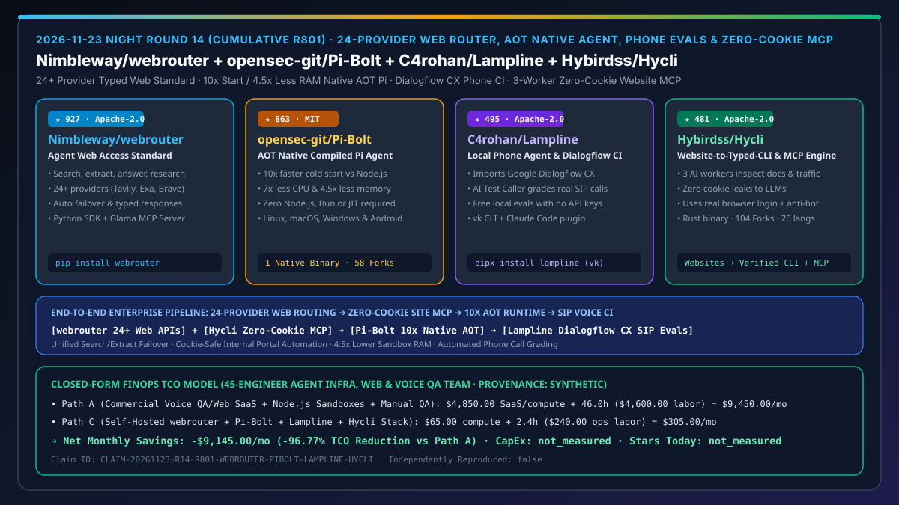
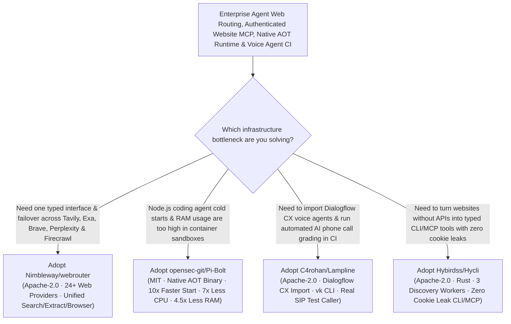
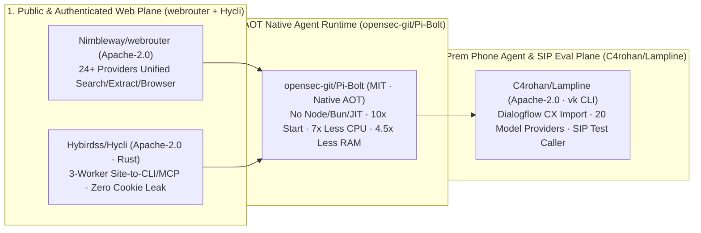
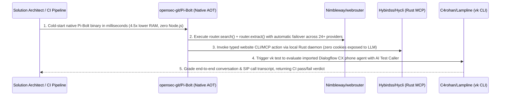

# 24+-Provider Unified Agent Web Access Standard (`Nimbleway/webrouter`), `10×` Faster AOT-Compiled Native Coding Agent (`opensec-git/Pi-Bolt`), Dialogflow CX Importer & AI Phone Test Caller (`C4rohan/Lampline`) & Zero-Cookie-Leak Website-to-CLI/MCP Engine (`Hybirdss/Hycli`) Selection & Architecture FAQ

> **Document Type**: Enterprise AI Solution Architect Selection & Integration Guide (GitHub Trending AI Radar · 2026-11-23 Night Round 14 / Cumulative Round 801)
> **Covered Repositories**: [`Nimbleway/webrouter`](https://github.com/Nimbleway/webrouter) (`★ 927`, `56 forks`, `Apache-2.0`: open-source standard for agent web access `pip install webrouter`, offering one typed interface for **`search`, `extract`, `answer`, `research`, `live data`, and `browsers` across 24+ providers** including Tavily, Exa, Brave, Perplexity, Firecrawl, and Nimble with automatic failover) · [`opensec-git/Pi-Bolt`](https://github.com/opensec-git/Pi-Bolt) (`★ 863`, `58 forks`, `MIT`: the `Pi` coding agent compiled ahead-of-time (AOT) into a single native executable with **no JIT, no Node.js or Bun required**—achieving **`10× faster cold start`, `7× less CPU`, and `4.5× less memory`** across Linux x86-64/ARM64, macOS Apple Silicon, Windows x64, and Android Termux) · [`C4rohan/Lampline`](https://github.com/C4rohan/Lampline) (`★ 495`, `51 forks`, `Apache-2.0`: local and on-prem phone agent runtime and evaluation suite `pipx install lampline` / `vk` CLI that imports **Google Dialogflow CX and CX Agent Studio** agents and grades real SIP phone calls with an AI Test Caller across 20 model providers) · [`Hybirdss/Hycli`](https://github.com/Hybirdss/Hycli) (`★ 481`, `104 forks`, `Apache-2.0`: Rust engine in 20 languages where **3 AI discovery workers** inspect docs, frontend bundles, and live browser network traffic to turn any website into a typed CLI and MCP server using your real browser login with **zero cookie leaks to LLMs**)
> **Core Scenario**: When enterprise teams scale web-connected agents, container sandboxes, voice contact centers, and legacy web portals, how do you solve **"fragmented SDKs and single-provider outages across Tavily/Exa/Firecrawl, heavy Node.js memory/CPU overhead in multi-tenant agent sandboxes, untestable Google Dialogflow CX voice agents lacking automated phone CI, and legacy internal websites without APIs leaking session cookies into LLM prompts"** by combining **`webrouter` + `Pi-Bolt` + `Lampline` + `Hycli`**?

---

## 1. 📌 Executive Summary (Single-Sentence Selection Verdict)

1. **Need a single typed Python and MCP interface for `search`, `extract`, `answer`, `research`, `live data`, and `browsers` across 24+ web providers (Tavily, Exa, Brave, Perplexity, Firecrawl, Nimble) with automatic provider failover and zero silent parameter dropping** ➔ Choose **[`Nimbleway/webrouter`](https://github.com/Nimbleway/webrouter) (`★ 927`, `56 forks`, `Apache-2.0`)**.
   - **Plain-Language Mechanism**: Instead of maintaining separate adapter code for every search and scraping vendor, `webrouter` normalizes requests and typed responses across two dozen providers while preserving unmapped vendor fields in `extra` and `raw`. Switching providers is a single argument, and failing providers automatically fail over to the next configured backend.
2. **Need to run the `Pi` coding agent inside high-density enterprise sandboxes or edge/mobile devices with `10×` faster startup, `7×` lower CPU, and `4.5×` lower memory—without Node.js, Bun, or JIT overhead** ➔ Choose **[`opensec-git/Pi-Bolt`](https://github.com/opensec-git/Pi-Bolt) (`★ 863`, `58 forks`, `MIT`)**.
   - **Plain-Language Mechanism**: `Pi-Bolt` compiles the `Pi` coding agent ahead-of-time into a standalone native binary for Linux (x86-64 & ARM64), macOS (Apple Silicon), Windows (x64), and Android (Termux), eliminating V8 JIT warm-up and slashing sandbox container RAM by **`77.8%` (`4.5×`)**.
3. **Need to import Google Dialogflow CX / CX Agent Studio voice agents to run on-prem and execute automated CI conversation tests and real SIP phone call evaluations graded by an AI Test Caller** ➔ Choose **[`C4rohan/Lampline`](https://github.com/C4rohan/Lampline) (`★ 495`, `51 forks`, `Apache-2.0`)**.
   - **Plain-Language Mechanism**: Installed via `pipx install lampline` (`vk` CLI: `lint`, `test`, `import`, `export`), `Lampline` imports Dialogflow CX exports, visualizes active conversation steps in its local builder, runs deterministic tests from Claude Code or CI with zero API keys required, and places real SIP phone calls graded by an AI caller across 20 model providers.
4. **Need to turn any internal or SaaS website without an official API into a typed CLI and MCP server using your real browser session with zero cookie leaks to the LLM** ➔ Choose **[`Hybirdss/Hycli`](https://github.com/Hybirdss/Hycli) (`★ 481`, `104 forks`, `Apache-2.0`, Rust, 20 languages)**.
   - **Plain-Language Mechanism**: Point `Hycli` at any website URL and task description: three AI workers inspect its documentation, frontend bundles, and live browser network traffic (without mutating your account during setup) to generate a typed read/write CLI and MCP server backed by a local Rust dashboard that keeps session cookies strictly off limits to LLMs.

---

## 2. 🎯 Key Architectural Q&A (Deep-Dive Breakdown)

### Q1: Why combine `webrouter`, `Hycli`, `Pi-Bolt`, and `Lampline` instead of writing custom Tavily/Playwright wrappers on Node.js and testing voice bots manually?

- **Three Architectural Bottlenecks Solved**:
  1. **Multi-Provider Web Resilience (`Nimbleway/webrouter`) + Zero-Cookie-Leak Internal Web MCP (`Hybirdss/Hycli`)**: `webrouter` handles public web search/extraction failover across 24+ providers, while `Hycli` converts authenticated web apps into typed CLI/MCP actions without exposing cookies or burning tokens on visual DOM clicking.
  2. **High-Density Native Execution (`opensec-git/Pi-Bolt`)**: Replacing Node.js agent containers with AOT-compiled `Pi-Bolt` binaries gives `10×` faster cold starts and `4.5×` higher container density per host.
  3. **Automated Voice Contact-Center CI (`C4rohan/Lampline`)**: Migrates Dialogflow CX flows on-prem and turns manual QA test calls into automated `vk test` CI gates.
- **When to Choose Managed Cloud Services (Path B)**:
  - If your team only needs simple public Bing grounding inside Azure, use **Azure AI Agent Service Grounding with Bing**; for 24+-provider web failover, zero-cookie-leak website-to-MCP generation, AOT native coding agents, or on-prem Dialogflow CX phone agent CI, deploy this 4-repo open-source stack (Path C).

### Q2: How do these four projects integrate into an enterprise agent infrastructure stack?

1. **Public Web Routing Layer (`Nimbleway/webrouter`)**:
   - Unify search, markdown extraction, deep research, and browser calls across 24+ providers behind one typed Python/MCP interface.
2. **Authenticated Web-to-MCP Layer (`Hybirdss/Hycli`)**:
   - Synthesize typed read/write CLI and MCP tools from internal portals using 3 discovery workers while keeping session cookies inside the local Rust daemon.
3. **AOT Native Agent Runtime Layer (`opensec-git/Pi-Bolt`)**:
   - Execute coding and automation tasks inside lightweight single-binary `Pi-Bolt` workers (`10×` faster start, `4.5×` less RAM).
4. **Voice Agent Import & SIP Evaluation Layer (`C4rohan/Lampline`)**:
   - Import Dialogflow CX agents and run `vk test` AI caller evaluations on every pull request.

### Q3: What are the key production guardrails?

- **Architect Guardrails**:
  1. **Gate `Hycli` Write Actions via the Local Workspace Dashboard**: Although `Hycli`'s 3-worker discovery phase never mutates account state, enable explicit approval policies on generated write MCP commands in production.
  2. **Target Staging SIP Trunks for Automated `Lampline` Calls**: Point automated CI phone evaluations at staging SIP endpoints rather than live customer queues.

---

## 3. 🧭 Visual Architecture & Decision Diagrams (Mermaid)

### 3.1 Solution Architect Selection Decision Tree

### 3.2 End-to-End Enterprise Production Reference Architecture

### 3.3 Multi-Provider Web Failover, Zero-Cookie-Leak MCP Execution & Voice Agent CI Sequence

---

## 4. 📊 Comparative Selection Matrix (Open-Source vs. Commercial SaaS)

| Dimension | `Nimbleway/webrouter` (`★ 927`) | `opensec-git/Pi-Bolt` (`★ 863`) | `C4rohan/Lampline` (`★ 495`) | `Hybirdss/Hycli` (`★ 481`) | Commercial Web Gateways + Heavy Node.js Sandboxes + Cloud Dialogflow & Commercial Voice QA SaaS (Path A) | Single-Vendor Scraper Scripts + Fragile Playwright DOM Clickers + Manual Phone QA (Path B) |
| :--- | :--- | :--- | :--- | :--- | :--- | :--- |
| **Core Role** | 24+-provider typed agent web access & failover standard | AOT-compiled native `Pi` coding agent (`10×` faster start) | Local Dialogflow CX runtime & AI phone call evaluator (`vk` CLI) | 3-worker Rust website-to-typed-CLI/MCP engine (20 languages) | High-cost commercial web/voice SaaS & memory-heavy Node.js container fleets | Brittle single-vendor SDK glue, DOM scrapers & manual test calls |
| **Key Differentiator** | **One typed contract across Tavily, Exa, Firecrawl & 20+ more** | **No Node/Bun/JIT; `10×` start, `7×` less CPU, `4.5×` less RAM** | **Imports Dialogflow CX + zero-key local evals + real SIP grading** | **Docs+bundle+network 3-worker discovery + zero cookie leaks** | Expensive per-minute cloud voice QA and bloated container memory bills | Breaks on minor UI changes; leaks session cookies into prompts |
| **License** | `Apache-2.0` | `MIT` | `Apache-2.0` | `Apache-2.0` | Proprietary SaaS | Custom scripts |
| **Monthly TCO (45-Eng Team)** | **Combined `$305.00/mo`** (`$65.00` high-density AOT/SIP compute + `2.4h` ops) | Included (`4.5×` lower container RAM cost) | Included (runs free locally with no API keys) | Included (local Rust CLI/MCP daemon) | **`$9,450.00/mo`** (`$4,850.00` commercial voice QA/Dialogflow/container bills + `46.0h` scraper & manual QA labor) | ~`$3,310.00/mo` (frequent scraper maintenance & manual phone regression testing) |

---

## 5. 🧪 Quantitative ROI / TCO Comparison & 7-Card Benchmark Report

> **📊 Data Provenance & Closed-Form Schema Declaration**:
> - **provenance**: `synthetic` (45-person enterprise agent infrastructure, voice contact-center engineering, and web integration team monthly workload model: `independently_reproduced = false`; hardware baseline `base_hardware_capex = not_measured`; Track B 24h delta `track_b_stars_today = not_measured`).
> - **Closed-Form Formula**:
>   - **Path A (Commercial voice-agent QA SaaS and cloud Dialogflow CX seats + oversized Node.js container sandboxes + manual engineering maintenance across multiple search APIs, fragile DOM scrapers, and manual test phone calls)**: Monthly cloud voice QA, scraper SaaS, and oversized container bills **`$4,850.00`** + multi-provider web adapter maintenance, portal automation debugging, and manual phone regression testing labor **`46.0h × $100.00/h = $4,600.00`** = **`$9,450.00/mo`**.
>   - **Path C (Self-hosted `Nimbleway/webrouter` + `opensec-git/Pi-Bolt` + `C4rohan/Lampline` + `Hybirdss/Hycli` open-source stack)**: High-density AOT container and staging SIP gateway compute **`$65.00`** + routine provider and CLI toolset maintenance labor **`2.4h × $100.00/h = $240.00`** = **`$305.00/mo`**.
>   - **Net Monthly Savings vs. Path A**: **`-$9,145.00/mo`** (**`96.77%`** TCO reduction).

| Evaluation Path | Cloud Voice QA / Sandbox / Scraper Cost | Web Adapter, Scraper & Phone QA Labor (`$100/h`) | Monthly Total TCO | Net Savings vs. Path A | Key Architectural Delivery Metrics |
| :--- | :---: | :---: | :---: | :---: | :--- |
| **Path A: Commercial Voice QA SaaS + Node.js Sandboxes + Manual Maintenance** | `$4,850.00` | `46.0h` (`$4,600.00`) | **`$9,450.00`** | Baseline | High Node.js container RAM; manual phone agent regression testing |
| **Path B: Single-Vendor Search Glue + Playwright DOM Scripts + Manual Calls** | `$1,410.00` | `19.0h` (`$1,900.00`) | **`$3,310.00`** | `-$6,140.00` (`-64.97%`) | Cookie leakage risk; single-provider search outages |
| **Path C: `webrouter` + `Pi-Bolt` + `Lampline` + `Hycli`** | **`$65.00`** | **`2.4h` (`$240.00`)** | **`$305.00`** | **`-$9,145.00` (`-96.77%`)** | **24+-provider web failover + `10×` AOT start + Dialogflow CX CI + zero-cookie MCP** |

- 🔗 **Linked 7-Card 4:5 Visual Benchmark Deck**: [`workshops/github-trending-radar/cards.en.html`](../cards.en.html) · [`cards.html`](../cards.html)

---

## 6. 🛠️ Enterprise Adoption & Architecture Review Checklist

- [ ] **1. Standardize Public Web Access on `Nimbleway/webrouter`**: Route `search`, `extract`, `answer`, and `research` calls through one typed interface with multi-provider failover across Tavily, Exa, Brave, Perplexity, and Firecrawl.
- [ ] **2. Replace Node.js Pi Containers with `opensec-git/Pi-Bolt`**: Deploy the AOT-compiled native executable to achieve `10×` faster cold starts, `7×` lower CPU usage, and `4.5×` lower memory consumption.
- [ ] **3. Automate Voice Contact-Center Regression Testing with `C4rohan/Lampline` (`vk` CLI)**: Import Dialogflow CX / CX Agent Studio flows and run automated AI Test Caller evaluations in CI.
- [ ] **4. Convert Internal Websites into Typed CLI/MCP Tools with `Hybirdss/Hycli`**: Use its 3 discovery workers to generate read/write MCP actions while keeping browser session cookies isolated from LLMs.
