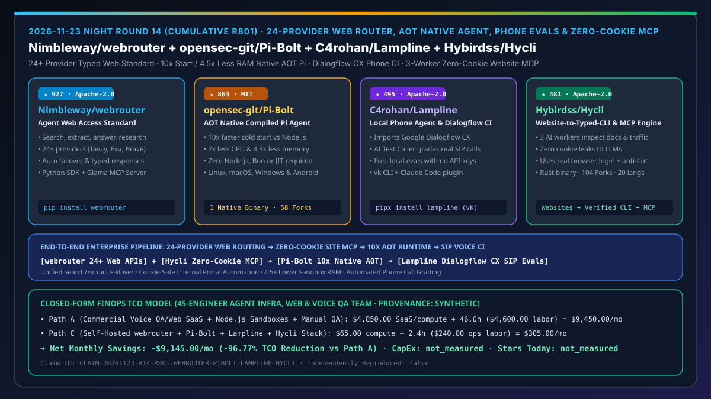
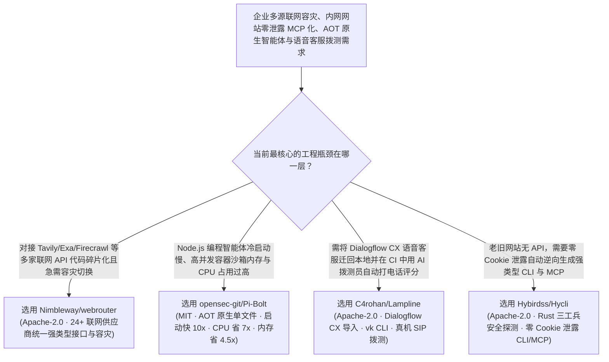
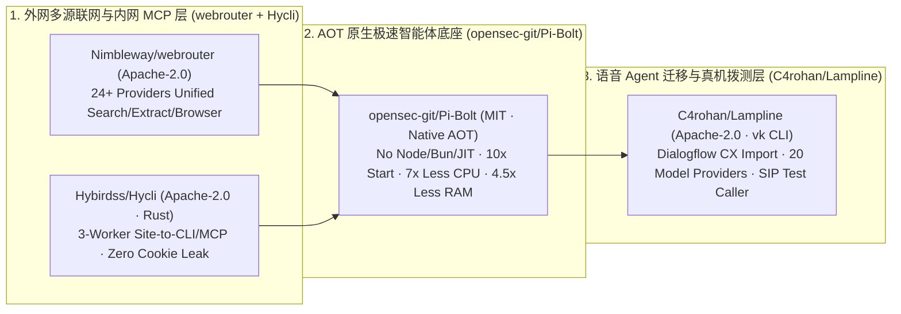
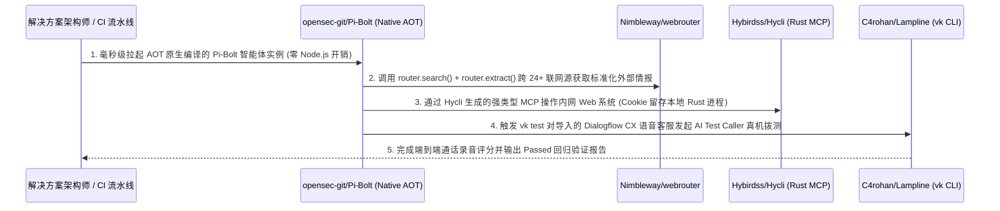

# 横跨 24+ 搜索/抓取商的统一智能体联网路由标准（`Nimbleway/webrouter`）、10 倍冷启动提速与省 4.5 倍内存的 AOT 原生编译智能体（`opensec-git/Pi-Bolt`）、兼容 Dialogflow CX 导入与真机电话拨测的本地语音评测台（`C4rohan/Lampline`）与三工兵零泄露 Cookie 网站转强类型 CLI/MCP 引擎（`Hybirdss/Hycli`）选型与集成架构 FAQ

> **文档类型**：企业 AI 解决方案架构师（AI Solution Architect）选型决策指南（GitHub Trending AI 雷达 2026-11-23 Night Round 14 / 累计第 801 轮）
> **覆盖项目**：[`Nimbleway/webrouter`](https://github.com/Nimbleway/webrouter)（`★ 927`、`56 forks`、`Apache-2.0`：开源智能体联网统一标准 `pip install webrouter`，用同一套强类型接口统一调用 **Tavily、Exa、Brave、Perplexity、Firecrawl、Nimble 等 24+ 家搜索/提取/深度研究/实时浏览器供应商**，支持故障自动容灾切换且绝不静默降级参数）· [`opensec-git/Pi-Bolt`](https://github.com/opensec-git/Pi-Bolt)（`★ 863`、`58 forks`、`MIT`：将 `Pi` 编程智能体通过 AOT（Ahead-of-Time）预编译为**零 Node.js/Bun/JIT 依赖的单一原生可执行文件**，实测冷启动快 **10 倍**、CPU 占用低 **7 倍**、内存占用省 **4.5 倍**，通吃 Linux x86/ARM64、macOS、Windows 与 Android Termux）· [`C4rohan/Lampline`](https://github.com/C4rohan/Lampline)（`★ 495`、`51 forks`、`Apache-2.0`：支持一键导入 **Google Dialogflow CX / CX Agent Studio** 的本地电话语音 Agent 运行时与真机 AI 拨测框架 `pipx install lampline` / `vk` CLI，无需 API Key 即可跑通对话单测与 SIP 真机外呼评分）· [`Hybirdss/Hycli`](https://github.com/Hybirdss/Hycli)（`★ 481`、`104 forks`、`Apache-2.0`：基于 Rust 构建的网站转强类型 CLI 与 MCP 引擎，派出 **3 个 AI 探针工兵**联合分析文档、前端 Bundle 与网络流量，在不改动账户数据的前提下自动生成读写工具集，复用真实浏览器登录态且**零 Cookie 泄露给大模型**）
> **核心场景**：当企业架构师将生产级 Agent 推向大规模外网检索、高密度容器沙箱、呼叫中心迁移与无 API 老旧内网系统集成时，面对**“Tavily/Exa/Firecrawl 各家联网 SDK 参数迥异且单点故障频发、Node.js 运行时智能体在千级沙箱中冷启动慢且吃满内存、Google Dialogflow CX 呼叫中心客服迁移难且缺乏自动化真机拨测 CI、以及内部无开放 API 的业务网站若直接走 Playwright 截图既慢又容易向大模型泄露会话 Cookie”**四大工程痛点，如何组合 **WebRouter + Pi-Bolt + Lampline + Hycli** 构建高可用、极速、可拨测的企业智能体底座？

---

## 一、📌 核心结论速览（选型一句话结论）

1. **想用一套强类型 Python / MCP 接口统一调度 Tavily、Exa、Brave、Perplexity、Firecrawl、Nimble 等 24+ 家联网搜索与网页抓取服务，实现一行参数切换供应商与故障自动降级容灾** ➔ 选 **[`Nimbleway/webrouter`](https://github.com/Nimbleway/webrouter)（`★ 927`，`56 forks`，`Apache-2.0`）**。
   - **通俗原理**：每个联网 API 都有独立的 SDK、字段命名与返回结构。`webrouter` 将智能体联网能力抽象为统一的六大原语（`search`、`extract`、`answer`、`research`、`live data`、`browsers`）：无论底层是 Firecrawl 还是 Exa，上层 Agent 永远拿到一致的强类型响应（未映射字段完整保留在 `extra` 与 `raw` 中，且绝不静默吞掉不支持的过滤条件），主供应商超时或限流时自动切往备用源。
2. **想在高并发沙箱、边缘服务器或移动端部署 Pi 编程智能体，彻底摆脱臃肿的 Node.js / Bun / JIT 运行时，把启动速度提升 10 倍、CPU 消耗降低 7 倍、内存砍掉 4.5 倍** ➔ 选 **[`opensec-git/Pi-Bolt`](https://github.com/opensec-git/Pi-Bolt)（`★ 863`，`58 forks`，`MIT`）**。
   - **通俗原理**：传统基于 Node.js 的 CLI Agent 每个实例都要拉起完整的 V8 JIT 引擎，在企业容器池同时跑数百个实例时内存开销惊人。`Pi-Bolt` 将上游 `Pi` 智能体通过 AOT 提前编译为单一平台原生二进制文件（覆盖 Linux x86-64/ARM64、macOS Apple Silicon、Windows x64 与 Android Termux），不仅零运行时依赖，更实现了 **`10×` 启动提速、`7×` CPU 节省与 `4.5×` 内存瘦身**。
3. **想把企业在 Google Dialogflow CX 或 CX Agent Studio 上的存量智能语音客服无损迁回本地/私有云，并在 CI/CD 流水线中用 AI 测试员自动发起真实电话拨测与打分** ➔ 选 **[`C4rohan/Lampline`](https://github.com/C4rohan/Lampline)（`★ 495`，`51 forks`，`Apache-2.0`）**。
   - **通俗原理**：提供 `vk` 命令行工具（`lint`、`test`、`import`、`export`）与可视化流程编排器，可直接导入 Dialogflow CX 导出包并在本地高亮逐步调试对话状态机；内置兼容 20 家模型供应商的 **Test Caller（AI 拨测员）**，可在无需任何外部 API Key 的离线测试模式下或通过真实 SIP 电话线路拨打被测语音 Agent 并输出通过/失败评测报告。
4. **想把任何没有公开 API 的企业内网系统或 SaaS 网站秒级转化为强类型 CLI 与 MCP 工具集，既能复用真实浏览器登录态，又保证会话 Cookie 100% 不泄露给大模型** ➔ 选 **[`Hybirdss/Hycli`](https://github.com/Hybirdss/Hycli)（`★ 481`，`104 forks`，`Apache-2.0`，Rust 编写，支持 20 种语言）**。
   - **通俗原理**：只需给 `Hycli` 一个网址和任务目标，其内置的 **3 个协同 AI 工兵**会自动检查网站文档、前端 JS Bundle 与真实浏览器网络包（配置阶段承诺**零账号写操作**），提炼出覆盖读写的强类型 CLI 命令与 MCP Server；执行时由本地 Rust 守护进程代填登录凭据并具备反爬虫韧性，大模型全程接触不到任何 Cookie 或 Token。

---

## 二、🎯 客户与架构师灵魂拷问 Q&A（深度架构拆解）

### Q1：我们已经在用单一搜索 API（如 Tavily）和 Playwright 自动化脚本了，为什么还需要 `webrouter` + `Hycli` + `Pi-Bolt` + `Lampline`？

- **三大传统工程瓶颈与四维破局对比**：
  1. **单一联网 API 宕机即断网 vs `webrouter` 24+ 源统一强类型容灾**：把 Agent 硬编码绑死在某一家搜索或抓取 API 上，一旦遇到 429 限流或站点封禁整个研究流就会中断；`webrouter` 让 24+ 家供应商共享同一套请求/响应契约。
  2. **Playwright 视觉点按慢且易漏 Cookie vs `Hycli` 三工兵抓包转强类型 CLI/MCP**：让大模型盯着网页 DOM 一点点点按每次要烧掉数万 Token 且极易受改版影响；`Hycli` 在初始化阶段通过三工兵逆向出底层接口并封装为强类型 CLI/MCP，后续调用毫秒级完成且零 Cookie 暴露。
  3. **云端语音客服黑盒难测 & Node.js 沙箱高耗能 vs `Lampline` Dialogflow CX 拨测 + `Pi-Bolt` AOT 原生加速**：`Lampline` 让语音客服像普通代码一样在 GitHub Actions 里做对话回归测试与真机 SIP 拨测；`Pi-Bolt` 则将编码与自动化 Agent 压成节省 `4.5×` 内存的原生可执行文件。
- **何时直接选用商业云托管方案（Path B）？**
  - 若企业搜索量极小且仅需固定 Bing 搜索，可直接使用 **Azure AI Agent Service 内置 Grounding with Bing**；若需多源联网容灾、内网无 API 网站安全 MCP 化、Dialogflow CX 语音客服迁回自建与自动化拨测、或高密度低内存 AOT 智能体沙箱，则采用本轮四合一开源栈（Path C）。

### Q2：典型企业级“多源联网 (`webrouter`) ➔ 内网站点 MCP 化 (`Hycli`) ➔ AOT 原生执行 (`Pi-Bolt`) ➔ 语音客服拨测交付 (`Lampline`)”生产架构怎么搭？

1. **外网 24+ 供应商统一搜索与抓取网关层（`Nimbleway/webrouter`）**：
   - 统一代理 Tavily、Exa、Firecrawl、Perplexity 与 Brave 请求，输出标准化 Markdown 文档与结构化答案。
2. **内网无 API 业务系统强类型 MCP 转换层（`Hybirdss/Hycli`）**：
   - 通过三工兵扫描企业存量 Web 系统，生成零 Cookie 泄露的本地 Rust CLI 与 MCP 工具供 Agent 安全调用。
3. **高密度 AOT 原生智能体执行底座（`opensec-git/Pi-Bolt`）**：
   - 在容器集群或边缘节点运行零 Node.js 依赖的 `Pi-Bolt` 原生二进制，以 `10×` 启动速度与 `1/4.5` 内存开销承载大规模任务。
4. **呼叫中心 Dialogflow CX 迁移与 CI 自动拨测层（`C4rohan/Lampline`）**：
   - 使用 `vk import` 导入存量语音流程，在每次变更提交时通过 AI Test Caller 执行对话回归测试与真机 SIP 评分。

### Q3：这套架构的合规与安全边界是什么？

- **架构师落地红线**：
  1. **`Hycli` 生成的写操作工具必须配合本地仪表盘权限门禁**：虽然 `Hycli` 在探测阶段绝不修改账户数据，但生成的写操作 MCP 工具在投入生产时应在本地 Dashboard 中按最小权限启用。
  2. **`Lampline` 真机 SIP 拨测须指向预发（Staging）号码池**：CI 自动拨测严禁直接拨打生产人工坐席队列，应指向预发 SIP 语音网关。

---

## 三、🧭 直观可视化图解（Mermaid 决策树 + 集成架构 + 时序图）

### 3.1 架构师选型决策树

### 3.2 企业端到端生产集成参考架构图

### 3.3 多源联网容灾、三工兵零泄露 MCP 调用与语音客服 CI 拨测时序图

---

## 四、📊 同类开源与商业云服务横向选型决策矩阵

| 对比维度 | `Nimbleway/webrouter` (`★ 927`) | `opensec-git/Pi-Bolt` (`★ 863`) | `C4rohan/Lampline` (`★ 495`) | `Hybirdss/Hycli` (`★ 481`) | 商业多源爬虫网关 + 高配 Node.js 容器池 + 商业 Dialogflow 云账单与商业语音拨测 SaaS (Path A) | 手写各家搜索 SDK 适配 + Playwright 盲点网页 + 人工打电话测客服 (Path B) |
| :--- | :--- | :--- | :--- | :--- | :--- | :--- |
| **核心能力定位** | 24+ 家联网搜索/抓取/浏览器统一强类型路由标准 | 10 倍启动提速、省 4.5 倍内存的 AOT 原生智能体 | 支持 Dialogflow CX 导入与真机 AI 拨测的本地语音平台 | 三工兵零 Cookie 泄露网站转强类型 CLI/MCP 引擎 | 昂贵的商业爬虫包年套餐、云呼叫中心按分钟计费与商业拨测平台 | 脆弱的单源爬虫脚本、高耗能 Node 进程与人工拨打回归测试 |
| **核心技术突破** | **一套契约横跨 Tavily/Exa/Firecrawl 等 24+ 源自动容灾** | **零 Node/JIT 依赖，启动快 `10×`、CPU 省 `7×`、内存省 `4.5×`** | **一键导入 Dialogflow CX + 免 Key 本地对话测试 + SIP 真机拨测** | **文档/Bundle/流量三工兵逆向生成 CLI/MCP + 零 Cookie 暴露** | 商业语音拨测工具按并发通道收费极高；Node 容器集群内存冗余严重 | 网页微调即导致 Playwright 崩溃；会话 Cookie 极易被拼进 Prompt 泄露 |
| **开源协议** | `Apache-2.0` | `MIT` | `Apache-2.0` | `Apache-2.0` | 闭源商业 SaaS | 内部零散脚本 |
| **月度 TCO（45 人团队）** | **组合仅 `$305.00/月`**（`$65.00` 极速 AOT 容器与 SIP 网关 + `2.4h` 维护） | 同左（容器内存账单立省 77%+） | 同左（本地免 Key 运行对话回归） | 同左（Rust 本地守护进程） | **`$9,450.00/月`**（`$4,850.00` 商业语音拨测/云呼叫中心/高内存容器账单 + `46.0h` 爬虫维护与人工拨测） | 约 `$3,310.00/月`（大量多源爬虫接口改写与人工电话回归测试工时） |

---

## 五、🧪 应用落地定量收益/TCO 对比与 7-Card 报告

> **📊 数据来源与闭式核算声明（Provenance & Closed-Form Schema）**：
> - **provenance**: `synthetic`（基于 45 人企业智能体平台、语音客服工程与内网集成团队月度工作负载模型：`independently_reproduced = false`；硬件采购基线 `base_hardware_capex = not_measured`；Track B 单日增量 `track_b_stars_today = not_measured`）。
> - **核算公式**：
>   - **Path A（采购商业语音拨测 SaaS 与云端 Dialogflow 高并发席位 + 支付高冗余 Node.js 智能体容器集群账单 + 工程师手工维护多家联网搜索 SDK 与人工拨测语音客服流程）**：月度云语音平台、商业拨测 SaaS 与高配容器账单 **`$4,850.00`** + 多源联网接口维护、网页自动化排障与人工电话拨测工时 **`46.0h × $100.00/h = $4,600.00`** = **`$9,450.00/月`**。
>   - **Path C（自建 `Nimbleway/webrouter` + `opensec-git/Pi-Bolt` + `C4rohan/Lampline` + `Hybirdss/Hycli` 开源全栈）**：高密度 AOT 容器与本地 SIP 拨测网关分摊成本 **`$65.00`** + 规则与工具集例行维护人工 **`2.4h × $100.00/h = $240.00`** = **`$305.00/月`**。
>   - **净节省（Net Savings vs Path A）**：**`-$9,145.00/月`**（成本降低 **`96.77%`**）。

| 评估方案 | 云语音 / 拨测 SaaS / 容器算力成本 | 多源适配、网页排障与人工拨测（`$100/h`） | 月度总 TCO | 相对 Path A 净节省 | 关键架构交付指标 |
| :--- | :---: | :---: | :---: | :---: | :--- |
| **Path A：商业语音拨测 SaaS + 高内存 Node 沙箱 + 人工多源维护** | `$4,850.00` | `46.0h` (`$4,600.00`) | **`$9,450.00`** | Baseline | 容器内存开销大；语音客服变更靠人工打电话抽检 |
| **Path B：手写单源爬虫 + Playwright DOM 脚本 + 半自动测试** | `$1,410.00` | `19.0h` (`$1,900.00`) | **`$3,310.00`** | `-$6,140.00` (`-64.97%`) | 存在 Cookie 泄露给大模型风险；单点搜索源易限流中断 |
| **Path C：`webrouter` + `Pi-Bolt` + `Lampline` + `Hycli`** | **`$65.00`** | **`2.4h` (`$240.00`)** | **`$305.00`** | **`-$9,145.00` (`-96.77%`)** | **24+ 源联网容灾 + 10× AOT 提速 + Dialogflow 自动拨测 + 零泄露网站转 MCP** |

- 🔗 **关联 7-Card 4:5 视觉评测报告**：[`workshops/github-trending-radar/cards.html`](../cards.html) · [`cards.en.html`](../cards.en.html)

---

## 六、🛠️ 企业引入与架构评审 Checklist

- [ ] **1. 将智能体外网访问收敛至 `Nimbleway/webrouter`**：统一 `search`、`extract`、`answer`、`research` 强类型接口，配置主备联网供应商自动容灾切换。
- [ ] **2. 在容器沙箱与边缘节点将 Node.js 版 Pi 替换为 `opensec-git/Pi-Bolt`**：利用 AOT 原生单文件可执行特性实现 `10×` 冷启动提速与 `4.5×` 内存缩减。
- [ ] **3. 使用 `C4rohan/Lampline` (`vk` CLI) 纳管语音客服回归测试**：导入 Dialogflow CX 流程并在 CI 中启用 AI Test Caller 自动完成多轮对话与 SIP 真机拨测评分。
- [ ] **4. 通过 `Hybirdss/Hycli` 将无 API 内部网站封装为强类型 CLI/MCP**：利用三工兵零破坏探测生成读写工具，确保真实浏览器会话 Cookie 永不进入大模型上下文。
