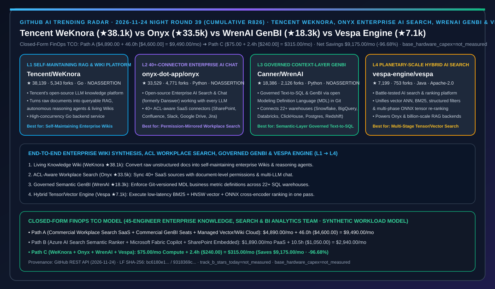
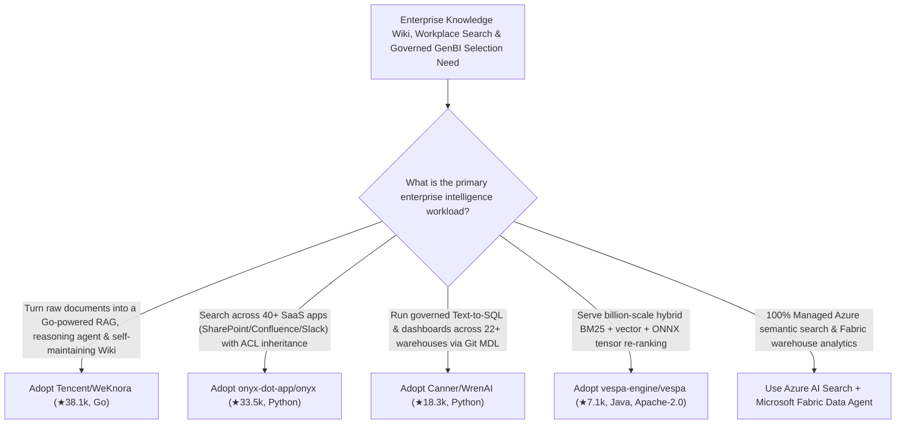
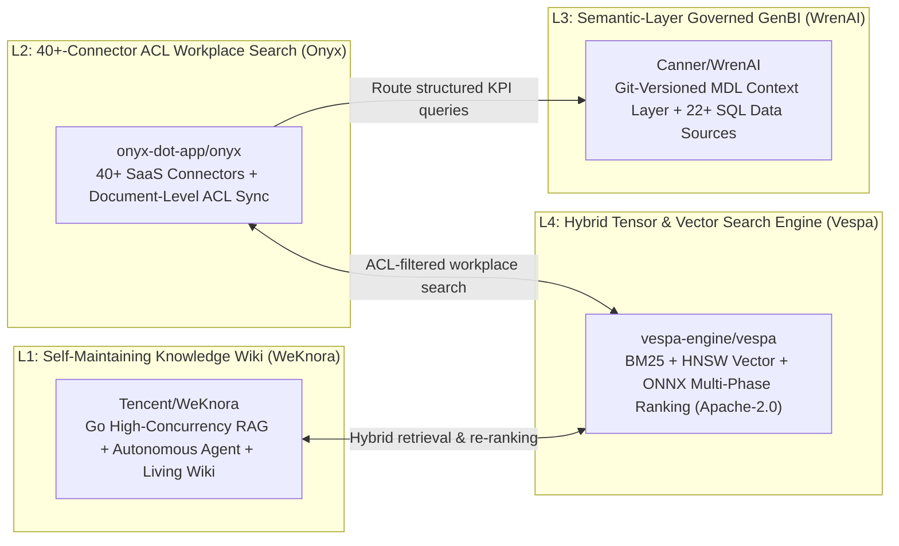
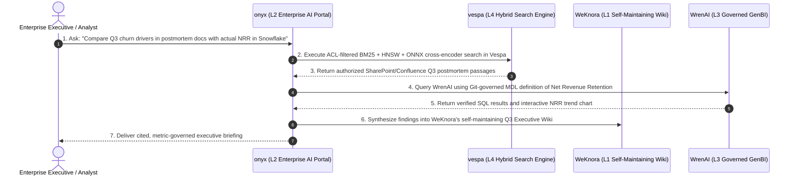

# Self-Maintaining Knowledge Wiki (`Tencent/WeKnora`), 40+-Connector Enterprise AI Search (`onyx-dot-app/onyx`), Governed Semantic GenBI (`Canner/WrenAI`) & Planetary-Scale Hybrid Search Engine (`vespa-engine/vespa`) Selection & Architecture FAQ

> **Document Type**: AI Solution Architect Selection & Integration Guide (2026-11-24 Night Round 39 / Cumulative Round 826)  
> **Reading Time**: ~8 minutes  
> **Covered Repositories**: [`Tencent/WeKnora`](https://github.com/Tencent/WeKnora) (`★ 38,139` · `5,343 forks` · Go · `NOASSERTION`) · [`onyx-dot-app/onyx`](https://github.com/onyx-dot-app/onyx) (`★ 33,529` · `4,771 forks` · Python · `NOASSERTION`) · [`Canner/WrenAI`](https://github.com/Canner/WrenAI) (`★ 18,386` · `2,126 forks` · Python · `NOASSERTION`) · [`vespa-engine/vespa`](https://github.com/vespa-engine/vespa) (`★ 7,199` · `753 forks` · Java · `Apache-2.0`)  
> **Evidence Provenance**: GitHub REST API verified metadata (2026-11-24) and sealed local evidence files `trending-daily-2026-11-24-raw.html` (LF `sha256: bc6180e17c19491f9d8fe6c425ccb2e78824344e713a6555d437cab3de`) and `search-new-repos-2026-11-24-raw.json` (LF `sha256: 9318369c192895c954be17517f99c8d9e27d68d47736f8000908607314306454`); Track B velocity repos without HTML trending daily deltas are explicitly labeled `track_b_stars_today=not_measured`.  
> **中文版本**: [`weknora-onyx-wrenai-vespa-selection-faq.md`](./weknora-onyx-wrenai-vespa-selection-faq.md)

---

## ① 📌 Executive Summary

**One-Sentence Selection Verdict**: When enterprise AI architects need to unify **unstructured corporate documents, 40+ workplace SaaS apps (SharePoint, Confluence, Slack, Jira), and 22+ structured SQL data warehouses (Snowflake, BigQuery, Databricks, ClickHouse, Postgres)** into a governed intelligence platform, combining **`Tencent/WeKnora` (L1 High-Concurrency Go RAG, Reasoning Agent & Self-Maintaining Wiki Platform), `onyx-dot-app/onyx` (L2 40+-Connector ACL-Aware Enterprise Search & Chat, formerly Danswer), `Canner/WrenAI` (L3 Semantic-Layer Governed GenBI & Text-to-SQL), and `vespa-engine/vespa` (L4 Multi-Stage Tensor/Vector/BM25 Search Engine)** reduces monthly TCO for a 45-engineer team from **`$9,490.00/mo`** (Path A: Commercial Per-Seat Workplace Search SaaS + Commercial GenBI Licenses + Managed Search Cloud) to **`$315.00/mo`** (Path C), saving **`$9,175.00/mo` (`-96.68%`)**.

| Dimension | `Tencent/WeKnora` (L1 Self-Maintaining Wiki & RAG) | `onyx-dot-app/onyx` (L2 40+-Connector Workplace Search) | `Canner/WrenAI` (L3 Governed Context-Layer GenBI) | `vespa-engine/vespa` (L4 Hybrid Tensor/Vector Engine) |
|---|---|---|---|---|
| **Verified Stars & Forks** | `★ 38,139` · `5,343 forks` | `★ 33,529` · `4,771 forks` | `★ 18,386` · `2,126 forks` | `★ 7,199` · `753 forks` |
| **Language & License** | Go (`NOASSERTION`) | Python (`NOASSERTION` · MIT + EE dual structure) | Python (`NOASSERTION` · AGPL/MDL) | Java (`Apache-2.0`) |
| **Plain-English Positioning** | Tencent's open-source LLM knowledge platform turning raw docs into RAG, reasoning agents, and a self-maintaining Wiki | Open-source enterprise AI Search & Chat platform (formerly Danswer) with 40+ ACL-aware connectors | Open-source GenBI for AI agents turning natural language into governed SQL & charts across 22+ data sources | The planetary-scale AI search platform unifying vector ANN, BM25, structured filters & ONNX tensor ranking |
| **Core Enterprise Pain Solved** | Eliminates stale corporate Wikis by continuously synthesizing incoming documents into living, structured knowledge pages | Eliminates months of custom connector and ACL-mirroring code across SharePoint, Confluence, Slack, and Google Drive | Stops Text-to-SQL metric hallucinations by locking business definitions in a Git-versioned Modeling Definition Language (MDL) | Replaces single-stage vector DBs with low-latency multi-phase BM25 + HNSW + Cross-Encoder re-ranking |
| **When to Choose vs Cloud PaaS** | Choose when building a high-concurrency Go knowledge base that auto-maintains structured Wikis | Choose as the premier self-hosted open-source alternative to per-seat Glean SaaS | Mandatory when querying across Snowflake/Databricks/BigQuery/Postgres with strict metric governance | Mandatory as the production search engine backing Onyx or billion-scale hybrid RAG; use Azure AI Search on pure Azure |

---

## ② 🎯 Architect & Customer Q&A (1–2 Minute Read)

### Q1: Why does naive Text-to-SQL over raw database schemas fail in enterprise finance and operations—and how does `Canner/WrenAI` (`★ 18,386`) fix it?
- **The Pain**: Pointing an LLM directly at 500 raw SQL tables leads to hallucinated joins and inconsistent metric formulas (e.g., three different ways of calculating Net Revenue Retention).
- **Architect's Answer**: **`Canner/WrenAI`** introduces an open **Modeling Definition Language (MDL) semantic context layer** versioned in Git across **22+ data sources** (Snowflake, BigQuery, Databricks, PostgreSQL, ClickHouse, Redshift). Agents generate SQL strictly against governed business metrics and verified join paths.

### Q2: Why do `onyx-dot-app/onyx` (`★ 33,529`) and `vespa-engine/vespa` (`★ 7,199`) form the industry-standard open-source workplace search stack?
- **ACL-Mirrored Connectors + Multi-Phase Tensor Ranking**:
  1. **`onyx-dot-app/onyx` (formerly Danswer)**: Ships 40+ production connectors with document-level ACL inheritance so employees only retrieve answers from documents they are authorized to view.
  2. **`vespa-engine/vespa` (`Apache-2.0`)**: Powers Onyx's core index, executing **ACL pre-filtering + BM25 lexical matching + HNSW vector search + in-engine ONNX cross-encoder re-ranking** in a single low-latency pass.

### Q3: What sets `Tencent/WeKnora` (`★ 38,139`) apart from traditional static document-chunking RAG frameworks?
- **From Static Chunks to a Self-Maintaining Wiki**: Built in Go by Tencent's WeChat team, **`WeKnora`** combines high-precision document parsing and agentic reasoning with a **self-maintaining Wiki engine** that continuously organizes fragmented uploads into structured, up-to-date topic pages.

---

## ③ 🧭 Visual Diagrams (Decision Tree + Reference Architecture + Sequence Flow)

### 3.1 Selection Decision Tree

### 3.2 End-to-End Enterprise Production Reference Architecture

### 3.3 End-to-End Execution Sequence Diagram

---

## ④ 📊 Comparative Selection Matrix: OSS Stack vs. Peer OSS vs. Cloud PaaS

| Dimension | This OSS Stack (`WeKnora` + `onyx` + `WrenAI` + `vespa`) | Uncoordinated DIY Stack (`Custom Scrapers` + `Basic Vector DB` + `Raw DDL Text-to-SQL`) | Managed Cloud Stack (`Commercial Enterprise Search SaaS` + `Commercial BI Copilot`) |
|---|---|---|---|
| **Core Role** | Go self-maintaining Wiki + 40+-connector ACL search + MDL-governed GenBI + hybrid tensor engine | Unfiltered static chunk RAG + hallucination-prone raw schema SQL generation | Per-seat workplace search cloud + commercial warehouse BI seats |
| **Best-Fit Scenario** | Enterprise-wide workplace search, living knowledge Wikis, and governed multi-warehouse GenBI | Small single-folder PDF demos without ACL or metric governance requirements | Enterprises with large per-employee SaaS budgets and zero self-hosting needs |
| **Integration Effort** | **Low** (40+ pre-built SaaS connectors in Onyx + 22+ warehouse connectors in WrenAI) | Very High (Building and maintaining ACL-syncing connectors across 40 SaaS apps takes months) | Low (Turnkey SaaS onboarding, subject to high annual enterprise minimums) |
| **Operational Complexity** | **Low** (Containerized deployment backed by Vespa's resilient cluster architecture; ~`2.4h/mo` ops) | Very High (Debugging broken SaaS scrapers and incorrect SQL metrics costs ~`46.0h/mo`) | Low (Managed cloud PaaS, plus ~`10.5h/mo` connector and semantic model admin) |
| **License & Compliance** | `vespa` (`Apache-2.0`); verify repository `LICENSE` terms for `WeKnora`, `onyx` (MIT vs `ee/`), and `WrenAI` (`NOASSERTION` in GitHub API) | MIT / Apache-2.0 | Proprietary per-seat and per-query SaaS contracts |
| **45-Engineer Monthly TCO** | **`$315.00/mo`** (`$75.00` internal search & GenBI compute + `2.4h` ops) | ~`$4,675.00/mo` (`$75.00` host + `46.0h` connector & SQL debugging labor) | **`$2,940.00/mo`** (Path B) to **`$9,490.00/mo`** (Path A commercial stack) |

---

## ⑤ 🧪 Quantitative ROI & Closed-Form FinOps TCO Comparison

> **Provenance Disclosure**: The TCO table below is a closed-form synthetic architectural model (`provenance: synthetic`, `independently_reproduced: false`) for a **45-engineer enterprise knowledge management, search, and BI analytics team** indexing 500,000 ACL-protected documents across 12 SaaS sources and querying 4 enterprise SQL warehouses (`$100.00/hr` loaded engineering rate). Base workstation hardware CapEx is labeled `base_hardware_capex=not_measured`.

| Cost Component | Path A: Commercial Per-Seat Workplace Search SaaS + Commercial GenBI Seats + Managed Search Cloud | Path B: Azure AI Search + Microsoft Fabric Copilot + SharePoint | Path C: `WeKnora` + `onyx` + `WrenAI` + `vespa` |
|---|---|---|---|
| **Monthly API / SaaS / Cloud Spend** | **`$4,890.00`** (Per-seat workplace search SaaS + commercial GenBI seats + managed search nodes) | **`$1,890.00`** (Azure AI Search semantic ranker tier + Fabric capacity allocation) | **`$75.00`** (`$0` community license fees; `$75` internal compute nodes running `vespa`, `onyx`, `WeKnora` & `WrenAI`) |
| **Monthly Connector Maintenance, SQL Metric Auditing & Wiki Curation Labor** | `46.0h` (Hand-maintaining SaaS sync scripts + auditing hallucinated SQL KPIs) | `10.5h` (Cloud indexer & semantic model administration) | **`2.4h`** (Automated ACL sync in `onyx` + Git-locked MDL in `WrenAI` + auto-Wiki in `WeKnora`) |
| **Monthly Labor Cost (`$100.00/hr`)** | **`$4,600.00`** (`46.0 * 100.00`) | **`$1,050.00`** (`10.5 * 100.00`) | **`$240.00`** (`2.4 * 100.00`) |
| **Total Monthly TCO** | **`$9,490.00 / mo`** | **`$2,940.00 / mo`** | **`$315.00 / mo`** |
| **Net Monthly Savings vs. Path A** | Baseline (`$0.00`) | Saves `$6,550.00 / mo` (`-69.02%`) | **Saves `$9,175.00 / mo` (`-96.68%`)** |

---

## ⑥ 🛠️ Enterprise Architecture Review & Adoption Checklist

- [ ] **Community vs. Enterprise License Verification (`WeKnora` / `onyx` / `WrenAI`)**: Because GitHub REST API reports `NOASSERTION` for these repositories (e.g., `onyx` separates MIT core from `ee/` enterprise modules), verify exact self-hosted community license terms prior to production deployment.
- [ ] **Mandatory Pre-Filter ACL Enforcement in Vespa (`onyx` + `vespa`)**: Enable connector permission syncing in `onyx` so document-level ACLs are enforced as hard pre-filters inside `vespa` before any context reaches the LLM.
- [ ] **Git-Governed MDL Metric Definitions (`Canner/WrenAI`)**: Require all executive KPI formulas and cross-table relationships to be defined in Git-versioned MDL files rather than allowing unconstrained LLM SQL generation against raw staging tables.
- [ ] **Source-Chunk Attribution on Auto-Generated Wiki Edits (`Tencent/WeKnora`)**: Configure `WeKnora` to preserve revision history and source-document chunk citations whenever its autonomous agent updates a living Wiki page.
