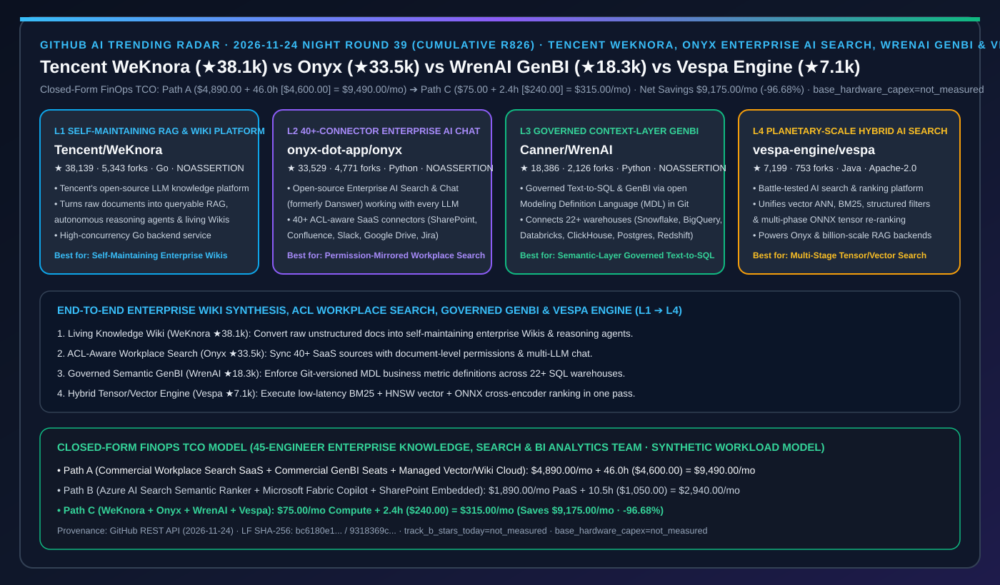
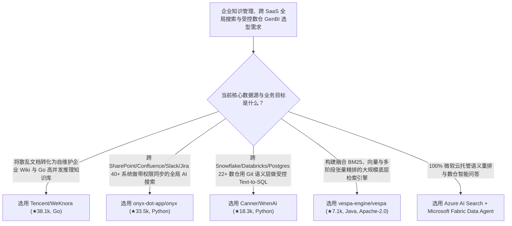
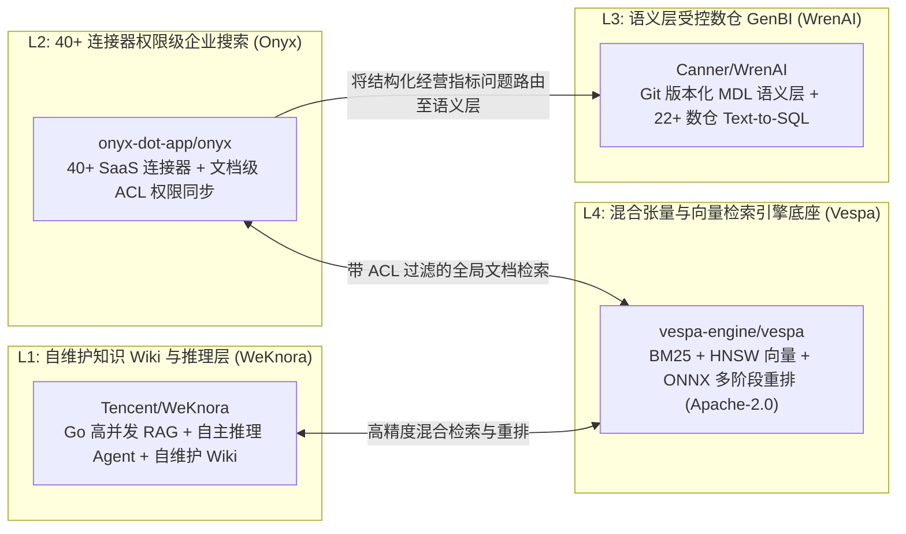
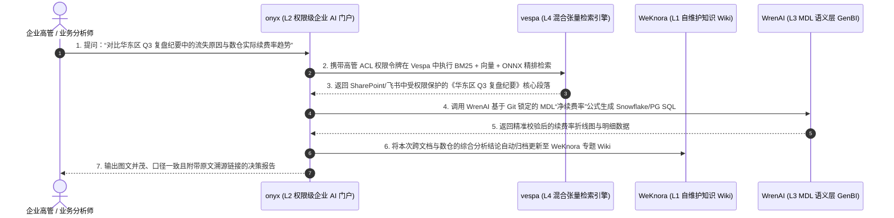

# 腾讯自演进知识库与 Wiki 平台（`Tencent/WeKnora`）、40+ 连接器企业权限级 AI 搜索（`onyx-dot-app/onyx`）、语义层受控 GenBI（`Canner/WrenAI`）与大规模混合张量检索引擎（`vespa-engine/vespa`）选型与集成 FAQ

> **文档类型**：AI 解决方案架构师（AI Solution Architect）选型决策指南（2026-11-24 Night Round 39 / 累计第 826 轮）  
> **阅读耗时**：约 8 分钟  
> **覆盖项目**：[`Tencent/WeKnora`](https://github.com/Tencent/WeKnora)（`★ 38,139` · `5,343 forks` · Go · `NOASSERTION`） · [`onyx-dot-app/onyx`](https://github.com/onyx-dot-app/onyx)（`★ 33,529` · `4,771 forks` · Python · `NOASSERTION`） · [`Canner/WrenAI`](https://github.com/Canner/WrenAI)（`★ 18,386` · `2,126 forks` · Python · `NOASSERTION`） · [`vespa-engine/vespa`](https://github.com/vespa-engine/vespa)（`★ 7,199` · `753 forks` · Java · `Apache-2.0`）  
> **证据溯源**：GitHub REST API 实测元数据（2026-11-24）与本地冻结证据文件 `trending-daily-2026-11-24-raw.html`（LF `sha256: bc6180e17c19491f9d8fe6c425ccb2e78824344e713a6555d437cab3de`）、`search-new-repos-2026-11-24-raw.json`（LF `sha256: 9318369c192895c954be17517f99c8d9e27d68d47736f8000908607314306454`）；Track B 仓库无 HTML 榜单对应的单日增量，统一标记为 `track_b_stars_today=not_measured`。  
> **English Version**: [`weknora-onyx-wrenai-vespa-selection-faq.en.md`](./weknora-onyx-wrenai-vespa-selection-faq.en.md)

---

## ① 📌 核心结论速览（Executive Summary）

**选型一句话结论**：当企业需要把**非结构化散乱文档、40+ 办公 SaaS 系统（Confluence/SharePoint/Slack/Jira）与 22+ 结构化数据仓库（Snowflake/BigQuery/Databricks/ClickHouse/Postgres）**统一整合为高可信的企业级知识与数据智能中台时，采用 **`Tencent/WeKnora`（L1 腾讯开源的高并发 Go 语言自维护 Wiki 与推理知识库平台）+ `onyx-dot-app/onyx`（L2 原 Danswer、内置 40+ 权限同步连接器的开源 Glean 替代方案）+ `Canner/WrenAI`（L3 基于 Git 版本化 MDL 语义上下文层的受控 Text-to-SQL 与 GenBI 引擎）+ `vespa-engine/vespa`（L4 支持十亿级向量、BM25 与多阶段张量重排的企业级搜索引擎）**，可将 45 人团队的月度 TCO 从商业企业搜索 SaaS（如 Glean 按席位订阅）+ 商业 GenBI 席位 + 商业托管搜索引擎（Path A）的 **`$9,490.00/月`** 降至 **`$315.00/月`**（净省 **`$9,175.00/月`**，降幅 **`-96.68%`**）。

| 评估维度 | `Tencent/WeKnora` (L1 腾讯自维护 Wiki 与 RAG 平台) | `onyx-dot-app/onyx` (L2 40+ 连接器企业 AI 搜索) | `Canner/WrenAI` (L3 语义层受控 GenBI 引擎) | `vespa-engine/vespa` (L4 多阶段张量与混合检索底座) |
|---|---|---|---|---|
| **GitHub 实测热度** | `★ 38,139` · `5,343 forks` | `★ 33,529` · `4,771 forks` | `★ 18,386` · `2,126 forks` | `★ 7,199` · `753 forks` |
| **实现语言与开源协议** | Go (`NOASSERTION` · 需核验仓库 `LICENSE`) | Python (`NOASSERTION` · MIT + Enterprise 双轨) | Python (`NOASSERTION` · 需核验 AGPL/商业条款) | Java (`Apache-2.0`) |
| **一句话通俗定位** | 腾讯微信团队开源的知识管理平台：把原始文档转化为可问答 RAG、自主推理 Agent 与自维护 Wiki | 开源版 Glean（原名 Danswer）：打通 40+ 办公数据源并支持任意大模型的企业级 AI 搜索与对话平台 | 面向 AI Agent 的开源 GenBI：通过开放上下文建模层（MDL）跨越 22+ 数据源生成可信 SQL 与看板 | 工业级 AI 搜索与排序平台：在单一引擎内融合向量 ANN、BM25、结构化过滤与 ONNX 模型重排序 |
| **解决的核心业务痛点** | 解决传统企业 Wiki“写完就没人更新、新老文档互相矛盾、只做死板切片检索而不会综合整理成册”的知识腐烂难题 | 免除手写几十个 SaaS 爬虫与文档级权限（ACL）同步代码的沉重负担，开箱即享权限继承的企业全局搜索 | 消除直接把数据库表结构扔给大模型写 SQL 时“指标口径乱算（如毛利率定义不一致）、跨表 Join 幻觉”的致命痛点 | 解决普通向量库“只能算余弦距离、不支持复杂业务权重公式与多阶段交叉编码器（Cross-Encoder）在线重排”的检索瓶颈 |
| **何时选它 vs 云托管** | 需要高并发 Go 后端驱动的“RAG + 自主任务 + 自动演进 Wiki”三位一体平台时首选 | 希望私有化替代昂贵的按员工数收费商业企业搜索（如 Glean）时首选 | 企业数仓跨 Snowflake/Databricks/BigQuery/Postgres 且必须把业务指标定义锁在 Git 里时首选 | 作为 `onyx` 的默认底层检索引擎或高并发生产级 RAG 排序底座必选；纯微软云选 Azure AI Search |

---

## ② 🎯 客户与架构师灵魂拷问 Q&A（1–2 分钟速读）

### Q1：为什么大多数企业直接让大模型连数据库写 SQL（Text-to-SQL）上线后都会翻车？`Canner/WrenAI`（`★ 18,386`）是怎么用“语义上下文层（MDL）”根治指标口径不一致的？
- **痛点**：不同部门对“活跃客户”或“净营收”的 SQL 计算口径完全不同。如果只给 LLM 看物理表的 DDL（`CREATE TABLE`），同一个问题问三次可能算出三个不同的财务数字。
- **架构师解答**：**`Canner/WrenAI`** 在大模型与底层 22+ 种数据库（BigQuery、Snowflake、PostgreSQL、ClickHouse、Databricks、Redshift）之间引入了 **MDL（Modeling Definition Language）开放语义上下文层**：
  1. **业务指标定义存进 Git**：数据架构师将标准化的表关联关系、计算字段与业务术语定义在 Git 管控的 MDL 模型中。
  2. **先查语义层、再生成受控 SQL 与图表**：AI Agent 基于经过治理的语义模型生成 SQL，彻底杜绝野生 Join 与口径漂移。

### Q2：企业想做类似 Glean 的跨系统全局 AI 搜索（同时搜 Confluence、SharePoint、飞书、Slack、GitHub），为什么 `onyx-dot-app/onyx`（`★ 33,529`）配 `vespa-engine/vespa`（`★ 7,199`）是黄金搭档？
- **核心收益**：
  1. **`onyx-dot-app/onyx`（原 Danswer）**：已经替企业写好了 **40+ 个生产级 SaaS 连接器**，并且原生支持**文档级访问控制列表（ACL）同步**——普通员工搜不到高管薪酬文档。
  2. **`vespa-engine/vespa`（`Apache-2.0`）**：`onyx` 底层正是采用 Vespa 作为核心检索引擎！Vespa 能在毫秒级单次查询中同时完成 **ACL 权限过滤 + BM25 关键词匹配 + HNSW 向量召回 + 内置 ONNX Cross-Encoder 多阶段精排**，检索精度远超单纯的向量相似度搜索。

### Q3：腾讯微信团队开源的 `Tencent/WeKnora`（`★ 38,139`）与传统只做“上传 PDF 问答”的 RAG 框架有什么本质区别？
- **从静态 RAG 走向“自维护活体 Wiki（Self-Maintaining Wiki）”**：`Tencent/WeKnora` 采用高性能 Go 语言编写，不仅提供精准的多模态文档解析与混合检索 RAG，更内建了**自主推理 Agent 与自维护 Wiki 机制**——当新会议纪要或新架构文档上传后，系统会自动梳理知识脉络、更新专题 Wiki 页面，把静态文件堆变成持续自演进的企业百科全书。

---

## ③ 🧭 直观可视化图解（Mermaid 决策树 + 集成架构 + 时序图）

### 3.1 技术选型决策树

### 3.2 企业端到端生产集成参考架构图

### 3.3 业务流全链路时序图

---

## ④ 📊 同类开源与商业云服务横向选型决策矩阵

| 对比维度 | 本轮开源组合 (`WeKnora` + `onyx` + `WrenAI` + `vespa`) | 传统自研拼凑 (`手写爬虫` + `裸跑 Chroma` + `直接喂 DDL 写 SQL`) | 商业云与 SaaS 方案 (`Glean 企业版` + `商业 BI Copilot` + `托管搜索云`) |
|---|---|---|---|
| **功能定位** | Go 自维护 Wiki + 40+ 连接器权限搜索 + MDL 语义受控 GenBI + 多阶段张量检索底座 | 无权限隔离的静态切片问答 + 口径混乱的裸表 Text-to-SQL | 按全员席位收费的商业搜索 SaaS + 商业数仓智能插件 |
| **适用场景** | 跨多办公系统与多数据仓库的企业统一知识门户、高合规权限继承搜索、强口径治理的经营分析 GenBI | 仅含几十份公开 PDF 与单张测试表的内部演示 | 预算充裕且愿意按全公司人头支付年框的跨国企业 |
| **集成成本** | **低**（内置 40+ 现成 SaaS 连接器与 22+ 数据库驱动，免去数月连接器开发） | 极高（仅维护 SharePoint/Confluence 增量同步与权限变更就要耗费数月） | 低（SaaS 授权即用，但往往要求最低百人以上年度起购门槛） |
| **运维复杂度** | **低**（Docker / K8s 容器化部署，Vespa 提供工业级高可用集群能力，月均维护约 `2.4h`） | 极高（排查 SQL 口径算错投诉与连接器断连耗费 `46.0h/月`） | 低（云端全托管，月均权限与数据目录维护约 `10.5h`） |
| **开源协议与合规** | `vespa` 为 `Apache-2.0`；`WeKnora`、`onyx`、`WrenAI` GitHub 标为 `NOASSERTION`（引入前需核验各仓 Community vs Enterprise 许可证边界） | MIT / Apache-2.0 | 商业闭源按席位/按索引量计费 |
| **45 人团队月度 TCO** | **`$315.00/月`**（含 `$75.00` 内部检索与分析节点 + `2.4h` 运维） | 约 `$4,675.00/月`（含 `$75.00` 主机 + `46.0h` 连接器维护与 SQL 修错工时） | **`$2,940.00/月`**（Path B）至 **`$9,490.00/月`**（Path A 商业全栈） |

---

## ⑤ 🧪 应用落地定量收益 / TCO 对比（Closed-Form FinOps 模型）

> **数据性质声明（Provenance Metadata）**：以下 TCO 模型为面向 **45 人企业知识管理、搜索与商业智能（BI）团队**（接入 12 个企业 SaaS 数据源共 50 万篇受权限保护文档、连接 4 套核心数据仓库，日均服务 8,000 次跨文档与结构化指标联合查询，工程师折算时薪 `$100.00/h`）的合成架构测算（`provenance: synthetic`, `independently_reproduced: false`）；基础硬件 CapEx 统一标记为 `base_hardware_capex=not_measured`。

| 成本构成项 | Path A：商业企业搜索 SaaS (按席位) + 商业 GenBI 席位 + 托管向量/Wiki 云 | Path B：Azure AI Search + Microsoft Fabric Copilot + SharePoint | Path C：`WeKnora` + `onyx` + `WrenAI` + `vespa` |
|---|---|---|---|
| **API / SaaS / 云资源月费** | **`$4,890.00`**（商业全局搜索席位费 + 商业 Text-to-SQL 分析席位 + 托管检索节点） | **`$1,890.00`**（Azure AI Search 语义排序层 + Fabric 容量分摊 + 存储） | **`$75.00`**（开源社区版 `$0` 授权费；仅需 `$75` 内网服务器运行 `vespa` 与知识服务） |
| **月度手写 SaaS 权限连接器、核对错误 SQL 口径与人工整理 Wiki 工时** | `46.0h`（手写增量同步脚本 + 人工复核大模型算错的财务报表 SQL） | `10.5h`（云端索引器与语义模型维护） | **`2.4h`**（`onyx` 自动同步 ACL + `WrenAI` MDL 锁定指标口径 + `WeKnora` 自动维护 Wiki） |
| **人工研发与数据治理成本（`$100.00/h`）** | **`$4,600.00`** (`46.0 * 100.00`) | **`$1,050.00`** (`10.5 * 100.00`) | **`$240.00`** (`2.4 * 100.00`) |
| **月度总拥有成本（Total Monthly TCO）** | **`$9,490.00 / 月`** | **`$2,940.00 / 月`** | **`$315.00 / 月`** |
| **相对 Path A 净节省** | 基准线 (`$0.00`) | 节省 `$6,550.00 / 月` (`-69.02%`) | **净省 `$9,175.00 / 月` (`-96.68%`)** |

---

## ⑥ 🛠️ 企业引入与架构评审 Checklist

- [ ] **双轨许可证与 `NOASSERTION` 法务边界核验（`WeKnora` / `onyx` / `WrenAI`）**：由于三者在 GitHub API 中均返回 `NOASSERTION`（其中 `onyx` 含 MIT 社区版与 `ee/` 企业版目录，`WrenAI` 含 AGPL-3.0 组件），上线前必须由法务核验仅启用开源社区版目录并遵守内部自托管边界。
- [ ] **文档级 ACL 权限前置过滤（Pre-Filter in `onyx` + `vespa`）**：在 `onyx` 对接企业 Confluence/SharePoint 时，必须开启权限同步（Permission Sync），确保 `vespa` 在向量 ANN 召回阶段即执行用户组 ACL 过滤，杜绝“先召回敏感文档再靠提示词遮掩”的越权隐患。
- [ ] **核心财务与经营指标强制写入 Git MDL 语义层（`Canner/WrenAI`）**：禁止让大模型对未经建模的原始宽表直接自由发挥写 Join，所有对外暴露的经营指标必须在 `WrenAI` 的 MDL 文件中显式定义计算公式并通过数据团队 PR 评审。
- [ ] **自维护 Wiki 页面变更保留版本历史与原文引用锚点（`Tencent/WeKnora`）**：配置 `WeKnora` 在自动更新专题 Wiki 时保留每次修订的 Diff 记录与源文档 Chunk 引用链接，方便业务专家随时抽检溯源。
