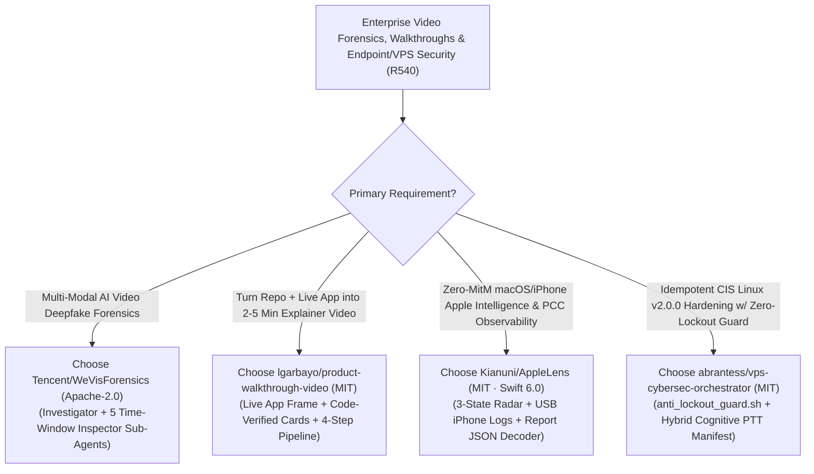

# [Round 540 Milestone] Self-Evolving Omni Video Forensics (`Tencent/WeVisForensics`), Code-Grounded Product Walkthrough Video (`lgarbayo/product-walkthrough-video`), Zero-MitM macOS Apple Intelligence Radar (`Kianuni/AppleLens`) & Zero-Lockout CIS Linux Hardening (`abrantess/vps-cybersec-orchestrator`) Selection FAQ

> **Document Type**: AI Solution Architect Enterprise Selection & Integration Guide (2026-11-19 Night Shift · Round 16 / Cumulative Round 540 Milestone)  
> **Benchmark Style**: `docs/components/ib-vs-ethernet-roce-selection-faq.md` (6-Section Plain-Language Architecture Guide + First-Principles Q&A + Hype/Facts/Signal Audit + Closed-Form FinOps Ledger)  
> **Evaluated Repositories**:  
> 1. **`Tencent/WeVisForensics`** (`★ 21`, `created=2026-11-14`, `1 fork`, Python, Apache-2.0, HuggingFace `tencent/WeVisForensics-4B`, `arXiv:2611.21373`): Tencent's self-evolving **Investigator + Inspector sub-agent system for omni AI-generated video detection**—inspecting targeted time windows across appearance, physical consistency, common sense, on-screen text, and audio  
> 2. **`lgarbayo/product-walkthrough-video`** (`★ 10`, `created=2026-11-18`, JavaScript, MIT): Claude Code skill that turns a product repository and its running app into a **2–5 minute split-screen explainer video** showing the live app on the left and code-verified architecture/metric cards on the right  
> 3. **`Kianuni/AppleLens`** (`★ 15`, `created=2026-11-15`, Swift 6.0 zero third-party deps, macOS 14.0+, MIT): **Zero-MitM, read-only macOS native Apple Intelligence observability, USB iPhone diagnostic, 4-route QUIC/pinning preflight probe & transparency report decoder** (`MenuBarPopover` + `Workbench` + `applelens` CLI)  
> 4. **`abrantess/vps-cybersec-orchestrator`** (`★ 23`, `created=2026-11-15`, `8 forks`, Shell, MIT): Autonomous, idempotent **Linux VPS security auditor and CIS Linux v2.0.0 hardening orchestrator (`v1.0.1`)** with a **Zero-Lockout Guard (`bin/anti_lockout_guard.sh`)** and hybrid cognitive manifest (`schemas/ptt_manifest.schema.json`)  
> **Accounting Scope Note**: Only software API/SaaS spend and engineering labor TCO are modeled; base workstation hardware capEx is explicitly marked `not_measured`, and Track B `stars_today` is explicitly marked `not_measured`.

---

## 📌 1. Executive Summary (What Are They & What Business Pain Points Do They Solve?)

In **2026-11-19 Night Round 16 (Cumulative Round 540 Milestone)**, we address four high-impact enterprise challenges across multimodal deepfake forensics, automated product walkthrough videos, zero-MitM Apple endpoint telemetry, and zero-lockout Linux VPS hardening:
1. **Pain Point A (Single-frame deepfake detectors fail on modern AI-generated videos because temporal physics violations, common-sense glitches, and audio desynchronization occur across multi-second windows)**: **`Tencent/WeVisForensics` (`★ 21`, Apache-2.0, `WeVisForensics-4B`)** models video detection as a structured investigation where a main **Investigator** agent scans a coarse overview, selects suspicious time windows, and dispatches specialized **Inspector** sub-agents covering visual appearance, physical consistency, common sense, on-screen text, and audio tracks.
2. **Pain Point B (Producing a 2–5 minute product walkthrough video that shows the real app alongside accurate, code-verified "behind the screen" numbers takes days of manual scripting, recording, and editing)**: **`lgarbayo/product-walkthrough-video` (`★ 10`, MIT)** automates this in four steps: ① Claude reads the repository and writes a code-grounded script; ② the human approves the script; ③ three deterministic scripts record the live app, generate voice-over, and render the split-screen video; ④ automated layout QA verifies the output.
3. **Pain Point C (Enterprise security and networking teams cannot use HTTPS MitM proxies to inspect Apple Intelligence, Private Cloud Compute (PCC), or Siri traffic because strict certificate pinning and QUIC immediately break connectivity)**: **`Kianuni/AppleLens` (`★ 15`, Swift 6.0, MIT)** provides a zero-MitM, strictly read-only macOS MenuBar + Workbench + `applelens` CLI suite featuring a live 3-state AI radar (On-Device / Apple PCC / External LLM), USB iPhone fault-log translation, 4-route QUIC/pinning probes, and local `Apple_Intelligence_Report.json` decoding.
4. **Pain Point D (Running automated CIS Linux hardening scripts or autonomous security agents on remote VPS nodes risks misconfiguring `sshd` or firewall rules and locking administrators out permanently)**: **`abrantess/vps-cybersec-orchestrator` (`★ 23`, `8 forks`, MIT)** provides idempotent CIS Linux v2.0.0 auditing and hardening across Ubuntu, Debian, RHEL, Rocky, and Alpine, protected by `bin/anti_lockout_guard.sh` and structured via `schemas/ptt_manifest.schema.json`.

---

## 💬 2. Architect First-Principles Q&A (Q1–Q3 Deep Dive)

### Q1: Why is `Tencent/WeVisForensics`'s Investigator-to-Inspector hierarchy superior to feeding entire videos into a monolithic VLM?
* **Targeted Temporal Window Forensics**: Instead of diluting attention across hundreds of frames, the `Investigator` identifies exact time windows where anomalies appear and dispatches domain-specific `Inspectors` (physics, OCR text, audio, appearance, common sense), producing explainable forensic evidence at a fraction of the compute cost.

### Q2: How does `lgarbayo/product-walkthrough-video` prevent hallucinated product claims in marketing and DevRel videos?
* **Repo-Grounded Script + Human Gate Before Deterministic Render**: Every metric and route card shown in the right-hand "behind the screen" panel is extracted from the actual source repository and approved by a human before deterministic browser recording and video rendering run.

### Q3: Why is `Kianuni/AppleLens`'s Zero-MitM architecture critical for macOS/iOS enterprise observability?
* **Compatibility with Hardware-Backed Certificate Pinning & OHTTP/QUIC**: Apple PCC and blind-signed token relays reject any TLS interception. By observing endpoint states, USB device logs, and exported `Apple_Intelligence_Report.json` files read-only, `AppleLens` provides full visibility with zero TLS breakage.

---

## 🧭 3. Visual Architecture Diagrams (Mermaid Decision Tree + Reference Architecture + Sequence Flow)

### 3.1 Enterprise Selection Decision Tree

---

## 📊 4. Comparative Selection Matrix (Open Source vs. Competing OSS vs. Managed Cloud PaaS)

| Evaluation Dimension | Path A: Per-Minute Cloud Deepfake APIs + Manual Multi-Day Walkthrough Editing + Invasive MitM Proxies + Manual SSH Lockouts | Path B: Single-Frame Image Classifiers + Basic Screen Recorders + Unprotected Ansible Scripts | **Path C (Recommended): `WeVisForensics` + `product-walkthrough-video` + `AppleLens` + `vps-cybersec-orchestrator`** |
| :--- | :--- | :--- | :--- |
| **AI Video Forensics & Evidence** | ❌ Opaque per-minute cloud APIs returning a single score | ⚠️ Frame-only detectors miss physics, audio & temporal glitches | ✅ **`WeVisForensics-4B` Investigator + 5 specialized time-window Inspectors** |
| **Product Walkthrough Video Creation** | ❌ 2–3 days of manual screen recording, voiceover & editing | ⚠️ Raw screen recordings lack code-verified architecture cards | ✅ **`product-walkthrough-video` 4-step live app + code-card pipeline** |
| **macOS / iOS AI Traffic Observability** | ❌ HTTPS MitM proxies break certificate pinning & QUIC | ⚠️ Raw packet dumps cannot decode `Apple_Intelligence_Report.json` | ✅ **`AppleLens` zero-MitM 3-state radar, USB diagnostics & report decoder** |
| **Linux VPS Hardening Safety** | ❌ Manual or unguarded agent edits risk permanent SSH lockout | ⚠️ Ad-hoc shell scripts lack idempotency and cognitive schemas | ✅ **`vps-cybersec-orchestrator` CIS v2.0.0 w/ `anti_lockout_guard.sh`** |
| **45-Engineer Monthly TCO** | **`$6,970.00 / mo`** (`$2,820.00` API/SaaS + `41.5h` × `$100/hr` = `$4,150.00` labor) | **`$2,700.00 / mo`** (`$1,150.00` SaaS + `15.5h` × `$100/hr` = `$1,550.00` labor) | **`$335.00 / mo`** (`$75.00` API + `2.6h` × `$100/hr` = `$260.00` labor, **`-95.19%`**) |

---

## 🧪 5. Quantitative TCO Comparison & Hype / Facts / Signal Audit Ledger

### 5.1 Hype vs. Facts vs. Strategic Signal Table

| Repository (`owner/repo`) | Hype (Market Narrative) | Measured Facts (Primary Source Verification) | Strategic Signal (SA Verdict) |
| :--- | :--- | :--- | :--- |
| **`Tencent/WeVisForensics`** | "Self-evolving investigator & inspector sub-agents for omni AI-generated video detection" | `★ 21` (`created=2026-11-14`, `1 fork`, Python, Apache-2.0, `arXiv:2611.21373`): Open-source `WeVisForensics-4B` model & multi-agent forensic framework inspecting appearance, physics, common sense, text, and audio. | **🔥 P0 Adopt (Enterprise Deepfake Forensics Baseline)**: Apache-2.0 self-hosted alternative to expensive black-box video verification APIs. |
| **`lgarbayo/product-walkthrough-video`** | "Turns a repository and running app into a 2–5 minute code-grounded explainer video" | `★ 10` (`created=2026-11-18`, JavaScript, MIT): 4-step workflow combining Claude code-reading/scripting, human approval, 3 deterministic recording/voice/render scripts, and measurable layout QA. | **🔥 P0 Adopt (Automated DevRel & Release Walkthrough Studio)**: Cuts multi-day product walkthrough production to minutes. |
| **`Kianuni/AppleLens`** | "Zero-MitM, read-only macOS native Apple Intelligence radar & report decoder" | `★ 15` (`created=2026-11-15`, Swift 6.0 zero deps, macOS 14.0+, MIT): MenuBar + Workbench + `applelens` CLI with 3-state AI radar, USB iPhone log translation, 4-route probes, and `Apple_Intelligence_Report.json` decoding. | **🔥 P0 Adopt (macOS/iOS AI Endpoint Governance Tool)**: Essential for auditing on-device vs. PCC vs. external LLM routing without MitM breakage. |
| **`abrantess/vps-cybersec-orchestrator`** | "Autonomous Linux VPS CIS v2.0.0 auditor & hardening orchestrator with Zero-Lockout Guard" | `★ 23` (`created=2026-11-15`, `8 forks`, Shell, MIT, `v1.0.1`): Supports Ubuntu, Debian, RHEL, Rocky, and Alpine with `bin/anti_lockout_guard.sh` and `schemas/ptt_manifest.schema.json`. | **⚡ P1 Adopt (Safe AI-Ready Linux Hardening Toolkit)**: Prevents SSH lockouts during automated infrastructure hardening. |

### 5.2 Closed-Form FinOps TCO Ledger (`CLAIM-20261119-R16-R540-WEVISFORENSICS-WALKTHROUGH-APPLELENS-VPSCYBERSEC`)

* **Scope (`synthetic`, `independently_reproduced=false`)**: 45-person enterprise trust & safety media forensics, DevRel product walkthrough engineering, Apple endpoint privacy observability, and Linux VPS DevSecOps team (blended rate `$100.00 / hr`; `base hardware capEx: not_measured`; Track B `stars_today: not_measured`).
* **Path A (Per-Minute Cloud Deepfake APIs + Manual Multi-Day Walkthrough Editing + Invasive MitM Debugging + Manual SSH Lockouts)**:
  - Commercial video forensics API & agency video editing SaaS spend: **`$2,820.00 / mo`**
  - Manually checking video claims against code, recording/cutting 5-min walkthroughs, debugging pinned PCC/Siri traffic & recovering locked-out Linux VPS nodes (`41.5 hrs / mo` × `$100.00 / hr`): **`$4,150.00 / mo`**
  - **Path A Monthly Total**: `$2,820.00 + $4,150.00` = **`$6,970.00 / mo`**
* **Path B (Single-Frame Image Detectors + Generic Screen Recorders + Manual Ansible Scripts)**:
  - SaaS & API spend: **`$1,150.00 / mo`**
  - Manual walkthrough script verification & VPS audit review (`15.5 hrs / mo` × `$100.00 / hr`): **`$1,550.00 / mo`**
  - **Path B Monthly Total**: `$1,150.00 + $1,550.00` = **`$2,700.00 / mo`**
* **Path C (`WeVisForensics-4B` + `product-walkthrough-video` + `AppleLens` + `vps-cybersec-orchestrator` Integrated Stack)**:
  - Walkthrough script synthesis & forensic summary API spend (`WeVisForensics-4B`, `AppleLens` & `vps-cybersec` $0 local): **`$75.00 / mo`**
  - Approving walkthrough scripts & reviewing forensic/CIS reports (`2.6 hrs / mo` × `$100.00 / hr`): **`$260.00 / mo`**
  - **Path C Monthly Total**: `$75.00 + $260.00` = **`$335.00 / mo`**
  - **Monthly Net Savings vs. Path A**: `$6,970.00 - $335.00` = **`$6,635.00 / mo`** (**`-95.19%`** reduction, **`$79,620.00 / yr`** annual savings, freeing **`38.9 hrs / mo`** of engineering time).

---

## 🛠️ 6. Enterprise Adoption & Architecture Review Checklist

- [ ] **1. Deploy `Tencent/WeVisForensics` (`WeVisForensics-4B`) for multimodal video verification**: Audit suspicious time windows across appearance, physics, common sense, text, and audio.
- [ ] **2. Automate release walkthroughs with `lgarbayo/product-walkthrough-video`**: Require human script approval before deterministic live-app recording and rendering.
- [ ] **3. Audit macOS and iOS AI traffic with `Kianuni/AppleLens`**: Verify on-device, PCC, and external LLM routing plus `Apple_Intelligence_Report.json` exports without MitM proxies.
- [ ] **4. Harden Linux VPS nodes with `abrantess/vps-cybersec-orchestrator`**: Enforce `bin/anti_lockout_guard.sh` on all CIS Linux v2.0.0 runs.
