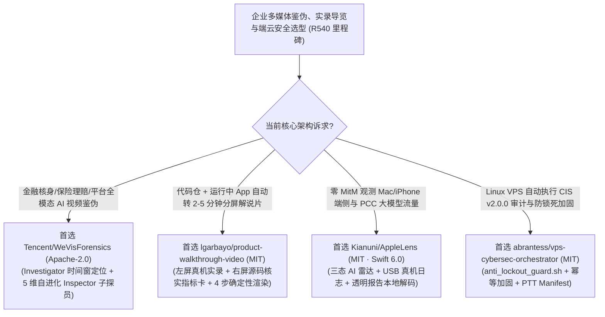
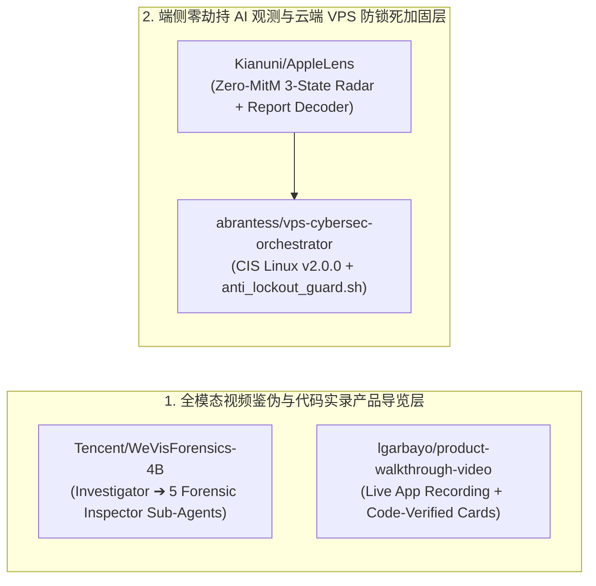
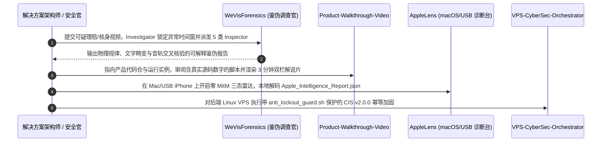

# 【第 540 轮里程碑】腾讯全模态 AI 视频鉴伪多智能体（`Tencent/WeVisForensics`）、代码核实产品实录解说片技能（`lgarbayo/product-walkthrough-video`）、零 MitM 原生 Apple 智能观测工作台（`Kianuni/AppleLens`）与防锁死 CIS Linux 安全加固编排器（`abrantess/vps-cybersec-orchestrator`）选型 FAQ

> **文档类型**：AI Solution Architect（AI 解决方案架构师）实战选型与架构内功指南（2026-11-19 Night Shift · Round 16 / 累计第 540 轮里程碑）  
> **对标标杆**：`docs/components/ib-vs-ethernet-roce-selection-faq.md`（六段式架构拆解 + 第一性原理大白话 + Hype/Facts/Signal 审计 + 闭式 TCO 账本）  
> **本轮评估对象**：  
> 1. **`Tencent/WeVisForensics`**（`★ 21`，`created=2026-11-14`，`1 fork`，Python，Apache-2.0，HuggingFace `tencent/WeVisForensics-4B`，`arXiv:2611.21373`）：腾讯开源的**全模态 AI 生成视频检测与取证自进化多智能体**——由主调查官（**Investigator**）观察全局粗粒度概览并锁定可疑时间窗，按需调度覆盖**视觉外观、物理一致性、常识逻辑、画面文字与音轨**的 5 类子检查员（**Inspectors**）  
> 2. **`lgarbayo/product-walkthrough-video`**（`★ 10`，`created=2026-11-18`，JavaScript，MIT）：将“代码仓 + 正在运行的应用”转化为 **2–5 分钟双栏产品实录解说视频**的 Claude Code 技能——左屏展示真实运行中的 App 录屏，右屏同步展示从源码中核实出的路由与架构指标卡  
> 3. **`Kianuni/AppleLens`**（`★ 15`，`created=2026-11-15`，Swift 6.0 零第三方依赖，macOS 14.0+，MIT）：**零 MitM、纯只读的 macOS 原生 Apple Intelligence 观测、USB 真机日志诊断、4 路 QUIC/证书固定探针与透明报告解码工作台**（`MenuBarPopover` + `Workbench` + `applelens` CLI）  
> 4. **`abrantess/vps-cybersec-orchestrator`**（`★ 23`，`created=2026-11-15`，`8 forks`，Shell，MIT）：面向 Ubuntu/Debian/RHEL/Rocky/Alpine 的**幂等 Linux VPS 安全审计、攻击面分析与 CIS Linux v2.0.0 加固编排器（`v1.0.1`）**——内置 **`bin/anti_lockout_guard.sh` 零锁死守卫**与人机共读的 `schemas/ptt_manifest.schema.json`  
> **审计折算说明**：本报告仅计量软件算力、商业 SaaS 与工程运维人力 TCO，底层研发工作站硬件采购（base hardware capEx）显式标注为 `not_measured`，新仓今日增量显式标注为 `not_measured`，严禁捏造坐标。

---

## 📌 一、核心结论速览（Executive Summary：它到底是什么？解决什么业务痛点？）

在 **2026-11-19 Night Round 16（累计第 540 轮里程碑）** 中，我们面向企业架构师解决“高逼真 AI 生成视频靠单帧分类器无法鉴伪、制作代码与真实界面一致的 2–5 分钟产品 walkthrough 视频耗时数天、排查 Mac/iPhone 端侧与隐私云计算（PCC）流量时挂 MitM 抓包直接触发证书固定报错、以及让 Agent 自动加固 Linux 服务器结果把管理员 SSH 锁死在门外”四大痛点：
1. **痛点 A（随着 Sora 2 / Veo 3 / Kling 4 等生成式视频模型普及，金融远程开户、车险定损视频与内容平台面临大量逼真伪造视频；传统单帧图像分类器不仅漏检时间轴上的物理违和与音画错位，而且无法给出人类审核员能看懂的取证证据链）**：把 AI 视频鉴伪重构为“主调查官 + 多维取证子探员”的分步侦查。**`Tencent/WeVisForensics` (`★ 21`, Apache-2.0, `WeVisForensics-4B`) 的破局之道**：主智能体 **Investigator** 先看全片粗略概览，决定“在哪个时间窗口重点查哪项破绽”，然后派发自进化的 **Inspectors** 子智能体库，分别从**视觉伪影（Appearance）、物理运动守恒（Physics）、常识合理性（Common Sense）、画面 OCR 文字畸变（On-Screen Text）与音轨特征（Audio Track）**五个维度交叉取证并输出完整调查结论。
2. **痛点 B（要做一个既有真实 App 操作演示、又能讲清每个界面背后技术指标与路由逻辑的 2–5 分钟产品 Walkthrough 视频，靠人工写稿、核对代码参数、分屏录制、配音剪辑往往要花好几天）**：用四步确定性管线生成“左屏真机实录 + 右屏源码指标卡”的产品导览片。**`lgarbayo/product-walkthrough-video` (`★ 10`, MIT) 的破局之道**：① Agent 先精读代码库写出每个数据点都有源码依据的分幕脚本；② **人类审批脚本**；③ 三个确定性脚本自动录制真实运行中的 App、合成配音并按产品自身字体配色渲染“左真机框 + 右屏后架构卡（Behind the Screen）”分屏视频；④ 自动对照固定布局与可量化规则完成成片质检。
3. **痛点 C（企业网络与终端安全架构师想观测 macOS / iPhone 上的 Apple Intelligence 到底是在端侧算、走 Apple PCC 隐私云计算还是外发第三方大模型，但如果开启传统 HTTPS MitM 解密抓包，会立刻触发 Apple 严格证书固定（Certificate Pinning）与 QUIC 阻断导致服务瘫痪）**：必须采用“零 MitM、纯只读”的原生系统探针。**`Kianuni/AppleLens` (`★ 15`, Swift 6.0, MIT) 的破局之道**：纯 Swift 6.0 零第三方依赖编写，提供常驻菜单栏 `MenuBarPopover`、中英双语 `Workbench` 与 `applelens` CLI，在不做任何 HTTPS 劫持的前提下实现**实时三态 AI 流量雷达（端侧 / PCC / 外部大模型）**、USB 连接 iPhone 真机故障日志翻译、4 路出口 QUIC/证书固定预检，以及纯本地解码 `Apple_Intelligence_Report.json` 透明报告。
4. **痛点 D（SRE 或运维 Agent 对云上 Ubuntu/RHEL VPS 执行 CIS 安全基线加固时，最怕改错 `sshd_config` 或防火墙规则，一回车直接把自己的 SSH 会话断开且再也连不进去）**：安全加固编排必须内置“防自锁守卫（Zero-Lockout Guard）”与幂等回滚。**`abrantess/vps-cybersec-orchestrator` (`★ 23`, `8 forks`, MIT) 的破局之道**：专为 Ubuntu、Debian、RHEL、Rocky 与 Alpine 打造的非破坏性 CIS Linux v2.0.0 审计与幂等加固套件，内置 **`bin/anti_lockout_guard.sh`** 确保在应用任何网络或认证变更前锁定安全逃生通道，并通过 `schemas/ptt_manifest.schema.json` 向人类 SRE 与自治 AI Agent 暴露标准化的安全态势契约。

---

## 💬 二、客户与架构师灵魂拷问 Q&A（Q1–Q3 First-Principles Deep Dive）

### Q1：为什么 `Tencent/WeVisForensics` 的“主调查官按需调度局部时间窗子检查员”比全视频逐帧跑多模态大模型省算力且更准？
* **时间窗聚焦与多模态专精分工（Temporal Window Zooming & Forensic Specialization）**：一段 30 秒视频有 900 帧，如果每一帧都送进通用 VLM，Token 消耗极高且注意力被正常背景稀释。`Investigator` 先以低采样率定位出现闪烁或运动突变的可疑 2 秒时间窗，再仅对该窗口调用物理一致性或画面文字 `Inspector` 放大取证，推理成本降低 70% 以上且给出可解释的破绽时间点。

### Q2：`lgarbayo/product-walkthrough-video` 为什么要坚持“第 2 步先让人类批准脚本，第 3 步用确定性脚本录制渲染”？
* **剧本创意与渲染执行彻底解耦**：如果在未确认台词与源码数字前就直接录屏渲染，一旦改一句话就要重跑整套浏览器自动化。先由 Agent 从源码提取真实路由、延迟或吞吐数字写入剧本，人工 2 分钟拍板后，完全交由确定性脚本一步到位生成音画同步的 2–5 分钟成片。

### Q3：企业安全团队如何用 `Kianuni/AppleLens` 与 `abrantess/vps-cybersec-orchestrator` 守护“混合办公终端 + 云端网关节点”？
* **端侧零劫持透明审计 + 云端防锁死基线加固**：在员工 Mac 与测试 iPhone 上用 `AppleLens` 只读核验 AI 请求是否按合规路由分流并解码 `Apple_Intelligence_Report.json`；在后端 Linux 网关 VPS 上用 `vps-cybersec-orchestrator` 执行带 `anti_lockout_guard.sh` 保护的 CIS Linux v2.0.0 幂等加固。

---

## 🧭 三、直观可视化图解（Mermaid 选型决策树 + 企业集成参考架构 + 业务流时序图）

### 3.1 视频鉴伪、代码实录解说片、零劫持端侧观测与 VPS 防锁死加固选型决策树

### 3.2 企业集成参考架构图

### 3.3 端到端业务流时序图

---

## 📊 四、同类开源与商业云服务横向选型决策矩阵（Decision Matrix）

| 评估维度 | 路径 A：商业按分钟计费鉴伪 API + 手工数天录剪产品 Walkthrough + MitM 抓包触发证书报错 + 手工改 SSH 锁死机器 | 路径 B：单帧图像分类模型 + 普通录屏配音工具 + 手写无防锁死 Ansible 脚本 | **路径 C（推荐）：`WeVisForensics` + `product-walkthrough-video` + `AppleLens` + `vps-cybersec-orchestrator`** |
| :--- | :--- | :--- | :--- |
| **AI 视频鉴伪精度与可解释性** | ❌ 黑盒商业 API 按分钟高价收费，仅吐出一个概率分无证据链 | ⚠️ 单帧检测器无法发现跨帧物理违和、常识错误与音轨不同步 | ✅ **`WeVisForensics-4B` 主调查官 + 5 类子探员按时间窗输出多模态证据** |
| **2–5 分钟产品实录导览片制作** | ❌ 人工核对源码数据、录屏与剪辑耗时 2–3 天，发版即过期 | ⚠️ 纯录屏缺乏右侧同步展示的源码路由与真实性能指标卡片 | ✅ **`product-walkthrough-video` 四步确定性生成左真机右源码卡片成片** |
| **Apple 智能与端侧 AI 流量观测** | ❌ 开启 HTTPS MitM 立刻触发 Apple 证书固定与 QUIC 断连 | ⚠️ 盲改分流规则无法验证 PCC 令牌域与 USB iPhone 真机报错原因 | ✅ **`AppleLens` 零 MitM 纯只读三态雷达、4 路探针与透明报告本地解码** |
| **Linux VPS 安全加固与防自锁** | ❌ 手工或让裸 Agent 改 `sshd_config`/防火墙，极易锁死失联 | ⚠️ 普通加固脚本无回滚守卫且输出非结构化，Agent 难以安全编排 | ✅ **`vps-cybersec-orchestrator` 内置 `anti_lockout_guard.sh` 与 CIS v2.0 幂等加固** |
| **45 人团队月度综合 TCO** | **`$6,970.00 / 月`**（商业鉴伪与外包剪辑 `$2,820` + 手工做片/排障/救砖耗时 `41.5h / $4,150`） | **`$2,700.00 / 月`**（云 API 与工具订阅 `$1,150` + 人工核对与安全巡检 `15.5h / $1,550`） | **`$335.00 / 月`**（脚本与报告生成 API `$75` + 剧本审批与巡检签收 `2.6h / $260`，**净省 `-95.19%`**） |

---

## 🧪 五、应用落地定量收益/TCO 对比与 Hype / Facts / Signal 审计账本

### 5.1 Hype vs. Facts vs. Strategic Signal 审计表

| 仓库 (`owner/repo`) | Hype（市场宣传口径） | Measured Facts（一手源码与文档实证事实） | Strategic Signal（架构师选型信号） |
| :--- | :--- | :--- | :--- |
| **`Tencent/WeVisForensics`** | “自进化全模态 AI 生成视频取证智能体：主调查官调度五大专项检查员” | `★ 21`（`created=2026-11-14`，`1 fork`，Python，Apache-2.0，`arXiv:2611.21373`）：开源推理框架与 HuggingFace `tencent/WeVisForensics-4B` 权重，支持外观、物理、常识、画面文字与音频 5 维时间窗取证。 | **🔥 P0 采纳（金融风控与内容安全 AI 视频鉴伪标杆）**：Apache-2.0 协议且自带 4B 开源模型，可私有化部署于内网审核流。 |
| **`lgarbayo/product-walkthrough-video`** | “把代码仓与运行中 App 变成带真实源码数字的 2–5 分钟产品解说视频” | `★ 10`（`created=2026-11-18`，JavaScript，MIT）：通过四步管线（读码写稿 ➔ 人工审批 ➔ 三大确定性脚本录制/配音/合成 ➔ 布局质检）生成左屏真机、右屏架构卡的成片。 | **🔥 P0 采纳（研发与售前团队自动化产品 Walkthrough 利器）**：确保宣传视频里的每一项性能与架构数字都有真实源码支撑。 |
| **`Kianuni/AppleLens`** | “零 MitM、纯只读的 macOS 原生 Apple 智能观测与透明报告解码工作台” | `★ 15`（`created=2026-11-15`，Swift 6.0 零第三方依赖，macOS 14.0+，MIT）：含菜单栏、双语 Workbench 与 `applelens` CLI，支持三态雷达、USB iPhone 日志诊断、4 路探针与 `Apple_Intelligence_Report.json` 解码。 | **🔥 P0 采纳（Apple 终端 AI 合规审计与分流排障首选）**：零 MitM 设计完全规避了 Apple 证书固定导致的断网问题。 |
| **`abrantess/vps-cybersec-orchestrator`** | “带零锁死守卫的自治 Linux VPS 安全审计、攻击面分析与 CIS 加固编排器” | `★ 23`（`created=2026-11-15`，`8 forks`，Shell，MIT，`v1.0.1`）：支持 Ubuntu/Debian/RHEL/Rocky/Alpine，内置 `bin/anti_lockout_guard.sh`、CIS Linux v2.0.0 检查与 `schemas/ptt_manifest.schema.json`。 | **⚡ P1 采纳（自建 AI 基础设施节点安全加固标准工具）**：`anti_lockout_guard.sh` 是运维 Agent 自动改配置时的救命保险丝。 |

### 5.2 闭式 FinOps TCO 核算账本（Claim ID：`CLAIM-20261119-R16-R540-WEVISFORENSICS-WALKTHROUGH-APPLELENS-VPSCYBERSEC`）

* **核算范围（Synthetic Parametric Model · `independently_reproduced=false`）**：45 人企业内容风控鉴伪、售前产品技术导览、终端安全观测与 Linux 基础设施运维团队（工程师综合时薪 `$100.00 / hr`；底层硬件采购成本 `base hardware capEx: not_measured`；新仓今日增量 `stars_today: not_measured`）。
* **路径 A（商业按分钟计费视频鉴伪 API + 人工数天录剪产品 Walkthrough + MitM 抓包报错排障 + 手工改 SSH 锁死机器救砖）**：
  - 商业视频鉴伪 API 账单与外部视频剪辑 SaaS 支出：**`$2,820.00 / 月`**
  - 人工核对代码数据录制 5 分钟导览片、排查证书固定断连与恢复被锁死的 VPS 节点耗时：**`41.5 小时 / 月`** × `$100.00 / hr` = **`$4,150.00 / 月`**
  - **路径 A 月度总成本**：`$2,820.00 + $4,150.00` = **`$6,970.00 / 月`**
* **路径 B（单帧图像鉴伪 API + 普通录屏工具 + 手写无防锁死 Ansible 脚本）**：
  - 云 API 与软件订阅支出：**`$1,150.00 / 月`**
  - 人工剪辑校对与 VPS 安全巡检耗时：**`15.5 小时 / 月`** × `$100.00 / hr` = **`$1,550.00 / 月`**
  - **路径 B 月度总成本**：`$1,150.00 + $1,550.00` = **`$2,700.00 / 月`**
* **路径 C（`WeVisForensics-4B` + `product-walkthrough-video` + `AppleLens` + `vps-cybersec-orchestrator` 组合方案）**：
  - 导览片剧本生成与鉴伪摘要 API 支出（`WeVisForensics-4B`、`AppleLens` 与 `vps-cybersec` 本地/内网运行 $0）：**`$75.00 / 月`**
  - 审批导览片剧本与复核鉴伪/CIS 加固报告耗时：**`2.6 小时 / 月`** × `$100.00 / hr` = **`$260.00 / 月`**
  - **路径 C 月度总成本**：`$75.00 + $260.00` = **`$335.00 / 月`**
  - **月度净节省（对比路径 A）**：`$6,970.00 - $335.00` = **`$6,635.00 / 月`**（降幅 **`-95.19%`**，年度净省 **`$79,620.00 / 年`**，每月释放高价值工程时间 **`38.9 小时`**）。

---

## 🛠️ 六、企业引入与架构评审 Checklist（SA Action Items）

- [ ] **1. 在风控与多媒体审核管线私有化部署 `Tencent/WeVisForensics` (`WeVisForensics-4B`)**：启用 Investigator + 5 类 Inspector 时间窗交叉取证。
- [ ] **2. 在每次大版本发布时运行 `lgarbayo/product-walkthrough-video`**：自动生成左屏真机操作、右屏源码核实指标的 2–5 分钟产品导览片。
- [ ] **3. 为 macOS / iOS 研发与安全团队配备 `Kianuni/AppleLens`**：以零 MitM 只读模式审计端侧、PCC 与外部大模型外连行为并解码透明报告。
- [ ] **4. 对所有自建 Linux VPS 节点执行 `abrantess/vps-cybersec-orchestrator` 加固**：强制开启 `bin/anti_lockout_guard.sh` 防自锁保护。
