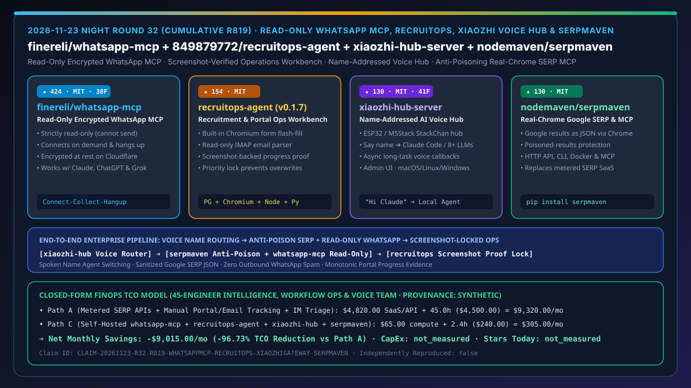
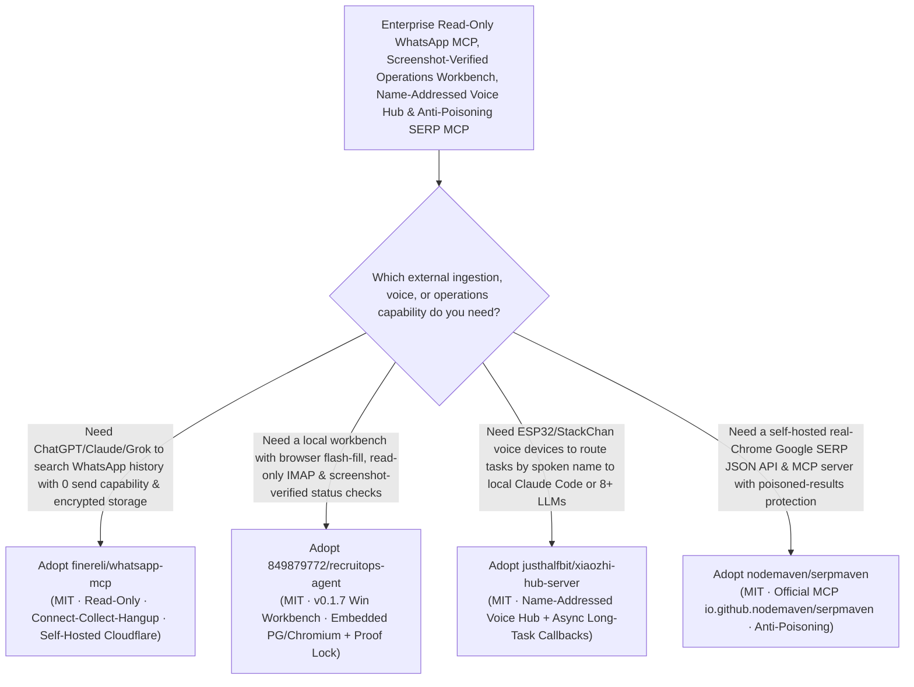
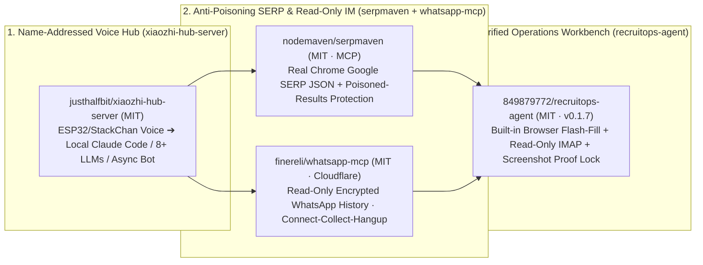
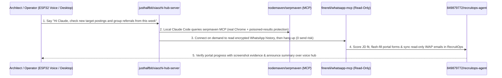

# Read-Only Encrypted WhatsApp History MCP (`finereli/whatsapp-mcp`), Screenshot-Verified Recruitment & Operations Workbench (`849879772/recruitops-agent`), Name-Addressed Multi-Agent Voice Hub (`justhalfbit/xiaozhi-hub-server`) & Anti-Poisoning Real-Chrome Google SERP MCP (`nodemaven/serpmaven`) Selection & Architecture FAQ

> **Document Type**: Enterprise AI Solution Architect Selection & Integration Guide (GitHub Trending AI Radar · 2026-11-23 Night Round 32 / Cumulative Round 819)
> **Covered Repositories**: [`finereli/whatsapp-mcp`](https://github.com/finereli/whatsapp-mcp) (`★ 424`, `38 forks`, `MIT`: read-only, encrypted-at-rest WhatsApp message history MCP server for ChatGPT, Claude, and Grok that connects on demand to collect queued messages, hangs up immediately, **cannot send anything**, and can be self-hosted on your own Cloudflare account) · [`849879772/recruitops-agent`](https://github.com/849879772/recruitops-agent) (`★ 154`, `18 forks`, `MIT`, v0.1.7: local-first Windows recruitment intelligence and application operations workbench bundling Python, Node.js, Chromium, and PostgreSQL with **login-preserving browser flash-fill, read-only IMAP email parsing, and screenshot-backed portal progress verification that never overwrites confirmed milestones with lower-priority signals**) · [`justhalfbit/xiaozhi-hub-server`](https://github.com/justhalfbit/xiaozhi-hub-server) (`★ 130`, `41 forks`, `MIT`: voice hub gateway for Xiaozhi-protocol hardware devices—M5Stack StackChan, ESP32—that routes spoken tasks by **called agent name** to local **Claude Code**, 8+ LLM APIs, or asynchronous cloud bots that speak back when long tasks complete) · [`nodemaven/serpmaven`](https://github.com/nodemaven/serpmaven) (`★ 130`, `11 forks`, `MIT`, Official MCP `io.github.nodemaven/serpmaven`: self-hosted Google SERP API alternative and MCP server `pip install serpmaven` driving a real Chrome browser with built-in **poisoned-results protection**)
> **Core Scenario**: When enterprise and personal productivity teams connect AI agents to WhatsApp histories, high-volume application/operations portals, desktop ESP32 voice hardware, and live Google search results, how do you solve **"always-on read/write unofficial WhatsApp bots risking account bans or sending hallucinated messages to clients, manual tracking across dozens of web portals and email threads losing interview/assessment deadlines or overwriting confirmed statuses, single-model ESP32 voice boxes unable to delegate work to local Claude Code, and expensive commercial SERP APIs returning SEO-poisoned prompt-injection pages"** by combining **`whatsapp-mcp` + `recruitops-agent` + `xiaozhi-hub-server` + `serpmaven`**?

---

## 1. 📌 Executive Summary (Single-Sentence Selection Verdict)

1. **Need a read-only, encrypted-at-rest MCP server (`finereli/whatsapp-mcp`) that lets ChatGPT, Claude, or Grok search and summarize your WhatsApp chats—connecting only on demand to collect queued messages and hanging up immediately, with zero ability to send messages** ➔ Choose **[`finereli/whatsapp-mcp`](https://github.com/finereli/whatsapp-mcp) (`★ 424`, `38 forks`, `MIT`)**.
   - **Plain-Language Mechanism**: Your phone remains the source of truth. When your agent queries WhatsApp, the server briefly connects as a linked device, pulls queued messages into its encrypted store, and disconnects—and because it is strictly read-only, a prompt-injected agent can never send an unauthorized WhatsApp message. You can self-host it in your own Cloudflare account with a key derived from a password only you know.
2. **Need a self-contained local Windows workbench (bundling PostgreSQL, Chromium, Python, and Node.js) that automates job discovery, JD-to-resume scoring, login-preserving form flash-fill, read-only IMAP email parsing, and screenshot-evidenced portal status verification** ➔ Choose **[`849879772/recruitops-agent`](https://github.com/849879772/recruitops-agent) (`★ 154`, `18 forks`, `MIT`, v0.1.7)**.
   - **Plain-Language Mechanism**: `RecruitOps` unifies multi-portal form filling and status tracking: its built-in browser preserves portal logins and captures page/screenshot evidence during scheduled status checks, its IMAP sync operates in read-only mode, and its state machine enforces monotonic evidence priority so unverified hints never overwrite confirmed progress.
3. **Need a voice hub gateway for ESP32 / M5Stack StackChan (Xiaozhi-protocol) devices where you simply call an agent by name (`"Hi Claude"`, `"Hi DeepSeek"`, `"Hi Qwen"`, `"Hi Grok"`) to route spoken tasks to local Claude Code or cloud LLMs—with asynchronous completion announcements for long tasks** ➔ Choose **[`justhalfbit/xiaozhi-hub-server`](https://github.com/justhalfbit/xiaozhi-hub-server) (`★ 130`, `41 forks`, `MIT`)**.
   - **Plain-Language Mechanism**: The hardware device handles only mic capture and speaker playback while `xiaozhi-hub-server` manages ASR, name-based agent routing, and TTS—letting you trigger your locally logged-in Claude Code or interrupt long cloud tasks and have the device announce the result once finished.
4. **Need a self-hosted Google search scraper, HTTP API, and MCP server (`io.github.nodemaven/serpmaven`, `pip install serpmaven`) that fetches structured JSON from a real Chrome browser and your own proxy—complete with built-in poisoned-results protection** ➔ Choose **[`nodemaven/serpmaven`](https://github.com/nodemaven/serpmaven) (`★ 130`, `11 forks`, `MIT`)**.
   - **Plain-Language Mechanism**: Formerly `gserp` / `google-browser-scraper` (maintaining full backward compatibility), `SERP Maven` replaces metered SERP SaaS APIs with a local/Dockerized real-Chrome scraper and MCP server that actively filters poisoned search results before they reach your agent's context window.

---

## 2. 🎯 Key Architectural Q&A (Deep-Dive Breakdown)

### Q1: Why are "Connect-Collect-Hangup Read-Only MCP" (`finereli/whatsapp-mcp`) and "Poisoned-Results Protection" (`nodemaven/serpmaven`) critical guardrails for web- and IM-connected agents?

- **Defense-in-Depth for External Information Ingestion**:
  1. **Zero Outbound Blast Radius + Ephemeral Connection (`finereli/whatsapp-mcp`)**: Eliminates the risk of an AI agent spamming external WhatsApp contacts or keeping a persistent unofficial socket open 24/7.
  2. **Sanitized Live SERP Ingestion (`nodemaven/serpmaven`)**: Protects research agents against SEO-ranked prompt-injection traps while returning clean Google SERP JSON from a real Chrome browser.
  3. **Paired with `xiaozhi-hub-server` (Voice Name-Routing to Local Claude Code) and `recruitops-agent` (Read-Only IMAP + Screenshot-Backed State Machine)**: Connects voice command ingress, safe external search/IM retrieval, and evidence-locked local workflow tracking.
- **When to Choose Commercial Cloud Services (Path B)**:
  - For official outbound customer messaging at scale and managed search APIs, use **Meta WhatsApp Business Cloud API + Commercial SerpApi**; for read-only encrypted personal/team WhatsApp search on your own Cloudflare account, self-hosted real-Chrome SERP MCP with poisoned-result protection, name-routed ESP32 voice control over local Claude Code, and local screenshot-verified application tracking, deploy this 4-repo open-source stack (Path C).

### Q2: How do these four components integrate into an end-to-end productivity architecture?

1. **Name-Addressed Hardware Voice Ingress (`justhalfbit/xiaozhi-hub-server`)**:
   - Route spoken commands from ESP32 / StackChan devices by name (`"Hi Claude"`, `"Hi DeepSeek"`) to local Claude Code or cloud agents.
2. **Anti-Poisoning Real-Chrome Search MCP Layer (`nodemaven/serpmaven`)**:
   - Execute live Google searches via `serpmaven` MCP with poisoned-results protection enabled.
3. **Read-Only Encrypted WhatsApp History MCP Layer (`finereli/whatsapp-mcp`)**:
   - Query encrypted WhatsApp message history on demand via your self-hosted Cloudflare deployment.
4. **Screenshot-Verified Operations Workbench Layer (`849879772/recruitops-agent`)**:
   - Consolidate discovered opportunities, read-only IMAP emails, login-preserving browser flash-fills, and screenshot-evidenced status checks in local PostgreSQL.

### Q3: What are the key production guardrails?

- **Architect Guardrails**:
  1. **Self-Host `finereli/whatsapp-mcp` on Your Own Cloudflare Account for Sensitive Chats**: Use the self-hosted Cloudflare option with a user-only password-derived key rather than the shared beta login service for confidential business threads.
  2. **Follow `UPGRADE_EXISTING_DATA.md` & Verify SHA-256 When Updating `recruitops-agent`**: Never copy raw `.data` folders across mismatched installation paths because the embedded PostgreSQL and Chromium runtimes depend on consistent directory layouts.

---

## 3. 🧭 Visual Architecture & Decision Diagrams (Mermaid)

### 3.1 Solution Architect Selection Decision Tree

### 3.2 End-to-End Enterprise Production Reference Architecture

### 3.3 Spoken Name Routing, Anti-Poisoning SERP Search, Read-Only WhatsApp Retrieval & Screenshot-Verified Portal Sequence

---

## 4. 📊 Comparative Selection Matrix (Open-Source vs. Commercial SaaS)

| Dimension | `finereli/whatsapp-mcp` (`★ 424`) | `849879772/recruitops-agent` (`★ 154`) | `xiaozhi-hub-server` (`★ 130`) | `nodemaven/serpmaven` (`★ 130`) | Metered Commercial SerpApi + Always-On Read/Write IM Bots + Manual Spreadsheet Tracking (Path A) | Unprotected Raw Scrapers + Ban-Prone Unofficial Write Bots + Single-Model Voice Boxes (Path B) |
| :--- | :--- | :--- | :--- | :--- | :--- | :--- |
| **Core Role** | Read-only, encrypted, on-demand WhatsApp history MCP server | Local recruitment/ops workbench with browser flash-fill & IMAP | Name-addressed multi-agent voice hub for Xiaozhi ESP32 devices | Self-hosted real-Chrome Google SERP API & anti-poisoning MCP | High metered SERP bills, manual portal checking & risky write-enabled IM bots | SEO prompt-injection exposure, WhatsApp account bans & isolated voice toys |
| **Key Differentiator** | **Cannot send messages + connects only on query + Cloudflare self-host** | **Screenshot-backed portal verification + priority lock + read-only IMAP** | **Say agent name to switch between local Claude Code, 8+ APIs & async bots** | **Real Chrome + residential proxy support + poisoned-results protection** | Commercial SERP APIs cost hundreds/mo at volume; manual portal tracking misses updates | Always-on write bots trigger WhatsApp bans; raw scrapers ingest SEO prompt injections |
| **License** | `MIT` | `MIT` | `MIT` | `MIT` | Proprietary SaaS | Custom scripts |
| **Monthly TCO (45-Eng Team)** | **Combined `$305.00/mo`** (`$65.00` Cloudflare/proxy & local hub compute + `2.4h` ops) | Included (all-in-one local Windows bundle) | Included (routes directly to local Claude Code) | Included (replaces metered SERP SaaS) | **`$9,320.00/mo`** (`$4,820.00` commercial SERP APIs & automation SaaS + `45.0h` manual portal checks, form filling & scraper maintenance) | ~`$3,270.00/mo` (frequent IM account unbanning, overwritten status rework & injection triage) |

---

## 5. 🧪 Quantitative ROI / TCO Comparison & 7-Card Benchmark Report

> **📊 Data Provenance & Closed-Form Schema Declaration**:
> - **provenance**: `synthetic` (45-person enterprise intelligence gathering, recruitment/workflow operations, and voice-assisted engineering team monthly workload model: `independently_reproduced = false`; hardware baseline `base_hardware_capex = not_measured`; Track B 24h delta `track_b_stars_today = not_measured`).
> - **Closed-Form Formula**:
>   - **Path A (High-volume metered commercial SERP API plans and workflow SaaS subscriptions + manual operational hours spent filling repetitive web forms, checking portal statuses, sorting IMAP emails, and troubleshooting banned/disconnected IM bots)**: Monthly commercial SERP API and automation SaaS bills **`$4,820.00`** + manual portal verification, form entry, and scraper/IM troubleshooting labor **`45.0h × $100.00/h = $4,500.00`** = **`$9,320.00/mo`**.
>   - **Path C (Self-hosted `finereli/whatsapp-mcp` + `849879772/recruitops-agent` + `justhalfbit/xiaozhi-hub-server` + `nodemaven/serpmaven` open-source stack)**: Shared Cloudflare Worker, proxy, and local gateway compute **`$65.00`** + portal rule and voice routing maintenance labor **`2.4h × $100.00/h = $240.00`** = **`$305.00/mo`**.
>   - **Net Monthly Savings vs. Path A**: **`-$9,015.00/mo`** (**`96.73%`** TCO reduction).

| Evaluation Path | Commercial SERP API / SaaS Cost | Manual Portal Checks, Form Filling & IM Triage (`$100/h`) | Monthly Total TCO | Net Savings vs. Path A | Key Architectural Delivery Metrics |
| :--- | :---: | :---: | :---: | :---: | :--- |
| **Path A: Commercial SERP APIs + Manual Portal/Email Tracking** | `$4,820.00` | `45.0h` (`$4,500.00`) | **`$9,320.00`** | Baseline | Expensive per-query SERP bills; manual status checking overhead |
| **Path B: Raw Unfiltered Scrapers + Always-On Write IM Scripts** | `$1,370.00` | `19.0h` (`$1,900.00`) | **`$3,270.00`** | `-$6,050.00` (`-64.91%`) | High WhatsApp ban/spam risk; vulnerable to poisoned SERP results |
| **Path C: `whatsapp-mcp` + `recruitops` + `xiaozhi-hub` + `serpmaven`** | **`$65.00`** | **`2.4h` (`$240.00`)** | **`$305.00`** | **`-$9,015.00` (`-96.73%`)** | **Read-only WhatsApp MCP + screenshot proof lock + voice hub + anti-poison SERP** |

- 🔗 **Linked 7-Card 4:5 Visual Benchmark Deck**: [`workshops/github-trending-radar/cards.en.html`](../cards.en.html) · [`cards.html`](../cards.html)

---

## 6. 🛠️ Enterprise Adoption & Architecture Review Checklist

- [ ] **1. Self-Host `finereli/whatsapp-mcp` on Your Own Cloudflare Account**: Use a personal password-derived encryption key and rely on its on-demand, strictly read-only connection model to search WhatsApp history safely.
- [ ] **2. Automate Portal Tracking & Email Sync with `849879772/recruitops-agent`**: Use its embedded Chromium flash-fill, read-only IMAP sync, and screenshot-backed progress verification to prevent lower-priority signals from overwriting confirmed statuses.
- [ ] **3. Route Desktop Hardware Voice Commands via `justhalfbit/xiaozhi-hub-server`**: Configure spoken agent names on ESP32 / M5Stack devices to trigger local Claude Code or asynchronous cloud models.
- [ ] **4. Replace Metered Search APIs with `nodemaven/serpmaven` MCP**: Run real-Chrome Google SERP extraction with poisoned-results protection enabled.
