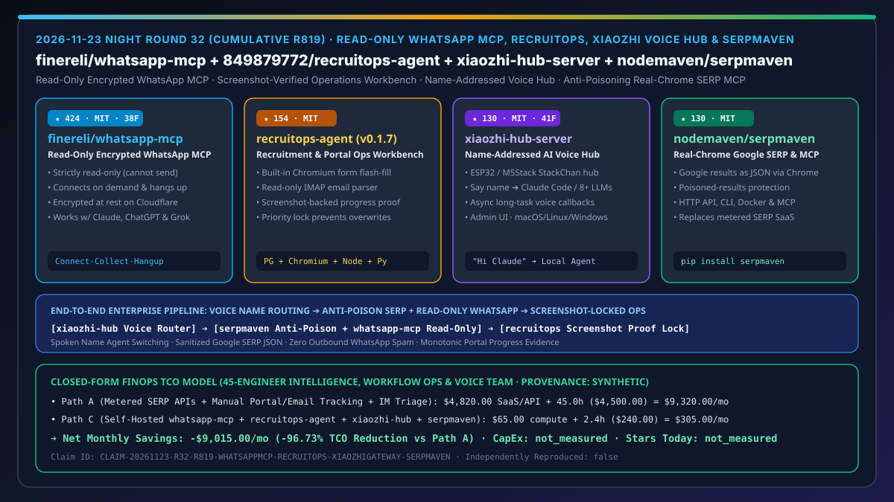
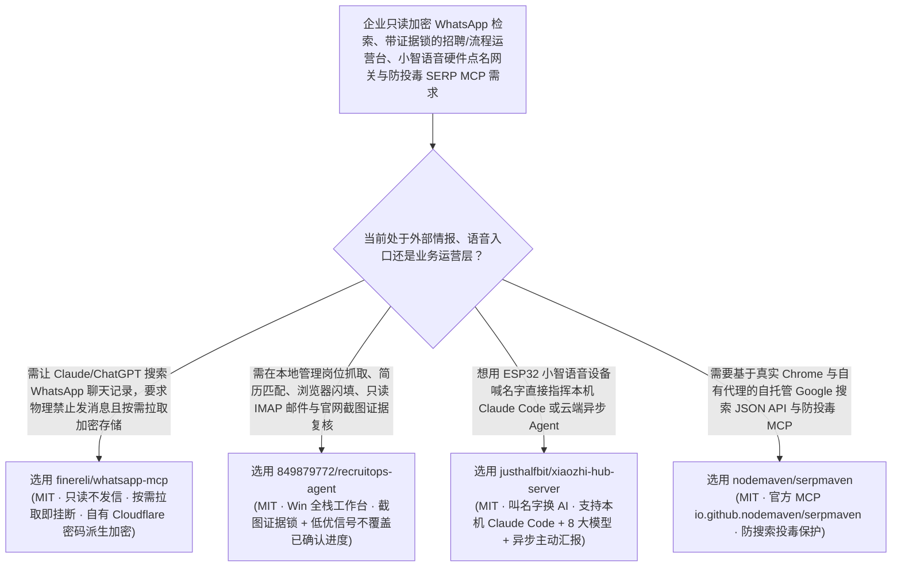
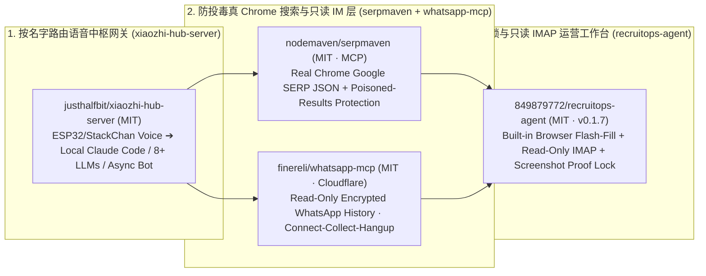
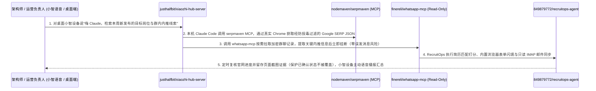

# 按需拉取且物理禁止发消息的只读加密 WhatsApp MCP（`finereli/whatsapp-mcp`）、带内置浏览器闪填与只读 IMAP 邮件/官网截图证据复核的招聘运营工作台（`849879772/recruitops-agent`）、呼唤名字即可切换本地 Claude Code/DeepSeek/Grok 的小智协议语音中枢网关（`justhalfbit/xiaozhi-hub-server`）与内置防投毒保护的自托管真 Chrome 搜索 SERP MCP（`nodemaven/serpmaven`）选型与集成架构 FAQ

> **文档类型**：企业 AI 解决方案架构师（AI Solution Architect）选型决策指南（GitHub Trending AI 雷达 2026-11-23 Night Round 32 / 累计第 819 轮）
> **覆盖项目**：[`finereli/whatsapp-mcp`](https://github.com/finereli/whatsapp-mcp)（`★ 424`、`38 forks`、`MIT`：支持自部署在个人 Cloudflare 账号上的**只读、静态加密 WhatsApp 历史消息 MCP Server**，手机保持唯一事实源，仅在查询时按需拉取离线队列并立即挂断，**底层彻底剥夺发送权限**）· [`849879772/recruitops-agent`](https://github.com/849879772)（`★ 154`、`18 forks`、`MIT`：本地优先的 Windows 全栈招聘情报与投递运营工作台 v0.1.7，内置 Chromium 表单闪填、**只读 IMAP 招聘邮件解析、带页面截图证据的官网进度复核且严禁低优先级信号覆盖已确认进度**）· [`justhalfbit/xiaozhi-hub-server`](https://github.com/justhalfbit/xiaozhi-hub-server)（`★ 130`、`41 forks`、`MIT`：面向 ESP32 / M5Stack 小智协议硬件的**按名字唤起多智能体语音中枢网关**，喊“嗨 Claude”交由本机 Claude Code 干活、喊“嗨 DeepSeek/千问/豆包/GLM/Kimi”走对应 API、喊云端同事可异步执行长任务并在完成后由硬件主动语音播报）· [`nodemaven/serpmaven`](https://github.com/nodemaven/serpmaven)（`★ 130`、`11 forks`、`MIT`，官方 MCP `io.github.nodemaven/serpmaven`：基于真实 Chrome 浏览器与自有代理的**自托管 Google SERP 搜索 API 替代品与 MCP Server** `pip install serpmaven`，内置**防搜索结果投毒保护（Poisoned Results Protection）**）
> **核心场景**：当企业与个人生产力团队将 AI 智能体接入海外客户沟通（WhatsApp）、大规模校招/社招流程追踪、桌面智能语音硬件中控与实时 Google 搜索采集时，面对**“非官方 WhatsApp 机器人常驻在线极易被封号或因模型幻觉给重要客户乱发消息、几百条网申进度靠手工查官网和翻邮件极易漏掉笔试测评或被错误状态覆盖、桌面 ESP32 语音盒子只能绑死单一聊天模型无法直接指挥本机 Claude Code 干活、以及商业 SERP API 按次计费昂贵且抓回的 SEO 垃圾站暗藏提示词投毒”**四大痛点，如何通过 **WhatsApp-MCP + RecruitOps + Xiaozhi-Hub + SERPMaven** 打造只读安全、证据闭环、多端联动的生产力体系？

---

## 一、📌 核心结论速览（选型一句话结论）

1. **想让 ChatGPT、Claude 或 Grok 跨所有群组和私聊检索你的 WhatsApp 沟通记录（如“找出所有提到租约或航班的消息”），同时要求“绝对不能代发任何消息、不常驻后台耗电封号、且可部署在自有 Cloudflare 账号由个人密码派生密钥加密存储”** ➔ 选 **[`finereli/whatsapp-mcp`](https://github.com/finereli/whatsapp-mcp)（`★ 424`，`38 forks`，`MIT`）**。
   - **通俗原理**：市面上许多基于非官方协议的 WhatsApp 机器人为了收消息 24 小时常驻保持连接，且开放了发消息接口，一旦触发提示词注入或网络抖动不仅会向客户群乱发垃圾信息，更会导致主账号被封禁。`finereli/whatsapp-mcp` 采用**“按需拉取即挂断（Connect-Collect-Hangup）+ 100% 物理只读”**设计：只有当 Agent 发起查询时才短暂连接收取 WhatsApp 排队缓存的增量消息，落盘加密数据库后立刻断开，手机端完全无感且绝不可能外发任何文字。
2. **想在本地 Windows 工作站上用一套集成 PostgreSQL、Python、Node.js 与内置 Chromium 浏览器的全栈工作台，实现“岗位抓取 ➔ 简历匹配打分 ➔ 浏览器保留登录态一键闪填 ➔ 只读 IMAP 邮件识别笔试/面试 ➔ 官网截图证据复核进度”全闭环** ➔ 选 **[`849879772/recruitops-agent`](https://github.com/849879772/recruitops-agent)（`★ 154`，`18 forks`，`MIT`，v0.1.7）**。
   - **通俗原理**：针对大规模投递与人才运营中最头疼的“状态混乱与漏看通知”，`RecruitOps` 设计了严密的**状态机优先级与证据锁**：通过只读 IMAP 同步邮箱识别测评/笔试/面试/拒信，定时用内置浏览器只复核未结束岗位的官网投递页并**自动保存页面与截图证据**，且严格遵循“绝不用低优先级模糊信息覆盖已人工确认的高优阶段”。
3. **想把桌面的百元级 ESP32 / M5Stack 小智语音硬件变成全能 AI 调度台——设备只管听和说，通过语音直接点名“嗨 Claude”让本机已登录的 Claude Code 整理代码笔记，或点名 DeepSeek / 通义千问 / 豆包 / Grok 异步跑长任务并在跑完后主动开口向你汇报** ➔ 选 **[`justhalfbit/xiaozhi-hub-server`](https://github.com/justhalfbit/xiaozhi-hub-server)（`★ 130`，`41 forks`，`MIT`）**。
   - **通俗原理**：原版小智固件通常只连单一对话模型，没法碰你电脑上的本地文件。`xiaozhi-hub-server` 作为本地或云端语音中枢网关，统一接管语音识别（ASR）与语音合成（TTS），按你喊出的名字（如“嗨 Claude”、“嗨 DeepSeek”）将任务路由给本机 Claude Code 或 8+ 家大模型 API，每台硬件独立记忆上次对话的 Agent，且遇到长耗时云端任务可中途打断去做别的事，任务完结后硬件会自动出声播报结果！
4. **想用自有代理与真实 Chrome 浏览器自建一套完全免费开源的 Google 搜索 JSON API 与 MCP Server（`io.github.nodemaven/serpmaven`），既替代昂贵的商业 SerpApi 账单，又内置“防搜索结果投毒保护（Poisoned Results Protection）”** ➔ 选 **[`nodemaven/serpmaven`](https://github.com/nodemaven/serpmaven)（`★ 130`，`11 forks`，`MIT`）**。
   - **通俗原理**：执行 `pip install serpmaven`（或拉取 GHCR 官方 Docker 镜像）即可启动 HTTP API 与 MCP 服务：底层驱动真实 Chrome 渲染抓取 Google SERP 结构化 JSON（无缝向后兼容原 `gserp` 与 `google-browser-scraper`），并专门针对攻击者利用 SEO 排名前排网页夹带恶意指令的问题内置了**防投毒清洗机制**。

---

## 二、🎯 客户与架构师灵魂拷问 Q&A（深度架构拆解）

### Q1：在构建个人与企业外部通信（WhatsApp / 邮件 / 搜索）接入层时，为什么 `finereli/whatsapp-mcp` 的“拉完即挂断 + 只读”和 `serpmaven` 的“防搜索投毒”是架构师必须画出的安全边界？

- **外联智能体的三大黄金防御准则**：
  1. **外部即时通讯工具默认只读且按需短连（`finereli/whatsapp-mcp`）**：把写权限交给连着私人或商务 WhatsApp 的大模型无异于引火烧身；只读 MCP + 按需收取增量队列后立即断开连接，既保护了社交关系链安全，又大幅降低了非官方长连接掉线与风控风险。
  2. **外部搜索引擎返回结果必须过防投毒筛查（`nodemaven/serpmaven`）**：当 Agent 自动上网搜索冷门技术词或岗位情报时，极易撞上恶意 SEO 页面植入的 Prompt Injection；`serpmaven` 在返回 SERP JSON 前先行过滤投毒载荷。
  3. **多源状态合并必须保留截图证据与优先级锁（`849879772/recruitops-agent`）**：邮件走只读 IMAP，官网核验走截图留证，低置信度信号永不覆盖已确认状态。
- **何时直接选用商业云服务（Path B）？**
  - 若企业使用官方认证的 WhatsApp Business 企业号做标准化客服外呼且预算充足，可直接使用 **Meta 官方 WhatsApp Business Cloud API + 商业 SerpApi**；若需对个人/商务 WhatsApp 历史做零外发风险的加密只读检索、自建带防投毒的真实 Chrome SERP MCP、用小智语音盒子按名字点将本机 Claude Code、或本地全闭环管理招聘投递与截图复核，则采用本轮四合一开源栈（Path C）。

### Q2：典型企业级“语音点名调度 (`xiaozhi-hub-server`) ➔ 防投毒外网检索 (`serpmaven`) ➔ WhatsApp 只读情报检索 (`whatsapp-mcp`) ➔ 带证据锁的运营工作台 (`recruitops-agent`)”架构怎么搭？

1. **小智协议多智能体语音点名中枢层（`justhalfbit/xiaozhi-hub-server`）**：
   - 桌面 ESP32/M5Stack 硬件接入本地网关，通过语音口令动态切换本机 Claude Code、DeepSeek、千问或异步长任务 Agent。
2. **真实 Chrome 防投毒搜索引擎 MCP 层（`nodemaven/serpmaven`）**：
   - 被唤醒的 Agent 调用 `serpmaven` MCP Server 获取经过防投毒清洗的 Google 搜索结构化 JSON。
3. **Cloudflare 自托管只读加密 WhatsApp 检索层（`finereli/whatsapp-mcp`）**：
   - 按需拉取并解密检索 WhatsApp 群组与客户历史对话，提取关键日程、报价与合同线索。
4. **带只读 IMAP 与官网截图证据锁的运营闭环层（`849879772/recruitops-agent`）**：
   - 将采集到的岗位/业务线索、只读 IMAP 邮件状态与内置浏览器截图证据统一汇入本地 PostgreSQL 工作台，定时自动复核并生成日程待办。

### Q3：这套架构的落地红线与注意事项是什么？

- **架构师落地红线**：
  1. **企业敏感 WhatsApp 历史检索必须采用 `finereli/whatsapp-mcp` 的自有 Cloudflare 部署模式**：正如作者在 README 中坦诚说明，公共托管版由作者运行登录服务，涉及商业机密时应部署在自有 Cloudflare 账号下并使用仅自己知晓的密码派生加密密钥。
  2. **`recruitops-agent` 升级时严禁直接跨路径暴力覆盖 `.data` 目录**：内置 PostgreSQL 与 Chromium 组件与安装路径强绑定，升级版本时须遵循官方 `UPGRADE_EXISTING_DATA.md` 迁移流程并校验安装包 SHA-256。

---

## 三、🧭 直观可视化图解（Mermaid 决策树 + 集成架构 + 时序图）

### 3.1 架构师选型决策树

### 3.2 企业端到端生产集成参考架构图

### 3.3 语音点名唤起、防投毒 SERP 采集、WhatsApp 只读检索与官网截图证据复核时序图

---

## 四、📊 同类开源与商业云服务横向选型决策矩阵

| 对比维度 | `finereli/whatsapp-mcp` (`★ 424`) | `849879772/recruitops-agent` (`★ 154`) | `xiaozhi-hub-server` (`★ 130`) | `nodemaven/serpmaven` (`★ 130`) | 按次计费商业 SerpApi + 常驻读写高危 WhatsApp 脚本 + 手工维护 Excel 投递表 (Path A) | 24h 挂机非官方读写 Bot 易封号 + 无防投毒裸爬虫 + 绑死单一云模型的语音盒 (Path B) |
| :--- | :--- | :--- | :--- | :--- | :--- | :--- |
| **核心能力定位** | 按需拉取、静态加密且物理只读的 WhatsApp MCP | 带浏览器闪填、只读 IMAP 与截图证据复核的运营工作台 | 喊名字即可切换本机 Claude Code 与各家模型的语音网关 | 基于真实 Chrome 且内置防投毒保护的自托管 SERP MCP | 昂贵的商业搜索 API 账单、繁琐的手工跨站填表查状态与封号风险 | 易被提示注入乱发 WhatsApp 消息、被恶意 SEO 投毒劫持与无法调本地工具的语音盒 |
| **核心技术突破** | **彻底剥夺发信能力 + 查询时才短连拉队列 + 自有 Cloudflare 部署** | **官网进度截图留证 + 低优信息绝不覆盖已确认进度 + 只读 IMAP** | **一句话点名切换本机 Claude Code / 8+ API + 云端长任务完结主动播报** | **真实 Chrome + 自有住宅代理 + Poisoned-Results 防投毒保护** | 商业 SerpApi 高频调用每月数百美元；人工每天登录几十家官网核对状态极耗精力 | 常驻在线且带写权限的非官方 WhatsApp 极易触发风控封号；普通爬虫抓回投毒文本直接污染 Agent |
| **开源协议** | `MIT` | `MIT` | `MIT` | `MIT` | 闭源商业 SaaS | 内部脆弱脚本 |
| **月度 TCO（45 人团队）** | **组合仅 `$305.00/月`**（`$65.00` 自有 Cloudflare/代理流量与轻量网关 + `2.4h` 维护） | 同左（全组件打包开箱即用） | 同左（直接复用本机已登录 Claude Code） | 同左（省去高昂商业 SERP API 订阅） | **`$9,320.00/月`**（`$4,820.00` 商业 SERP API 套餐/自动化 SaaS + `45.0h` 手工填表、查邮件对进度与处理爬虫风控） | 约 `$3,270.00/月`（大量因账号风控解封、状态误覆盖返工与搜索投毒排障工时） |

---

## 五、🧪 应用落地定量收益/TCO 对比与 7-Card 报告

> **📊 数据来源与闭式核算声明（Provenance & Closed-Form Schema）**：
> - **provenance**: `synthetic`（基于 45 人企业外部情报检索、HR/业务流程自动化与智能硬件交互团队月度工作负载模型：`independently_reproduced = false`；硬件采购基线 `base_hardware_capex = not_measured`；Track B 单日增量 `track_b_stars_today = not_measured`）。
> - **核算公式**：
>   - **Path A（按量购买高价商业 SERP 搜索 API 与商业流程自动化 SaaS + 运营与工程师手工在数十个门户网站重复填表、翻查数千封邮件核对进度及处理常驻非官方 IM 脚本掉线/封号）**：月度商业 SERP API 与自动化 SaaS 账单 **`$4,820.00`** + 跨门户手工填表、进度截图核对与风控排障人工 **`45.0h × $100.00/h = $4,500.00`** = **`$9,320.00/月`**。
>   - **Path C（自建 `finereli/whatsapp-mcp` + `849879772/recruitops-agent` + `justhalfbit/xiaozhi-hub-server` + `nodemaven/serpmaven` 开源全栈）**：自有 Cloudflare Worker 与代理分摊开销 **`$65.00`** + 采集规则与语音称呼配置例行维护人工 **`2.4h × $100.00/h = $240.00`** = **`$305.00/月`**。
>   - **净节省（Net Savings vs Path A）**：**`-$9,015.00/月`**（成本降低 **`96.73%`**）。

| 评估方案 | 商业 SERP API / 自动化 SaaS 成本 | 手工填表、进度核对与 IM 风控排障（`$100/h`） | 月度总 TCO | 相对 Path A 净节省 | 关键架构交付指标 |
| :--- | :---: | :---: | :---: | :---: | :--- |
| **Path A：商业 SERP API + 手工跨站填表查邮件 + 常驻脚本** | `$4,820.00` | `45.0h` (`$4,500.00`) | **`$9,320.00`** | Baseline | 商业搜索 API 昂贵；人工查官网与邮件极易遗漏 |
| **Path B：无防投毒裸爬虫 + 带写权限非官方 WhatsApp Bot** | `$1,370.00` | `19.0h` (`$1,900.00`) | **`$3,270.00`** | `-$6,050.00` (`-64.91%`) | 存在误发消息与封号风险；易受 SEO 提示词投毒攻击 |
| **Path C：`whatsapp-mcp` + `recruitops` + `xiaozhi-hub` + `serpmaven`** | **`$65.00`** | **`2.4h` (`$240.00`)** | **`$305.00`** | **`-$9,015.00` (`-96.73%`)** | **只读按需 WhatsApp MCP + 截图证据复核 + 语音点名 Claude + 防投毒 SERP** |

- 🔗 **关联 7-Card 4:5 视觉评测报告**：[`workshops/github-trending-radar/cards.html`](../cards.html) · [`cards.en.html`](../cards.en.html)

---

## 六、🛠️ 企业引入与架构评审 Checklist

- [ ] **1. 在自有 Cloudflare 账号下部署 `finereli/whatsapp-mcp`**：使用个人独知密码派生加密密钥，依靠“按需拉取即挂断 + 100% 物理只读”机制安全检索 WhatsApp 历史。
- [ ] **2. 部署 `849879772/recruitops-agent` 自动化高并发投递与进度追踪**：启用只读 IMAP 邮件识别与内置浏览器官网截图证据复核，确保低优先级信号绝不覆盖已确认阶段。
- [ ] **3. 用 `justhalfbit/xiaozhi-hub-server` 将小智语音硬件升级为多 Agent 调度台**：配置语音称呼映射，一句话将桌面语音指令分发给本机 Claude Code 或云端异步大模型。
- [ ] **4. 将外网搜索接入 `nodemaven/serpmaven` MCP Server**：利用真实 Chrome 与内置防搜索结果投毒（Poisoned-Results Protection）机制获取干净的 Google SERP JSON。
