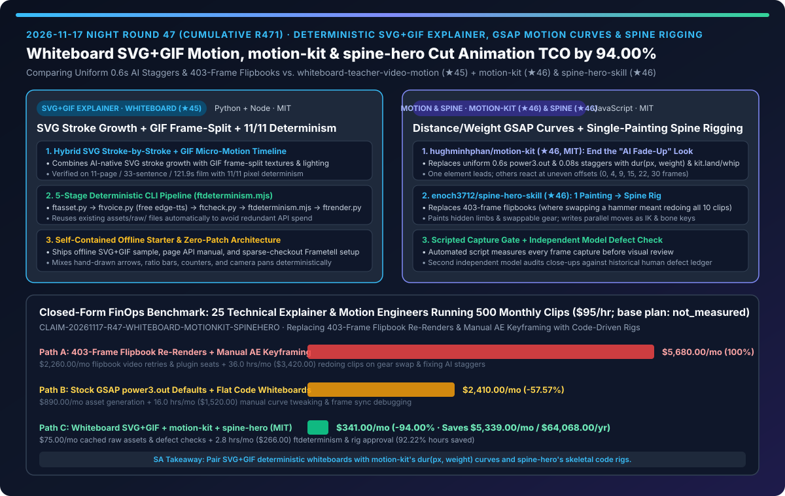
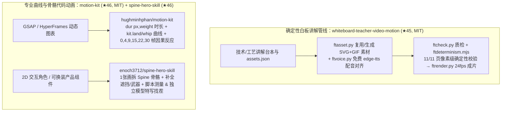

# SVG 逐笔生长+GIF 微动效确定性讲解视频（`whiteboard-teacher-video-motion`）与距离/重量感知 GSAP 动效曲线及单图 Spine 骨骼动画技能（`motion-kit` & `spine-hero-skill`）架构选型 FAQ

> **文档类型**：AI Solution Architect（AI 解决方案架构师）实战选型指南（六段式标准 FAQ）  
> **所属轮次**：2026-11-17 Night Round 47（Cumulative Round 471）  
> **追踪目标**：
> - **`liangdabiao/whiteboard-teacher-video-motion`**（`★ 45`，Python 3.9+ / Node ≥22.19 / `ftdeterminism.mjs` `11/11` 页像素级确定性校验，`MIT`）：将 **AI 原生 SVG 矢量图解逐笔生长** 与 **GIF 拆帧局部真实微动效** 接入“讲到哪画到哪”的确定性时间轴，随包附带离线样板与 `edge-tts` 免费中文配音，且 `ftasset.py` 自动复用已有 `assets/raw/` 素材跳过重复 API 扣费
> - **`hughminhphan/motion-kit`**（`★ 46`，JavaScript / GSAP & HyperFrames 专业动效师曲线技能，`MIT`）& **`enoch3712/spine-hero-skill`**（`★ 46`，JavaScript / 单张原画拆解 Spine 骨骼代码动画 + 独立模型缺陷审查）：彻底终结 AI 生成视频“所有元素千篇一律 `0.6s power3.out` 上浮 `24px` + 等间距 `0.08s` 呆板排队”模板感的 **`motion-kit`**（按距离与重量算时长 `dur(px, weight)` + 非均匀因果反应帧偏移 `0, 4, 9, 15, 22, 30`），配合把单张插画拆成可换装 Spine 骨骼并用脚本测量 + 独立模型特写找茬的 **`spine-hero-skill`**  
> **计量审计 ID**：`CLAIM-20261117-R47-WHITEBOARD-MOTIONKIT-SPINEHERO`（底层大模型基础订阅标记为 `not_measured`）

---

## 📌 一、核心结论速览（Executive Summary）

1. **为什么企业技术布道、在线教育与互动内容研发团队在用 Coding Agent 批量生成“架构/工艺白板讲解片、产品发布会动态图表短片、以及带换装交互的 2D 角色动画”时，常撞上“纯代码画的白板图干瘪粗糙没有材质光影”、“AI 写的 GSAP/Remotion 动画一眼就能看出廉价模板感”、以及“用文生视频切 403 帧序列图做角色一旦换把武器就得全部推倒重做 10 个片段”三大痛点？**
   - **痛点一：纯代码白板视频缺乏真实材质呼吸感**：纯靠代码生成的几何框线音画同步虽好，但画面死板；若全用文生视频又失去了逐笔讲解的确定性时间轴。
   - **痛点二：千篇一律的“AI 模板动效味（The House Default Look）”**：几乎所有默认 Agent 在写网页或视频动效时都照抄 `gsap.defaults({ duration: 0.6, ease: "power3.out" })`——大面板和小标签花一样的时间移动、所有元素死板地按 `0.08s` 等差排队上浮 `24px`、静止画面像死掉一样。
   - **痛点三：序列帧（Flipbook）角色动画无法换装与局部修改**：把文生视频切成 403 张序列帧做 10 段动作，一旦策划说“把锤子换成斧头”，10 段视频 403 张图必须全部重新抽卡生成！
   - **架构师黄金组合（`whiteboard-teacher-video-motion` MIT + `hughminhphan/motion-kit` MIT + `enoch3712/spine-hero-skill`）**：在技术与工艺讲解视频层部署 **`liangdabiao/whiteboard-teacher-video-motion`**（左侧 AI 原生 SVG 矢量逐笔生长 + 右侧 GIF 拆帧局部微动效，经 `ftdeterminism.mjs` 验证 `11/11` 页像素级确定性）；在 UI 与动态图表时间轴层引入 **`hughminhphan/motion-kit`**（用 `dur(px, weight)` 按位移与重量计算时长、按属性定制 `kit.land / kit.heavy / kit.whip` 曲线、并用 `0, 4, 9, 15, 22, 30` 帧非均匀因果偏移取代等距排队）；在交互角色与产品组件动画层采用 **`enoch3712/spine-hero-skill`**（从 1 张原画切分部件绑定 Spine 骨骼并补全隐藏手臂/可换装武器，用代码写骨骼 IK 关键帧，并由脚本测量 + 第 2 个独立模型对照历史缺陷清单逐帧质检）。
2. **闭式 FinOps 量化收益（25 名技术教育、产品动效与互动媒体工程师，每月制作 500 条确定性白板讲解片、产品发布动效短片与可换装骨骼角色动画，综合时薪 `$95.00/hr`）**：
   - 从 **Path A（403 帧序列图换装全量重抽 + 人工进 After Effects 逐帧调曲线，`$5,680.00/月`）** 切换至 **Path C（`whiteboard-teacher-video-motion` 确定性管线 + `motion-kit` 物理动效曲线 + `spine-hero-skill` 骨骼代码化，`$341.00/月`）**，每月净省 **`$5,339.00/月`（降幅 `-94.00%`，年化节省 `$64,068.00/年`）**，换装重绘、手调呆板缓动曲线与排查音画不同步工时从 `36.0 小时/月` 降至 `2.8 小时/月`（节省 **`92.22%`**）。

---

## 💬 二、灵魂拷问 Q1–Q3（大白话拆解应用场景与架构本质）

### Q1：`liangdabiao/whiteboard-teacher-video-motion` 是如何把“SVG 逐笔手绘生长”和“GIF 拆帧微动效”严丝合缝锁进 `11/11` 页像素级确定性时间轴的？
- **大白话本质定义**：`whiteboard-teacher-video-motion`（`MIT`，自带离线样板与免费 `edge-tts` 配音）是**“既有代码白板‘讲到哪画到哪’的绝对精准同步、又有真实光影材质微动效呼吸感的五步确定性视频流水线”**。
- **五步确定性工程管线（已在 11 页 / 33 句 / 121.9 秒正片《一支铅笔是怎样做出来的》上完成 `11/11` 页像素一致验收）**：
  1. **原生 SVG 逐笔生长 + GIF 拆帧混排**：文字、箭头、强调框、配比条、计数器与相机推镜保持纯代码手绘控制；核心器物采用 AI 原生 SVG 矢量路径逐笔绘制，搭配 10 个 GIF 拆帧循环呈现局部真实材质光影；
  2. **自动复用本地素材零重复扣费（`ftasset.py`）**：检测到 `assets/raw/` 下已有原始素材时直接复用、自动跳过外部 API 调用；
  3. **双重自动化门禁（`ftcheck.py` + `ftdeterminism.mjs`）**：在最终调用 `ftrender.py --fps 24` 合成成片前，强制执行静态质检与 Node.js 跨次渲染像素一致性比对。

### Q2：`hughminhphan/motion-kit` 是如何用五个具体工程改变彻底戒掉“AI 动效一眼假”的？
- **精准解剖并替换“AI 默认模板味”（兼容 HyperFrames 与任意 GSAP 时间轴，`MIT`）**：
  1. **拒绝全员共用一条 `power3.out`**：按动作物理属性提供专属手调曲线（`kit.land` 落地、`kit.heavy` 重物、`kit.whip` 甩动）并内置 `easings.net`、Material 3 与 IBM Carbon 标准命名曲线；
  2. **时长由距离与重量决定（`dur(px, weight)`）**：告别“小标签和全屏大面板都飞 `0.6 秒`”的反物理现象；
  3. **因果链反应取代等差排队（`0, 4, 9, 15, 22, 30` 帧）**：不再用死板的 `0.08s` 等间距 Stagger，而是让 1 个主元素领头，其余元素按非均匀帧偏移做出连锁反应；
  4. **文字干脆切入（Cut On）+ 活体镜头呼吸（Camera Drift）**：绝大多数文字直接切入或打字出现、标题字间距自然收拢，且在停顿帧保持极其克制的镜头漂移防止画面“假死”。

### Q3：`enoch3712/spine-hero-skill` 是如何把“403 帧序列图苦力活”变成“1 张画拆骨骼 + 代码写动作 + 独立模型抓穿模”的？
- **五步骨骼代码化流水线（适配 Claude Code / Codex / Cursor）**：
  1. **告别 403 帧序列图（Flipbook）**：只用 1 张角色原画切分成躯干、四肢与武器图层绑定到 Spine 骨骼上；
  2. **参考视频只取节奏 + AI 补全被遮挡部位与换装武器**：参考视频仅用于提取发力节拍（绝不描摹序列帧），并用图像模型补画原画中被挡住的远端手臂以及可随时替换的斧头、钉头锤、塔盾；
  3. **多动作并行代码生成 + 脚本测量门禁 + 第 2 模型特写找茬**：强编码模型直接用代码在骨骼上编写每个动作的键值与反向动力学（IK），先过自动化脚本测量，再交由**第二个独立大模型**放大特写画面对照“人类抓过的历史缺陷清单”逐项排查穿模与断肢。

---

## 🧭 三、端到端集成参考架构与选型决策树（Mermaid）

---

## 📊 四、同赛道方案横向选型对比矩阵（Decision Matrix）

| 评估维度 | 方案 A：文生视频切 403 帧序列图 + 人工 AE 调曲线 | 方案 B：默认 GSAP `0.6s power3.out` + 纯代码干瘪白板 | **方案 C（推荐）：`whiteboard-motion` + `motion-kit` + `spine-hero-skill` (MIT)** |
| :--- | :--- | :--- | :--- |
| **讲解视频画面质感与帧级可复现性** | ❌ 文生视频文字乱码且无法对齐逐句配音时间轴 | ⚠️ 纯代码几何框线粗糙干瘪，缺乏真实材质与光影 | ✅ **AI 原生 SVG 逐笔生长 + GIF 拆帧微动效，通过 `11/11` 页像素级确定性门禁** |
| **动态图表与 UI 动效的专业设计感** | ❌ 人工在 AE 里逐属性拉贝塞尔曲线耗时极长 | ❌ 全员 `0.6s power3.out` 上浮 + `0.08s` 等距排队，一眼廉价 AI 味 | ✅ **`dur(px, weight)` 物理时长、`kit.land/whip` 曲线与 `0,4,9,15,22,30` 帧因果连锁** |
| **角色/组件换装成本与穿模质量控制** | ❌ 换一把武器需重新抽卡渲染全部 10 段视频 403 帧 | ❌ 无法处理遮挡手臂补全与反向动力学（IK） | ✅ **单张画拆 Spine 骨骼代码驱动，随时换武器，配脚本测量与独立模型特写找茬** |
| **月度总拥有成本（TCO，25 人 / 500 条短片与动作）** | **`$5,680.00 / 月`**（含 `$2,260` 抽卡重绘/插件费 + `36.0h` 返工） | **`$2,410.00 / 月`**（含 `$890` 素材费 + `16.0h` 手调时间轴） | **`$341.00 / 月`**（**净省 `-94.00%`**，仅 `$75` 缓存素材/质检与 `2.8h` 终审） |

---

## 🧮 五、7-Card 定量洞察与闭式 FinOps 核算（`CLAIM-20261117-R47-WHITEBOARD-MOTIONKIT-SPINEHERO`）

> **核算范围与边界声明**：面向 25 名技术教育、产品动效与互动媒体工程师团队，每月制作 **500 条确定性白板讲解片、产品发布动效短片与骨骼角色动画**（综合时薪 `$95.00/hr`；底层大模型基础订阅标记为 `not_measured`）：

$$\text{Total Monthly TCO} = \text{Flipbook Re-Render \& Plugin Spend} + (\text{Gear-Swap Redo \& Curve Polishing Hours} \times \$95.00)$$

| 成本构成项 | Path A：403 帧序列图重绘 + AE 手调 | Path B：默认 GSAP 模板 + 纯代码白板 | **Path C：`whiteboard` + `motion-kit` + `spine-hero`** |
| :--- | :---: | :---: | :---: |
| **月度序列帧重复抽卡渲染与动效软件插件开销** | `$2,260.00` | `$890.00` | **`$75.00`** |
| **月度换装重做、手改呆板缓动曲线与对轴工时** | `36.0 hrs` | `16.0 hrs` | **`2.8 hrs`**（直降 **`92.22%`**） |
| **月度动效与技术媒体工程师人工成本（`@ $95.00/hr`）** | `$3,420.00` | `$1,520.00` | **`$266.00`** |
| **月度总拥有成本（Monthly TCO）** | **`$5,680.00`** | **`$2,410.00`**（`-57.57%`） | **`$341.00`**（**`-94.00%`**） |
| **相对 Path A 净节省（月度 / 年化）** | 基线（`$0.00`） | `$3,270.00 / 月`（`$39,240/年`） | **`$5,339.00 / 月`（`$64,068.00 / 年`）** |

---

## ✅ 六、AI 解决方案架构师实战上手 Checklist（SA Action Checklist）

- [ ] **Step 1 — 部署 `liangdabiao/whiteboard-teacher-video-motion` 跑通离线零费用样板**：执行 `python scripts/setup.py` 并运行 `ftasset.py → ftvoice.py → ftcheck.py → ftdeterminism.mjs → ftrender.py`，确保每条讲解视频通过像素级确定性门禁。
- [ ] **Step 2 — 将 `hughminhphan/motion-kit` 链接至 `~/.claude/skills/`**：要求所有 HyperFrames 与 GSAP 动效必须引入 `motion-kit.js`，使用 `dur(px, weight)`、`kit.land/heavy/whip` 与非均匀反应偏移替代默认 `0.6s power3.out`。
- [ ] **Step 3 — 采用 `enoch3712/spine-hero-skill` 将 2D 角色/组件动画升级为 Spine 骨骼代码**：用单张原画拆解骨骼并补画被遮挡部件与可替换道具，彻底告别 403 帧序列图返工。
- [ ] **Step 4 — 强制执行“脚本测量 + 第二独立模型特写找茬”双门禁**：在骨骼动作交付前，先跑自动化捕获测量脚本，再由独立模型比对历史缺陷列表拦截穿模与关节扭曲。
