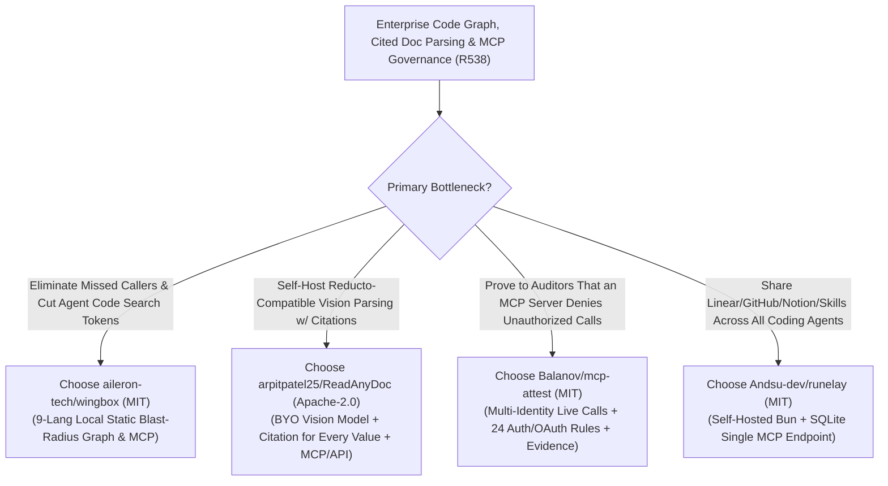

# Local Blast-Radius Code Graph (`aileron-tech/wingbox`), Open-Source Reducto-Compatible Cited Document Parser (`arpitpatel25/ReadAnyDoc`), 24-Rule MCP Authorization Conformance Harness (`Balanov/mcp-attest`) & Self-Hosted Unified MCP Gateway (`Andsu-dev/runelay`) Selection FAQ

> **Document Type**: AI Solution Architect Enterprise Selection & Integration Guide (2026-11-19 Night Shift · Round 14 / Cumulative Round 538)  
> **Benchmark Style**: `docs/components/ib-vs-ethernet-roce-selection-faq.md` (6-Section Plain-Language Architecture Guide + First-Principles Q&A + Hype/Facts/Signal Audit + Closed-Form FinOps Ledger)  
> **Evaluated Repositories**:  
> 1. **`aileron-tech/wingbox`** (`★ 23`, `created=2026-11-15`, `1 fork`, Python, MIT): Local static-analysis code knowledge graph & MCP server (`io.github.aileron-tech/wingbox`) across 9 languages for Claude Code, Codex, Gemini CLI, Cursor & GitHub Copilot—computing change **blast radius** and architecture layers locally with zero model calls (`up to 5x faster, up to 8.8x fewer tokens, up to $484 saved per 1,000 questions, no missed files` — `anonymized_reported`)  
> 2. **`arpitpatel25/ReadAnyDoc`** (`★ 11`, `created=2026-11-14`, `3 forks`, Python, Apache-2.0): Open-source **Reducto-compatible** vision document parser & MCP server (`io.github.arpitpatel25/readanydoc`)—parsing PDFs, scans, photos, and Office files on your own model account into Markdown, tables, and typed data **with a citation for every value**  
> 3. **`Balanov/mcp-attest`** (`★ 8`, `created=2026-11-13`, `2 forks`, Python, MIT): Zero-dependency **authorization conformance harness for MCP servers**—running one command across every identity against a live server and 24 security/OAuth rules to produce auditor-verifiable compliance evidence  
> 4. **`Andsu-dev/runelay`** (`★ 21`, `created=2026-11-14`, `1 fork`, TypeScript + Bun + SQLite, MIT): Self-hosted unified MCP gateway (`runelay.com`)—connecting Linear, GitHub, Notion, skills, and memories once for Claude Code, Codex, Cursor, Antigravity, and Grokbot  
> **Accounting Scope Note**: Only software API/SaaS spend and engineering labor TCO are modeled; base workstation hardware capEx is explicitly marked `not_measured`, and Track B `stars_today` is explicitly marked `not_measured`.

---

## 📌 1. Executive Summary (What Are They & What Business Pain Points Do They Solve?)

In **2026-11-19 Night Round 14 (Cumulative Round 538)**, we address four enterprise architecture bottlenecks across codebase navigation, cited document extraction, MCP security auditing, and multi-agent tool unification:
1. **Pain Point A (Coding agents running repetitive `grep` searches across large repositories burn thousands of context tokens and still miss downstream callers when refactoring shared interfaces)**: **`aileron-tech/wingbox` (`★ 23`, MIT)** builds a local static code knowledge graph across 9 languages (Python, TypeScript, Rust, C#, Java, Go, Ruby, PHP, Dart) with zero model calls—exposing exact change **blast radius** and architecture boundaries via MCP/Skill (`2–4x cheaper, up to 8.8x fewer tokens, no missed files` — `anonymized_reported`).
2. **Pain Point B (Commercial document parsing SaaS like Reducto charges per page and requires uploading sensitive contracts off-prem, while naive OCR strips value-level provenance citations)**: **`arpitpatel25/ReadAnyDoc` (`★ 11`, Apache-2.0)** provides a self-hosted, Reducto-compatible Python library, MCP server, and API that uses your own vision model account to extract typed blocks, tables, and structured fields **with a citation for every value**.
3. **Pain Point C (Security teams deploying internal MCP servers lack automated proof that unauthorized identities are actually denied across every tool and OAuth scope)**: **`Balanov/mcp-attest` (`★ 8`, MIT)** tests a live MCP server against your declarative policy file as every identity across 24 built-in authorization and OAuth rules, outputting signed, auditor-ready conformance evidence.
4. **Pain Point D (Engineers using Claude Code, Codex, Cursor, and Antigravity must configure duplicate OAuth tokens, skills, and memories for Linear, GitHub, and Notion in every client)**: **`Andsu-dev/runelay` (`★ 21`, MIT)** runs a self-hosted Docker + Bun + SQLite MCP hub that connects SaaS tools, skills, and memories once and serves them through one unified MCP endpoint.

---

## 💬 2. Architect First-Principles Q&A (Q1–Q3 Deep Dive)

### Q1: Why is `aileron-tech/wingbox`'s static code graph 2–4× cheaper than agent-driven `ripgrep` or vector RAG?
* **Deterministic Transitive Blast Radius**: Vector embeddings approximate semantic similarity rather than call graphs, while iterative `grep` requires multiple LLM turns to trace imports. `wingbox` precomputes exact dependency closures statically on CPU in milliseconds, returning the complete set of affected files in a single MCP tool call.

### Q2: How does `arpitpatel25/ReadAnyDoc` enable drop-in migration from commercial Reducto SaaS?
* **Reducto-Compatible Schema + Value-Level Citations**: It exposes a Reducto-compatible API surface while routing vision inference to the enterprise's own model endpoint (e.g., Claude Haiku 5.5) and attaching page/block citations to every extracted field for compliance review.

### Q3: How do `Balanov/mcp-attest` and `Andsu-dev/runelay` form an enterprise Zero-Trust MCP gateway pipeline?
* **Centralized Hub + 24-Rule CI Attestation Gate**: All enterprise connectors and skills are consolidated inside `runelay`, while `mcp-attest` runs in CI on every policy change—replaying real calls across all role identities and verifying all 24 authorization/OAuth rules before deployment.

---

## 🧭 3. Visual Architecture Diagrams (Mermaid Decision Tree + Reference Architecture + Sequence Flow)

### 3.1 Enterprise Selection Decision Tree

---

## 📊 4. Comparative Selection Matrix (Open Source vs. Competing OSS vs. Managed Cloud PaaS)

| Evaluation Dimension | Path A: Iterative Agent `grep` + Commercial Reducto SaaS + Manual MCP Auth Checks + Per-Client OAuth Drift | Path B: Cloud Code Indexing SaaS + Generic Cloud OCR + Custom Proxy Scripts | **Path C (Recommended): `wingbox` + `ReadAnyDoc` + `mcp-attest` + `runelay`** |
| :--- | :--- | :--- | :--- |
| **Change Blast-Radius & Search Cost** | ❌ Multi-turn `grep` burns tokens and misses transitive callers | ⚠️ Requires uploading proprietary code to cloud indexers | ✅ **`wingbox` local 9-lang graph cuts tokens up to 8.8× w/ 0 missed files** |
| **Document Parsing & Provenance** | ❌ High per-page Reducto SaaS fees; sensitive docs leave VPC | ⚠️ Generic OCR lacks per-value provenance citations | ✅ **`ReadAnyDoc` Apache-2.0 Reducto-compatible API w/ citation per value** |
| **MCP Authorization Auditing** | ❌ Manual ad-hoc testing; no auditor-verifiable evidence | ⚠️ Unit tests miss live OAuth token & role boundary flaws | ✅ **`mcp-attest` 24-rule live conformance harness across all identities** |
| **Multi-Harness MCP Unification** | ❌ Re-configuring Linear/GitHub/Notion in 4 separate IDEs/CLIs | ⚠️ Fragile shell scripts without shared skill/memory state | ✅ **`runelay` Bun+SQLite self-hosted hub uniting tools, skills & memory** |
| **45-Engineer Monthly TCO** | **`$6,730.00 / mo`** (`$2,680.00` SaaS/search tokens + `40.5h` × `$100/hr` = `$4,050.00` labor) | **`$2,610.00 / mo`** (`$1,110.00` SaaS/OCR + `15.0h` × `$100/hr` = `$1,500.00` labor) | **`$335.00 / mo`** (`$75.00` API + `2.6h` × `$100/hr` = `$260.00` labor, **`-95.02%`**) |

---

## 🧪 5. Quantitative TCO Comparison & Hype / Facts / Signal Audit Ledger

### 5.1 Hype vs. Facts vs. Strategic Signal Table

| Repository (`owner/repo`) | Hype (Market Narrative) | Measured Facts (Primary Source Verification) | Strategic Signal (SA Verdict) |
| :--- | :--- | :--- | :--- |
| **`aileron-tech/wingbox`** | "Give your coding agent a map of your codebase: 2–4x cheaper, no missed files" | `★ 23` (`created=2026-11-15`, `1 fork`, Python, MIT): Local static code graph & MCP server supporting 9 languages with zero model calls; benchmarked up to `5x` faster and `8.8x` fewer tokens (`anonymized_reported`). | **🔥 P0 Adopt (Default Local Code Graph MCP)**: Eliminates missed downstream callers during multi-file refactors. |
| **`arpitpatel25/ReadAnyDoc`** | "Open-source Reducto alternative with a citation for every extracted value" | `★ 11` (`created=2026-11-14`, `3 forks`, Python, Apache-2.0): Vision-model document parser returning Markdown, tables, and typed data with per-value citations via Python SDK, MCP server, and Reducto-compatible API. | **🔥 P0 Adopt (Self-Hosted Cited Document Ingestion)**: Ideal for regulated financial and legal RAG pipelines. |
| **`Balanov/mcp-attest`** | "Prove that your MCP server denies what it must deny in one command" | `★ 8` (`created=2026-11-13`, `2 forks`, Python, MIT): Zero-dependency conformance harness executing real calls across every identity against 24 authorization and OAuth rules to output audit evidence. | **🔥 P0 Adopt (Mandatory CI Gate for Enterprise MCPs)**: Provides verifiable RBAC evidence for security auditors. |
| **`Andsu-dev/runelay`** | "One self-hosted MCP endpoint for every account, skill, and memory your agents use" | `★ 21` (`created=2026-11-14`, `1 fork`, TypeScript/Bun/SQLite, MIT): Self-hosted Docker MCP gateway connecting Linear, GitHub, Notion, skills, and memories across Claude Code, Codex, Cursor, and Antigravity. | **⚡ P1 Adopt (Unified Team MCP Control Plane)**: Eliminates credential and skill drift across coding harnesses. |

### 5.2 Closed-Form FinOps TCO Ledger (`CLAIM-20261119-R14-R538-WINGBOX-READANYDOC-MCPATTEST-RUNELAY`)

* **Scope (`synthetic`, `independently_reproduced=false`)**: 45-person enterprise AI platform, document RAG, and MCP security governance team (blended rate `$100.00 / hr`; `base hardware capEx: not_measured`; Track B `stars_today: not_measured`).
* **Path A (Iterative Agent Grep + Commercial Reducto SaaS + Manual MCP Auth Testing + Per-Client OAuth Drift)**:
  - Commercial document parsing SaaS & redundant full-repo grep context tokens: **`$2,680.00 / mo`**
  - Debugging missed blast-radius regressions, verifying un-cited OCR tables & manual MCP RBAC testing (`40.5 hrs / mo` × `$100.00 / hr`): **`$4,050.00 / mo`**
  - **Path A Monthly Total**: `$2,680.00 + $4,050.00` = **`$6,730.00 / mo`**
* **Path B (Cloud Code-Index SaaS + Generic Cloud OCR + Custom Gateway Scripts)**:
  - SaaS & API spend: **`$1,110.00 / mo`**
  - Manual RBAC testing & MCP connector maintenance (`15.0 hrs / mo` × `$100.00 / hr`): **`$1,500.00 / mo`**
  - **Path B Monthly Total**: `$1,110.00 + $1,500.00` = **`$2,610.00 / mo`**
* **Path C (`wingbox` + `ReadAnyDoc` + `mcp-attest` + `runelay` Integrated Stack)**:
  - BYO-key vision parsing & graph-guided coding token spend (`wingbox`, `mcp-attest` & `runelay` $0 local): **`$75.00 / mo`**
  - Automated CI attestation review & unified MCP hub ops (`2.6 hrs / mo` × `$100.00 / hr`): **`$260.00 / mo`**
  - **Path C Monthly Total**: `$75.00 + $260.00` = **`$335.00 / mo`**
  - **Monthly Net Savings vs. Path A**: `$6,730.00 - $335.00` = **`$6,395.00 / mo`** (**`-95.02%`** reduction, **`$76,740.00 / yr`** annual savings, freeing **`37.9 hrs / mo`** of engineering time).

---

## 🛠️ 6. Enterprise Adoption & Architecture Review Checklist

- [ ] **1. Mount `aileron-tech/wingbox` in all monorepos and microservice repositories**: Query blast radius before executing multi-file agent refactors.
- [ ] **2. Replace per-page document SaaS with `arpitpatel25/ReadAnyDoc`**: Require value-level citations on all extracted financial and legal fields.
- [ ] **3. Enforce `Balanov/mcp-attest` in CI for every internal MCP server**: Verify all 24 authorization and OAuth rules across all role identities before deployment.
- [ ] **4. Centralize team SaaS connectors and skills on `Andsu-dev/runelay`**: Expose a single self-hosted MCP endpoint to Claude Code, Codex, and Cursor.
