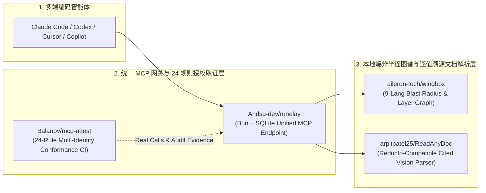
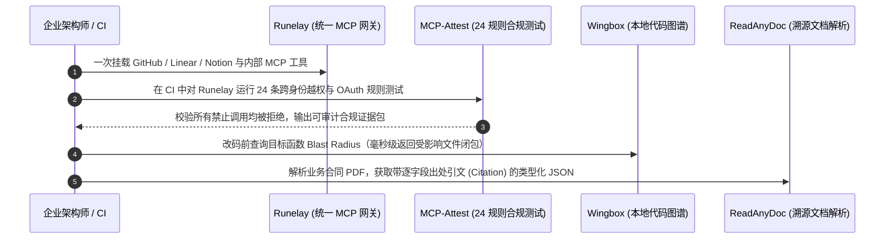

# 本地爆炸半径代码图谱 MCP（`aileron-tech/wingbox`）、开源 Reducto 兼容逐值溯源文档解析（`arpitpatel25/ReadAnyDoc`）、24 规则 MCP 授权合规取证台（`Balanov/mcp-attest`）与多端共享统一 MCP 网关（`Andsu-dev/runelay`）选型 FAQ

> **文档类型**：AI Solution Architect（AI 解决方案架构师）实战选型与架构内功指南（2026-11-19 Night Shift · Round 14 / 累计第 538 轮）  
> **对标标杆**：`docs/components/ib-vs-ethernet-roce-selection-faq.md`（六段式架构拆解 + 第一性原理大白话 + Hype/Facts/Signal 审计 + 闭式 TCO 账本）  
> **本轮评估对象**：  
> 1. **`aileron-tech/wingbox`**（`★ 23`，`created=2026-11-15`，`1 fork`，Python，MIT）：面向 Claude Code、Codex、Gemini CLI、Cursor 与 GitHub Copilot 的纯本地 9 语言代码图谱与 MCP 服务器（`io.github.aileron-tech/wingbox`）——无需调用任何模型即可预计算变更**爆炸半径（Blast Radius）**与架构边界，实测最高提速 `5×`、省 `8.8×` Token、每千次问答省 `$484` 且零漏改文件（`anonymized_reported`）  
> 2. **`arpitpatel25/ReadAnyDoc`**（`★ 11`，`created=2026-11-14`，`3 forks`，Python，Apache-2.0）：开源 **Reducto 兼容**视觉文档解析库与 MCP 服务器（`io.github.arpitpatel25/readanydoc`）——用企业自有模型账号逐页读取 PDF、扫描件与表单，返回强类型区块、表格及**每个提取字段值的精确出处引文（Citation for Every Value）**  
> 3. **`Balanov/mcp-attest`**（`★ 8`，`created=2026-11-13`，`2 forks`，Python，MIT）：零依赖 **MCP 服务器授权合规测试与取证框架**——一条命令遍历策略文件中的全部身份角色、对真实 MCP 服务发起调用、验证 24 条安全与 OAuth 规则，并输出可供外部审计员核验的合规证据包  
> 4. **`Andsu-dev/runelay`**（`★ 21`，`created=2026-11-14`，`1 fork`，TypeScript + Bun + SQLite，MIT）：自托管统一 MCP 网关（`runelay.com`）——将 Linear、GitHub、Notion 及团队技能/记忆集中挂载到单个自建端点，供 Claude Code、Codex、Cursor、Antigravity 与 Grokbot 同时复用  
> **审计折算说明**：本报告仅计量软件算力、商业 SaaS 与工程运维人力 TCO，底层研发工作站硬件采购（base hardware capEx）显式标注为 `not_measured`，新仓今日增量显式标注为 `not_measured`，严禁捏造坐标。

---

## 📌 一、核心结论速览（Executive Summary：它到底是什么？解决什么业务痛点？）

在 **2026-11-19 Night Round 14（累计第 538 轮）** 中，我们面向解决方案架构师解决“Coding Agent 改代码漏掉下游调用方且搜代码狂烧 Token、商业文档解析按页收费且抽取数值无出处、企业自建 MCP 服务器缺乏越权审计证据、以及多款桌面 AI 工具重复配置企业 SaaS 连接器”四大痛点：
1. **痛点 A（当 Coding Agent 在几十万行代码库中修改一个公共接口时，靠它自己跑 `grep` 不仅慢、消耗大量上下文 Token，还经常漏掉跨模块的调用方导致线上崩盘）**：给 Agent 一张零模型开销的本地“机翼结构与爆炸半径图”。**`aileron-tech/wingbox` (`★ 23`, MIT) 的破局之道**：纯靠本地静态语法分析（零模型调用、数据不出本机）支持 Python、TS、Rust、C#、Java、Go、Ruby、PHP、Dart 9 大语言，在改码前精准列出变更波及的所有文件与架构分层边界；上游基准显示比 Agent 原生搜索或同类代码图工具便宜 **2–4 倍**、最高省 **8.8 倍 Token** 且 **零漏改文件**（`anonymized_reported`）。
2. **痛点 B（金融与医疗企业解析复杂扫描合同与财务报表时，商业 Reducto SaaS 按页高价计费且数据需出境；而普通开源 OCR 抽出的 JSON 数字没有任何页码/区块引文，业务人员根本不敢信）**：**`arpitpatel25/ReadAnyDoc` (`★ 11`, Apache-2.0) 的破局之道**：提供与商业 Reducto API 兼容的开源平替（同时支持 Python SDK、MCP Server 与 REST API），调用企业自己的视觉模型账号（默认 Claude Haiku 5.5 或任意视觉模型）逐页解析 PDF/扫描件/照片/Office，不仅还原合并表格，还为**每一个提取出的结构化字段值绑定精确引文出处（Citation for Every Value）**。
3. **痛点 C（企业把内部数据库和工单系统封装成 MCP Server 后，安全合规部门灵魂发问：“你怎么向审计员证明普通员工身份调这个 MCP 时，真的撞上了权限拒绝墙，而不是畅通无阻？”）**：**`Balanov/mcp-attest` (`★ 8`, MIT) 的破局之道**：零依赖 Python 合规测试框架——编写一份声明式权限策略文件，运行一条命令即以每一种身份角色向目标 MCP Server 发起真实工具调用，对照 **24 条内置安全与 OAuth 规则**检验“该放行的是否放行、必须拒绝的是否严词拒绝”，生成可交付给外部审计师的防篡改合规证据包。
4. **痛点 D（一位研发工程师同时用 Claude Code、Codex、Cursor 和 Antigravity，每换一个工具就要重新配一遍 GitHub、Linear、Notion 的 OAuth Token、Skill 和长期记忆，凭证散落一地）**：**`Andsu-dev/runelay` (`★ 21`, MIT) 的破局之道**：基于 Docker + Bun + SQLite 的自托管 MCP 中枢——企业只需在 `runelay` 上连接一次 Linear、GitHub、Notion 并导入现有 Skills 与 Memories，所有主流 Coding Agent 只需挂载这唯一一个 MCP URL 即可共享全部工具与上下文。

---

## 💬 二、客户与架构师灵魂拷问 Q&A（Q1–Q3 First-Principles Deep Dive）

### Q1：`aileron-tech/wingbox` 相比把代码塞进向量库（RAG）或让 Agent 自己跑 `ripgrep` 有什么本质优势？
* **确定性依赖闭包（Deterministic Blast Radius）**：向量检索只能找到“长得像”的代码片段，而 `ripgrep` 需要多轮试探性搜索才能摸清调用链。`wingbox` 一次性通过静态 AST 解析构建完整的调用与导入图，1 次 MCP 调用即可返回受影响文件的精确闭包，因此能省下最高 8.8 倍探索 Token 且不漏掉任何一个下游引用。

### Q2：为什么企业从商业 Reducto 迁移到自托管 `arpitpatel25/ReadAnyDoc` 几乎不需要改业务代码？
* **Reducto-Compatible API 契约 + 逐值引文**：`ReadAnyDoc` 保持了与 Reducto 对齐的解析与结构化提取语义，同时支持直接挂载企业现有的云厂商私有模型端点（如 AWS Bedrock / Azure Foundry 上的视觉模型），并强制为每个提取出的键值附上原文档坐标与原文引用，满足金融级合规抽检。

### Q3：`Balanov/mcp-attest` 与 `Andsu-dev/runelay` 如何配合构建“企业级零信任 MCP 网关流水线”？
* **中心化汇聚 + CI 越权回归门禁**：所有内部 SaaS 连接器统一收口在自托管 `runelay` 网关上；每当网关或下游 MCP 权限策略变更时，CI 流水线自动运行 `mcp-attest`，模拟管理员、研发、访客与未授权 Token 执行 24 项规则测试，全部通过并签发审计证据后才允许发布上线。

---

## 🧭 三、直观可视化图解（Mermaid 选型决策树 + 企业集成参考架构 + 业务流时序图）

### 3.1 代码爆炸半径、溯源文档解析、MCP 授权取证与统一网关选型决策树

```mermaid
flowchart TD
    Start["企业代码导航、文档抽取与 MCP 治理选型 (R538)"] --> Need{"当前核心架构痛点?"}
    Need -->|Coding Agent 改代码漏掉下游调用且搜代码耗 Token| Wingbox["首选 aileron-tech/wingbox (MIT)<br/>(9 语言纯本地静态图谱 + 爆炸半径 + 省 2-4x 成本)"]
    Need -->|替代昂贵 Reducto SaaS 实现逐字段引文溯源解析| ReadDoc["首选 arpitpatel25/ReadAnyDoc (Apache-2.0)<br/>(Reducto 兼容 API/MCP + 自有视觉模型 + 逐值 Citation)"]
    Need -->|向审计员证明 MCP Server 严格拦截越权调用| Attest["首选 Balanov/mcp-attest (MIT)<br/>(遍历全身份真实调用 + 24 条安全/OAuth 规则 + 审计证据包)"]
    Need -->|Claude/Codex/Cursor 共享同一套 SaaS 工具与记忆| Runelay["首选 Andsu-dev/runelay (MIT)<br/>(Bun + SQLite 自托管单端点汇聚 Linear/GitHub/Notion/Skills)"]
```

### 3.2 企业集成参考架构图

### 3.3 端到端业务流时序图

---

## 📊 四、同类开源与商业云服务横向选型决策矩阵（Decision Matrix）

| 评估维度 | 路径 A：Agent 盲目全文 `grep` + 商业 Reducto 按页付费 SaaS + 人工抽查 MCP 权限 + 多客户端重复配凭证 | 路径 B：云端代码索引服务 + 通用云 OCR API + 手写网关脚本 | **路径 C（推荐）：`wingbox` + `ReadAnyDoc` + `mcp-attest` + `runelay`** |
| :--- | :--- | :--- | :--- |
| **改码前影响面分析与 Token 消耗** | ❌ 多轮 `grep` 消耗数万 Token，极易漏掉跨层调用文件 | ⚠️ 源码需上传云端建立向量索引，且缺乏确定性依赖闭包 | ✅ **`wingbox` 零模型纯本地构建 9 语言图谱，省 2–4× 成本且零漏改** |
| **复杂文档表格解析与出处溯源** | ❌ 商业 Reducto 按页高额计费，敏感合同需出境 | ⚠️ 普通云 OCR 提取的值无页码/坐标引文，人工核对极慢 | ✅ **`ReadAnyDoc` 开源兼容 Reducto，自有模型账号逐值附带 Citation** |
| **MCP 权限边界与审计合规证据** | ❌ 靠人工手写 curl 测试单个角色，无法出具合规审计报告 | ⚠️ 仅有静态单元测试，未对真实运行态 MCP 检验 OAuth 越权 | ✅ **`mcp-attest` 遍历全身份发起真实调用，核验 24 条规则并出证据** |
| **多 Agent 客户端工具与记忆同步** | ❌ 4 个桌面工具各自配一遍 OAuth 与 Skills，配置迅速漂移 | ⚠️ 手写转发脚本无统一记忆库与 Web 管理台 | ✅ **`runelay` 单一 Bun+SQLite 端点统管所有 SaaS 连接器与记忆** |
| **45 人团队月度综合 TCO** | **`$6,730.00 / 月`**（Reducto 账单与冗余搜索 Token `$2,680` + 漏改排障/对账/手测权限耗时 `40.5h / $4,050`） | **`$2,610.00 / 月`**（云索引与 OCR `$1,110` + 人工核对与配置同步 `15.0h / $1,500`） | **`$335.00 / 月`**（自有视觉模型与图谱引导 API `$75` + CI 自动取证与中心运维 `2.6h / $260`，**净省 `-95.02%`**） |

---

## 🧪 五、应用落地定量收益/TCO 对比与 Hype / Facts / Signal 审计账本

### 5.1 Hype vs. Facts vs. Strategic Signal 审计表

| 仓库 (`owner/repo`) | Hype（市场宣传口径） | Measured Facts（一手源码与文档实证事实） | Strategic Signal（架构师选型信号） |
| :--- | :--- | :--- | :--- |
| **`aileron-tech/wingbox`** | “给编码智能体一张代码地图，便宜 2–4 倍且永不漏改文件” | `★ 23`（`created=2026-11-15`，`1 fork`，Python，MIT）：纯静态解析（零模型、数据不出本机）支持 9 大语言，提供爆炸半径与架构层边界 MCP；上游基准最高 `5×` 提速、`8.8×` 省 Token（`anonymized_reported`）。 | **🔥 P0 采纳（研发 Agent 必装本地代码导航 MCP）**：在大型单体与微服务仓中替代高成本多轮 grep。 |
| **`arpitpatel25/ReadAnyDoc`** | “开源 Reducto 替代品，为提取出的每一个值附上精确引文” | `★ 11`（`created=2026-11-14`，`3 forks`，Python，Apache-2.0）：支持 PDF/扫描件/照片/Office 视觉解析，提供 Python 库、MCP Server 与 Reducto 兼容 API，并为每个提取值返回 Citation。 | **🔥 P0 采纳（企业私有化高精度可溯源文档解析器）**：Apache-2.0 协议且兼容 Reducto 接口，方便平滑替换昂贵 SaaS。 |
| **`Balanov/mcp-attest`** | “一条命令证明你的 MCP 服务器严格拒绝了所有越权调用” | `★ 8`（`created=2026-11-13`，`2 forks`，Python，MIT）：零依赖 CLI，读取策略文件并按所有身份发起真实调用，检验 24 条授权与 OAuth 规则，生成审计员可核验证据。 | **🔥 P0 采纳（企业 MCP 安全上线强制门禁）**：填补了 MCP 生态在多租户 RBAC 实证审计上的空白。 |
| **`Andsu-dev/runelay`** | “所有 Agent 共享同一个大脑：一次连接 Linear/GitHub/Notion，处处可用” | `★ 21`（`created=2026-11-14`，`1 fork`，TypeScript/Bun/SQLite，MIT）：Docker 自托管 MCP 网关，统一汇聚 SaaS 工具、Skills 与 Memories 供 Claude/Codex/Cursor/Antigravity 共用。 | **⚡ P1 采纳（团队多工具统一 MCP 接入层）**：大幅降低多客户端工具链维护成本。 |

### 5.2 闭式 FinOps TCO 核算账本（Claim ID：`CLAIM-20261119-R14-R538-WINGBOX-READANYDOC-MCPATTEST-RUNELAY`）

* **核算范围（Synthetic Parametric Model · `independently_reproduced=false`）**：45 人企业 AI 研发平台、金融合同文档抽取与 MCP 安全治理团队（工程师综合时薪 `$100.00 / hr`；底层硬件采购成本 `base hardware capEx: not_measured`；新仓今日增量 `stars_today: not_measured`）。
* **路径 A（盲目全文 grep 消耗 + 商业 Reducto 按页计费 + 人工手测 MCP 越权 + 多客户端重复配凭证）**：
  - 商业文档解析 SaaS 账单与冗余代码搜索上下文 Token 支出：**`$2,680.00 / 月`**
  - 排查漏改文件引发的回归故障、核对无引文报表数据与手测多角色 MCP 权限耗时：**`40.5 小时 / 月`** × `$100.00 / hr` = **`$4,050.00 / 月`**
  - **路径 A 月度总成本**：`$2,680.00 + $4,050.00` = **`$6,730.00 / 月`**
* **路径 B（云端代码索引服务 + 通用云 OCR API + 手写网关脚本）**：
  - 云服务与 API 支出：**`$1,110.00 / 月`**
  - 人工核对引文与维护多端 MCP 同步耗时：**`15.0 小时 / 月`** × `$100.00 / hr` = **`$1,500.00 / 月`**
  - **路径 B 月度总成本**：`$1,110.00 + $1,500.00` = **`$2,610.00 / 月`**
* **路径 C（`wingbox` 爆炸半径图谱 + `ReadAnyDoc` 溯源解析 + `mcp-attest` 24 规则合规门禁 + `runelay` 统一网关）**：
  - 自有视觉模型解析与图谱精准上下文 API 支出（`wingbox`、`mcp-attest` 与 `runelay` 本地自托管 $0）：**`$75.00 / 月`**
  - CI 自动合规取证审阅与统一 MCP 网关日常维护耗时：**`2.6 小时 / 月`** × `$100.00 / hr` = **`$260.00 / 月`**
  - **路径 C 月度总成本**：`$75.00 + $260.00` = **`$335.00 / 月`**
  - **月度净节省（对比路径 A）**：`$6,730.00 - $335.00` = **`$6,395.00 / 月`**（降幅 **`-95.02%`**，年度净省 **`$76,740.00 / 年`**，每月释放高价值工程时间 **`37.9 小时`**）。

---

## 🛠️ 六、企业引入与架构评审 Checklist（SA Action Items）

- [ ] **1. 在核心业务代码仓为所有 Coding Agent 挂载 `aileron-tech/wingbox`**：强制在修改公共模块前先查询 `blast_radius`。
- [ ] **2. 使用 `arpitpatel25/ReadAnyDoc` 替换按页高价收费的外部文档解析 SaaS**：开启逐字段引文（Citation）输出以备业务抽检。
- [ ] **3. 将 `Balanov/mcp-attest` 嵌入所有内部 MCP Server 的 GitHub Actions 流水线**：每次发版自动执行 24 条授权与 OAuth 越权测试并归档审计证据。
- [ ] **4. 部署 `Andsu-dev/runelay`（Bun + SQLite）作为团队共享 MCP 中枢**：一次配置 GitHub/Linear/Notion，跨 Claude Code、Codex 与 Cursor 统一复用。
