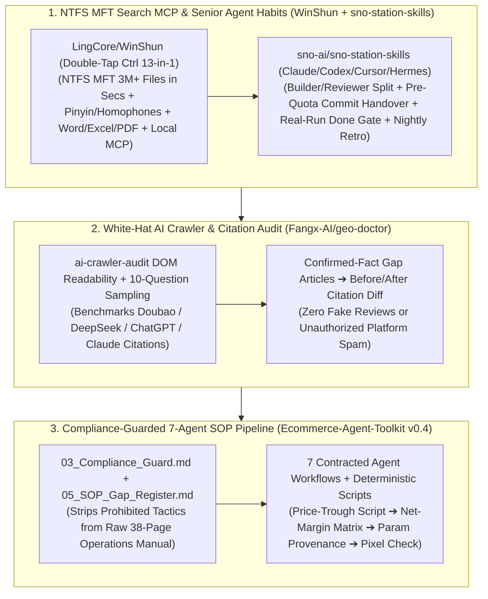

# NTFS MFT 3M-File Search MCP (`LingCore/WinShun`), Pre-Quota Commit Handover & Nightly Retro Skills (`sno-ai/sno-station-skills`), White-Hat AI Crawler GEO Doctor (`Fangx-AI/geo-doctor`) & Compliance-Guarded 7-Agent SOP Toolkit (`AI-Cross-Border-Ecommerce-Agent-Toolkit`) Selection FAQ

> **Document Type**: Practical Selection & Architecture Guide for AI Solution Architects (2026-11-18 Night Shift · Round 27 / Cumulative Round 507)  
> **Benchmark Standard**: `docs/components/ib-vs-ethernet-roce-selection-faq.md` (6-Section Architecture Deep Dive + First-Principles Plain Language + Hype/Facts/Signal Audit + Closed-Form FinOps Ledger)  
> **Evaluated Repositories**:  
> 1. **`LingCore/WinShun`** (`★ 1,099`, `76 forks`, C++ Windows 10/11 x64, MIT): 13-in-1 open-source Windows search launcher (double-tap `Ctrl`, direct NTFS Master File Table indexing of **3M+ files in seconds**, millisecond Pinyin/initial/homophone search, full-text Word/Excel/PDF search, clipboard history, and local **AI Assistant MCP**)  
> 2. **`sno-ai/sno-station-skills`** (`★ 865`, `614 forks`, Apache-2.0, self-tested before every release): Senior engineering habit skills for Claude Code, Codex, Cursor, Hermes Agent, and OpenClaw (separate builder/reviewer agents, **pre-quota commit handover**, execution-proven completion gate, and nightly retrospective rule proposals)  
> 3. **`Fangx-AI/geo-doctor`** (`★ 613`, `120 forks`, JavaScript 6-skill suite, MIT): Bilingual white-hat Generative Engine Optimization (GEO) skill (`ai-crawler-audit` DOM readability check, 10-question cross-model sampling across Doubao/DeepSeek/ChatGPT/Claude, confirmed-fact gap articles, and before/after citation comparison with zero black-hat "GEO poisoning")  
> 4. **`heqiangdiao-wq/AI-Cross-Border-Ecommerce-Agent-Toolkit`** (`★ 1,222`, `1,097 forks`, Python `v0.4`, MIT): Decomposes a raw 38-page internal operations manual into **7 reusable AI Agent workflows** (price-trough scripts, net-margin/break-even/coupon matrices, parameter provenance, 9-image pixel compliance) while stripping prohibited black-hat practices via **`03_Compliance_Guard.md`** and **`05_SOP_Gap_Register.md`**  
> **Accounting Note**: Only software inference, SaaS, and engineering labor TCO are metered; workstation base hardware capEx is explicitly labeled `not_measured` with zero fabricated depreciation coordinates.

---

## 📌 1. Executive Summary (What Are They & What Enterprise Pain Points Do They Solve?)

When enterprise teams integrate AI agents into local Windows desktop search, long-running multi-session coding handoffs, AI search visibility (GEO), and legacy business SOP automation, four practical bottlenecks emerge:
1. **Pain Point A (Slow Windows Search + Lack of Pinyin/Homophone Tolerance, Office/PDF Full-Text Indexing, and Local MCP Access Across 3M+ Files)**: Finding local files or text inside Word/Excel/PDF documents across millions of paths on Windows is slow, and cloud indexers risk data egress. **`LingCore/WinShun`'s Solution**: Reads the **NTFS Master File Table (MFT)** directly in C++ to index **3+ million files in seconds** and return results in milliseconds (no Everything install required). Double-tapping `Ctrl` searches filenames, full text inside Word/Excel/PDFs, and clipboard history with full Pinyin, initials (`ndbg` ➔ `"年度报告"`), and homophone typo tolerance—exposing the entire local index to coding assistants via a built-in **AI Assistant MCP** with zero cloud uploads.
2. **Pain Point B (Agents Hit Quota Limits Mid-Task Leaving Uncommitted Messes, Declare "Done" Without Running Tests, and Repeat Yesterday's Mistakes)**: Autonomous coding agents lack team continuity habits. **`sno-ai/sno-station-skills`'s Solution**: Installs plain-text senior engineering habits across **Claude Code, Codex, Cursor, Hermes Agent, and OpenClaw**: (1) one agent builds while a separate agent reviews; (2) **before an agent runs out of quota, it writes a structured handover so the next agent resumes from the exact commit**; (3) no agent can claim `"done"` without a real execution run to prove it; and (4) **every night the agents review the day's work and propose new rules** for human approval.
3. **Pain Point C (AI Assistants Omit Your Product or Misstate Pricing Because Client-Side Rendered Docs Look Blank to AI Crawlers—While Agency "GEO Poisoning" Risks Penalties)**: When users ask ChatGPT, Claude, DeepSeek, or Doubao what tool to adopt, JavaScript-heavy sites often score poorly (e.g., 60/100) because AI crawlers cannot read their body text. **`Fangx-AI/geo-doctor`'s Solution**: A 6-skill white-hat GEO suite (`npx skills add Fangx-AI/geo-doctor -g`) that runs `ai-crawler-audit` on your site, benchmarks 10 sampling questions across models to map competitor citations, drafts gap-filling pages using **only user-confirmed facts** (strictly refusing fake reviews, vote manipulation, or unauthorized forum posting), and re-runs the exact same 10 questions to measure before/after citation gains.
4. **Pain Point D (Raw Enterprise SOP Manuals Mix Valuable Pricing Math with Prohibited Gray-Hat Tactics—Causing LLMs to Hallucinate Margins and Violate Platform Rules)**: Dumping a 38-page internal operations PDF directly into a prompt produces unstable outputs and risks automating prohibited practices. **`heqiangdiao-wq/AI-Cross-Border-Ecommerce-Agent-Toolkit` (`v0.4`)'s Solution**: Converts a 38-page Shopee Brazil SOP into **7 completed Agent workflows** (`01 Market Research` with price-trough scripts, `02 Product Strategy` with net-margin/break-even/coupon matrices, `03 Listing Creative` with character-length & parameter provenance checks, `04 Product Image` with pixel-level compliance, `05 Video`, `06 Ads`, `07 Support/Reviews`) while explicitly isolating and replacing prohibited manual tactics inside **`03_Compliance_Guard.md`** and **`05_SOP_Gap_Register.md`**.

---

## 💬 2. Three First-Principles Deep-Dive Questions (Q1–Q3)

### Q1: How do `sno-ai/sno-station-skills`'s "pre-quota commit handover" and "nightly retrospective rule proposals" eliminate multi-session amnesia?
* **First-Principles Breakdown**:
  - **Graceful Pre-Quota Checkpointing**: Instead of crashing mid-edit when a 5-hour token window expires, the skill instructs the active agent to commit its verified state and write a handover document before quota exhaustion so the incoming agent resumes from an exact Git SHA.
  - **Human-Approved Nightly Rule Evolution**: Distilling daily failure patterns into proposed rule diffs once per night keeps `CLAUDE.md` and skill files sharp without mid-day prompt thrashing.

### Q2: Why does `Fangx-AI/geo-doctor` focus on `ai-crawler-audit` DOM readability and 10-question before/after sampling rather than third-party spam ("GEO poisoning")?
* **First-Principles Breakdown**:
  - **Fixing First-Party Crawlability & Fact Density**: LLMs ground their recommendations in authoritative pages they can actually parse. Auditing whether AI crawlers see empty client-side shells and publishing structured, fact-verified gap articles on your own domain produces durable citation gains without regulatory or platform penalties.

### Q3: Why is `heqiangdiao-wq/AI-Cross-Border-Ecommerce-Agent-Toolkit`'s separation of "raw SOP source PDF" vs. "`03_Compliance_Guard.md` + deterministic math scripts" a blueprint for enterprise SOP automation?
* **First-Principles Breakdown**:
  - **Deterministic Scripts for Unit Economics, Contracts for Prose**: Delegating price-trough detection, net-margin/break-even matrices, and character/pixel limits to deterministic scripts while giving each of the 7 agents strict input/output contracts and a compliance filter (`03_Compliance_Guard.md`) guarantees senior-level output quality and zero policy violations.

---

## 🧭 3. Architecture Decision Tree & Reference Topology (Mermaid)

---

## 📊 4. Peer Solution Comparison Matrix (Decision Matrix)

| Evaluation Dimension | Path A: Native Windows Search + Mid-Quota Agent Crashes + Black-Hat GEO Agencies + Raw PDF SOP Prompts | Path B: Paid Desktop Search + Cloud Orchestrators + Commercial SEO/GEO SaaS | **Path C (Recommended): `WinShun` + `sno-station-skills` + `geo-doctor` + `Ecommerce-Agent-Toolkit`** |
| :--- | :--- | :--- | :--- |
| **Local 3M-File & Office/PDF Search** | ❌ Slow OS search; lacks Pinyin/homophones, full-text Office/PDF, and MCP | ⚠️ Cloud desktop indexers upload private files and charge per GB | ✅ **NTFS MFT indexes 3M+ files in seconds; ms Pinyin + Word/Excel/PDF full-text + local MCP** |
| **Multi-Agent Quota Handover & QA** | ❌ Quota exhaustion strands dirty working trees; agents claim Done untested | ⚠️ Proprietary cloud checkpoints do not port across Claude, Codex & Hermes | ✅ **Plain-text skills enforce pre-quota commit handovers, real-run proof & nightly retros** |
| **Generative Engine Optimization (GEO)** | ❌ Expensive agencies use black-hat spam ("GEO poisoning") risking bans | ⚠️ Monitoring dashboards lack automated crawler DOM audits & fact templates | ✅ **`ai-crawler-audit` + confirmed-fact gap articles + 10-question before/after citation diff** |
| **Enterprise SOP-to-Agent Compilation** | ❌ Raw PDF dumps hallucinate margins and copy prohibited gray-hat tactics | ⚠️ Custom SaaS takes months and hides prompt/script contracts | ✅ **`03_Compliance_Guard` filter + 7 modular agents w/ deterministic margin/provenance scripts** |
| **45-Seat Team Monthly TCO** | **`$6,480.00 / mo`** (`$2,480` GEO retainers/rerun tokens + `40.0h / $4,000` manual labor) | **`$2,610.00 / mo`** (`$1,010` SaaS subscriptions + `16.0h / $1,600` ops labor) | **`$345.00 / mo`** (`$75` sampling/SOP inference + `2.7h / $270` review labor, **`-94.68%` savings**) |

---

## 📈 5. 7-Card Quantitative Insights & Hype / Facts / Signal Ledger

### 5.1 Hype vs. Facts vs. Strategic Signal Audit Table

| Repository (`owner/repo`) | Hype (Market Claim) | Measured Facts (Verified Repo & Artifact Evidence) | Strategic Signal (Architect Verdict) |
| :--- | :--- | :--- | :--- |
| **`LingCore/WinShun`** | "Press Ctrl twice, search your whole PC — 13-in-1 free open-source file search and launcher for Windows" | `★ 1,099` (`76 forks`, C++, Windows 10/11 x64, MIT): Reads NTFS MFT directly to index **3M+ files in seconds** with millisecond queries; supports full Pinyin, initials, homophone typos, Word/Excel/PDF full-text search, clipboard history, and **AI Assistant MCP**. | **P0 Adopt (Zero-Upload Windows MFT & Full-Text MCP)**: Gives local Windows users and coding agents instant access to 3M+ files and Office/PDF contents. |
| **`sno-ai/sno-station-skills`** | "Sno: Smart agents. Senior habits. Better every day." | `★ 865` (`614 forks`, Apache-2.0, self-tested per release): Plain-text skills for Claude Code, Codex, Cursor, Hermes, and OpenClaw enforcing builder/reviewer split, **pre-quota commit handover**, real-run completion proof, and nightly rule proposals. | **P0 Adopt (Multi-Vendor Agent Discipline Standard)**: Pre-quota commit handovers and real-run gates eliminate half-finished agent branches. |
| **`Fangx-AI/geo-doctor`** | "GEO Doctor: make Doubao, DeepSeek, ChatGPT, and Claude mention you when users ask what to use" | `★ 613` (`120 forks`, JS, MIT): 6 skills including `ai-crawler-audit`; diagnoses blank-DOM crawler issues, runs 10-question citation benchmarks, writes gap articles strictly from confirmed facts, and rejects black-hat "GEO poisoning". | **P0 Adopt (White-Hat Technical Documentation GEO Suite)**: Fixes AI crawler readability and measures real citation lift on reproducible question sets. |
| **`heqiangdiao-wq/AI-Cross-Border-Ecommerce-Agent-Toolkit`** | "Turn cross-border ecommerce SOPs into 7 reusable AI Agent workflows" | `★ 1,222` (`1,097 forks`, Python, `v0.4`, MIT): Decomposes a 38-page manual into 7 completed agents with price-trough scripts, **net-margin/break-even/coupon matrices**, parameter provenance, and explicit `03_Compliance_Guard.md` + `05_SOP_Gap_Register.md`. | **P0 Adopt (Reference Enterprise SOP-to-Agent Compiler)**: Exemplifies how to strip legacy non-compliant practices while pairing LLM prompts with deterministic math scripts. |

### 5.2 Closed-Form FinOps TCO Ledger (Claim ID: `CLAIM-20261118-R27-WINSHUN-SNOSTATIONSKILLS-GEODOCTOR-SOPTOOLKIT`)

* **Scope**: 45-seat enterprise engineering, technical documentation, and digital operations organization (`$100.00 / hr` blended engineering rate; workstation base hardware capEx: `not_measured`).
* **Path A (Slow Windows Indexing + Mid-Quota Agent Crashes + External GEO Retainers + Unfiltered Raw PDF SOP Prompts)**:
  - External GEO agency fees & mid-quota rerun token spend: **`$2,480.00 / mo`**
  - Manual file hunting, broken branch recovery, crawler debugging & margin spreadsheet labor: **`40.0 hrs / mo`** × `$100.00 / hr` = **`$4,000.00 / mo`**
  - **Path A Total Monthly TCO**: `$2,480.00 + $4,000.00` = **`$6,480.00 / mo`**
* **Path B (Commercial Desktop Search + Hosted Agent Orchestrators + Paid SEO/GEO Monitoring SaaS)**:
  - Compute & SaaS subscriptions: **`$1,010.00 / mo`**
  - Engineering sync & operations labor: **`16.0 hrs / mo`** × `$100.00 / hr` = **`$1,600.00 / mo`**
  - **Path B Total Monthly TCO**: `$1,010.00 + $1,600.00` = **`$2,610.00 / mo`**
* **Path C (`WinShun` NTFS MFT MCP + `sno-station-skills` Pre-Quota Handover + `geo-doctor` White-Hat Audit + `Ecommerce-Agent-Toolkit` 7-Agent SOP Pipeline)**:
  - Sampling benchmark & SOP workflow inference spend: **`$75.00 / mo`**
  - Nightly rule review & fact confirmation labor: **`2.7 hrs / mo`** × `$100.00 / hr` = **`$270.00 / mo`**
  - **Path C Total Monthly TCO**: `$75.00 + $270.00` = **`$345.00 / mo`**
  - **Net Monthly Savings vs. Path A**: `$6,480.00 - $345.00` = **`$6,135.00 / mo`** (**`-94.68%`**, **`$73,620.00 / yr`** annual savings, **`37.3 hrs / mo`** saved).

---

## 🛠️ 6. AI Solution Architect Actionable Checklist (SA Action Items)

- [ ] **1. Deploy `LingCore/WinShun` on Windows Workstations for Instant MFT & Document MCP Search**: Index 3M+ local files and Word/Excel/PDF full text in seconds with Pinyin/homophone support and local MCP integration.
- [ ] **2. Install `sno-ai/sno-station-skills` Across Claude Code, Codex & Cursor**: Enforce builder/reviewer separation, pre-quota commit handovers, execution-verified completion, and nightly retrospective rule proposals.
- [ ] **3. Audit Product & Documentation Sites with `Fangx-AI/geo-doctor` (`ai-crawler-audit`)**: Verify AI crawlers can parse full body text and run 10-question before/after citation benchmarks using confirmed facts only.
- [ ] **4. Apply `AI-Cross-Border-Ecommerce-Agent-Toolkit`'s `03_Compliance_Guard.md` Pattern to Internal SOPs**: Explicitly register and strip legacy non-compliant steps before compiling operations manuals into multi-agent workflows with deterministic pricing/margin scripts.
