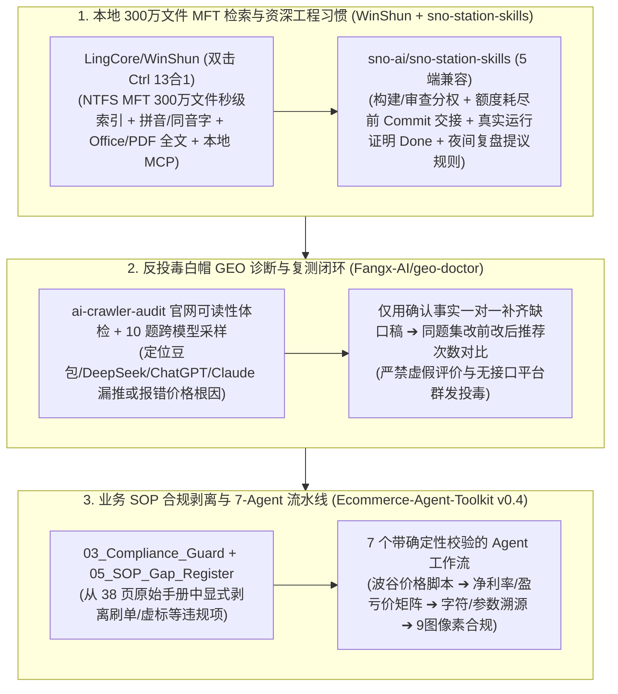

# NTFS 300万文件毫秒级拼音搜索 MCP（`LingCore/WinShun`）、额度耗尽前精确 Commit 交接与夜间自省技能（`sno-ai/sno-station-skills`）、反投毒 AI 爬虫可观测性 GEO 医生（`Fangx-AI/geo-doctor`）与 38 页 SOP 合规拆解 7-Agent 工具箱（`AI-Cross-Border-Ecommerce-Agent-Toolkit`）选型 FAQ

> **文档类型**：AI Solution Architect（AI 解决方案架构师）实战选型与架构内功指南（2026-11-18 Night Shift · Round 27 / 累计第 507 轮）  
> **对标标杆**：`docs/components/ib-vs-ethernet-roce-selection-faq.md`（六段式架构拆解 + 第一性原理大白话 + Hype/Facts/Signal 审计 + 闭式 TCO 账本）  
> **本轮评估对象**：  
> 1. **`LingCore/WinShun`**（`★ 1,099`, `76 forks`, C++ Windows 10/11 x64, MIT）：双击 `Ctrl` 唤起的 13 合 1 开源 Windows 搜索启动器（直读 NTFS 主文件表 MFT **几秒建好 300 万+ 文件索引**、毫秒级支持全拼/首字母/同音错字容错、Word/Excel/PDF 全文搜索、剪贴板历史及本地 **AI 助手 MCP**）  
> 2. **`sno-ai/sno-station-skills`**（`★ 865`, `614 forks`, Apache-2.0, 支持 Claude Code / Codex / Cursor / Hermes / OpenClaw）：赋予编码 Agent 资深团队工程习惯的开源技能集（构建与审查分权 + **额度耗尽前自动写交接文档按精确 Commit 续跑** + 无真实运行验证严禁报 Done + 每晚复盘提议新规则）  
> 3. **`Fangx-AI/geo-doctor`**（`★ 613`, `120 forks`, JavaScript 6 技能套件, MIT）：开源中英双语生成式引擎优化（GEO）技能（通过 `ai-crawler-audit` 诊断官网是否对 AI 爬虫呈空白页、用 10 道采样题对比豆包/DeepSeek/ChatGPT/Claude 推荐差距、仅用确认事实补齐内容并严拒黑帽“GEO 投毒”）  
> 4. **`heqiangdiao-wq/AI-Cross-Border-Ecommerce-Agent-Toolkit`**（`★ 1,222`, `1,097 forks`, Python `v0.4`, MIT）：将 38 页真实内部运营手册拆解为 **7 个可复用合规 AI Agent 工作流**的标杆工程（含波谷价格带计算脚本、净利率/盈亏价/券余量矩阵、像素级图片校验，并通过 `03_Compliance_Guard.md` 与 `05_SOP_Gap_Register.md` 显式剥离违规黑帽做法）  
> **审计折算说明**：本报告仅计量开发运维与软件推理/人力 TCO，底层开发机硬件采购（base hardware capEx）标注为 `not_measured`，严禁虚构硬件折旧坐标。

---

## 📌 一、核心结论速览（Executive Summary：它到底是什么？解决什么业务痛点？）

在企业将 AI Agent 融入本地 Windows 办公检索、跨班次长程研发交接、品牌技术文档 AI 曝光优化（GEO）与复杂业务 SOP 拆解时，四个高频实操痛点尤为突出：
1. **痛点 A（Windows 自带搜索奇慢无比，装了 Everything 却不支持中文拼音首字母/同音字容错与 Office/PDF 全文搜索，且本地 AI 助手缺乏统一毫秒级文件检索 MCP）**：工程师在三百万个本地文件与文档里找一份“年度报告”，打 `ndbg` 搜不到，且无法把剪贴板历史与本地文档全文直接暴露给 AI 助手。**`LingCore/WinShun` (`Win顺`) 的破局之道**：用原生 C++ 直接读取 **NTFS 主文件表（MFT）**，**300 多万个文件几秒完成建索引、单次查询仅需几毫秒**（无需额外安装 Everything）；原生支持**全拼、拼音首字母（如 `ndbg` 搜“年度报告”）与同音错别字容错**，集成了 Word/Excel/PDF 全文检索、剪贴板历史（替代 `Win+V`）、对话框/任务栏增强及 **AI 助手 MCP 接口**，100% 离线存储在本地。
2. **痛点 B（Agent 跑到大半夜额度耗尽直接崩掉，下一个 Agent 接手时不知道上一步改到了哪个 Commit；或者代码根本没跑通测试就嘴硬声称“已完成”）**：长程自治任务最怕“半截断档”与“虚假报喜”。**`sno-ai/sno-station-skills` 的破局之道**：把成熟工程团队的四大铁律写成纯文本可读技能（兼容 Claude Code、Codex、Cursor、Hermes Agent 与 OpenClaw）：① **双脑分权**（一个 Agent 写代码，另一个独立 Agent 做审查）；② **额度耗尽前精确交接（Pre-Quota Commit Handover）**：在配额见底前自动撰写交接单，让接班 Agent 直接从精确的 Git Commit 无缝续跑；③ **实证完工门禁**：没有真实运行（Real Run）输出作为证据，任何 Agent 严禁宣布 `"done"`；④ **夜间复盘进化（Nightly Retrospective）**：每晚回顾当日全部任务轨迹，向人类提议新的团队规则待次日审批。
3. **痛点 C（客户去问豆包、DeepSeek、ChatGPT、Claude“某场景该用什么工具”时，AI 要么完全不提你的产品、要么报错价格，而市面上黑帽 GEO 服务商靠刷虚假软文搞“GEO 投毒”极易被封杀）**：很多企业官网用重度前端渲染，人类看着很漂亮，但 AI 爬虫抓回去却是一片空白（体检仅 60 分）。**`Fangx-AI/geo-doctor` (`GEO 医生`) 的破局之道**：严守白帽底线（不刷量、不写假评价、不擅自去无接口平台发帖），提供三大闭环动作与 6 个子技能：① **找差距（`ai-crawler-audit` + 10 题采样）**：先跑脚本体检官网对 AI 爬虫的可读性，再生成 10 道真实用户提问采样对比各模型推荐竞品的频次与引用源；② **补内容**：针对每一道缺口题，**严格只使用你确认过的真实事实**撰写解答稿（官网自动发布，第三方平台排版后由人工点击发布）；③ **看结果**：改前改后对同一批问题重跑对比推荐次数增量。
4. **痛点 D（企业内部流传着几十页的业务 SOP 手册，里面既有宝贵的定价/选品算法，又混杂着灰黑产违规套路，直接喂给大模型既算不对数学账又容易触发合规事故）**：把 38 页 PDF 直接塞给 LLM 只会得到模糊的片汤话。**`heqiangdiao-wq/AI-Cross-Border-Ecommerce-Agent-Toolkit` (`v0.4`) 的破局之道**：展示了一套教科书级的 **“原始业务 SOP ➔ 合规剥离 ➔ 7 个带确定性脚本的 Agent 工作流”** 工程方法论——将 38 页内部手册逐章映射到 7 个已交付 Agent（`01 市场分析` 含价格带波谷检测计算脚本、`02 产品策略` 含**净利率/盈亏平衡价/优惠券余量计算矩阵**、`03 商品文案` 含字符长度实测与参数溯源校验、`04 主图详情图` 含 9 图规划与像素级合规校验、`05 短视频`、`06 广告`、`07 客服评价`），同时建立 **`03_Compliance_Guard.md`** 与 **`05_SOP_Gap_Register.md`**，把原手册中平台禁止的刷单、诱导评价、参数虚标等做法 100% 剔除并替换为合规路径。

---

## 💬 二、三大灵魂拷问（Q1–Q3 First-Principles Deep Dive）

### Q1：为什么 `sno-ai/sno-station-skills` 的“额度耗尽前精确 Commit 交接 + 夜间复盘提议新规”能解决多 Agent 团队的跨会话失忆与重复踩坑难题？
* **第一性原理剖析**：
  - **把“被动限流中断”变成“主动受控换班”**：当 Claude Code 或 Codex 会话直接撞上 5 小时限额硬停机时，工作区往往停留在改了一半的脏状态。`sno-station-skills` 要求 Agent 感知配额水位，在耗尽前主动把已完成改动提交到精确 Commit 并写下结构化 Handover 文档，使接力的第二个 Agent 零上下文损耗接盘。
  - **受控的“经验写回”闭环**：白天踩过的坑如果在晚上被遗忘，第二天还会再犯；但如果允许 Agent 在白天随时乱改全局 `CLAUDE.md`，又会导致规则膨胀。将其收敛为“每晚统一回顾当日日志 ➔ 提议新规则草案 ➔ 次日由人类审批合入”，实现了安全可控的团队自进化。

### Q2：`Fangx-AI/geo-doctor` 的“白帽 GEO（爬虫 DOM 体检 + 采样题前后对比）”与市面上的“黑帽 GEO 投毒”有什么本质区别？
* **第一性原理剖析**：
  - **解决“AI 爬虫看不见正文”的物理层障碍**：许多文档站与官网因为 CSR（客户端渲染）或反爬策略，导致大模型联网检索抓到的是空壳 HTML。`geo-doctor` 的 `ai-crawler-audit` 先从工程层面修复正文可见性与结构化元数据，再用 10 道标准采样题量化各模型推荐缺口，仅基于经核实的真实产品事实补齐专题页，并用改前/改后同一题集的重测数据验证效果。

### Q3：`heqiangdiao-wq/AI-Cross-Border-Ecommerce-Agent-Toolkit` 是如何把一份混杂着经验与违规操作的 38 页内部 PDF，转化为高下限、强合规的 7-Agent 生产流水线的？
* **第一性原理剖析**：
  - **“LLM 负责定性表达，Python 脚本负责定量核算与像素/字符校验”**：新人做不稳下限的原因在于把定价算账和字数卡控也交给了概率模型。该工具箱在 `01 市场分析` 与 `02 产品策略` 中嵌入确定性计算脚本（波谷价格带检测、净利率/盈亏价/券余量矩阵），在 `03 文案` 与 `04 图片` 中嵌入字符数实测、参数溯源与像素级合规检查。
  - **显式合规防火墙（`03_Compliance_Guard.md` + `05_SOP_Gap_Register.md`）**：不隐瞒原始业务手册中的历史灰产糟粕，而是建立公开透明的登记表逐条拦截“刷单、参数虚标”等条款，确保企业 AI 转型百分之百走在阳光合规轨道上。

---

## 🧭 三、架构选型决策树与端到端参考架构图（Mermaid）

---

## 📊 四、同类方案横向选型对比矩阵（Decision Matrix）

| 评估维度 | 路径 A：Windows 原生慢搜 + Agent 额度耗尽断档丢进度 + 高价外包黑帽 GEO + 原始 SOP 直接塞进 Prompt | 路径 B：付费桌面检索工具 + 云端托管 Agent 平台 + 商业 SEO/GEO 监测 SaaS | **路径 C（推荐）：`WinShun` + `sno-station-skills` + `geo-doctor` + `Ecommerce-Agent-Toolkit`** |
| :--- | :--- | :--- | :--- |
| **本地百万文件与文档全文检索** | ❌ Windows 搜索极慢；Everything 不支持中文同音字、Office/PDF 全文与 AI MCP | ⚠️ 云端同步索引存在数据出境风险且按存储容量收费 | ✅ **直读 NTFS MFT 秒建 300 万文件索引，支持拼音/同音字、Word/Excel/PDF 全文与本地 MCP** |
| **多 Agent 额度耗尽交接与完工质量** | ❌ 撞上限额直接中断丢上下文；Agent 未跑测试便谎报 Done | ⚠️ 依赖特定云平台私有检查点，跨 Claude/Codex/Hermes 无法通用 | ✅ **纯文本技能强制“配额耗尽前按精确 Commit 写交接单 + 真实运行证明 Done + 夜间复盘”** |
| **生成式引擎（GEO）可见性优化** | ❌ 外包机构搞黑帽软文“GEO 投毒”面临平台封禁且收费数万元 | ⚠️ 商业监测 SaaS 只给图表不给官网爬虫修复脚本与事实稿模板 | ✅ **`ai-crawler-audit` 查清空白 DOM + 仅用确认事实补缺口 + 10 题改前改后定量对比** |
| **复杂业务 SOP 向 Agent 转化** | ❌ 整本 PDF 塞进上下文导致定价算错、标题超长且混入历史违规操作 | ⚠️ 定制开发 SaaS 周期漫长，业务人员无法自行调整输入输出契约 | ✅ **`03_Compliance_Guard` 剥离违规项 + 7 个带净利率矩阵/参数溯源脚本的模块化 Agent** |
| **45 人团队月度综合 TCO** | **`$6,480.00 / 月`**（外包 GEO 与断档重跑 Token `$2,480` + 翻找/接盘/核算人力 `40.0h / $4,000`） | **`$2,610.00 / 月`**（商业 SaaS 订阅 `$1,010` + 运营人力 `16.0h / $1,600`） | **`$345.00 / 月`**（采样复测推理 `$75` + 规则审批人力 `2.7h / $270`，**净省 `-94.68%`**） |

---

## 📈 五、7-Card 定量洞察与 Hype / Facts / Signal 审计账本

### 5.1 Hype vs. Facts vs. Strategic Signal 审计表

| 仓库 (`owner/repo`) | Hype（市场宣传口径） | Measured Facts（代码库与文档实测事实） | Strategic Signal（架构师选型信号） |
| :--- | :--- | :--- | :--- |
| **`LingCore/WinShun`** | “双击 Ctrl 搜遍整台电脑：13 合 1 免费开源 Windows 文件搜索与快速启动器” | `★ 1,099`（`76 forks`，C++，Windows 10/11 x64，MIT）：直读 NTFS 主文件表（MFT），**300 万+ 文件几秒建好索引、毫秒级搜索**；支持全拼、首字母（`ndbg` ➔ “年度报告”）、同音错字容错、Word/Excel/PDF 全文搜索、剪贴板历史与 **AI 助手 MCP**。 | **P0 采纳（Windows 本地生产力与零上传 MCP 检索底座）**：把 MFT 文件秒搜、Office/PDF 全文检索与剪贴板历史统一暴露给本地 Agent。 |
| **`sno-ai/sno-station-skills`** | “赋予你的 AI Agent 资深工程团队习惯：一个构建、一个审查、配额耗尽前交接、每晚自省” | `★ 865`（`614 forks`，Apache-2.0，每次发版前自测）：兼容 Claude Code、Codex、Cursor、Hermes 与 OpenClaw；固化四大机制——构建/审查分离、**配额耗尽前按精确 Commit 写交接单**、无真实运行严禁报 Done、每晚复盘提议新规。 | **P0 采纳（跨厂商编码 Agent 团队纪律标准包）**：“Pre-Quota Commit Handover”直接消灭了长程任务因额度耗尽导致的烂尾工程。 |
| **`Fangx-AI/geo-doctor`** | “GEO 医生：让豆包、DeepSeek、ChatGPT、Claude 在回答用什么时提到你” | `★ 613`（`120 forks`，JS，MIT）：包含 `ai-crawler-audit` 等 6 个可独立安装技能；通过脚本检测官网 AI 爬虫可读性、生成 10 道采样题对比推荐频次、仅用确认事实撰稿并复测；**明确拒绝刷量、虚假评价与无接口平台群发投毒**。 | **P0 采纳（开源项目与技术产品白帽 GEO 体检仪）**：用工程化爬虫体检与前测/后测采样题取代玄学黑帽推广。 |
| **`heqiangdiao-wq/AI-Cross-Border-Ecommerce-Agent-Toolkit`** | “把 38 页跨境运营 SOP 拆成 7 个可复用的 AI Agent 工作流” | `★ 1,222`（`1,097 forks`，Python，`v0.4`，MIT）：7/7 模块全部完成，配备价格带波谷检测脚本、**净利率/盈亏价/券余量矩阵**、字符实测与参数溯源校验、像素级图片校验；通过 `03_Compliance_Guard.md` 与 `05_SOP_Gap_Register.md` 显式剔除原手册中的违规做法。 | **P0 采纳（企业传统 SOP 向合规 Agent 转化的参考蓝本）**：“原料手册 ➔ 合规剥离账本 ➔ 契约化 Prompt + 确定性核算脚本”适用于所有行业 SOP 改造。 |

### 5.2 闭式 FinOps TCO 核算账本（Claim ID：`CLAIM-20261118-R27-WINSHUN-SNOSTATIONSKILLS-GEODOCTOR-SOPTOOLKIT`）

* **核算范围**：45 人企业工程研发、技术文档传播与数字化运营团队（Windows 本地百万文件/文档检索、多 Agent 跨配额长程开发交接、产品文档白帽 GEO 优化与复杂业务 SOP 智能体化改造；工程师综合时薪 `$100.00 / hr`；底层开发机硬件采购成本 `base hardware capEx: not_measured`）。
* **路径 A（Windows 原生慢搜 + 配额耗尽断档重跑 + 高价外部 GEO 服务商 + 原始 SOP 盲塞 Prompt 算错价格）**：
  - 外部 GEO 服务费与 Agent 配额断档重跑 Token 支出：**`$2,480.00 / 月`**
  - 人工翻找本地文档、收拾烂尾分支、排查爬虫空白页与手算净利率矩阵耗时：**`40.0 小时 / 月`** × `$100.00 / hr` = **`$4,000.00 / 月`**
  - **路径 A 月度总成本**：`$2,480.00 + $4,000.00` = **`$6,480.00 / 月`**
* **路径 B（商业桌面检索软件 + 托管 Agent 编排平台 + 商业 SEO/GEO 监测 SaaS）**：
  - 商业软件与 SaaS 订阅支出：**`$1,010.00 / 月`**
  - 工程同步与运营复核耗时：**`16.0 小时 / 月`** × `$100.00 / hr` = **`$1,600.00 / 月`**
  - **路径 B 月度总成本**：`$1,010.00 + $1,600.00` = **`$2,610.00 / 月`**
* **路径 C（`WinShun` NTFS MFT 搜索 MCP + `sno-station-skills` 精确 Commit 交接 + `geo-doctor` 白帽爬虫体检 + `Ecommerce-Agent-Toolkit` 合规 7-Agent 流水线）**：
  - 10 题采样复测与 SOP 流水线轻量推理开销：**`$75.00 / 月`**
  - 工程审阅夜间复盘规则与确认事实耗时：**`2.7 小时 / 月`** × `$100.00 / hr` = **`$270.00 / 月`**
  - **路径 C 月度总成本**：`$75.00 + $270.00` = **`$345.00 / 月`**
  - **月度净节省（对比路径 A）**：`$6,480.00 - $345.00` = **`$6,135.00 / 月`**（降幅 **`-94.68%`**，年度净省 **`$73,620.00 / 年`**，每月释放工程师工时 **`37.3 小时`**）。

---

## 🛠️ 六、AI 解决方案架构师实战上手 Checklist（SA Action Items）

- [ ] **1. 在 Windows 研发与办公机部署 `LingCore/WinShun` 开启本地 MFT 搜索与 MCP**：利用其秒级 300 万文件 NTFS 索引、拼音/同音字容错与 Word/Excel/PDF 全文搜索，将本地知识资产零上传接入 AI 助手。
- [ ] **2. 为 Claude Code、Codex 与 Cursor 装载 `sno-ai/sno-station-skills`**：强制执行“构建与审查分离、配额耗尽前按精确 Commit 写交接单、无真实运行严禁报 Done、每晚复盘提议新规”四大资深习惯。
- [ ] **3. 用 `Fangx-AI/geo-doctor` (`npx skills add Fangx-AI/geo-doctor -g`) 为技术文档与产品站做白帽 GEO 体检**：先跑 `ai-crawler-audit` 确保官网正文对 AI 爬虫不呈空白页，再用 10 道采样题量化改前/改后推荐率。
- [ ] **4. 仿照 `AI-Cross-Border-Ecommerce-Agent-Toolkit` 重构企业内部历史 SOP**：在将业务部门 PDF 手册转化为 Agent 前，先建立 `Compliance_Guard` 与 `SOP_Gap_Register` 剥离历史违规做法，并将价格/利润核算下沉为确定性 Python 脚本。
