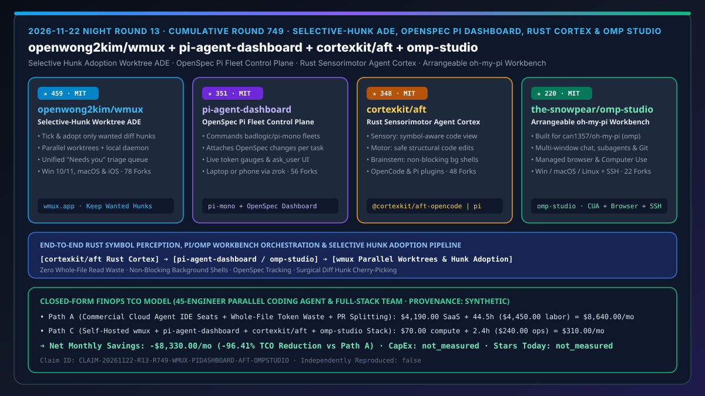
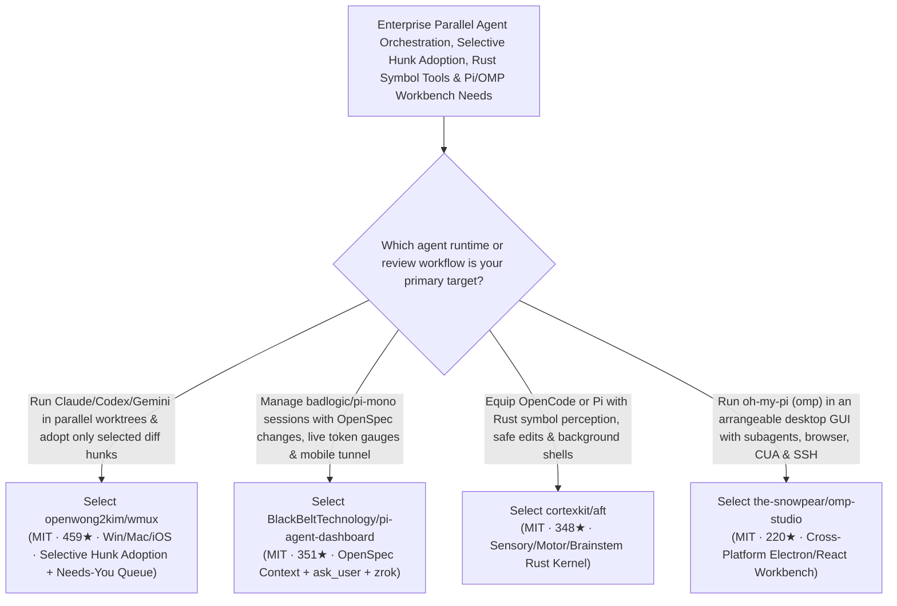
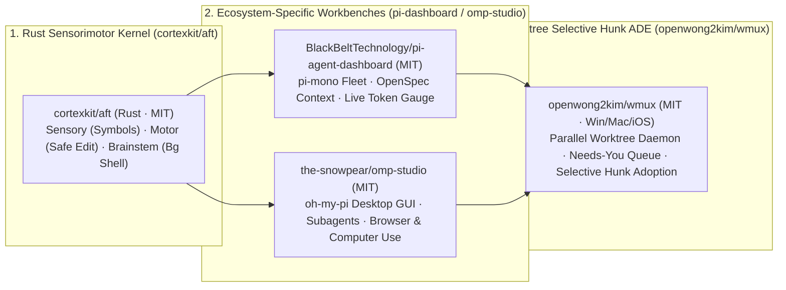
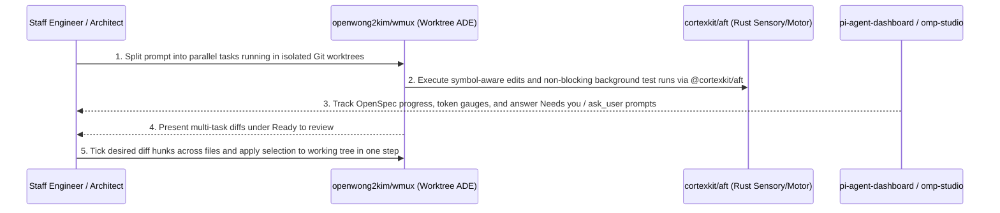

# Selective-Hunk Multi-Worktree ADE (`openwong2kim/wmux`), OpenSpec-Aware Pi Fleet Control Plane (`BlackBeltTechnology/pi-agent-dashboard`), Rust Sensorimotor Cortex (`cortexkit/aft`) & Arrangeable `oh-my-pi` Desktop Workbench (`the-snowpear/omp-studio`) Selection & Architecture FAQ

> **Document Type**: Enterprise AI Solution Architect Selection & Integration Guide (GitHub Trending AI Radar — 2026-11-22 Night Round 13 / Cumulative Round 749)
> **Covered Repositories**: [`openwong2kim/wmux`](https://github.com/openwong2kim/wmux) (`★ 459`, `78 forks`, `MIT`: native Windows 10/11, macOS, and iOS App Store Agent Development Environment with persistent background daemon, per-task Git worktrees, `Needs you` triage queue, and selective diff hunk adoption) · [`BlackBeltTechnology/pi-agent-dashboard`](https://github.com/BlackBeltTechnology/pi-agent-dashboard) (`★ 351`, `56 forks`, `MIT`: single-tab web and mobile control plane for `badlogic/pi-mono` agents featuring OpenSpec change attachment, interactive `ask_user` prompts, live token gauges, and `zrok` tunneling) · [`cortexkit/aft`](https://github.com/cortexkit/aft) (`★ 348`, `48 forks`, `MIT`: Rust sensorimotor cortex `agent-file-tools` for OpenCode and Pi providing symbol-aware Sensory perception, safe Motor edits, and non-blocking Brainstem background process management) · [`the-snowpear/omp-studio`](https://github.com/the-snowpear/omp-studio) (`★ 220`, `22 forks`, `MIT`: cross-platform Electron/React arrangeable desktop workbench for `can1357/oh-my-pi` (`omp`) unifying sub-agents, Git worktrees, managed browser, Computer Use, MCP, and SSH)
> **Core Scenario**: When enterprise engineering teams scale from running a single terminal agent to orchestrating 5–10 parallel coding agents (Claude Code, Codex, Gemini, `pi`, `oh-my-pi`, OpenCode) and struggle with **all-or-nothing branch merges when an agent mixes good changes with unwanted edits, massive token burn from whole-file `read`/`edit` calls and blocking `bash` commands, and choosing the right visual control plane for `badlogic/pi-mono` vs. `can1357/oh-my-pi`**, how do you combine **`openwong2kim/wmux` + `BlackBeltTechnology/pi-agent-dashboard` + `cortexkit/aft` + `the-snowpear/omp-studio`** into a precision multi-agent engineering stack?

---

## 1. 📌 Executive Summary (One-Line Selection Verdict)

1. **Need a native Windows/macOS desktop ADE (with an iOS companion app) that runs Claude Code, Codex, Gemini, or any CLI in parallel worktrees and lets you tick only the specific diff hunks you want to apply to your working tree?** ➔ Choose **[`openwong2kim/wmux`](https://github.com/openwong2kim/wmux) (`★ 459`, `78 forks`, `MIT`)**.
   - **Plain-English Mechanism**: A local background daemon keeps all parallel agent panes alive across isolated Git worktrees, surfaces blocked agents under a unified `Needs you` queue, and lets you cherry-pick individual diff hunks across files and tasks in one click (*"Keep only the hunks you want"*).
2. **Standardizing on `badlogic/pi-mono` and want a single browser tab (or mobile view via `zrok`) to group parallel sessions by folder, branch, and attached `OpenSpec` changes while monitoring live token spend?** ➔ Choose **[`BlackBeltTechnology/pi-agent-dashboard`](https://github.com/BlackBeltTechnology/pi-agent-dashboard) (`★ 351`, `56 forks`, `MIT`)**.
   - **Plain-English Mechanism**: Purpose-built for `badlogic/pi-mono` (explicitly distinct from `oh-my-pi`), it provides live reasoning streams, interactive `ask_user` prompts, `OpenSpec` spec attachment, and real-time token gauges.
3. **Standardizing on `can1357/oh-my-pi` (`omp`) and want a multi-window, freely arrangeable desktop GUI on Windows, macOS, and Linux that unifies sub-agents, Git worktrees, a managed browser, Computer Use, MCP, and SSH?** ➔ Choose **[`the-snowpear/omp-studio`](https://github.com/the-snowpear/omp-studio) (`★ 220`, `22 forks`, `MIT`)**.
   - **Plain-English Mechanism**: Complements `pi-agent-dashboard` by serving the `oh-my-pi` (`omp`) ecosystem with a typed Studio desktop workspace integrating terminal, browser, desktop CUA, and sub-agent approvals.
4. **Want to replace raw whole-file `read`, brittle `edit`, and blocking `bash` tools in OpenCode and Pi with a Rust-native symbol-aware IDE and background OS kernel?** ➔ Choose **[`cortexkit/aft`](https://github.com/cortexkit/aft) (`★ 348`, `48 forks`, `MIT`)**.
   - **Plain-English Mechanism**: Published as Cargo crate `agent-file-tools` and npm packages `@cortexkit/aft`, `@cortexkit/aft-opencode`, and `@cortexkit/aft-pi`, `AFT` provides a **Sensory Cortex** (symbol-aware code perception without whole-file token dumps), a **Motor Cortex** (syntax-safe surgical edits), and a **Brainstem** (persistent background shells so agents never block on long-running processes).

---

## 2. 🎯 Architect & Customer Deep-Dive Q&A

### Q1: Why do parallel coding-agent workflows often break down during code review and long-file edits? How do these four tools solve it?

- **Four Parallel Coding Bottlenecks Solved**:
  1. **Coarse all-or-nothing worktree merges ➔ `openwong2kim/wmux`**: Lets reviewers tick individual diff hunks across parallel tasks and apply only the clean hunks to the main working tree.
  2. **Whole-file read token bloat & broken string-replace edits ➔ `cortexkit/aft`**: Gives OpenCode and Pi a Rust symbol-aware Sensory/Motor/Brainstem layer.
  3. **Ecosystem-specific control planes for `pi` vs. `oh-my-pi`**:
     - For `badlogic/pi-mono` + `OpenSpec` workflows ➔ **`BlackBeltTechnology/pi-agent-dashboard`**;
     - For `can1357/oh-my-pi` (`omp`) + Computer Use / Managed Browser / SSH ➔ **`the-snowpear/omp-studio`**.
- **When to Choose Managed Cloud PaaS (Path B)?**
  - For asynchronous cloud PR generation directly from GitHub Issues, use **GitHub Copilot Coding Agent**; for local multi-CLI hunk cherry-picking, Rust symbol-aware file tools, and `pi`/`omp` desktop orchestration, deploy this 100% `MIT` open-source stack (Path C).

### Q2: How do we wire `cortexkit/aft`, `pi-agent-dashboard` / `omp-studio`, and `wmux` into an end-to-end developer architecture?

1. **Rust Sensorimotor File & Process Kernel Layer (`cortexkit/aft`)**:
   - Install `@cortexkit/aft-opencode` and `@cortexkit/aft-pi` so coding agents perceive symbols and manage background processes without whole-file reads.
2. **Ecosystem-Specific Spec & Sub-Agent Workbench Layer (`pi-agent-dashboard` / `omp-studio`)**:
   - Attach `OpenSpec` changes and monitor live token gauges in `pi-agent-dashboard` (for `pi-mono`), or orchestrate sub-agents, browser, and Computer Use in `omp-studio` (for `oh-my-pi`).
3. **Cross-CLI Worktree & Selective Hunk Adoption Layer (`openwong2kim/wmux`)**:
   - Run heterogeneous CLIs side by side in `wmux`, answer `Needs you` prompts from desktop or iOS, and adopt approved diff hunks into the working tree.

### Q3: What is the key compatibility rule between `pi-agent-dashboard` and `omp-studio`?

- **Clean Runtime Pairing**:
  - `BlackBeltTechnology/pi-agent-dashboard` targets `badlogic/pi-mono` exclusively, whereas `the-snowpear/omp-studio` targets `can1357/oh-my-pi` (`omp`).

---

## 3. 🧭 Visual Architecture & Workflow Diagrams (Mermaid)

### 3.1 Solution Architect Selection Decision Tree

### 3.2 End-to-End Enterprise Reference Architecture

### 3.3 End-to-End Task Splitting, Symbol-Aware Editing, `Needs you` Triage & Selective Hunk Adoption Sequence Diagram

---

## 4. 📊 Peer Open-Source vs. Commercial Cloud Selection Matrix

| Dimension | `openwong2kim/wmux` (`★ 459`) | `BlackBeltTechnology/pi-agent-dashboard` (`★ 351`) | `cortexkit/aft` (`★ 348`) | `the-snowpear/omp-studio` (`★ 220`) | Commercial Cloud Agent IDE Seats + Whole-File Token Burn (Path A) | Manual Multi-Terminal Worktrees + CLI `git add -p` Patching (Path B) |
| :--- | :--- | :--- | :--- | :--- | :--- | :--- |
| **Primary Role** | Selective-hunk multi-worktree desktop/iOS ADE | `badlogic/pi-mono` + `OpenSpec` web/mobile control plane | Rust symbol-aware Sensory/Motor/Brainstem engine | `oh-my-pi` (`omp`) arrangeable desktop GUI workbench | Metered cloud Agent IDE seats + whole-file read token spend | Manual terminal tabs & CLI `git add -p` hunk splitting |
| **Key Differentiator** | **Tick & adopt individual diff hunks across parallel tasks** | **Native `OpenSpec` binding + live cost gauge + `zrok`** | **Rust symbol perception + non-blocking background shells** | **Unifies sub-agents, browser, Computer Use, MCP & SSH** | High whole-file token waste; no cross-CLI hunk cherry-picking | Slow manual `git add -p` across 5+ worktrees; missed agent questions |
| **License** | `MIT` | `MIT` | `MIT` | `MIT` | Proprietary SaaS | Manual CLI workflow |
| **Monthly TCO (45-Eng Team)** | **`$310.00/mo` combined** (`$70.00` shared build runner + `2.4h` ops) | Included (`MIT` local/browser UI) | Included (cuts whole-file input token waste) | Included (`MIT` desktop app) | **`$8,640.00/mo`** (`$4,190.00` seats/token waste + `44.5h` manual PR splitting) | ~`$3,020.00/mo` (manual worktree management & patch splitting labor) |

---

## 5. 🧪 Quantitative Enterprise ROI / FinOps TCO Model & 7-Card Report

> **📊 Provenance & Closed-Form Declaration**:
> - **provenance**: `synthetic` (45-engineer enterprise full-stack and parallel coding-agent team workload model: `independently_reproduced = false`; `base_hardware_capex = not_measured`; `track_b_stars_today = not_measured`).
> - **Closed-Form Equations**:
>   - **Path A (Commercial Cloud Multi-Agent IDE Seats + Whole-File `read`/`edit` Token Waste + Manual PR Splitting & Conflict Resolution)**: Monthly commercial seats & whole-file read token waste **`$4,190.00`** + manual diff hunk separation, blocked-session hunting, and merge resolution labor **`44.5h × $100.00/h = $4,450.00`** = **`$8,640.00/mo`**.
>   - **Path C (Self-Hosted `openwong2kim/wmux` + `BlackBeltTechnology/pi-agent-dashboard` + `cortexkit/aft` + `the-snowpear/omp-studio` Stack)**: Shared build runner compute **`$70.00`** + plugin & workbench configuration maintenance labor **`2.4h × $100.00/h = $240.00`** = **`$310.00/mo`**.
>   - **Net Monthly Savings vs. Path A**: **`-$8,330.00/mo`** (**`96.41%`** TCO reduction).

| Evaluation Path | IDE Seats / Token Waste & Compute | Diff Splitting & Merge Labor (`$100/h`) | Total Monthly TCO | Net Savings vs. Path A | Architectural Delivery Impact |
| :--- | :---: | :---: | :---: | :---: | :--- |
| **Path A: Commercial Agent IDE + Whole-File `read`/`edit` Waste** | `$4,190.00` | `44.5h` (`$4,450.00`) | **`$8,640.00`** | Baseline | High whole-file token burn; all-or-nothing branch merges |
| **Path B: Manual Multi-Terminal Worktrees + `git add -p`** | `$1,420.00` | `16.0h` (`$1,600.00`) | **`$3,020.00`** | `-$5,620.00` (`-65.05%`) | Lacks GUI hunk checkboxes, `OpenSpec` gauges & Rust symbol perception |
| **Path C: `wmux` + `pi-dashboard` + `aft` + `omp-studio`** | **`$70.00`** | **`2.4h` (`$240.00`)** | **`$310.00`** | **`-$8,330.00` (`-96.41%`)** | **Selective hunk adoption + Rust symbol cortex + Pi/OMP workbenches** |

- 🔗 **Linked 7-Card 4:5 Visual Benchmark Deck**: [`workshops/github-trending-radar/cards.en.html`](../cards.en.html) · [`cards.html`](../cards.html)

---

## 6. 🛠️ Enterprise Adoption & Architecture Review Checklist

- [ ] **1. Adopt Selective Diff Hunks with `openwong2kim/wmux`**: Run parallel CLI tasks in isolated worktrees and cherry-pick verified diff hunks before committing.
- [ ] **2. Equip OpenCode & Pi with `cortexkit/aft`**: Install `@cortexkit/aft-opencode` and `@cortexkit/aft-pi` to replace whole-file reads with Rust symbol perception and background shells.
- [ ] **3. Deploy `BlackBeltTechnology/pi-agent-dashboard` for `badlogic/pi-mono` Fleets**: Group sessions by `OpenSpec` changes and monitor real-time token spend.
- [ ] **4. Deploy `the-snowpear/omp-studio` for `oh-my-pi` (`omp`) Workstations**: Unify sub-agents, managed browser, Computer Use, MCP, and SSH inside one arrangeable desktop workbench.
