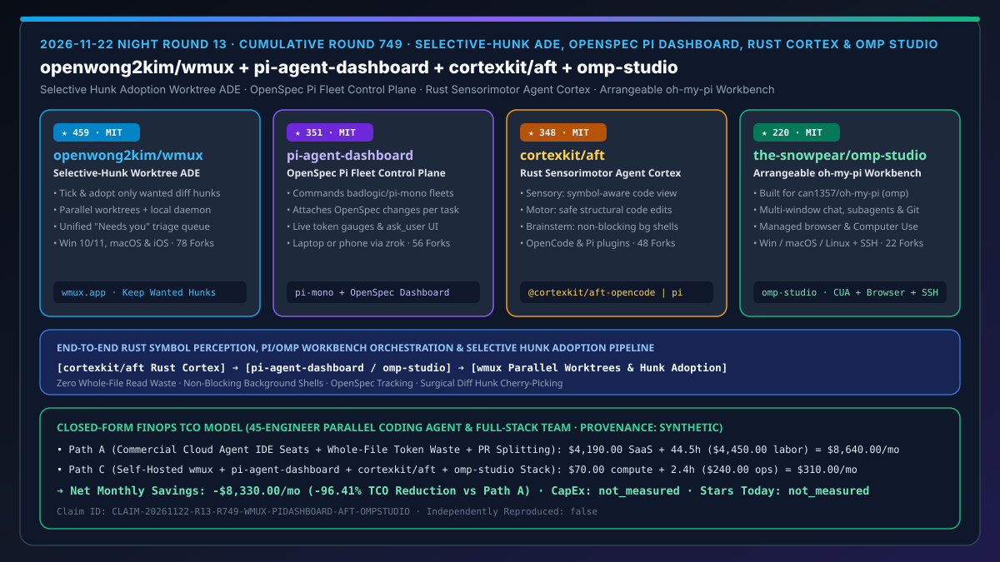
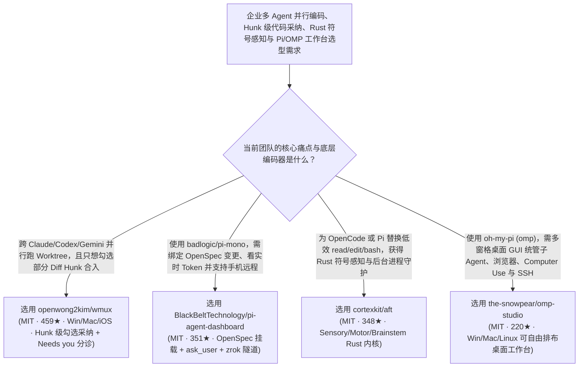
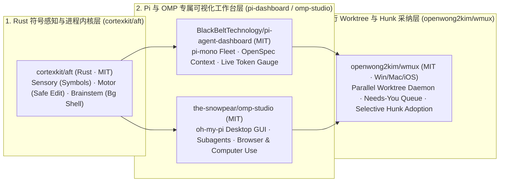
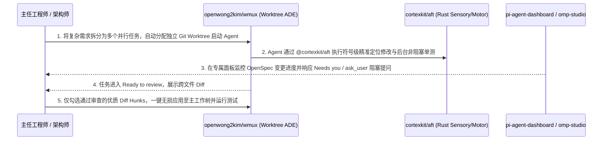

# 按 Hunk 勾选采纳的多 Worktree 智能体开发台（`openwong2kim/wmux`）、带 OpenSpec 挂载与手机穿透的 Pi 舰队面板（`BlackBeltTechnology/pi-agent-dashboard`）、Rust 符号级感知与后台进程引擎（`cortexkit/aft`）与 oh-my-pi 多窗格桌面工作台（`the-snowpear/omp-studio`）选型与集成架构 FAQ

> **文档类型**：企业 AI 解决方案架构师（AI Solution Architect）选型决策指南（GitHub Trending AI 雷达 2026-11-22 Night Round 13 / 累计第 749 轮）
> **覆盖项目**：[`openwong2kim/wmux`](https://github.com/openwong2kim/wmux)（`★ 459`、`78 forks`、`MIT`，原生支持 Windows 10/11、macOS 与 iOS App Store 的 AI 智能体集成开发环境 ADE，支持一键拆解多任务至独立 Git Worktree、汇总 `Needs you` 待回答会话以及**跨任务按 Hunk 勾选采纳代码 Diff**）· [`BlackBeltTechnology/pi-agent-dashboard`](https://github.com/BlackBeltTechnology/pi-agent-dashboard)（`★ 351`、`56 forks`、`MIT`，专为 `badlogic/pi-mono` 打造的浏览器控制面，支持按目录/分支/OpenSpec 变更分组、实时 Token 仪表盘、交互式 `ask_user` 问答与 `zrok` 手机远程隧道）· [`cortexkit/aft`](https://github.com/cortexkit/aft)（`★ 348`、`48 forks`、`MIT`，Rust 编写的 `agent-file-tools` 感觉运动皮层套件 `@cortexkit/aft`，通过 Sensory 符号感知、Motor 精准编辑与 Brainstem 后台长进程守护替代低效全文件 `read`/`edit`/`bash`）· [`the-snowpear/omp-studio`](https://github.com/the-snowpear/omp-studio)（`★ 220`、`22 forks`、`MIT`，专为 `oh-my-pi` (`omp`) 打造的可自由排布桌面工作台，集成多窗口对话、子 Agent、Git Worktree、托管浏览器、Computer Use、MCP 与 SSH）
> **核心场景**：当企业全栈研发团队从“单终端串行用 CLI 写代码”迈向“一人指挥 5–10 个并行编码 Agent（Claude Code、Codex、Pi、oh-my-pi、OpenCode）”时，面临**“Agent 一次性改了 10 个文件但其中 3 个代码块不能要（要么全合要么全丢）、底层 `read`/`edit`/`bash` 反复整文件读取浪费海量 Token 且阻塞后台服务、以及 `pi` 与 `oh-my-pi` 两大生态缺乏各自的专属可视化指挥台”**四大痛点时，如何按团队编码器栈选型并组合这四款工作台与引擎？

---

## 一、📌 核心结论速览（选型一句话结论）

1. **想在 Windows 或 macOS（含配套 iOS App）上并行跑 Claude Code、Codex、Gemini 等任意 CLI，且在审查成果时能“像挑菜一样只勾选你想要的某几个 Diff Hunk 一键合入主工作树”** ➔ 选 **[`openwong2kim/wmux`](https://github.com/openwong2kim/wmux)（`★ 459`，`78 forks`，`MIT`）**。
   - **通俗原理**：每个子任务都在独立的 Git Worktree 与本机常驻后台守护进程（Daemon）中运行；当某个 Agent 卡住提问时自动归类到 `Needs you` 队列集中回答；任务完成后进入 `Ready to review`，你可以跨文件逐个勾选满意的 Hunk 增量应用到工作树，彻底告别“为了剔除两行垃圾代码而手动拆 PR”的痛苦。
2. **团队主力使用极简 `pi`（`badlogic/pi-mono`）智能体，想用一个浏览器标签页（或通过 `zrok` 隧道在手机上）统管所有并行会话、实时挂载 `OpenSpec` 规格变更并监控每轮 Token 账单** ➔ 选 **[`BlackBeltTechnology/pi-agent-dashboard`](https://github.com/BlackBeltTechnology/pi-agent-dashboard)（`★ 351`，`56 forks`，`MIT`）**。
   - **通俗原理**：专为原版 `pi` 量身定制（注：明确不支持 `oh-my-pi`），按文件夹、分支与 `OpenSpec` 规格上下文自动分组会话，原生渲染交互式 `ask_user` 弹窗与实时上下文/成本仪表盘。
3. **团队主力使用 `oh-my-pi`（`omp`）智能体，想要一套支持 Windows、macOS、Linux 的多窗格可拖拽桌面 GUI，把子 Agent、Git Worktree、托管浏览器、桌面键鼠操作（Computer Use）、MCP 与 SSH 放进同一扇窗口** ➔ 选 **[`the-snowpear/omp-studio`](https://github.com/the-snowpear/omp-studio)（`★ 220`，`22 forks`，`MIT`）**。
   - **通俗原理**：与 `pi-agent-dashboard` 形成完美互补——专门服务于 `can1357/oh-my-pi`（`omp`）生态，提供可自由拼装的窗口化工作台与子 Agent 审批视图。
4. **想给 OpenCode 或 Pi 智能体换上一套“真正的 Rust 符号级 IDE 与后台操作系统内核”，终结原始 `read`/`edit`/`bash` 整文件读取烧 Token 与阻塞等待的问题** ➔ 选 **[`cortexkit/aft`](https://github.com/cortexkit/aft)（`★ 348`，`48 forks`，`MIT`）**。
   - **通俗原理**：发布为 Cargo Crate `agent-file-tools` 及 npm 包 `@cortexkit/aft`、`@cortexkit/aft-opencode`、`@cortexkit/aft-pi`。内部划分为三大模块：**① Sensory Cortex（符号级代码感知，无需整文件读取）➔ ② Motor Cortex（防破坏语法感知编辑）➔ ③ Brainstem（后台长进程守护与非阻塞 Shell 管理）**。

---

## 二、🎯 客户与架构师灵魂拷问 Q&A（深度架构拆解）

### Q1：为什么研发团队在尝试“并行开 5 个 Agent 写代码”时，往往死在最后一步的代码合并与 Token 暴增上？这四个项目如何破局？

- **四大并行编码痛点与工程解方**：
  1. **全盘接受或全盘放弃的粗粒度合并 ➔ `openwong2kim/wmux`**：提供 Hunk 级精细勾选采纳（Keep only the hunks you want）与 `Needs you` 阻塞问题集中分诊。
  2. **原始 `read`/`edit` 工具把几千行文件全塞进上下文 ➔ `cortexkit/aft`**：用 Rust Tree-sitter/符号感知（Sensory + Motor）只提取和修改目标符号，用 Brainstem 管理后台编译与测试进程。
  3. **`pi` 与 `oh-my-pi` 生态双轨分化选型**：
     - 用原版 `badlogic/pi-mono` + `OpenSpec` 规格驱动开发 ➔ 选 **`BlackBeltTechnology/pi-agent-dashboard`**；
     - 用 `can1357/oh-my-pi` (`omp`) + Computer Use / 托管浏览器 / SSH ➔ 选 **`the-snowpear/omp-studio`**。
- **何时直接用云厂商托管方案（Path B）？**
  - 若团队仅需在云端沙箱异步跑 GitHub Issue 修复 PR，可直接使用 **GitHub Copilot Coding Agent**；若需在本机跨 Worktree 按 Hunk 粒度挑拣多个 CLI 的代码产出、或深度驾驭 `pi` / `omp` / `OpenCode` 本地工作台，则采用本轮全部 `MIT` 协议的开源组合（Path C）。

### Q2：典型企业级“Rust 符号级内核 (`cortexkit/aft`) + 规格/多窗格专有台 (`pi-dashboard` / `omp-studio`) + 跨 CLI Hunk 级采纳总控 (`wmux`)”架构怎么搭？

1. **底层文件与进程感知加速层（`cortexkit/aft`）**：
   - 为 OpenCode 与 Pi 挂载 `@cortexkit/aft-opencode` 与 `@cortexkit/aft-pi`，将整文件读取替换为 Rust 符号级感知与后台非阻塞进程管理。
2. **中层专用智能体工作台层（`pi-agent-dashboard` / `omp-studio`）**：
   - `pi` 团队通过 `pi-agent-dashboard` 绑定 `OpenSpec` 规格与实时成本仪表盘；`omp` 团队通过 `omp-studio` 调度子 Agent、托管浏览器与 SSH。
3. **顶层跨 CLI 并行 Worktree 与 Hunk 采纳层（`openwong2kim/wmux`）**：
   - 架构师在 `wmux` 中将复杂需求拆分为多个并行 Worktree 任务，集中响应 `Needs you` 提问，并在验收时跨任务勾选最优 Diff Hunk 合入主分支。

### Q3：在选型 `pi-agent-dashboard` 与 `omp-studio` 时最需要注意什么？

- **严格区分底层宿主兼容性**：
  - `BlackBeltTechnology/pi-agent-dashboard` 官方文档明确标注仅支持 `badlogic/pi-mono`（不支持 `oh-my-pi`）；而 `the-snowpear/omp-studio` 则专为 `can1357/oh-my-pi` (`omp`) 构建。架构师可根据团队实际采用的分支精准对号入座。

---

## 三、🧭 直观可视化图解（Mermaid 决策树 + 集成架构 + 时序图）

### 3.1 架构师选型决策树

### 3.2 企业端到端生产集成参考架构图

### 3.3 任务拆解、Rust 符号级编辑、`Needs you` 集中问答与跨任务 Hunk 勾选合入时序图

---

## 四、📊 同类开源与商业云服务横向选型决策矩阵

| 对比维度 | `openwong2kim/wmux` (`★ 459`) | `BlackBeltTechnology/pi-agent-dashboard` (`★ 351`) | `cortexkit/aft` (`★ 348`) | `the-snowpear/omp-studio` (`★ 220`) | 商业云端多 Agent IDE 席位 + 全文件读写高额 Token 账单 (Path A) | 手工开多个终端切分支 + `git add -p` 手动拆补丁 (Path B) |
| :--- | :--- | :--- | :--- | :--- | :--- | :--- |
| **核心能力定位** | 按 Hunk 勾选采纳的多 Worktree ADE | 原版 `pi` + `OpenSpec` Web/手机指挥台 | Rust 符号感知、安全编辑与后台进程引擎 | `oh-my-pi` (`omp`) 多窗格全能桌面工作台 | 按席位与云端计算时长计费的商业 Agent IDE | 人工管理多个 `git worktree` 与终端 `git add -p` |
| **核心技术突破** | **跨任务可视化勾选 Diff Hunk + 本机 Daemon 保活 + iOS 端** | **原生集成 `OpenSpec` 变更 + 实时成本表 + `zrok` 隧道** | **Sensory/Motor/Brainstem 三层替代整文件 `read`/`edit`** | **同窗融合子 Agent、托管浏览器、Computer Use 与 SSH** | 整文件反复读取消耗大量 Token；云端环境难以直接连本地硬件/内网 | 手动在 5 个终端敲 `git add -p` 极易出错且漏看阻塞提问 |
| **开源协议** | `MIT` | `MIT` | `MIT` | `MIT` | 闭源商业 SaaS | 人工手工作业 |
| **月度 TCO（45 人团队）** | **组合仅 `$310.00/月`**（`$70.00` 共享构建运行器 + `2.4h` 维护） | 同左（MIT 本地/内网运行） | 同左（符号级编辑大幅降低输入 Token） | 同左（MIT 跨平台桌面端） | **`$8,640.00/月`**（`$4,190.00` 商业席位与整文件读取 Token 浪费 + `44.5h` 手工拆 PR 工时） | 约 `$3,020.00/月`（大量人工合并分支冲突与盯守多个终端窗口工时） |

---

## 五、🧪 应用落地定量收益/TCO 对比与 7-Card 报告

> **📊 数据来源与闭式核算声明（Provenance & Closed-Form Schema）**：
> - **provenance**: `synthetic`（基于 45 人企业全栈研发与多智能体并行工程团队月度工作负载模型：`independently_reproduced = false`；硬件采购基线 `base_hardware_capex = not_measured`；Track B 单日增量 `track_b_stars_today = not_measured`）。
> - **核算公式**：
>   - **Path A（采购商业云端多 Agent 工作台席位 + 原始 `read`/`edit` 反复整文件读取浪费高额 Token + 工程师为剔除 Agent 夹带的无关改动而手工拆分 PR 与重跑构建）**：月度商业席位与整文件读取 Token 浪费 **`$4,190.00`** + 手工拆分混杂 Diff、跨终端排查阻塞提问与合并冲突人工 **`44.5h × $100.00/h = $4,450.00`** = **`$8,640.00/月`**。
>   - **Path C（自建 `openwong2kim/wmux` + `BlackBeltTechnology/pi-agent-dashboard` + `cortexkit/aft` + `the-snowpear/omp-studio` 开源并行工程栈）**：共享验证容器开销 **`$70.00`** + 插件与工作台版本同步人工 **`2.4h × $100.00/h = $240.00`** = **`$310.00/月`**。
>   - **净节省（Net Savings vs Path A）**：**`-$8,330.00/月`**（成本降低 **`96.41%`**）。

| 评估方案 | IDE 席位 / 整文件 Token 成本 | 拆分 Diff 与合并排障人工（`$100/h`） | 月度总 TCO | 相对 Path A 净节省 | 关键架构交付指标 |
| :--- | :---: | :---: | :---: | :---: | :--- |
| **Path A：商业云端 Agent IDE + 裸 `read`/`edit` 整文件消耗** | `$4,190.00` | `44.5h` (`$4,450.00`) | **`$8,640.00`** | Baseline | 整文件读取浪费高；无法跨任务可视化挑拣单个 Hunk |
| **Path B：手工切多个终端 + `git add -p` 命令行拆补丁** | `$1,420.00` | `16.0h` (`$1,600.00`) | **`$3,020.00`** | `-$5,620.00` (`-65.05%`) | 缺少 `Needs you` 集中队列、`OpenSpec` 绑定与 Rust 符号感知 |
| **Path C：`wmux` + `pi-dashboard` + `aft` + `omp-studio`** | **`$70.00`** | **`2.4h` (`$240.00`)** | **`$310.00`** | **`-$8,330.00` (`-96.41%`)** | **Hunk 级勾选采纳 + Rust 符号编辑 + Pi/OMP 双生态全覆盖** |

- 🔗 **关联 7-Card 4:5 视觉评测报告**：[`workshops/github-trending-radar/cards.html`](../cards.html) · [`cards.en.html`](../cards.en.html)

---

## 六、🛠️ 企业引入与架构评审 Checklist

- [ ] **1. 在开发者桌面部署 `openwong2kim/wmux`**：将多子任务自动隔离在各自 Git Worktree 中，并通过 Hunk 级勾选采纳机制严控合入主工作树的代码质量。
- [ ] **2. 为 OpenCode 与 Pi 安装 `cortexkit/aft`（`@cortexkit/aft-opencode` / `@cortexkit/aft-pi`）**：启用 Sensory 符号感知、Motor 安全编辑与 Brainstem 后台进程管理以消减整文件 Token 消耗。
- [ ] **3. 对 `badlogic/pi-mono` 团队配置 `BlackBeltTechnology/pi-agent-dashboard`**：绑定 `OpenSpec` 规格变更并开启实时 Token 预算监控。
- [ ] **4. 对 `oh-my-pi` (`omp`) 团队配置 `the-snowpear/omp-studio`**：在一扇窗口内统一管控子 Agent、托管浏览器、Computer Use 与远程 SSH。
