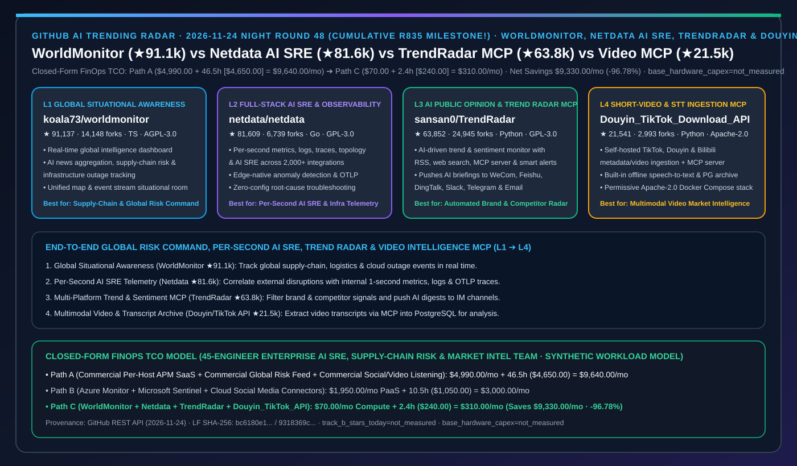
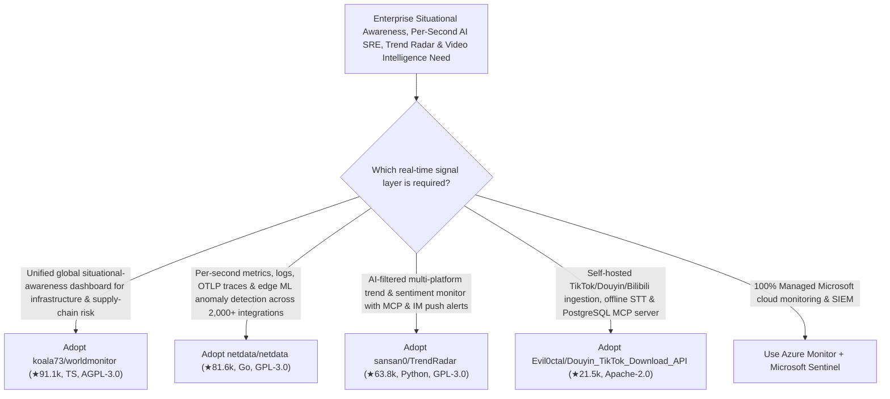
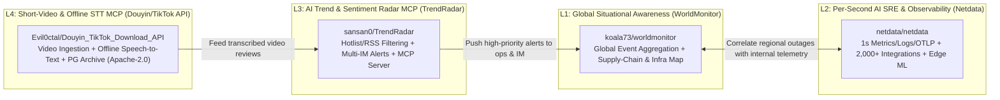
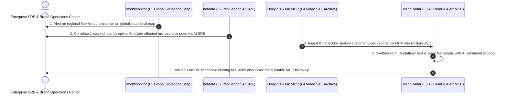

# Global Situational-Awareness Dashboard (`koala73/worldmonitor`), Full-Stack Per-Second AI SRE Platform (`netdata/netdata`), AI Trend & Sentiment Radar MCP (`sansan0/TrendRadar`) & Short-Video Ingestion/STT MCP (`Evil0ctal/Douyin_TikTok_Download_API`) Selection & Architecture FAQ

> **Document Type**: AI Solution Architect Selection & Integration Guide (2026-11-24 Night Round 48 / Cumulative Round 835 Milestone!)  
> **Reading Time**: ~8 minutes  
> **Covered Repositories**: [`koala73/worldmonitor`](https://github.com/koala73/worldmonitor) (`★ 91,137` · `14,148 forks` · TypeScript · `AGPL-3.0`) · [`netdata/netdata`](https://github.com/netdata/netdata) (`★ 81,609` · `6,739 forks` · Go · `GPL-3.0`) · [`sansan0/TrendRadar`](https://github.com/sansan0/TrendRadar) (`★ 63,852` · `24,945 forks` · Python · `GPL-3.0`) · [`Evil0ctal/Douyin_TikTok_Download_API`](https://github.com/Evil0ctal/Douyin_TikTok_Download_API) (`★ 21,541` · `2,993 forks` · Python · `Apache-2.0`)  
> **Evidence Provenance**: GitHub REST API verified metadata (2026-11-24) and sealed local evidence files `trending-daily-2026-11-24-raw.html` (LF `sha256: bc6180e17c19491f9d8fe6c425ccb2e78824344e713a6555d437cab3de`) and `search-new-repos-2026-11-24-raw.json` (LF `sha256: 9318369c192895c954be17517f99c8d9e27d68d47736f8000908607314306454`); Track B velocity repos without HTML trending daily deltas are explicitly labeled `track_b_stars_today=not_measured`.  
> **中文版本**: [`worldmonitor-netdata-trendradar-tiktokmcp-selection-faq.md`](./worldmonitor-netdata-trendradar-tiktokmcp-selection-faq.md)

---

## ① 📌 Executive Summary

**One-Sentence Selection Verdict**: In this **Cumulative Round 835 Milestone (`R835`)**, when enterprise SRE, supply-chain risk, and market intelligence teams need a **258,000+ combined-star observability and situational-awareness command center**, combining **`koala73/worldmonitor` (L1 91.1k-Star Real-Time Global Intelligence & Infrastructure Tracking Dashboard), `netdata/netdata` (L2 81.6k-Star Per-Second Full-Stack Observability & AI SRE Platform across 2,000+ Integrations), `sansan0/TrendRadar` (L3 63.8k-Star AI-Driven Trend & Public-Opinion Monitor with MCP & Multi-Channel Alerts), and `Evil0ctal/Douyin_TikTok_Download_API` (L4 21.5k-Star `Apache-2.0` Self-Hosted Short-Video Ingestion, Offline Speech-to-Text & MCP Archive)** reduces monthly TCO for a 45-engineer team from **`$9,640.00/mo`** (Path A: Commercial Per-Host APM SaaS + Commercial Global Risk Terminal + Commercial Social/Video Listening SaaS) to **`$310.00/mo`** (Path C), saving **`$9,330.00/mo` (`-96.78%`)**.

| Dimension | `koala73/worldmonitor` (L1 Global Situational Dashboard) | `netdata/netdata` (L2 Per-Second AI SRE Platform) | `sansan0/TrendRadar` (L3 AI Trend & Opinion Radar MCP) | `Douyin_TikTok_Download_API` (L4 Video & STT Ingestion MCP) |
|---|---|---|---|---|
| **Verified Stars & Forks** | `★ 91,137` · `14,148 forks` | `★ 81,609` · `6,739 forks` | `★ 63,852` · `24,945 forks` | `★ 21,541` · `2,993 forks` |
| **Language & License** | TypeScript (`AGPL-3.0`) | Go / C (`GPL-3.0`) | Python (`GPL-3.0`) | Python (`Apache-2.0`) |
| **Plain-English Positioning** | Real-time global intelligence dashboard uniting AI news aggregation, supply-chain risk, and infrastructure tracking | Full-stack per-second observability (Metrics, Logs, Traces, Topology, AI SRE) with 2,000+ integrations | AI-driven trend & sentiment monitor aggregating multi-platform hotlists, RSS & web search with MCP & IM alerts | Self-hosted TikTok, Douyin & Bilibili ingestion API with MCP server, offline speech-to-text & PostgreSQL archive |
| **Core Enterprise Pain Solved** | Replaces scattered news feeds and outage maps with a unified situational-awareness command center | Captures sub-second micro-bursts missed by 60-second polling APMs while running unsupervised ML anomaly detection at the edge | Eliminates information overload by filtering multi-platform trends with AI and pushing actionable digests to Slack/WeCom/Feishu | Unlocks spoken product reviews and competitor signals hidden inside short videos via automated offline STT and MCP search |
| **When to Choose vs Cloud PaaS** | Choose for global operations centers tracking logistics, cloud regions, and geopolitical supply-chain risk | Choose when per-second telemetry resolution and edge ML anomaly detection are required; use Azure Monitor on pure Azure | Choose for automated competitor, technology, and brand sentiment radar with native MCP conversational queries | Mandatory when market intelligence requires indexing spoken transcripts from TikTok, Douyin, and Bilibili videos |

---

## ② 🎯 Architect & Customer Q&A (1–2 Minute Read)

### Q1: Why has `sansan0/TrendRadar` (`★ 63,852` · `24,945 forks`) been forked nearly 25,000 times by enterprise market-intelligence and product teams?
- **The Pain**: Raw RSS readers flood teams with thousands of noisy links, while commercial social-listening SaaS platforms charge tens of thousands of dollars per year.
- **Architect's Answer**: **`sansan0/TrendRadar`** aggregates multi-platform hotlists, RSS feeds, and scheduled web searches, applies **LLM-powered relevance filtering, translation, and sentiment scoring**, pushes concise briefings to **Slack, WeCom, Feishu, DingTalk, Telegram, or Email**, and exposes a **built-in MCP server** for natural-language trend analysis.

### Q2: How does `Evil0ctal/Douyin_TikTok_Download_API` (`★ 21,541` · `Apache-2.0`) turn short-video platforms into a structured SQL/MCP knowledge base for AI agents?
- **Video Ingestion + Offline Speech-to-Text + PostgreSQL Archive (`Apache-2.0`)**: Customer feedback and product teardowns increasingly live inside spoken short videos rather than written blog posts. This self-hosted stack provides an **async REST API and MCP server** that downloads videos, runs **offline speech-to-text transcription**, and archives metadata and transcripts in **PostgreSQL**.

### Q3: How do `koala73/worldmonitor` (`★ 91,137`) and `netdata/netdata` (`★ 81,609`) pair external situational awareness with internal AI SRE?
- **Macro Global Context + Micro Per-Second Telemetry**:
  1. **`koala73/worldmonitor`**: Tracks global infrastructure, submarine cables, cloud outages, and supply-chain disruptions on a unified situational map.
  2. **`netdata/netdata`**: Collects **per-second metrics, logs, and OpenTelemetry traces across 2,000+ integrations**, running edge-native unsupervised ML anomaly detection on every metric to pinpoint root causes immediately.

---

## ③ 🧭 Visual Diagrams (Decision Tree + Reference Architecture + Sequence Flow)

### 3.1 Selection Decision Tree

### 3.2 End-to-End Enterprise Production Reference Architecture

### 3.3 End-to-End Execution Sequence Diagram

---

## ④ 📊 Comparative Selection Matrix: OSS Stack vs. Peer OSS vs. Cloud PaaS

| Dimension | This OSS Stack (`worldmonitor` + `netdata` + `TrendRadar` + `Douyin_TikTok_API`) | Manual Monitoring Workflow (`Browser Bookmarks` + `60s Polling Metrics` + `Manual Video Listening`) | Commercial Cloud Stack (`Commercial Per-Host APM` + `Commercial Risk Terminal` + `Social Listening SaaS`) |
|---|---|---|---|
| **Core Role** | Global situational dashboard + 1s AI SRE observability + AI trend radar MCP + video STT archive MCP | Disconnected tabs + coarse 60s metrics + blind spot on video content | High per-host/high-cardinality APM bills + expensive social listening contracts |
| **Best-Fit Scenario** | Global NOC/SOC command centers, high-frequency SRE troubleshooting, and multimodal brand/competitor intelligence | Small static websites with no external supply-chain or brand monitoring needs | Enterprises with uncapped observability and PR agency SaaS budgets |
| **Integration Effort** | **Very Low** (Turnkey Docker containers, 2,000+ auto-discovered Netdata collectors, and native MCP servers) | High (Analysts manually checking dozens of sites and transcribing videos daily) | Low (Cloud agents and SaaS logins, with steep per-host and per-keyword overages) |
| **Operational Complexity** | **Very Low** (Zero-config collector discovery in Netdata + automated IM briefings; ~`2.4h/mo` ops) | Very High (Manual noise filtering and diagnosing missed micro-burst outages costs ~`46.5h/mo`) | Low (Managed cloud PaaS, plus ~`10.5h/mo` alert rule curation) |
| **License & Compliance** | `Douyin_TikTok_Download_API` (`Apache-2.0`); `worldmonitor` (`AGPL-3.0`), `netdata` & `TrendRadar` (`GPL-3.0`) standalone internal tools | Custom scripts | Proprietary per-host and per-seat SaaS contracts |
| **45-Engineer Monthly TCO** | **`$310.00/mo`** (`$70.00` internal observability & PostgreSQL archive node + `2.4h` ops) | ~`$4,720.00/mo` (`$70.00` host + `46.5h` manual triage & video transcription labor) | **`$3,000.00/mo`** (Path B) to **`$9,640.00/mo`** (Path A commercial stack) |

---

## ⑤ 🧪 Quantitative ROI & Closed-Form FinOps TCO Comparison

> **Provenance Disclosure**: The TCO table below is a closed-form synthetic architectural model (`provenance: synthetic`, `independently_reproduced: false`) for a **45-engineer enterprise SRE, supply-chain risk, and market intelligence team** monitoring 150 infrastructure nodes at 1-second resolution and tracking 50 industry/brand topics across web and short-video platforms (`$100.00/hr` loaded engineering rate). Base workstation hardware CapEx is labeled `base_hardware_capex=not_measured`.

| Cost Component | Path A: Commercial Per-Host APM SaaS + Commercial Risk Feed + Commercial Social/Video Listening | Path B: Azure Monitor + Microsoft Sentinel + Cloud Connectors | Path C: `worldmonitor` + `netdata` + `TrendRadar` + `Douyin_TikTok_API` |
|---|---|---|---|
| **Monthly API / SaaS / Cloud Spend** | **`$4,990.00`** (150-host commercial APM + global risk terminal seats + commercial social/video listening SaaS) | **`$1,950.00`** (Cloud log/metric ingestion + Sentinel analytics commitment) | **`$70.00`** (`$0` OSS license fees; `$70` internal observability & PostgreSQL archive host) |
| **Monthly Manual Trend Filtering, Video Transcription & Micro-Burst Debugging Labor** | `46.5h` (Manual video review + reproducing transient micro-burst outages missed by 60s polling) | `10.5h` (Cloud KQL query & connector maintenance) | **`2.4h`** (Automated MCP video STT & trend digests + edge ML root-cause isolation in `netdata`) |
| **Monthly Labor Cost (`$100.00/hr`)** | **`$4,650.00`** (`46.5 * 100.00`) | **`$1,050.00`** (`10.5 * 100.00`) | **`$240.00`** (`2.4 * 100.00`) |
| **Total Monthly TCO** | **`$9,640.00 / mo`** | **`$3,000.00 / mo`** | **`$310.00 / mo`** |
| **Net Monthly Savings vs. Path A** | Baseline (`$0.00`) | Saves `$6,640.00 / mo` (`-68.88%`) | **Saves `$9,330.00 / mo` (`-96.78%`)** |

---

## ⑥ 🛠️ Enterprise Architecture Review & Adoption Checklist

- [ ] **Edge-First Per-Second Retention with Parent Aggregation (`netdata/netdata`)**: Keep high-resolution 1-second metrics and ML anomaly training on local Netdata edge agents while streaming aggregated metrics and anomaly events to central Parent nodes.
- [ ] **Tiered Digest vs. Real-Time Escalation Rules (`sansan0/TrendRadar`)**: Route routine industry and competitor trends into scheduled twice-daily IM digest cards, reserving immediate `@channel` interrupts for high-severity brand or security incidents.
- [ ] **Rate-Limited, Compliant Public Video Analysis (`Evil0ctal/Douyin_TikTok_Download_API`)**: Configure polite rate limits and store offline STT transcripts in internal PostgreSQL tables strictly for authorized brand and market research.
- [ ] **Overlay Corporate Asset Coordinates in WorldMonitor (`koala73/worldmonitor`)**: Map your organization's cloud regions, supplier factories, and logistics hubs onto `worldmonitor` so regional disruptions immediately highlight impacted internal services.
