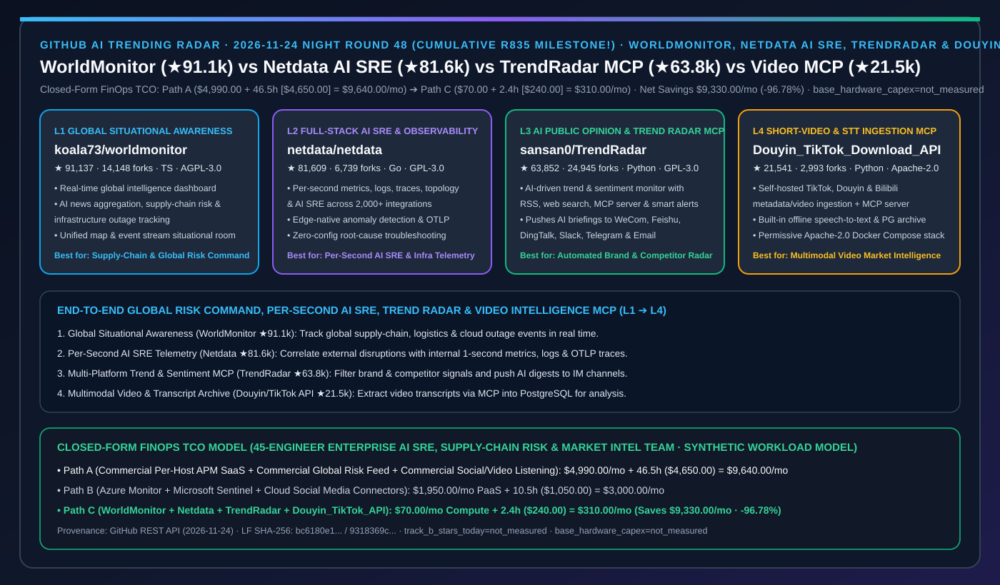
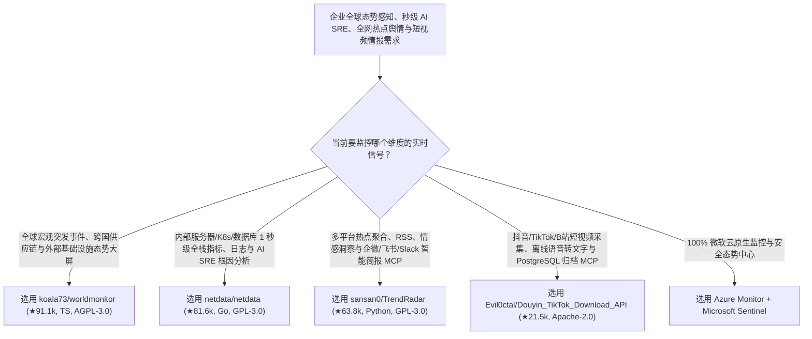
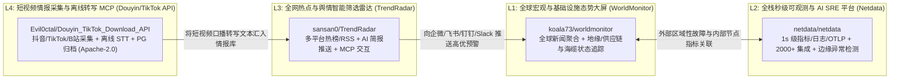
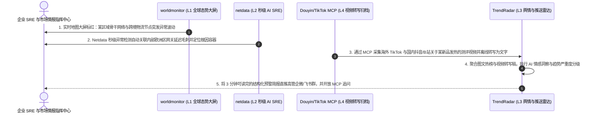

# 全球实时态势感知大屏（`koala73/worldmonitor`）、全栈秒级 AI SRE 可观测平台（`netdata/netdata`）、AI 舆情与热点追踪 MCP（`sansan0/TrendRadar`）与短视频采集转写 MCP 服务（`Evil0ctal/Douyin_TikTok_Download_API`）选型与集成 FAQ

> **文档类型**：AI 解决方案架构师（AI Solution Architect）选型决策指南（2026-11-24 Night Round 48 / 累计第 835 轮里程碑！）  
> **阅读耗时**：约 8 分钟  
> **覆盖项目**：[`koala73/worldmonitor`](https://github.com/koala73/worldmonitor)（`★ 91,137` · `14,148 forks` · TypeScript · `AGPL-3.0`） · [`netdata/netdata`](https://github.com/netdata/netdata)（`★ 81,609` · `6,739 forks` · Go · `GPL-3.0`） · [`sansan0/TrendRadar`](https://github.com/sansan0/TrendRadar)（`★ 63,852` · `24,945 forks` · Python · `GPL-3.0`） · [`Evil0ctal/Douyin_TikTok_Download_API`](https://github.com/Evil0ctal/Douyin_TikTok_Download_API)（`★ 21,541` · `2,993 forks` · Python · `Apache-2.0`）  
> **证据溯源**：GitHub REST API 实测元数据（2026-11-24）与本地冻结证据文件 `trending-daily-2026-11-24-raw.html`（LF `sha256: bc6180e17c19491f9d8fe6c425ccb2e78824344e713a6555d437cab3de`）、`search-new-repos-2026-11-24-raw.json`（LF `sha256: 9318369c192895c954be17517f99c8d9e27d68d47736f8000908607314306454`）；Track B 仓库无 HTML 榜单对应的单日增量，统一标记为 `track_b_stars_today=not_measured`。  
> **English Version**: [`worldmonitor-netdata-trendradar-tiktokmcp-selection-faq.en.md`](./worldmonitor-netdata-trendradar-tiktokmcp-selection-faq.en.md)

---

## ① 📌 核心结论速览（Executive Summary）

**选型一句话结论**：在第 835 轮里程碑（`R835 Milestone`）中，当跨国供应链、品牌公关与 SRE 稳定性保障团队需要构建一套**合计突破 25.8 万 Star、覆盖“全球宏观基础设施态势感知 + 内部服务器秒级 AI SRE 监控 + 全网热点舆情 MCP 预警 + 短视频多模态语音转写归档”**的全天候监控指挥中心时，采用 **`koala73/worldmonitor`（L1 9.11 万星实时全球情报、供应链与基础设施态势感知大屏）+ `netdata/netdata`（L2 8.16 万星支持 2,000+ 集成与边缘实时异常检测的全栈秒级 AI SRE 平台）+ `sansan0/TrendRadar`（L3 6.38 万星、近 2.5 万 Fork 的 AI 舆情监控与热点筛选 MCP 平台）+ `Evil0ctal/Douyin_TikTok_Download_API`（L4 支持抖音/TikTok/B站数据采集、离线语音转文字与 PostgreSQL 归档的 `Apache-2.0` MCP 服务）**，可将 45 人团队的月度 TCO 从商业按主机计费 APM 云 + 商业全球风险情报终端 + 商业社媒短视频监听 SaaS（Path A）的 **`$9,640.00/月`** 降至 **`$310.00/月`**（净省 **`$9,330.00/月`**，降幅 **`-96.78%`**）。

| 评估维度 | `koala73/worldmonitor` (L1 全球实时态势感知大屏) | `netdata/netdata` (L2 全栈秒级 AI SRE 平台) | `sansan0/TrendRadar` (L3 AI 舆情与热点雷达 MCP) | `Douyin_TikTok_Download_API` (L4 短视频采集与转写 MCP) |
|---|---|---|---|---|
| **GitHub 实测热度** | `★ 91,137` · `14,148 forks` | `★ 81,609` · `6,739 forks` | `★ 63,852` · `24,945 forks` | `★ 21,541` · `2,993 forks` |
| **实现语言与开源协议** | TypeScript (`AGPL-3.0`) | Go / C (`GPL-3.0`) | Python (`GPL-3.0`) | Python (`Apache-2.0`) |
| **一句话通俗定位** | 9.1 万星实时全球态势感知仪表盘：融合 AI 新闻聚合、宏观事件监控与全球基础设施追踪 | 8.1 万星全栈可观测性与 AI SRE 引擎：秒级采集指标/日志/链路/网络流并内置边缘机器学习异常检测 | 2.49 万次 Fork 的 AI 舆情监控与热点筛选工具：聚合多平台热榜 + RSS + 联网搜索，支持 MCP 与全渠道推送 | 自托管的抖音、TikTok、B 站数据采集与离线语音转文字 API（内置 AI Agent MCP Server 与 PG 归档） |
| **解决的核心业务痛点** | 解决跨国企业供应链、跨境物流与海外云节点运维“平时看十几个分散网站、发生海底光缆中断或港口停摆时后知后觉”的盲区 | 解决传统 Prometheus/商业 APM 采集粒度粗（15–60 秒一次）、高基数指标账单爆炸且缺乏节点级实时无监督异常评分的痛点 | 根治市场与产品团队每天刷几十个平台产生严重信息过载、重大品牌负面舆情或竞品发布未能第一时间推到企微/飞书的痛点 | 解决消费品与出海品牌“现在的用户吐槽和爆款全在抖音/TikTok/B站视频里，纯文本舆情工具根本搜不到视频口播内容”的痛点 |
| **何时选它 vs 云托管** | 跨境电商、航运物流、金融风控与全球 NOC 指挥中心必配的自托管态势大屏 | 需要 1 秒级超高分辨率主机/容器/GPU 监控与 AI 根因诊断时首选；纯微软云选 Azure Monitor | 企业市场部、PR 团队与技术情报雷达构建自动化多渠道简报与 MCP 问答时首选 | 需要合规自建短视频元数据采集 + 离线 ASR 口播提炼并接入 Agent MCP 时首选 |

---

## ② 🎯 客户与架构师灵魂拷问 Q&A（1–2 分钟速读）

### Q1：为什么 `sansan0/TrendRadar`（`★ 63,852` · `24,945 forks`）能获得近 2.5 万次 Fork，成为企业内部市场情报与舆情监控的国民级开源项目？
- **痛点**：传统的舆情系统要么是每年几十万的商业 SaaS，要么是简陋的 RSS 阅读器（每天塞给你 2,000 条未过滤的垃圾新闻）。
- **架构师解答**：**`sansan0/TrendRadar`** 打通了从“多源采集 ➔ AI 智能筛选与情感分析 ➔ 多渠道精准推送 ➔ MCP 对话深挖”的完整闭环：
  1. **全网热榜 + RSS + 定时联网搜索三合一**：用关键词规则与大模型语义筛掉 95% 的无关噪音；
  2. **原生 MCP 架构赋能自然语言复盘**：管理层收到微信/飞书/钉钉/Slack 推送的 AI 简报后，可以直接通过 MCP 协议用自然语言追问历史趋势变化与情感倾向。

### Q2：现在的消费者测评和行业干货 80% 都在短视频平台，光盯图文热榜根本不够，`Evil0ctal/Douyin_TikTok_Download_API`（`★ 21,541`）是怎么补齐“视频口播情报”的？
- **核心收益**：该项目（`Apache-2.0`）早已超越了单纯的下载工具，演进为**面向 AI Agent 的短视频情报采集与离线语音转文字底座**：
  1. **内置 MCP Server 与异步 REST API**：Agent 只需传入抖音、TikTok 或 B 站链接/创作者主页，即可自动拉取视频元数据与音频流；
  2. **离线语音转文字 + PostgreSQL 自动归档**：将短视频口播内容直接转写为结构化文本落入 PostgreSQL，与 `TrendRadar` 联动即可实现“图文 + 短视频”全模态市场情报覆盖。

### Q3：`koala73/worldmonitor`（`★ 91,137`）与 `netdata/netdata`（`★ 81,609`）如何构成企业 NOC（网络运营中心）的“外看全球态势、内看秒级指标”双屏联动？
- **外部宏观态势 + 内部微观遥测**：
  1. **左屏 `koala73/worldmonitor`**：实时聚合全球突发新闻、航空海运物流异常与云基础设施状态；
  2. **右屏 `netdata/netdata`**：以 **1 秒级分辨率**采集企业全球节点、K8s 集群、数据库与 GPU 的指标、日志和 OpenTelemetry 链路，并利用边缘内置的机器学习为每个指标实时训练无监督异常检测模型（Anomaly Advisor），一旦外部区域网络波动传导至内部服务，AI SRE 立即锁定根因。

---

## ③ 🧭 直观可视化图解（Mermaid 决策树 + 集成架构 + 时序图）

### 3.1 技术选型决策树

### 3.2 企业端到端生产集成参考架构图

### 3.3 业务流全链路时序图

---

## ④ 📊 同类开源与商业云服务横向选型决策矩阵

| 对比维度 | 本轮开源组合 (`worldmonitor` + `netdata` + `TrendRadar` + `Douyin_TikTok_API`) | 传统人工盯盘 (`人工刷十几个网页` + `60s 粗粒度监控` + `人工听视频写纪要`) | 商业云与 SaaS 方案 (`商业 APM 按主机收费` + `商业舆情 SaaS` + `商业情报终端`) |
|---|---|---|---|
| **功能定位** | 全球态势大屏 + 1 秒级 AI SRE + 全渠道热点舆情 MCP + 短视频转写归档 MCP | 信息割裂的网页书签 + 滞后监控图表 + 无短视频口播检索能力 | 昂贵按主机/高基数指标收费的 APM + 每年数十万的商业社媒监听平台 |
| **适用场景** | 跨国供应链与出海企业指挥大屏、高可用基础设施秒级排障、品牌公关舆情预警與竞品短视频情报分析 | 无外部市场竞争压力且服务器仅 1–2 台的静态内部小网站 | 预算充裕且不介意将所有服务器遥测与商业搜索词交由外部 SaaS 托管的企业 |
| **集成成本** | **极低**（全部支持 Docker 一键部署，`TrendRadar` 与 `Douyin_TikTok_API` 原生提供标准 MCP 接口） | 高（人工每天早中晚巡检十几个平台并手工剪辑转写视频极耗人力） | 中（SaaS 开通快，但自定义采集源与短视频全文转写往往需额外交费） |
| **运维复杂度** | **极低**（`Netdata` 零配置自动发现 2,000+ 服务，月均维护仅 `2.4h`） | 极高（人工筛查海量噪音信息与排查瞬时毛刺故障耗费 `46.5h/月`） | 低（云端全托管，月均告警规则与关键词维护约 `10.5h`） |
| **开源协议与合规** | `Douyin_TikTok_Download_API` 为 `Apache-2.0`；`worldmonitor` (`AGPL-3.0`)、`netdata` & `TrendRadar` (`GPL-3.0`) 作为企业内部监控与情报平台独立运行完全合规 | 自研脚本 | 商业闭源按主机数/按监听关键词数量收费 |
| **45 人团队月度 TCO** | **`$310.00/月`**（含 `$70.00` 内部监控与情报采集节点 + `2.4h` 运维） | 约 `$4,720.00/月`（含 `$70.00` 主机 + `46.5h` 人工刷榜、转写视频与排障工时） | **`$3,000.00/月`**（Path B）至 **`$9,640.00/月`**（Path A 商业全栈） |

---

## ⑤ 🧪 应用落地定量收益 / TCO 对比（Closed-Form FinOps 模型）

> **数据性质声明（Provenance Metadata）**：以下 TCO 模型为面向 **45 人企业 SRE 稳定性、供应链风控与市场情报团队**（监控 150 个微服务与容器节点秒级指标、7×24 小时追踪全球基础设施态势与 50 个行业关键词的图文/短视频舆情，工程师与分析师折算时薪 `$100.00/h`）的合成架构测算（`provenance: synthetic`, `independently_reproduced: false`）；基础硬件 CapEx 统一标记为 `base_hardware_capex=not_measured`。

| 成本构成项 | Path A：商业按主机 APM SaaS + 商业全球风险终端 + 商业社媒短视频监听 SaaS | Path B：Azure Monitor + Microsoft Sentinel + 云端社媒连接器 | Path C：`worldmonitor` + `netdata` + `TrendRadar` + `Douyin_TikTok_API` |
|---|---|---|---|
| **API / SaaS / 云资源月费** | **`$4,990.00`**（150 节点商业 APM 订阅 + 商业风险态势席位 + 商业多平台图文/短视频舆情 SaaS） | **`$1,950.00`**（云端日志与高分辨率指标摄取费 + Sentinel 分析配额） | **`$70.00`**（四套开源引擎 `$0` 授权费；仅需 `$70` 内网监控与 PostgreSQL 归档宿主机） |
| **月度人工巡检多平台热榜、听译竞品短视频与排查亚秒级毛刺故障工时** | `46.5h`（人工收集整理竞品短视频口播 + 60 秒采样漏掉瞬时毛刺导致反复复现排障） | `10.5h`（云端 KQL 查询编写与推送工作流维护） | **`2.4h`**（`TrendRadar`+`Douyin_TikTok_API` 自动转写推送 + `netdata` 秒级边缘异常定位） |
| **人工运维与情报分析成本（`$100.00/h`）** | **`$4,650.00`** (`46.5 * 100.00`) | **`$1,050.00`** (`10.5 * 100.00`) | **`$240.00`** (`2.4 * 100.00`) |
| **月度总拥有成本（Total Monthly TCO）** | **`$9,640.00 / 月`** | **`$3,000.00 / 月`** | **`$310.00 / 月`** |
| **相对 Path A 净节省** | 基准线 (`$0.00`) | 节省 `$6,640.00 / 月` (`-68.88%`) | **净省 `$9,330.00 / 月` (`-96.78%`)** |

---

## ⑥ 🛠️ 企业引入与架构评审 Checklist

- [ ] **采用“边缘本地流式存储 + 中心聚合”部署 `netdata/netdata`**：利用 Netdata 极低的单节点内存开销在每台生产宿主机保留 1 秒级近期指标并运行本地 ML 异常检测，仅将异常告警与聚合摘要上报中心 Parent 节点，避免把内网带宽打满。
- [ ] **为 `sansan0/TrendRadar` 配置分级推送策略（避免告警疲劳）**：将常规行业动态配置为每日早晚两次定时汇总卡片推送到部门群，仅当命中核心品牌高危负面情感阈值时才触发即时 `@` 告警。
- [ ] **短视频情报采集遵守平台 Robots 频率限制与数据合规（`Douyin_TikTok_Download_API`）**：仅针对企业自有品牌账号、授权达人或公开竞品宣发视频进行低频合理分析，开启内置连接池限速并将离线语音转写文本存放在内网受控 PostgreSQL 中。
- [ ] **将 `koala73/worldmonitor` 与企业供应链 ERP 节点坐标叠加展示**：在态势大屏中导入企业核心海外仓、代工厂与云可用区地理位置，一旦周边发生极端天气、罢工或海缆故障，第一时间触发备货与流量切换预案。
