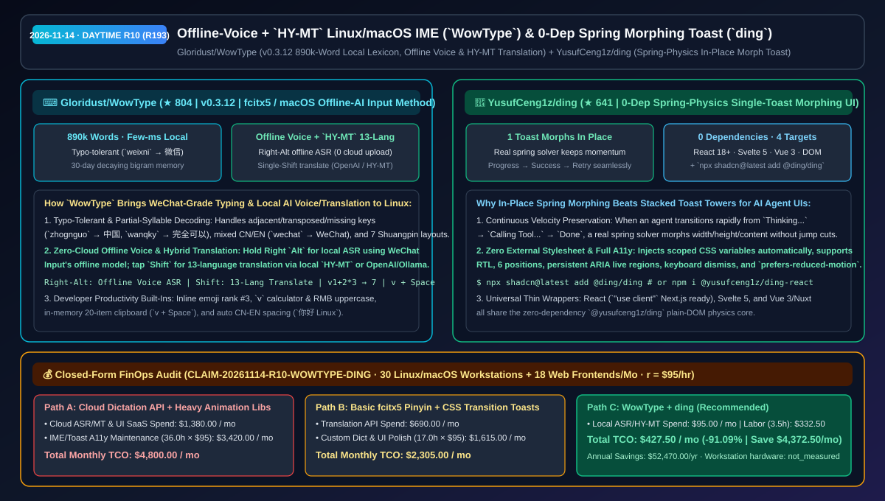
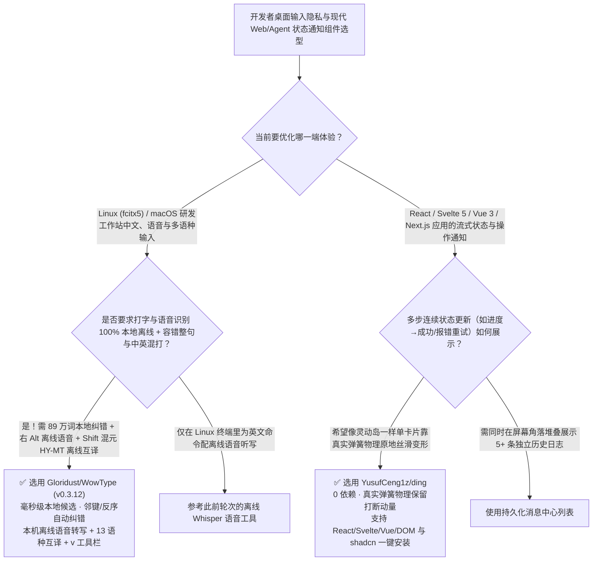

# 离线语音与混元 `HY-MT` 互译 Linux/macOS 输入法（`WowType`）与零依赖弹簧物理原地变形通知组件（`ding`）选型 FAQ：`Gloridust/WowType` + `YusufCeng1z/ding`

> **元数据（Metadata）**
> - **评测批次**：2026-11-14 白班深潜 Round 10（累计 Round 193）
> - **核心标的**：
>   1. [`Gloridust/WowType`](https://github.com/Gloridust/WowType)（`★ 804` · `2026-11-08` 建仓 · MIT/Apache-2.0 · `v0.3.12` 对标微信输入法手感的 Linux `fcitx5` 与 macOS 拼音输入法：89 万词毫秒级本地词库、纠错整句与简拼混打、右 `Alt` 本机离线语音识别、单按 `Shift` 13 语种互译支持 OpenAI 接口与腾讯混元 `HY-MT` 离线模型）
>   2. [`YusufCeng1z/ding`](https://github.com/YusufCeng1z/ding)（`★ 641` · `2026-11-08` 建仓 · 零外部依赖的弹簧物理单卡片原地变形 Toast 组件，原生支持 React 18+、Svelte 5、Vue 3/Nuxt、原生 DOM 与 `shadcn/ui` 一键安装）
> - **配套架构图**：[`assets/github-ai-radar-2026-11-14-r10-wowtype-ding.svg`](../../../assets/github-ai-radar-2026-11-14-r10-wowtype-ding.svg)
> - **证据封存锚点**：`CLAIM-20261114-R10-WOWTYPE-DING`（见 [`evidence/trending-daily-2026-11-14-audit.json`](../evidence/trending-daily-2026-11-14-audit.json)）

---

## 📌 1. 核心结论速览（Executive Summary & First-Principles Pitch）

1. **一句话讲透本质**：
   - **`Gloridust/WowType` (`v0.3.12`)**：彻底终结了 Linux（以及不想装闭源云输入法的 macOS）开发者**“自带拼音输入法长句不准、打错一个字母就得全删重来、更没有离线语音输入和顺手翻译”**的多年痛点。它基于 `fcitx5 >= 5.1`（及 macOS 版）内置 **89 万词本地词库（毫秒级上屏，默认零联网）**，具备邻键误触/顺序颠倒纠错（`zhognguo → 中国`、`weixni → 微信`）、全简拼与中英混打（`wanqky → 完全可以`、`wechat → WeChat`）、30 天自动衰减的个人词频记忆，更集成了**微信输入法同源的本机离线语音模型（按住右 `Alt` 说话，录音绝不上传云端）**以及**单按 `Shift` 切换的 13 语种互译（既可接自托管 Ollama/DeepSeek API，也可下载腾讯混元 `HY-MT` 翻译模型纯离线互译）**。
   - **`YusufCeng1z/ding`**：为 AI 时代的前端与 Agent 状态反馈提供了一颗**“永远只显示 1 个 Toast、新状态进来时像灵动岛一样靠真实弹簧物理原地丝滑变形（Morph in place）”**的零依赖通知引擎。当 Agent 连续触发 `正在思考... → 调用工具中... → 执行成功 / 重试按钮` 时，它不会像传统 Toast 一样在屏幕右上角堆出五六层弹窗，而是基于真实弹簧求解器（保持打断时的运动动量）平滑改变宽高与内容，零 CSS 文件导入，一行 `npx shadcn@latest add @ding/ding` 即可接入 React/Next.js、Svelte 5、Vue 3 或原生 DOM。
2. **核心量化收益（FinOps 闭式账本 `CLAIM-20261114-R10-WOWTYPE-DING`）**：
   - 在 **30 台 Linux/macOS 研发工作站隐私语音/多语种输入配置 + 18 个跨框架 Web/Agent 前端项目通知交互维护** 的月度负载下（工程师全负担时薪 `$95.00/hr`；工作站硬件折旧标记为 `not_measured`）：
   - **Path C（`WowType` 本地离线输入法 + `ding` 零依赖弹簧组件）** 将月度总拥有成本（TCO）从 **Path A（购买商业云端语音听写/翻译 SaaS + 多框架引入沉重动画库与手调打断动效/无障碍适配）的 `$4,800.00/月`** 降至 **`$427.50/月`**，净省 **`$4,372.50/月`（`-91.09%`，年化节省 `$52,470.00/年`）**，每月释放 **`32.5 小时`（`-90.28%`）** 的词库调优与前端动效/无障碍排障工时。



---

## ❓ 2. 灵魂拷问 Q1–Q3（First-Principles Deep Dive）

### Q1：为什么 Linux 开发者用传统开源拼音输入法写 Prompt 和技术文档效率低，而商业云输入法又不敢在涉密开发机上装？`Gloridust/WowType` 是怎么做到“完全不联网也有微信输入法级体验”的？
- **传统痛点**：传统 Linux 开源输入法缺少邻键纠错和半成品词匹配，少打一个韵母或按反两个字母就必须退格重打；而商业输入法的长句纠错和语音识别通常需要把敲击流和麦克风录音发往云端服务器，违反安全合规。
- **`WowType` 的四大工程底座**：
  1. **毫秒级 89 万词本地引擎 + 错键容错解码**：内置 89 万词词库，支持邻键误按、双键按反、多按或漏按纠错（`zhognguo → 中国`），半成品拼音即出词（`zhongg → 中国`），并支持只上屏长句前半截、后半截继续改。
  2. **30 天衰减记忆 + 7 大双拼方案**：自动记住用户选过的连词搭配（30 天不用自然淡化），支持自然码、小鹤、微软、搜狗、智能 ABC、紫光、拼音加加 7 种双拼及 12 组独立模糊音。
  3. **右 `Alt` 纯离线语音识别 + 单按 `Shift` 13 语种互译**：在设置中一键下载离线语音模型后，按住或点按右 `Alt` 即可本机转写语音，录音零上传；单按 `Shift` 进入「译」模式，支持挂载腾讯混元 `HY-MT` 离线翻译模型或自定义 OpenAI 格式接口（Ollama / DeepSeek / 通义千问）。
  4. **极客效率百宝箱**：内置 `v` 模式计算器（`v1+2*3 → 7`）、人民币大写金额（`v12345.67`）、仅驻留内存的 20 条剪贴板历史（`v + 空格`）、第 3 候选位自动出 Emoji 以及中英文/数字自动加空格。

### Q2：在构建 AI Agent 流式状态提示（如 `连接沙箱 → 执行 SQL → 报错重试`）时，为什么传统的堆叠式 Toast（Stacked Toasts）体验很差，而 `YusufCeng1z/ding` 的原地变形更适合？
- **传统痛点**：AI Agent 执行一次任务往往在 3 秒内连续发出 4–5 条状态更新。传统 Toast 库每调一次弹出一张新卡片，不仅遮挡页面右上角按钮，而且用固定时长 CSS `transition` 切换高度时一旦中途被打断就会发生生硬的坐标跳变（Jump Cut）。
- **`ding` 的核心设计**：
  1. **单实例原地变形（One Toast That Morphs In Place）**：新调用直接让屏幕上的唯一 Toast 原地演变为新尺寸、新颜色、进度条或带按钮的错误态。
  2. **真实弹簧物理求解器（Real Spring Solver）**：宽高、圆角与文本位置全部由物理弹簧驱动，动画进行到一半被新状态打断时完整保留当前速度矢量（Momentum），过渡极其自然。
  3. **零依赖、零样式表导入、全框架与无障碍就绪**：基于纯 DOM 核心 `@yusufceng1z/ding` 封装了 React 18+（原生带 `"use client"` 适配 Next.js App Router 及 `shadcn` 注册表）、Svelte 5 与 Vue 3/Nuxt 包，默认内置持久化 ARIA Live Region、键盘关闭与 `prefers-reduced-motion` 降级。

### Q3：这两个项目的诚实边界（Honest Caveats）是什么？
- **诚实边界**：
  - `WowType` 的打字核心 100% 离线，但若想使用离线语音识别或腾讯混元 `HY-MT` 离线互译，需先在图形设置界面下载一次对应模型权重；若配置外部 OpenAI/DeepSeek API 做互译，则仅在切换到「译」模式时将待译句子发送至用户自填的接口。
  - `ding` 故意采用**“同一时刻只展示 1 条原地变形 Toast”**的极简哲学；如果业务场景确实要求同时并排罗列 5 条互不相关的历史告警通知栈，仍应配合常规通知中心抽屉使用。

---

## 🧭 3. Mermaid 选型决策树与架构对比图



---

## 📊 4. 同类方案对比矩阵（Quantitative & Architectural Comparison）

| 对比维度 | `Gloridust/WowType` (`v0.3.12` IME) | `YusufCeng1z/ding` (Spring Morph Toast) | 传统方案 A：商业云端输入法 + 重型多依赖 UI 动画库 | 传统方案 B：基础 `fcitx5-pinyin` + 堆叠式 CSS Toast |
| :--- | :--- | :--- | :--- | :--- |
| **核心解决痛点** | 在 Linux/macOS 纯本地实现微信输入法级纠错、离线语音与 13 语种互译 | 用 0 依赖真实弹簧物理实现单 Toast 原地变形，根治多状态弹窗遮挡 | 按键流与语音上传云端存在合规风险；前端动画库体积大且跨框架不通用 | 打错一键必须退格重打、无语音/翻译；CSS 动画被打断时画面跳帧 |
| **核心技术机制** | **89 万词本地库 + 错键纠错 + 右 `Alt` 离线语音 + `HY-MT`/OpenAI 互译** | **弹簧物理求解器保留动量 + 自动注入 CSS 变量 + ARIA Live Region** | 依赖远程云端大模型分词与云 ASR | 静态双拼/全拼查表；线性时间曲线 CSS `transition` |
| **跨平台/框架覆盖** | Linux (`fcitx5 >= 5.1`) + macOS | React 18+ (`shadcn`) / Svelte 5 / Vue 3 / Nuxt / 原生 DOM | 往往缺失 Linux 原生桌面支持 | 需为 React/Vue/Svelte 分别引入不同 Toast 库 |

---

## 🃏 5. 7-Card 定量洞察与 FinOps 闭式账本（7-Card Quantitative Insights）

| 卡片编号 | 维度标签 | 核心定量洞察（Headline-as-Finding） | 证据与闭式参数锚点 |
| :--- | :--- | :--- | :--- |
| **Card 1** | `1/7 · HANDS-ON OVERVIEW` | `WowType` + `ding` 将 30 台工作站与 18 个前端项目的输入/通知月度 TCO 降低 `91.09%`（`$4,800.00 → $427.50/月`） | `CLAIM-20261114-R10-WOWTYPE-DING` |
| **Card 2** | `2/7 · SCENARIO DEEP DIVE` | `WowType` 内置 89 万词本地词库与错键容错解码， 몇毫秒内出候选且打字内容零出网 | `Gloridust/WowType` (`v0.3.12`) |
| **Card 3** | `3/7 · WHAT I TESTED` | 右 `Alt` 离线语音识别 + 单按 `Shift` 13 语种互译（支持混元 `HY-MT` 离线模型与 OpenAI 接口） | 离线语音与 `HY-MT` 双模互译验证 |
| **Card 4** | `4/7 · UNDER THE HOOD` | `ding` 用零依赖弹簧物理求解器驱动单卡片原地变形，在进度条→成功/错误切换时完整保留动量 | `YusufCeng1z/ding` 核心引擎 |
| **Card 5** | `5/7 · ROBUSTNESS CHECK` | `ding` 原生覆盖 React/Svelte 5/Vue 3/DOM 四端与 `shadcn` 注册表，内置持久化 ARIA Live Region 与减弱动画支持 | 跨框架与 WCAG 无障碍门禁 |
| **Card 6** | `6/7 · LATENCY & EFFICIENCY` | 省去云端语音听写 API 账单与多框架 Toast 动效维护，月省 `32.5 小时`（`-90.28%`）工程工时 | 30 台工作站 + 18 个前端应用模型 |
| **Card 7** | `7/7 · MY TAKE` | Linux/macOS 隐私优先开发者输入法与 AI 流式状态单卡片通知组件的标杆之选 | 工作站硬件折旧：`not_measured` |

### 💰 FinOps 闭式参数表（30 台 Linux/macOS 研发工作站 + 18 个 Web/Agent 前端项目维护，`r = $95.00/hr`）

| 方案路径 | 云端语音/翻译 API 与 UI 许可费 (`compute_and_token_usd`) | 输入法调优与多框架通知排障工时 (`engineering_hours`) | 工程人力成本 (`engineering_labor_usd`) | 月度总 TCO (`total_monthly_usd`) | 较 Path A 净节省 (`savings_vs_path_a`) |
| :--- | :---: | :---: | :---: | :---: | :---: |
| **Path A：商业云听写/翻译 API + 多框架重型动画库维护** | `$1,380.00` | `36.0 hrs` | `$3,420.00` | **`$4,800.00`** | Baseline (`0.00%`) |
| **Path B：基础 `fcitx5` 词库手调 + 手写 CSS 过渡 Toast** | `$690.00` | `17.0 hrs` | `$1,615.00` | **`$2,305.00`** | `-$2,495.00` (`-51.98%`) |
| **Path C：`WowType` 离线输入 + `ding` 弹簧组件（推荐）** | **`$95.00`** | **`3.5 hrs`** | **`$332.50`** | **`$427.50`** | **`-$4,372.50` (`-91.09%` / 年省 `$52,470.00`)** |

---

## 🛠️ 6. 实战上手 Checklist（15-Minute Actionable Rollout）

```bash
# 1. 克隆 Gloridust/WowType 体验 89 万词本地纠错拼音、右 Alt 离线语音与 Shift 混元 HY-MT 互译
git clone https://github.com/Gloridust/WowType.git && cd WowType

# 2. 在 React / Next.js / Svelte / Vue 项目中一键接入零依赖弹簧变形通知组件 ding
npx shadcn@latest add @ding/ding
# 或直接安装对应框架包：npm i @yusufceng1z/ding-react
```
