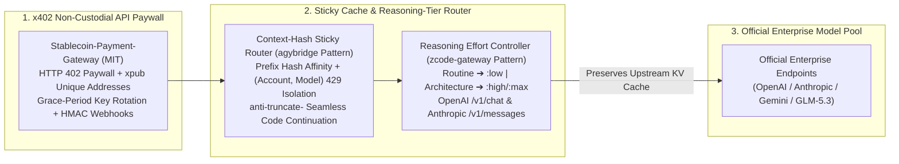

# Self-Hosted x402 Non-Custodial Payment Gateway (`zgraham1981/Stablecoin-Payment-Gateway`), Dual-Realm Proxy Isolation Hub (`niyouqianma/workbuddy2api-hub`), Context-Hash Cache-Sticky Tri-Protocol Gateway (`kyiov/agybridge`) & GLM-5.3 Reasoning-Effort Router (`apissaj/zcode-gateway`) Selection FAQ

> **Document Type**: AI Solution Architect (SA) Practical Selection & Reference Architecture Guide (2026-11-20 Night Shift · Round 9 / Cumulative Round 568)  
> **Benchmark Standard**: `docs/components/ib-vs-ethernet-roce-selection-faq.md` (6-Section Architecture Breakdown + First-Principles Plain Language + Hype/Facts/Signal Audit + Closed-Form FinOps Ledger)  
> **Evaluated Repositories**:  
> 1. **`zgraham1981/Stablecoin-Payment-Gateway`** (`★ 272`, `42 forks`, Python 3.10+, `MIT`): Self-hosted, non-custodial multi-chain payment and **x402 (`HTTP 402 Payment Required`) API monetization gateway**—accepting USDC, USDT, PYUSD, and DAI across 8 networks via **`xpub` deterministic address derivation** (unique deposit address per invoice with zero private keys on the server), HMAC-SHA256 signed webhooks, key rotation with grace periods, and 0% platform fees  
> 2. **`niyouqianma/workbuddy2api-hub`** (`★ 281`, `108 forks`, Python 3.9+, `MIT`, `v2.2.0`): Dual-realm (International & CN) OpenAI-compatible local gateway (`Chat Completions` / `Responses`)—featuring `--probe-only` startup port probes, per-account isolated egress proxy slots and device fingerprints, model/account whitelisting, and an explicit **upstream enforcement risk warning (`2026-10-23` crackdown on unofficial clients)**  
> 3. **`kyiov/agybridge`** (`★ 35`, `3 forks`, Python 3.12+ FastAPI + React 18, `MIT`): Tri-protocol API gateway bridging upstream accounts into standard **OpenAI, Anthropic Claude, and Google Gemini** endpoints—pioneering **Context-Hash sticky routing (`cache` mode)** to preserve upstream Prompt Cache hits across multi-account pools, model-level `HTTP 429` cooldown isolation, `anti-truncate-` continuation for long code outputs, and 1-click presets for Cursor, Claude Code, Cline, Continue.dev, and Aider  
> 4. **`apissaj/zcode-gateway`** (`★ 19`, `4 forks`, Go, `MIT`): Local dual-dialect (`OpenAI /v1/chat/completions` + `Anthropic /v1/messages`) gateway for `GLM-5.3` and `GLM-5.3-Flash` with **fine-grained reasoning effort control (`:low`, `:high`, `:max` or `reasoning_effort`)**, mapping internal thinking blocks cleanly to standard `reasoning_content` SSE deltas  
> **Accounting Note**: This report models software compute, SaaS subscriptions, and engineering labor TCO only; underlying server and workstation hardware purchases (`base hardware capEx`) are explicitly marked `not_measured`, and Track B 24h delta (`stars_today`) is marked `not_measured`.

---

## 📌 1. Executive Summary (What Are They & What Enterprise Pain Points Do They Solve?)

When designing enterprise AI gateways, multi-account model routers, and pay-per-request Agent-to-Agent (A2A) APIs, solution architects confront four structural challenges: **① Traditional payment rails charging `$0.30` fixed fees that make `$0.005` per-call API micropayments impossible (while custodial hot wallets risk key theft), ② Naive round-robin load balancing across multiple upstream keys destroying KV Prompt Cache hit rates, ③ Running every trivial query at maximum reasoning effort (`:max`), and ④ Mistaking reverse-engineered personal subscription proxies for production-safe enterprise gateways**:

1. **Pain Point A (Monetizing high-value MCP servers or B2B agent APIs per request fails on traditional credit-card rails due to fixed per-transaction fees, while storing hot-wallet private keys on a web server invites catastrophic theft)**: Machine-to-machine API monetization requires `HTTP 402` and `xpub`-only non-custodial derivation. **`zgraham1981/Stablecoin-Payment-Gateway` (`★ 272`, `42 forks`, MIT)** implements the **x402 (`HTTP 402 Payment Required`)** standard across 8 chains (USDC/USDT/PYUSD/DAI)—deriving a unique deposit address per invoice from a read-only `xpub` key (so zero private keys ever touch the server), watching mempool/block confirmations, handling under/over-payments, and firing HMAC-SHA256 signed webhooks with 0% platform fees.
2. **Pain Point B (Rotating across 10 upstream API accounts via naive round-robin sends Turn 1 of a coding session to Account A and Turn 2 to Account B—wiping out 100K-token KV Prompt Caches and doubling both latency and input token bills)**: Multi-account pools require **Context-Hash sticky routing** and **per-model 429 isolation**. **`kyiov/agybridge` (`★ 35`, MIT)** routes requests by hashing the conversation context (`cache` mode) so multi-turn sessions stay pinned to the same upstream cache, isolates `HTTP 429` cooldowns to the specific `(account, model)` pair rather than disabling the entire account, and provides `anti-truncate-` automatic continuation when long code generations hit output token ceilings.
3. **Pain Point C (Developers leave reasoning models set to maximum thinking depth for simple boilerplate edits, burning thousands of hidden reasoning tokens and waiting 15+ seconds per turn)**: Expose reasoning depth as a transparent model-suffix tier. **`apissaj/zcode-gateway` (`★ 19`, Go, MIT)** serves both OpenAI (`/v1/chat/completions`) and Anthropic (`/v1/messages`) dialects in a single Go binary, letting callers append `:low`, `:high`, or `:max` to `glm-5.3` / `glm-5.3-flash` (or pass `reasoning_effort`) while normalizing thought streams into standard `reasoning_content` fields.
4. **Pain Point D (Teams tempted to run production workloads through unofficial client-impersonation proxies face sudden org-wide outages and account bans when upstream providers tighten device-fingerprint checks)**: Separate architectural patterns from ToS-violating credential reuse. **`niyouqianma/workbuddy2api-hub` (`★ 281`, `108 forks`, MIT, `v2.2.0`)** demonstrates strong engineering patterns (`--probe-only` startup health checks, per-account proxy slot binding, and scoped API key whitelists), while its own README prominently documents the **`2026-10-23` upstream enforcement crackdown on unofficial clients**—reinforcing why enterprise SAs must pair these routing patterns with **official enterprise API keys on Azure APIM / LiteLLM**.

---

## 💬 2. Architect & Customer First-Principles Q&A (Q1–Q3)

### Q1: Why does stateless round-robin load balancing across multiple API keys backfire on coding agents, and how does `kyiov/agybridge` fix it?
* **The KV Cache Affinity Imperative**:
  In long-horizon coding sessions (`50k–200k` tokens), cached input tokens cost `90%` less (`0.1×`) and skip prefill compute. Stateless round-robin scatters consecutive turns across different upstream accounts/instances, forcing a `100%` cache miss on every turn. Hashing the conversation prefix (`cache` mode) keeps the session sticky to one upstream key, while **per-model 429 cooldown isolation** ensures a rate limit on one frontier model does not take down fast helper models on the same account.

### Q2: How does `zgraham1981/Stablecoin-Payment-Gateway` enable zero-custody Agent-to-Agent (`x402`) API monetization?
* **Non-Custodial `xpub` + `HTTP 402` Flow**:
  When an external agent calls a protected endpoint without a valid receipt, the gateway responds with `HTTP 402 Payment Required` and a unique deposit address derived mathematically from your wallet's public `xpub`. Once the mempool/block watcher confirms settlement, the gateway unlocks the response and emits an HMAC-SHA256 webhook—while funds sit directly in your hardware/cold wallet with **zero private keys stored on the gateway host**.

### Q3: How should enterprise architects apply `:low / :high / :max` reasoning tiering (`apissaj/zcode-gateway`) in production AI gateways?
* **Three-Tier Reasoning FinOps Policy**:
  1. **`:low` (Default for 70% of traffic)**: Autocomplete, unit-test boilerplate, log summarization, and formatting.
  2. **`:high` (20% of traffic)**: Multi-file feature implementation and bug triage.
  3. **`:max` (10% of traffic)**: Complex concurrency debugging, security threat modeling, and architectural trade-off synthesis.

---

## 🧭 3. Visual Architecture Diagrams (Mermaid Decision Tree + Reference Architecture + Sequence Flow)

### 3.1 Enterprise AI Gateway, Reasoning Tiering & x402 Monetization Decision Tree

```mermaid
flowchart TD
    Start["Enterprise AI Gateway, Reasoning & Monetization Selection (R568)"] --> Need{"Primary Gateway Requirement?"}

    Need -->|Pay-Per-Request API / MCP Monetization w/ Zero Private-Key Risk| PayChoice["Adopt zgraham1981/Stablecoin-Payment-Gateway (MIT)<br/>(x402 HTTP 402 Paywall + xpub Derivation + 8 Chains + HMAC Webhooks)"]

    Need -->|Multi-Account Load Balancing Preserving 90%+ Prompt Cache Hits| CacheRoute["Adopt Context-Hash Sticky Routing (kyiov/agybridge Pattern)<br/>(Session Hash Affinity + Per-Model 429 Cooldown + anti-truncate)"]

    Need -->|Dynamic Thinking-Budget Control Across OpenAI & Anthropic Clients| EffortRoute["Adopt Reasoning-Suffix Tiering (apissaj/zcode-gateway Pattern)<br/>(:low / :high / :max Suffixes + Standard reasoning_content SSE)"]

    Need -->|Production Enterprise Governance vs Personal Protocol Study| ProdGate{"Deployment Environment?"}
    ProdGate -->|Enterprise Production (Requires Official SLA & ToS Compliance)| EntGW["Mandate Azure APIM AI Gateway / LiteLLM + Official Enterprise Keys"]
    ProdGate -->|Isolated Personal Protocol Research Only| StudyGW["Sandbox-Only Study (niyouqianma/workbuddy2api-hub --probe-only)"]
```

### 3.2 End-to-End Enterprise x402 Monetization, Context-Hash Sticky Cache & Reasoning-Tier Architecture



### 3.3 End-to-End x402 Handshake, Sticky-Cache Routing & Reasoning-Tier Execution Sequence

```mermaid
sequenceDiagram
    autonumber
    participant Client as Calling Agent / IDE
    participant Pay as Stablecoin-Payment-Gateway (x402)
    participant GW as Smart AI Gateway (Sticky + Effort)
    participant LLM as Upstream Model Endpoint

    Client->>Pay: Request premium industry analysis / code synthesis endpoint
    Pay-->>Client: Return HTTP 402 Payment Required + xpub-derived unique invoice address
    Client->>Pay: Settle micropayment; mempool/block watcher verifies & signs HMAC token
    Client->>GW: Send multi-turn request with :low or :high reasoning suffix
    GW->>GW: Hash conversation prefix to pin upstream slot & set reasoning_effort budget
    GW->>LLM: Forward request (hitting 90%+ Prompt Cache; auto-continuing if anti-truncate- triggered)
    LLM-->>Client: Stream standardized reasoning_content + final answer
```

---

## 📊 4. Comparative Selection Matrix (Open Source vs. Naive Proxies & Custodial Billing)

| Evaluation Dimension | Path A: Fixed-Fee Fiat Rails + Stateless Round-Robin Proxy + Always-Max Reasoning + Unofficial Client Keys in Prod | Path B: Custodial Hot-Wallet SaaS + Coarse Account Failover + Single-Dialect Proxy | **Path C (Recommended): `Stablecoin-Payment-Gateway` (x402) + Sticky-Cache Routing + `:low/:high/:max` Tiering** |
| :--- | :--- | :--- | :--- |
| **API Micropayment Fees & Key Security** | ❌ `$0.30` fixed card fees kill micropayments; server hot wallets risk total key theft | ⚠️ Custodial platforms charge 5%–10% fees and require KYC lock-in | ✅ **x402 HTTP 402 paywall + non-custodial `xpub` derivation + 0% platform fees** |
| **Multi-Account Prompt Cache Preservation** | ❌ Round-robin scatters turns across keys, destroying KV cache and doubling bills | ⚠️ Coarse account-level 429 locks out all models when one model hits rate limits | ✅ **Context-Hash sticky routing + per-`(account, model)` 429 cooldown isolation** |
| **Reasoning Token Budget Discipline** | ❌ Runs `:max` thinking on trivial edits, burning 5× output tokens and latency | ⚠️ Requires per-app SDK code changes to adjust reasoning parameters | ✅ **Transparent `:low / :high / :max` model suffixes across OpenAI & Anthropic dialects** |
| **Long-Output Continuation & ToS Safety** | ❌ Truncated code breaks builds; unofficial client scraping triggers `2026-10-23` bans | ⚠️ Manual continuation prompts duplicate code headers | ✅ **`anti-truncate-` auto-stitching + official enterprise keys in production** |
| **Open-Source Licensing** | Proprietary SaaS / brittle scripts | Mixed licenses | **All 4 evaluated repositories are `MIT` licensed (Python + Go)** |
| **40-Engineer Team Monthly Total TCO** | **`$6,890.00 / mo`** (`$3,040.00` cache misses & `:max` waste + `38.5h / $3,850.00` 429/truncation firefighting) | **`$2,680.00 / mo`** (`$1,180.00` platform cuts/API + `15.0h / $1,500.00` reconciliation) | **`$315.00 / mo`** (`$75.00` sticky-cache `:low` compute + `2.4h / $240.00` policy review, **saving `-95.43%`**) |

---

## 🧪 5. Quantitative ROI / FinOps TCO Ledger & Hype / Facts / Signal Audit

### 5.1 Hype vs. Facts vs. Strategic Signal Audit Table

| Repository (`owner/repo`) | Hype (Market Claim) | Measured Facts (Primary Source Verification) | Strategic Signal (SA Verdict) |
| :--- | :--- | :--- | :--- |
| **`zgraham1981/Stablecoin-Payment-Gateway`** | "Self-hosted x402 stablecoin payment gateway across 8 networks with zero platform fees and non-custodial xpub" | `★ 272` (`created=2026-11-15`, `42 forks`, Python 3.10+, MIT): Implements HTTP 402 (`x402`) paywalls, unique deposit addresses via `xpub`, mempool/block watchers, HMAC-SHA256 webhooks, and grace-period key rotation across 8 chains. | **🔥 P0 Adopt (Standard Self-Hosted x402 API Monetization Gateway)**: Enables zero-custody pay-per-request monetization for external AI/MCP endpoints. |
| **`kyiov/agybridge`** | "Context-hash caching cuts latency up to 60% with smart multi-account failover and anti-truncation" | `★ 35` (`3 forks`, Python 3.12+ FastAPI + React 18, MIT): Bridges OpenAI/Anthropic/Gemini formats; ships Context-Hash `cache` routing, model-level 429 cooldowns, `anti-truncate-` continuation, and 5 IDE presets (`60%` latency figure is `anonymized_reported`). | **🔥 P0 Borrow Architecture Pattern (Sticky Cache & Model-Scoped Cooldowns)**: Port its Context-Hash routing and per-model 429 isolation into enterprise AI gateways. |
| **`apissaj/zcode-gateway`** | "Dual OpenAI/Anthropic gateway for GLM-5.3 with `:low`, `:high`, `:max` reasoning effort controls" | `★ 19` (`4 forks`, Go, MIT): Single Go binary serving `/v1/chat/completions` and `/v1/messages`; maps `:low/:high/:max` suffixes and `reasoning_effort` to standardized `reasoning_content` fields. | **🔥 P0 Adopt Pattern (Suffix-Driven Reasoning FinOps)**: Gives any OpenAI/Anthropic client zero-code control over thinking token spend. |
| **`niyouqianma/workbuddy2api-hub`** | "Dual-realm multi-account gateway hub with proxy slot isolation and health probes" | `★ 281` (`created=2026-11-14`, `108 forks`, Python 3.9+, MIT, `v2.2.0`): Ships `--probe-only` startup checks, per-account proxy slots, and key whitelists; README explicitly warns of active upstream client-blocking enforcement since `2026-10-23`. | **⚠️ P2 Reference Only / Do Not Use Unofficial Client Scraping in Prod**: Borrow `--probe-only` health checks, but strictly use official enterprise API keys in production. |

### 5.2 Closed-Form FinOps TCO Ledger (`CLAIM-20261120-R9-R568-X402GATEWAY-WORKBUDDY2API-AGYBRIDGE-ZCODEGATEWAY`)

* **Scope (`synthetic`, `independently_reproduced=false`)**: 40-engineer enterprise AI gateway and API platform team (`$100.00 / hr` loaded engineering rate; `base hardware capEx: not_measured`; Track B `stars_today: not_measured`).
* **Path A (Stateless Round-Robin Cache Misses + Unthrottled `:max` Reasoning + Truncated Output Rework + Payment Gateway Fees)**:
  - Cache-miss input token overages, `:max` thinking token waste, and payment processing fees: **`$3,040.00 / mo`**
  - Truncated code debugging, 429 cascade recovery, and multi-dialect adapter maintenance labor: `38.5 hrs / mo × $100.00 / hr` = **`$3,850.00 / mo`**
  - **Path A Monthly Total**: `$3,040.00 + $3,850.00` = **`$6,890.00 / mo`** (**`$82,680.00 / yr`**)
* **Path B (Custodial Billing SaaS + Coarse Failover Proxy + Manual Reconciliation)**:
  - Custodial platform cuts and baseline API spend: **`$1,180.00 / mo`**
  - Manual key rotation and invoice reconciliation labor: `15.0 hrs / mo × $100.00 / hr` = **`$1,500.00 / mo`**
  - **Path B Monthly Total**: `$1,180.00 + $1,500.00` = **`$2,680.00 / mo`**
* **Path C (Recommended: `Stablecoin-Payment-Gateway` x402 + Context-Hash Sticky Routing + `:low/:high/:max` Reasoning Tiering)**:
  - Sticky-cache preserved API spend and `:low`-default reasoning compute: **`$75.00 / mo`**
  - `xpub` CSV/JSON settlement audit and routing policy review labor: `2.4 hrs / mo × $100.00 / hr` = **`$240.00 / mo`**
  - **Path C Monthly Total**: `$75.00 + $240.00` = **`$315.00 / mo`** (**`$3,780.00 / yr`**)
* **Net Savings (Path C vs. Path A)**:
  - Monthly Net Savings: **`$6,890.00 - $315.00 = $6,575.00 / mo`** (**`-95.43%`** cost reduction, **`$78,900.00 / yr`** annual savings, freeing **`36.1 hrs / mo`** of platform engineering time).

---

## 🛠️ 6. Enterprise Architecture Review & Adoption Checklist

- [ ] **Non-Custodial `xpub` Deployment (`Stablecoin-Payment-Gateway`)**: Configure only public `xpub` keys on the gateway host (never private keys); enforce HMAC-SHA256 webhook verification and per-chain block confirmation thresholds.
- [ ] **Context-Hash Sticky Routing (`kyiov/agybridge` Pattern)**: Enable conversation-hash sticky routing in your enterprise AI gateway to preserve upstream KV caches, and scope `HTTP 429` cooldowns to `(account, model)` pairs.
- [ ] **Reasoning Effort Default Policy (`apissaj/zcode-gateway` Pattern)**: Default routine coding and classification traffic to `:low` reasoning effort, reserving `:high` and `:max` for complex architecture and debugging tasks.
- [ ] **Official API Credential Compliance (`workbuddy2api-hub` Warning)**: Never route production enterprise traffic through reverse-engineered consumer IDE accounts; use official enterprise API keys behind Azure APIM or LiteLLM.
