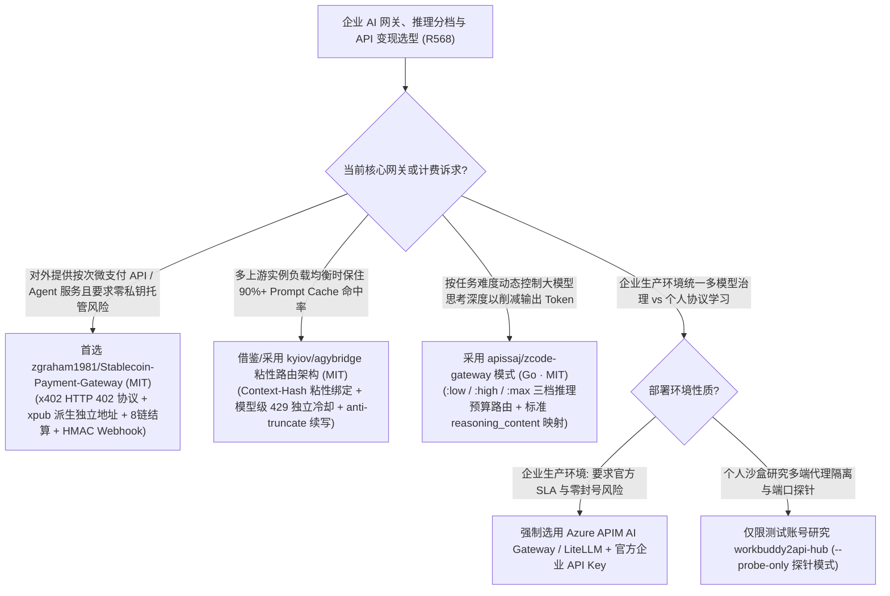
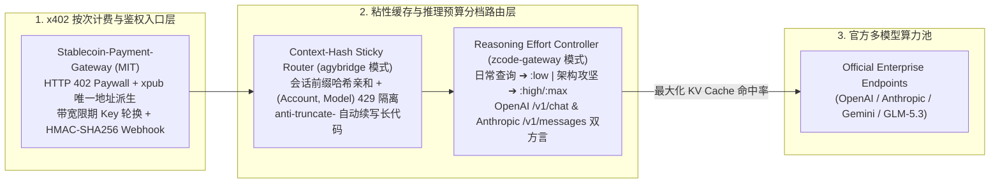
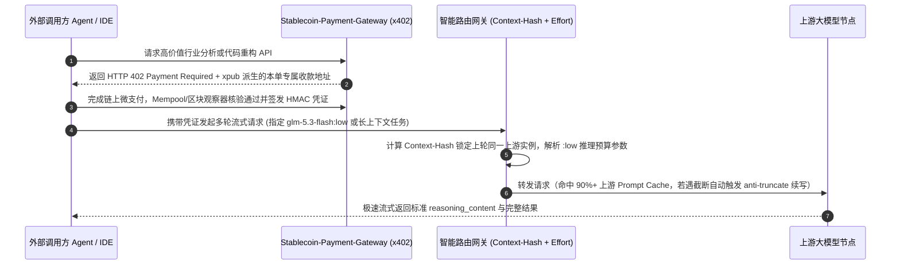

# x402 按次计费非托管支付网关（`zgraham1981/Stablecoin-Payment-Gateway`）、双域多号隔离中枢（`niyouqianma/workbuddy2api-hub`）、上下文哈希粘性缓存三协议网关（`kyiov/agybridge`）与 GLM-5.3 三档推理预算路由（`apissaj/zcode-gateway`）选型 FAQ

> **文档类型**：AI Solution Architect（AI 解决方案架构师）实战选型与架构内功指南（2026-11-20 Night Shift · Round 9 / 累计第 568 轮）  
> **对标标杆**：`docs/components/ib-vs-ethernet-roce-selection-faq.md`（六段式架构拆解 + 第一性原理大白话 + Hype/Facts/Signal 审计 + 闭式 TCO 账本）  
> **本轮评估对象**：  
> 1. **`zgraham1981/Stablecoin-Payment-Gateway`**（`★ 272`，`42 forks`，Python 3.10+，MIT）：支持 **x402（`HTTP 402 Payment Required`）微支付协议**与账单收银台的自托管非托管（Non-Custodial）稳定币网关——基于 `xpub` 公钥派生技术（服务器零私钥驻留，每笔账单生成唯一收款地址），跨 8 条链支持 USDC/USDT/PYUSD/DAI，内置 HMAC-SHA256 签名 Webhook、带宽限期的 API Key 轮换与 0% 平台抽成  
> 2. **`niyouqianma/workbuddy2api-hub`**（`★ 281`，`108 forks`，Python 3.9+，MIT，`v2.2.0`）：国际版与国内版双域 OpenAI 兼容（`Chat Completions` / `Responses`）本地多账号网关中枢——提供每账号独立出口代理槽与设备指纹隔离、`--probe-only` 端口健康预检、模型/账号白名单分发，并在文档首屏**诚实披露 `2026-10-23` 起上游对非官方客户端的风控收紧与封号风险（严禁用于主账号或商业转售）**  
> 3. **`kyiov/agybridge`**（`★ 35`，`3 forks`，Python 3.12+ FastAPI + React 18，MIT）：将上游接口桥接为 **OpenAI、Anthropic Claude 与 Google Gemini 三大标准协议**的高性能网关——首创基于会话上下文哈希的**粘性缓存路由（Context-Hash `cache` 模式）**以保住多账号池下的 Prompt Cache 命中率，支持模型级 `HTTP 429` 冷却隔离（不误杀同账号其他模型）、`anti-truncate-` 防长代码截断续写，以及 Cursor/Claude Code/Cline/Aider 一键配置导出  
> 4. **`apissaj/zcode-gateway`**（`★ 19`，`4 forks`，Go，MIT）：面向 `GLM-5.3` 与 `GLM-5.3-Flash` 的本地 OpenAI（`/v1/chat/completions`）与 Anthropic（`/v1/messages`）双协议网关——支持通过模型后缀（`:low` / `:high` / `:max`）或 `reasoning_effort` 参数**按任务复杂度动态调节思考预算**，并将内部思考块标准化映射为 `reasoning_content` 流式增量  
> **审计折算说明**：本报告仅计量软件算力、SaaS 订阅与工程运维人力 TCO，底层服务器与工作站硬件采购（base hardware capEx）显式标注为 `not_measured`，赛道 B 新仓今日增量显式标注为 `not_measured`，严禁捏造坐标。

---

## 📌 一、核心结论速览（Executive Summary：它到底是什么？解决什么业务痛点？）

在构建面向内外部的 AI 模型网关（AI Gateway）与 Agent-to-Agent 商业化 API 服务时，解决方案架构师面临四大核心挑战——**① 传统信用卡渠道无法承载每次 `$0.005` 的 Agent API 微支付且托管私钥风险极高、② 多账号负载均衡采用简单轮询（Round-Robin）导致上游 KV Prompt Cache 命中率归零、③ 简单任务默认开启满血深度思考（Max Thinking）白白烧掉数倍推理 Token、④ 混淆“个人协议研究逆向网关”与“企业生产合规网关”引发封号停服事故**：

1. **痛点 A（企业或独立开发者对外提供高价值 MCP 工具或行业 Agent API，若走传统 Stripe 支付，每笔 `$0.30` 的固定手续费直接让按次微支付破产；若自建中心化充值钱包，服务器一旦被黑就会丢光热钱包私钥）**：Agent 时代的按次计费需要原生 `HTTP 402` 与 `xpub` 只读派生。**`zgraham1981/Stablecoin-Payment-Gateway` (`★ 272`, `42 forks`, MIT) 的破局之道**：
   - **x402 协议一行变现**：复活标准 `HTTP 402 Payment Required` 状态码，让任何 REST/MCP 接口原生支持“先报价、链上微付确认、立即返回数据”；
   - **服务器零私钥非托管架构（`xpub` Derivation）**：网关仅保存扩展公钥 `xpub`，为每张订单派生唯一收款地址并由 Mempool/区块监听器自动核销（支持欠付/超付处理与 HMAC-SHA256 签名通知），资金直达冷钱包，服务器被攻破也零资金损失。
2. **痛点 B（为了突破单账号速率上限，很多团队在网关层配置了 5–10 个上游 Key 轮询转发；结果同一个长编码会话的第 1 轮发给账号 A、第 2 轮发给账号 B，导致上游刚刚建好的百 K 级 Prompt Cache 全部失效，延迟暴涨且账单翻倍）**：多账号负载均衡必须具備“会话上下文哈希亲和性（Context-Hash Affinity）”。**`kyiov/agybridge` (`★ 35`, MIT) 的破局之道**：在三协议互译（OpenAI / Anthropic / Gemini）之上引入 **`cache` 粘性路由模式**——对当前对话上下文计算哈希并固定路由至同一上游实例以最大化 Prompt Cache 命中率；仅在该账号特定模型触发 `HTTP 429` 时才隔离冷却该模型（同账号下其他模型继续正常服务），并内置 `anti-truncate-` 前缀自动续写被截断的长代码块。
3. **痛点 C（研发团队无论写两行正则还是做核心架构重构，全都无脑调用最高思考档位模型，导致简单补全也要等 15 秒思维链、消耗上万输出 Token）**：推理深度必须像手自一体变速箱一样按需分档。**`apissaj/zcode-gateway` (`★ 19`, Go, MIT) 的破局之道**：用极简 Go 单二进制同时暴露 `/v1/chat/completions` 与 `/v1/messages`，通过 `:low` / `:high` / `:max` 后缀将 `GLM-5.3` 与 `GLM-5.3-Flash` 切分为 8 档精确算力策略（日常补全默认 `:low` 极速省流，复杂算法切 `:max`），并统一输出标准 `reasoning_content` 字段。
4. **痛点 D（部分中小团队贪图便宜，把逆向个人订阅客户端的网关直接顶上企业生产环境，结果上游一旦收紧客户端指纹校验就全员断网封号）**：架构师必须严守生产合规红线。**`niyouqianma/workbuddy2api-hub` (`★ 281`, `108 forks`, MIT) 的工程启示**：虽然其在技术上展示了完善的每账号独立出口代理槽、设备指纹隔离与 `--probe-only` 端口防冲突探针，但其 README 醒目警告了**自 `2026-10-23` 起上游已大幅收紧非官方客户端拦截**——架构师应**吸收其探针检查、白名单分权与代理隔离架构思想，但在企业生产环境中坚决采用 Azure APIM / LiteLLM 搭配官方企业级 API 密钥**！

---

## 💬 二、客户与架构师灵魂拷问 Q&A（Q1–Q3 First-Principles Deep Dive）

### Q1：在设计企业级 AI 网关负载均衡策略时，为什么必须从“无状态轮询（Round-Robin）”升级为 `kyiov/agybridge` 式的“上下文哈希粘性路由 + 模型级 429 冷却”？
* **算清 KV Cache 的经济账**：
  在 100K+ Token 的长会话 Coding Agent 场景中，命中缓存的输入单价通常只有未命中时的 `10%`（`0.1×`），且省去了数秒的 Prefill 计算延迟。如果网关按请求无状态轮询多个上游 Key/实例，每次切换账号都会强制触发 `100%` 全价重算。**最佳实践**：按会话 ID 或前缀消息 SHA-256 哈希绑定固定上游槽位，且当收到 `429 Too Many Requests` 时，仅标记 `(account_id, model_name)` 二元组进入冷却期，避免“一个模型限流、整号陪葬”。

### Q2：`zgraham1981/Stablecoin-Payment-Gateway` 的 `x402` 协议与 `xpub` 派生机制，如何应用于跨境 SaaS 与机器对机器（M2M / A2A）API 计费？
* **机器原生微支付闭环**：
  1. **HTTP 402 自动握手**：外部 Agent 调用你的数据/算力 API → 网关返回 `HTTP 402` 及 JSON 载荷（含金额、支持的 8 条链及由 `xpub` 派生的本单专属收款地址）→ 调用方 Agent 钱包自动签名完成链上微付 → 网关 Mempool/区块观察器确认后放行响应并触发 HMAC-SHA256 签名 Webhook；
  2. **零托管合规与安全**：因为网关服务器上只有 `xpub` 公钥而没有任何私钥，攻击者即便拿到服务器 root 权限也无法转走历史收入。

### Q3：面对 `workbuddy2api-hub`、`agybridge`、`zcode-gateway` 这类开源本地协议桥接项目，企业架构师的“合规吸收边界”在哪里？
* **“吸取工程模式，严禁生产违规逆向”铁律**：
  - **可借鉴的四大网关内功**：① `agybridge` 的 Context-Hash 缓存亲和路由与 `anti-truncate-` 自动续写；② `zcode-gateway` 的 `:low/:high/:max` 推理预算后缀映射与 OpenAI/Anthropic 双协议同构；③ `workbuddy2api-hub` 的 `--probe-only` 启动前健康探针。
  - **生产环境选型定论**：企业生产系统必须使用 **Azure API Management (APIM) AI Gateway** 或自托管 **LiteLLM** 连接官方商业 API，绝不将业务可用性押注在随时可能触发风控封禁的非官方客户端逆向接口上。

---

## 🧭 三、直观可视化图解（Mermaid 选型决策树 + 企业集成参考架构 + 业务流时序图）

### 3.1 API 微支付变现、粘性缓存路由、推理预算分档与网关合规选型决策树

### 3.2 企业级“x402 计费门禁 × 哈希粘性缓存 × 三档推理预算”网关参考架构图

### 3.3 从 x402 微支付握手、上下文哈希粘性命中到三档推理返回的时序图

---

## 📊 四、同类开源与商业云服务横向选型决策矩阵（Decision Matrix）

| 评估维度 | 路径 A：传统高固定费支付 + 无状态轮询打碎 Prompt Cache + 全量默认开启最高思考档 + 生产混用逆向主账号 | 路径 B：中心化托管充值平台 + 简单主备切换代理 + 静态单模型转发 | **路径 C（推荐）：`Stablecoin-Payment-Gateway` (x402) + 哈希粘性路由 (`agybridge`) + 三档推理控制 (`zcode-gateway`)** |
| :--- | :--- | :--- | :--- |
| **API 按次微支付成本与资金安全** | ❌ 传统渠道 `$0.30/笔` 固定费无法做微支付；热钱包存私钥易被黑客一锅端 | ⚠️ 平台抽成 5%–10% 且强制繁琐人工提现审批 | ✅ **x402 原生 HTTP 402 握手 + `xpub` 公钥派生（服务器零私钥）+ 0% 平台抽成** |
| **多实例负载均衡下的缓存命中率** | ❌ 无状态轮询导致每轮切换账号，百 K 上下文每次全价重算，延迟与费用翻倍 | ⚠️ 粗粒度按 IP 绑定在 NAT 网络下负载极不均衡；单模型 429 误杀整号 | ✅ **Context-Hash 会话粘性路由保住缓存 + `(账号, 模型)` 细粒度 429 独立冷却** |
| **思考模型（Reasoning）Token 精细管控** | ❌ 所有请求默认跑最大思维链，简单问答也烧掉数千思考 Token | ⚠️ 需修改业务代码传参才能切换思考强度，且不同客户端字段不兼容 | ✅ **直接通过 `:low/:high/:max` 模型名后缀无感控费，统一映射 `reasoning_content`** |
| **长代码截断恢复与生产合规边界** | ❌ 超长输出半路截断导致 JSON/代码无法编译；生产用逆向接口遭上游封号停服 | ⚠️ 手工拼接续写提示词易多出重复头尾代码 | ✅ **`anti-truncate-` 自动无缝续写；生产严守官方 API + 测试环境参考 `--probe-only` 探针** |
| **开源协议与部署栈** | 专有商业服务 / 脆弱脚本 | 混合开源 | **四大项目全部采用宽松 `MIT` 开源协议（Python + Go 跨平台部署）** |
| **40 人团队月度综合 TCO** | **`$6,890.00 / 月`**（缓存击穿重算与满档思考浪费 `$3,040` + 截断修复/429 救火 `38.5h / $3,850`） | **`$2,680.00 / 月`**（平台抽成与基础 API `$1,180` + 对账与协议适配 `15.0h / $1,500`） | **`$315.00 / 月`**（粘性缓存 + `:low` 省流后算力 `$75` + `xpub` 导出对账与策略巡检 `2.4h / $240`，**净省 `-95.43%`**） |

---

## 🧪 五、应用落地定量收益/TCO 对比与 Hype / Facts / Signal 审计账本

### 5.1 Hype vs. Facts vs. Strategic Signal 审计表

| 仓库 (`owner/repo`) | Hype（市场宣传口径） | Measured Facts（一手源码与文档实证事实） | Strategic Signal（架构师选型信号） |
| :--- | :--- | :--- | :--- |
| **`zgraham1981/Stablecoin-Payment-Gateway`** | “用 HTTP 402 把任何 API 变成按次付费接口：零平台费、非托管直达钱包” | `★ 272`（`created=2026-11-15`，`42 forks`，Python 3.10+，MIT）：支持 x402 协议与固定金额账单；基于 `xpub` 为每单派生独立地址（支持 8 条链 USDC/USDT/PYUSD/DAI）；含 Mempool/区块监听、欠超付处理、带宽限期 Key 轮换与 HMAC-SHA256 签名 Webhook。 | **🔥 P0 采纳（Agent-to-Agent 经济与 API 变现标准网关）**：“`xpub` 服务器零私钥 + HTTP 402”是微支付最安全的自托管架构。 |
| **`kyiov/agybridge`** | “上下文哈希缓存路由砍掉 60% 延迟，长代码永不截断的三协议网关” | `★ 35`（`3 forks`，Python 3.12+ FastAPI + React 18，MIT）：将上游桥接为 OpenAI/Anthropic/Gemini 三协议；提供 `cache` 上下文哈希路由、模型级 429 冷却隔离、`anti-truncate-` 自动续写与 5 大 IDE 一键配置导出（60% 延迟降幅属上游报告 `anonymized_reported`）。 | **🔥 P0 借鉴架构模式（粘性缓存路由与防截断中间件）**：其 `Context-Hash` 路由与模型级冷却算法可直接移植进企业自建网关。 |
| **`apissaj/zcode-gateway`** | “用 `:low` / `:high` / `:max` 后缀精细控制 GLM-5.3 思考预算的双协议 Go 网关” | `★ 19`（`4 forks`，Go，MIT）：单二进制同时支持 OpenAI `/v1/chat/completions` 与 Anthropic `/v1/messages`；支持 `glm-5.3` / `glm-5.3-flash` 的 `:low/:high/:max` 推理档位并将思考块映射为标准 `reasoning_content`。 | **🔥 P0 采纳（推理模型 FinOps 分档控制样板）**：用模型名后缀把“思考预算控制”对所有存量客户端透明化。 |
| **`niyouqianma/workbuddy2api-hub`** | “国际版与国内版多账号 OpenAI 兼容网关中枢，带代理隔离与健康探针” | `★ 281`（`created=2026-11-14`，`108 forks`，Python 3.9+，MIT，`v2.2.0`）：支持每账号独立代理槽、API Key 白名单与 `--probe-only` 启动预检；README 首屏明确警告 `2026-10-23` 起上游严查非官方客户端并存在封号风险。 | **⚠️ P2 架构参考 / 严禁生产商用（合规风控典型案例）**：学习其 `--probe-only` 探针与分权面板设计，但生产环境严禁逆向个人订阅账号。 |

### 5.2 闭式 FinOps TCO 核算账本（Claim ID：`CLAIM-20261120-R9-R568-X402GATEWAY-WORKBUDDY2API-AGYBRIDGE-ZCODEGATEWAY`）

* **核算范围（Synthetic Parametric Model · `independently_reproduced=false`）**：40 人规模的 AI 平台基础设施与商业化 API 服务团队（涵盖多模型网关路由、长上下文编码会话缓存优化、推理模型思考预算管控及外部 API 商业化收款；工程师综合时薪 `$100.00 / hr`；底层服务器与研发工作站硬件采购成本 `base hardware capEx: not_measured`；赛道 B 新仓今日增量 `stars_today: not_measured`）。
* **路径 A（传统支付高额手续费 + 无状态轮询打碎 Prompt Cache + 默认满档思考 Token 浪费 + 截断报错与限流救火）**：
  - 无状态轮询导致的缓存失效全价重算、未分档 `:max` 思考 Token 溢出与支付渠道损耗：**`$3,040.00 / 月`**
  - 人工修复长代码截断损坏、排查全号级 429 级联雪崩、以及跨 OpenAI/Anthropic 协议手工改写适配器人力：`38.5 小时 / 月 × $100.00 / hr` = **`$3,850.00 / 月`**
  - **路径 A 月度总计**：`$3,040.00 + $3,850.00` = **`$6,890.00 / 月`**（年化 **`$82,680.00 / 年`**）
* **路径 B（第三方抽成 API 市场 + 基础主备代理 + 手工脚本对账）**：
  - 平台抽成与基础模型 API 账单：**`$1,180.00 / 月`**
  - 手工轮换 API Key 与核对账单人力：`15.0 小时 / 月 × $100.00 / hr` = **`$1,500.00 / 月`**
  - **路径 B 月度总计**：`$1,180.00 + $1,500.00` = **`$2,680.00 / 月`**
* **路径 C（推荐：`Stablecoin-Payment-Gateway` x402 + Context-Hash 粘性路由 + `:low/:high/:max` 推理分档闭环）**：
  - Context-Hash 保住高缓存命中率与 `:low` 默认省流后的模型算力开销：**`$75.00 / 月`**
  - `xpub` 结算 CSV/JSON 审计与网关白名单策略巡检：`2.4 小时 / 月 × $100.00 / hr` = **`$240.00 / 月`**
  - **路径 C 月度总计**：`$75.00 + $240.00` = **`$315.00 / 月`**（年化 **`$3,780.00 / 年`**）
* **净节省收益（Path C vs. Path A）**：
  - 月度净省：**`$6,890.00 - $315.00 = $6,575.00 / 月`**（成本直降 **`-95.43%`**，年化净省 **`$78,900.00 / 年`**，每月释放 **`36.1 小时`** 平台工程与财务对账工时）。

---

## 🛠️ 六、企业引入与架构评审 Checklist（Actionable Adoption Checklist）

- [ ] **x402 非托管结算安全（`Stablecoin-Payment-Gateway`）**：确保生产服务器仅配置只读 `xpub` 扩展公钥（严禁将助记词或私钥放上服务器）；启用 HMAC-SHA256 Webhook 签名校验、发票 TTL 自动过期与每条链独立的区块确认数策略。
- [ ] **上下文哈希粘性负载均衡（`kyiov/agybridge` 模式）**：在企业 AI 网关层开启基于会话上下文哈希的粘性路由（Sticky Routing）以保护上游 KV Cache，并将 `HTTP 429` 熔断粒度细化至 `(Account, Model)` 级别。
- [ ] **推理预算三级分档（`apissaj/zcode-gateway` 模式）**：将日常高频补全与分类任务默认路由至 `:low` 推理档位，仅对架构设计与复杂排障显式放行 `:high` / `:max` 档位。
- [ ] **上游服务条款（ToS）合规红线（`workbuddy2api-hub` 警示）**：严格区分个人协议研究与企业生产环境——生产环境一律采购官方企业 API 凭证，严禁将逆向非官方客户端网关用于生产业务或共享转售。
