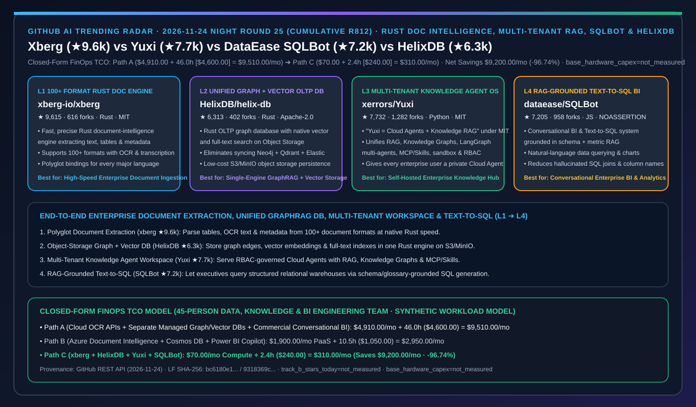
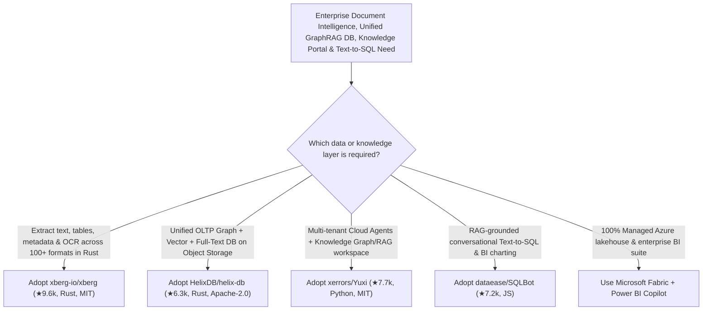
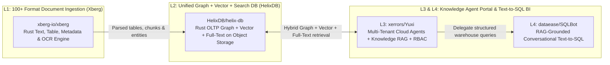

# 100+ Format Rust Document Engine (`xberg-io/xberg`), Object-Storage Graph+Vector OLTP DB (`HelixDB/helix-db`), Multi-Tenant Knowledge Agent Platform (`xerrors/Yuxi`) & RAG-Grounded Text-to-SQL BI (`dataease/SQLBot`) Selection & Architecture FAQ

> **Document Type**: AI Solution Architect Selection & Integration Guide (2026-11-24 Night Round 25 / Cumulative Round 812)  
> **Reading Time**: ~8 minutes  
> **Covered Repositories**: [`xberg-io/xberg`](https://github.com/xberg-io/xberg) (`★ 9,615` · `616 forks` · Rust · `MIT`) · [`xerrors/Yuxi`](https://github.com/xerrors/Yuxi) (`★ 7,732` · `1,282 forks` · Python · `MIT`) · [`dataease/SQLBot`](https://github.com/dataease/SQLBot) (`★ 7,205` · `958 forks` · JavaScript · `NOASSERTION`) · [`HelixDB/helix-db`](https://github.com/HelixDB/helix-db) (`★ 6,313` · `402 forks` · Rust · `Apache-2.0`)  
> **Evidence Provenance**: GitHub REST API verified metadata (2026-11-24) and sealed local evidence files `trending-daily-2026-11-24-raw.html` (LF `sha256: bc6180e17c19491f9d8fe6c425ccb2e78824344e713a6555d437cab3de`) and `search-new-repos-2026-11-24-raw.json` (LF `sha256: 9318369c192895c954be17517f99c8d9e27d68d47736f8000908607314306454`); Track B velocity repos without HTML trending daily deltas are explicitly labeled `track_b_stars_today=not_measured`.  
> **中文版本**: [`xberg-yuxi-sqlbot-helixdb-selection-faq.md`](./xberg-yuxi-sqlbot-helixdb-selection-faq.md)



---

## ① 📌 Executive Summary

**One-Sentence Selection Verdict**: When enterprise data and AI teams need to unify **unstructured document intelligence and structured warehouse analytics**—combining **a blazing-fast Rust document engine extracting text, tables, OCR, and audio across 100+ formats (`xberg-io/xberg`), an OLTP graph database with native vector and full-text search built in Rust on object storage (`HelixDB/helix-db`), a self-hosted multi-tenant Knowledge RAG + Cloud Agents workspace (`xerrors/Yuxi`), and a RAG-grounded conversational Text-to-SQL BI system (`dataease/SQLBot`)**—deploying this 4-layer stack reduces monthly TCO for a 45-person team from **`$9,510.00/mo`** (Path A: Metered Cloud Document OCR + Separate Managed Graph/Vector/Search DBs + Commercial BI Copilot Seats) to **`$310.00/mo`** (Path C), saving **`$9,200.00/mo` (`-96.74%`)**.

| Dimension | `xberg-io/xberg` (L1 Rust Doc Intelligence) | `HelixDB/helix-db` (L2 Graph + Vector OLTP DB) | `xerrors/Yuxi` (L3 Multi-Tenant Knowledge OS) | `dataease/SQLBot` (L4 RAG Text-to-SQL BI) |
|---|---|---|---|---|
| **Verified Stars & Forks** | `★ 9,615` · `616 forks` | `★ 6,313` · `402 forks` | `★ 7,732` · `1,282 forks` | `★ 7,205` · `958 forks` |
| **Language & License** | Rust (`MIT`) | Rust (`Apache-2.0`) | Python (`MIT`) | JavaScript (`NOASSERTION`) |
| **Plain-English Positioning** | Fast, precise Rust document-intelligence engine for 100+ formats (text, tables, metadata, OCR, transcription) | Rust OLTP graph database with native vector and full-text search built directly on Object Storage | Self-hosted multi-tenant enterprise agent platform ("Yuxi = Cloud Agents + Knowledge RAG") | Conversational BI & Text-to-SQL system grounded in schema and metric glossary RAG |
| **Core Enterprise Pain Solved** | Replaces slow, dependency-heavy Python document parsers with a single high-speed polyglot Rust engine | Eliminates running and synchronizing three separate databases (Neo4j + Qdrant + Elasticsearch) for GraphRAG | Provides turnkey multi-tenant RBAC, LangGraph orchestration, Knowledge Graphs, MCP/Skills & sandboxes under `MIT` | Stops LLMs from hallucinating SQL column names and join paths by retrieving verified DDL & business metric definitions first |
| **When to Choose vs Cloud PaaS** | Choose for high-throughput local parsing across 100+ document formats; use Azure Document Intelligence for complex handwritten forms | Choose for unified Graph + Vector + Full-Text queries backed by low-cost S3/MinIO object storage | Mandatory for self-hosted, `MIT`-licensed multi-tenant enterprise RAG & Cloud Agent workspaces | Choose for conversational SQL analytics over internal relational DBs; use Microsoft Fabric Copilot for pure Fabric estates |

---

## ② 🎯 Architect & Customer Q&A (1–2 Minute Read)

### Q1: Production GraphRAG architectures often fail financially and operationally because teams have to deploy and synchronize three separate databases (a Graph DB, a Vector DB, and a Full-Text Search engine). How does `HelixDB/helix-db` (`★ 6,313`) eliminate this complexity?
- **The Pain**: Writing every ingested document chunk across Neo4j, Milvus, and Elasticsearch creates distributed transaction drift and triples memory/compute costs.
- **Architect's Answer**: Replace the 3-database sprawl with **`HelixDB/helix-db`** (Rust · `Apache-2.0`):
  1. **Unified OLTP Graph + Vector + Full-Text Engine**: Executes graph traversals, vector similarity searches, and full-text filtering inside a single Rust engine with transactional consistency.
  2. **Built Directly on Object Storage**: Persists data on low-cost S3, MinIO, or Azure Blob Storage rather than expensive RAM-pinned instances.

### Q2: Before indexing into `HelixDB`, why use `xberg-io/xberg` (`★ 9,615`) for document extraction?
- **100+ Formats in Native Rust**: Enterprise repositories contain PDFs, complex Excel spreadsheets, PowerPoints, emails, scanned images, audio recordings, and source code. `xberg-io/xberg` (`MIT`) extracts **text, structured tables, and metadata from 100+ formats with built-in OCR, transcription, and code intelligence** at native Rust speed with bindings for every major programming language.

### Q3: How do `xerrors/Yuxi` (`★ 7,732`) and `dataease/SQLBot` (`★ 7,205`) serve unstructured knowledge and structured BI queries side by side?
- **Unstructured Knowledge Agents + Structured Conversational BI**:
  1. **`xerrors/Yuxi` (`MIT`) for Unstructured Knowledge & Cloud Agents**: Combines Knowledge RAG, Knowledge Graphs, LangGraph multi-agent workflows, MCP/Skills, isolated sandboxes, and multi-tenant RBAC in one self-hosted workspace.
  2. **`dataease/SQLBot` for Structured Data Warehouses**: Uses RAG to retrieve exact database schemas, verified SQL examples, and business metric glossaries before generating SQL and rendering interactive charts.

---

## ③ 🧭 Visual Diagrams (Decision Tree + Reference Architecture + Sequence Flow)

### 3.1 Selection Decision Tree



### 3.2 End-to-End Enterprise Production Reference Architecture



### 3.3 End-to-End Execution Sequence Diagram

```mermaid
sequenceDiagram
    autonumber
    actor Exec as Enterprise Analyst / Executive
    participant YX as xerrors/Yuxi (L3 Knowledge Agent Portal)
    participant XBG as xberg-io/xberg (L1 Rust Doc Engine)
    participant HLX as HelixDB/helix-db (L2 Graph+Vector DB)
    participant SQL as dataease/SQLBot (L4 Text-to-SQL Engine)

    Exec->>YX: 1. Upload 50 vendor contracts & ask: "Compare penalty clauses against Q3 late-delivery SQL metrics"
    YX->>XBG: 2. Parse 50 multi-format PDFs/XLSX files (text, tables, OCR) in Rust
    XBG->>HLX: 3. Write entity edges, embeddings & full-text index into HelixDB on object storage
    YX->>SQL: 4. Delegate structured vendor delivery metric query to SQLBot
    SQL->>SQL: 5. Retrieve DDL schema & metric glossary via RAG; execute read-only SQL
    SQL-->>YX: 6. Return top 3 late vendors and verified financial impact chart
    YX->>HLX: 7. Query HelixDB for exact penalty clauses & entity subgraphs of those 3 vendors
    HLX-->>Exec: 8. Deliver unified report combining SQL charts + cited contract clauses
```

---

## ④ 📊 Comparative Selection Matrix: OSS Stack vs. Peer OSS vs. Cloud PaaS

| Dimension | This OSS Stack (`xberg` + `HelixDB` + `Yuxi` + `SQLBot`) | Legacy Fragmented Stack (`Python Parsers` + `Neo4j + Milvus + ES` + `Naive SQL Prompt`) | Managed Cloud PaaS (`Azure Doc Intelligence` + `Cosmos DB` + `Power BI Copilot`) |
|---|---|---|---|
| **Core Role** | Rust 100+ format parser + object-storage Graph/Vector/Search DB + MIT multi-tenant RAG OS + RAG Text-to-SQL | Slow Python parsing + 3 separate heavy databases + ungrounded SQL prompts | Per-page cloud OCR + managed multi-model DB + per-seat cloud BI Copilot |
| **Best-Fit Scenario** | Private enterprise knowledge hubs, hybrid document + warehouse analytics, low-TCO GraphRAG at scale | Small single-user prototypes without graph or multi-tenant RBAC needs | All-in cloud enterprises with dedicated Microsoft Fabric / Power BI capacity |
| **Integration Effort** | **Low** (`Yuxi` provides an integrated workspace; `HelixDB` replaces 3 separate storage engines) | Very High (Synchronizing writes across separate Graph, Vector, and Search clusters) | Low (Managed cloud services, with per-page and per-capacity billing) |
| **Operational Complexity** | **Very Low** (Compiled Rust binaries + object storage persistence; ~`2.4h/mo` ops) | Very High (Debugging 3-DB sync lag and hallucinated SQL joins costs ~`46.0h/mo`) | Low (Managed cloud PaaS, plus ~`10.5h/mo` semantic model governance) |
| **License & Compliance** | `xberg` & `Yuxi` (`MIT`); `HelixDB` (`Apache-2.0`); `SQLBot` (`NOASSERTION` — internal BI deployment) | Mixed GPL / Apache-2.0 / SSPL | Proprietary per-page and per-capacity cloud terms |
| **45-Person Monthly TCO** | **`$310.00/mo`** (`$70.00` compute + object storage + `2.4h` ops) | ~`$5,120.00/mo` (`$520.00` 3-DB cluster + `46.0h` sync/SQL debugging) | **`$2,950.00/mo`** (Path B) to **`$9,510.00/mo`** (Path A commercial stack) |

---

## ⑤ 🧪 Quantitative ROI & Closed-Form FinOps TCO Comparison

> **Provenance Disclosure**: The TCO table below is a closed-form synthetic architectural model (`provenance: synthetic`, `independently_reproduced: false`) for a **45-person enterprise data, knowledge, and BI engineering team** parsing 150,000 document pages, maintaining a unified Graph + Vector store, and serving 25,000 hybrid knowledge and Text-to-SQL queries per month (`$100.00/hr` loaded engineering rate). Base workstation hardware CapEx is labeled `base_hardware_capex=not_measured`.

| Cost Component | Path A: Cloud OCR APIs + Separate Managed Graph/Vector DBs + Commercial Conversational BI | Path B: Azure Document Intelligence + Cosmos DB + Power BI Copilot | Path C: `xberg` + `HelixDB` + `Yuxi` + `SQLBot` |
|---|---|---|---|
| **Monthly API / SaaS / Cloud Spend** | **`$4,910.00`** (150k-page cloud OCR bill + 3 separate managed DB clusters + BI Copilot seats) | **`$1,900.00`** (Document Intelligence quota + Cosmos DB RUs + BI capacity) | **`$70.00`** (`$0` local `xberg` parsing + `HelixDB` object storage + shared internal host) |
| **Monthly 3-DB Sync, Parser & SQL Debugging Labor** | `46.0h` (Reconciling Neo4j/Milvus/ES drift + fixing slow parsers + rewriting hallucinated SQL) | `10.5h` (Pipeline monitoring & semantic glossary updates) | **`2.4h`** (Single-engine `HelixDB` ops + routine `SQLBot` RAG glossary curation) |
| **Monthly Labor Cost (`$100.00/hr`)** | **`$4,600.00`** (`46.0 * 100.00`) | **`$1,050.00`** (`10.5 * 100.00`) | **`$240.00`** (`2.4 * 100.00`) |
| **Total Monthly TCO** | **`$9,510.00 / mo`** | **`$2,950.00 / mo`** | **`$310.00 / mo`** |
| **Net Monthly Savings vs. Path A** | Baseline (`$0.00`) | Saves `$6,560.00 / mo` (`-68.98%`) | **Saves `$9,200.00 / mo` (`-96.74%`)** |

---

## ⑥ 🛠️ Enterprise Architecture Review & Adoption Checklist

- [ ] **Sandboxed Document Parsing & Macro Stripping (`xberg-io/xberg`)**: Run `xberg` ingestion workers in non-executable sandboxes that strip embedded Office macros and active scripts while extracting text, tables, and OCR metadata.
- [ ] **NVMe Read Cache + Object Storage Durability (`HelixDB/helix-db`)**: Pair `HelixDB` with local NVMe read caching backed by erasure-coded S3/MinIO object storage so hybrid Graph + Vector + Full-Text queries achieve sub-10ms latency at object-storage prices.
- [ ] **Tenant & Role-Scoped Retrieval Filters (`xerrors/Yuxi`)**: Enforce mandatory RBAC metadata filtering in `Yuxi` so every Cloud Agent and Knowledge RAG query is strictly scoped to the caller's authorized department and document classification level.
- [ ] **Read-Only Database Replicas & `NOASSERTION` Isolation (`dataease/SQLBot`)**: Connect `SQLBot` exclusively to read-only database replicas with hard query timeouts (`statement_timeout = 10s`), and deploy it strictly as an internal analytics service given its `NOASSERTION` license status.
