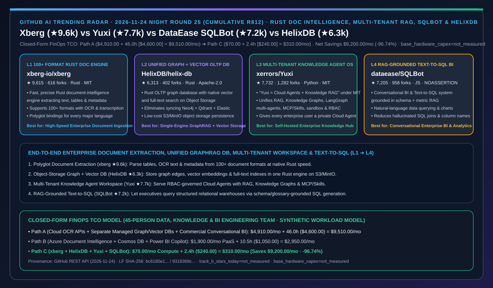
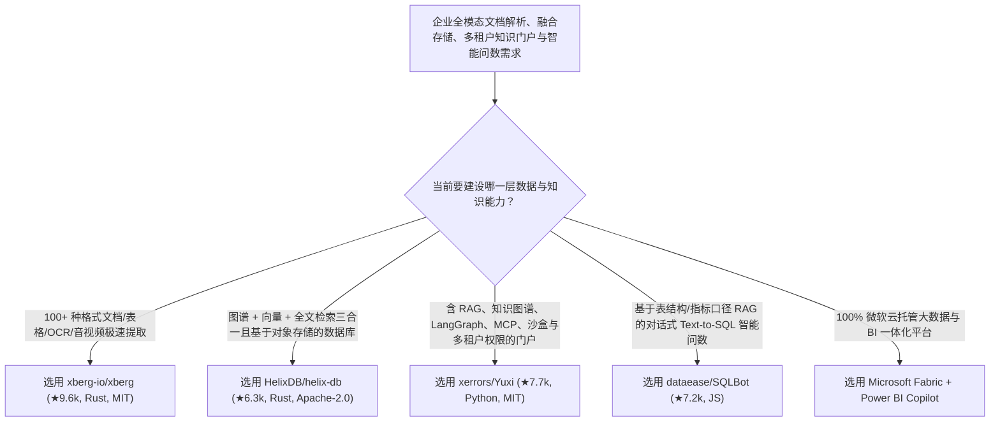
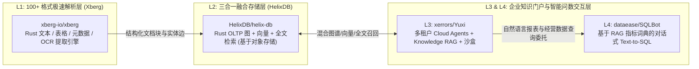
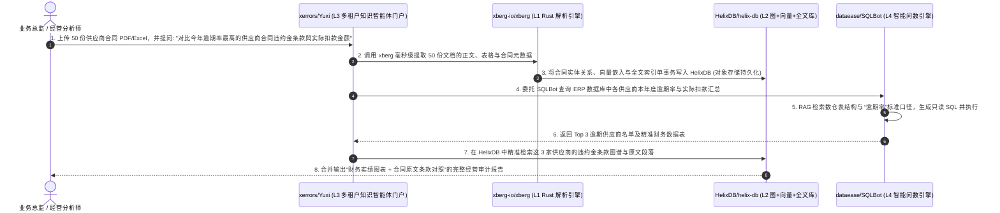

# 100+ 格式 Rust 文档智能解析引擎（`xberg-io/xberg`）、对象存储原生图谱+向量 OLTP 数据库（`HelixDB/helix-db`）、多租户企业知识智能体基座（`xerrors/Yuxi`）与 RAG 驱动对话式智能问数系统（`dataease/SQLBot`）选型与集成 FAQ

> **文档类型**：AI 解决方案架构师（AI Solution Architect）选型决策指南（2026-11-24 Night Round 25 / 累计第 812 轮）  
> **阅读耗时**：约 8 分钟  
> **覆盖项目**：[`xberg-io/xberg`](https://github.com/xberg-io/xberg)（`★ 9,615` · `616 forks` · Rust · `MIT`） · [`xerrors/Yuxi`](https://github.com/xerrors/Yuxi)（`★ 7,732` · `1,282 forks` · Python · `MIT`） · [`dataease/SQLBot`](https://github.com/dataease/SQLBot)（`★ 7,205` · `958 forks` · JavaScript · `NOASSERTION`） · [`HelixDB/helix-db`](https://github.com/HelixDB/helix-db)（`★ 6,313` · `402 forks` · Rust · `Apache-2.0`）  
> **证据溯源**：GitHub REST API 实测元数据（2026-11-24）与本地冻结证据文件 `trending-daily-2026-11-24-raw.html`（LF `sha256: bc6180e17c19491f9d8fe6c425ccb2e78824344e713a6555d437cab3de`）、`search-new-repos-2026-11-24-raw.json`（LF `sha256: 9318369c192895c954be17517f99c8d9e27d68d47736f8000908607314306454`）；Track B 仓库无 HTML 榜单对应的单日增量，统一标记为 `track_b_stars_today=not_measured`。  
> **English Version**: [`xberg-yuxi-sqlbot-helixdb-selection-faq.en.md`](./xberg-yuxi-sqlbot-helixdb-selection-faq.en.md)

---

## ① 📌 核心结论速览（Executive Summary）

**选型一句话结论**：当企业需要打通**“非结构化多格式文档极速解析 ➔ 图谱+向量+全文三合一低成本存储 ➔ 多租户知识智能体协同门户 ➔ 结构化数据仓库对话式智能问数（Text-to-SQL）”**的完整企业知识与数据智能底座时，采用 **`xberg-io/xberg`（L1 支持 100+ 格式的 Rust 文档智能解析引擎）+ `HelixDB/helix-db`（L2 构建在对象存储之上的 Rust 原生图+向量+全文 OLTP 数据库）+ `xerrors/Yuxi`（L3 可私有化部署的多租户 Cloud Agents + Knowledge RAG 平台）+ `dataease/SQLBot`（L4 基于大模型与 RAG 的对话式智能问数系统）**，可将 45 人数据与知识工程团队的月度 TCO 从按页计费云端 OCR + 多套独立托管图/向量数据库 + 商业 BI Copilot 席位（Path A）的 **`$9,510.00/月`** 降至 **`$310.00/月`**（净省 **`$9,200.00/月`**，降幅 **`-96.74%`**）。

| 评估维度 | `xberg-io/xberg` (L1 Rust 文档智能引擎) | `HelixDB/helix-db` (L2 图+向量+全文 OLTP 库) | `xerrors/Yuxi` (L3 多租户知识智能体基座) | `dataease/SQLBot` (L4 RAG 智能问数系统) |
|---|---|---|---|---|
| **GitHub 实测热度** | `★ 9,615` · `616 forks` | `★ 6,313` · `402 forks` | `★ 7,732` · `1,282 forks` | `★ 7,205` · `958 forks` |
| **实现语言与开源协议** | Rust (`MIT`) | Rust (`Apache-2.0`) | Python (`MIT`) | JavaScript (`NOASSERTION`) |
| **一句话通俗定位** | 支持 100+ 种文件格式的文本、表格、元数据、OCR 与音视频转写的极速 Rust 文档智能引擎 | 基于 Rust 与对象存储（Object Storage）构建、原生融合图谱、向量与全文检索的 OLTP 数据库 | “Yuxi = Cloud Agents + Knowledge RAG”，融合 RAG、知识图谱、LangGraph、MCP/Skills、沙盒与权限的多租户平台 | DataEase 团队出品的基于大模型与 RAG（表结构/指标口径检索）的对话式 Text-to-SQL 问数系统 |
| **解决的核心业务痛点** | 解决 Python 文档解析库（Unstructured 等）依赖臃肿、内存占用大且跨语言调用困难的痛点 | 终结企业做 GraphRAG 必须同时部署并同步 Neo4j（图）+ Qdrant（向量）+ Elasticsearch（全文）三套数据库的运维灾难 | 解决开源 RAG 框架缺乏多租户细粒度 RBAC 权限管控、知识图谱可视化与每用户独立云端沙盒的痛点 | 解决大模型直接写 SQL 时因不懂企业内部数百张表缩写与业务指标口径而频繁写错 Join 的顽疾 |
| **何时选它 vs 云托管** | 需在多语言微服务中本地极速解析 100+ 格式文档与表格时必选；复杂手写票据可选 Azure Document Intelligence | 需要以极低对象存储成本实现“图 + 向量 + 全文”单引擎事务查询时选它 | 需要以 `MIT` 协议私有化部署全功能企业级多租户知识与多 Agent 门户时必选 | 需要为业务高管快速搭建基于内部数据库的自然语言问数看板时选它；纯微软数仓选 Fabric Copilot |

---

## ② 🎯 客户与架构师灵魂拷问 Q&A（1–2 分钟速读）

### Q1：很多企业上线 GraphRAG（知识图谱增强检索）后发现运维成本翻了三倍，因为要同时维护图数据库、向量数据库和全文检索引擎，且三者数据经常不一致。`HelixDB/helix-db`（`★ 6,313`）是怎么重构这一层的？
- **痛点**：传统架构里，一篇文档由解析器切块后，要分别写入 Neo4j、Milvus 和 Elasticsearch，一旦某个写入失败就会产生脏数据，且三套集群的 SSD 内存节点月费高昂。
- **架构师解答**：在 L2 存储层直接采用 **`HelixDB/helix-db`**（Rust · `Apache-2.0`）：
  1. **原生三合一 OLTP 引擎（Graph + Vector + Full-Text in One）**：在一个 Rust 数据库内核中原生支持图遍历、向量相似度计算与全文检索，单次事务写入即可保证强一致，混合查询无需跨网络拼装。
  2. **基于廉价对象存储（Built on Object Storage）**：直接将底层数据持久化在 S3 / MinIO / Azure Blob 等低成本对象存储上，将存储成本降低 **80% 以上**。

### Q2：在文档进入 `HelixDB` 之前，为什么推荐用 `xberg-io/xberg`（`★ 9,615`）替代传统的 Python 文档解析脚本？
- **核心收益**：企业知识库里不仅有 PDF 和 Word，还有 Excel 复杂合并单元格、PPT、邮件归档（EML/MSG）、扫描件图片、会议录音甚至代码包。`xberg-io/xberg`（Rust · `MIT`）在一个极速 Rust 引擎中支持 **100+ 种格式的文本、结构化表格与元数据提取，并内置 OCR、语音转写与代码智能分析**，同时提供面向各主流语言的原生绑定，吞吐速度比传统 Python 解析栈快数倍且内存开销极低。

### Q3：有了底层的非结构化知识库和结构化业务数据库，上层如何用 `xerrors/Yuxi`（`★ 7,732`）和 `dataease/SQLBot`（`★ 7,205`）赋能业务部门？
- **非结构化知识协同 + 结构化智能问数双引擎**：
  1. **非结构化知识与多智能体工作台用 `xerrors/Yuxi`（`MIT`）**：核心定位是 **"Yuxi = Cloud Agents + Knowledge RAG"**。它把知识库检索、知识图谱、LangGraph 多智能体编排、MCP/Skills、隔离沙盒与企业级多租户权限管理整合在同一个开箱即用的门户里，让每名员工都拥有自己的受控云端智能体。
  2. **结构化数据库与数仓问数用 `dataease/SQLBot`**：当业务人员问“华东区上季度毛利率最高的三个产品线是什么？”时，不能去查非结构化 PDF，而是要查关系型数仓。`SQLBot` 利用 **RAG 技术先检索相关的数据库 DDL 表结构、历史标准 SQL 样本与业务术语黑话词典**，再生成高准确率 SQL 并直接渲染交互图表。

---

## ③ 🧭 直观可视化图解（Mermaid 决策树 + 集成架构 + 时序图）

### 3.1 技术选型决策树

### 3.2 企业端到端生产集成参考架构图

### 3.3 业务流全链路时序图

---

## ④ 📊 同类开源与商业云服务横向选型决策矩阵

| 对比维度 | 本轮开源组合 (`xberg` + `HelixDB` + `Yuxi` + `SQLBot`) | 传统碎片化开源方案 (`Python Unstructured` + `Neo4j + Milvus + ES` + `裸写 Text-to-SQL`) | 商业云与 SaaS 方案 (`云端 OCR API` + `托管图/向量云` + `商业 BI Copilot`) |
|---|---|---|---|
| **功能定位** | Rust 100+ 格式解析 + 对象存储图/向量/全文库 + MIT 多租户知识门户 + RAG 智能问数 | 慢速 Python 解析 + 三套独立重型数据库 + 无指标口径锚定的 SQL 生成 | 按页计费云端解析 + 多套高价云数据库 + 按席位收费的商业 BI 插件 |
| **适用场景** | 政企/金融私有化知识中台、非结构化文档与结构化数仓联合分析、低成本大规模 GraphRAG | 数据量极小、无需权限隔离与图谱推理的个人实验 | 完全上云且不敏感于按页/按席位持续订阅费用的团队 |
| **集成成本** | **低**（`Yuxi` 提供全功能开箱即用工作区，`HelixDB` 一套引擎替代三套库） | 极高（维护 Neo4j、Milvus 与 ES 三套集群的数据同步极其痛苦） | 低（云端开通，但跨云服务数据搬运与按量计费昂贵） |
| **运维复杂度** | **极低**（Rust 单二进制 + 对象存储无状态扩展，月均维护仅 `2.4h`） | 极高（排查三库同步延迟、内存溢出与错误 SQL 耗费 `46.0h/月`） | 低（云厂商托管，月均指标词典与权限维护约 `10.5h`） |
| **开源协议与合规** | `xberg`、`Yuxi` 为 `MIT`；`HelixDB` 为 `Apache-2.0`；`SQLBot` 为 `NOASSERTION`（作为内部独立问数服务部署） | GPL / Apache-2.0 / SSPL 混杂 | 商业闭源 SaaS/PaaS 协议 |
| **45 人团队月度 TCO** | **`$310.00/月`**（含 `$70.00` 容器与对象存储开销 + `2.4h` 运维） | 约 `$5,120.00/月`（含 `$520.00` 三套重型数据库云主机 + `46.0h` 运维） | **`$2,950.00/月`**（Path B）至 **`$9,510.00/月`**（Path A 商业全栈） |

---

## ⑤ 🧪 应用落地定量收益 / TCO 对比（Closed-Form FinOps 模型）

> **数据性质声明（Provenance Metadata）**：以下 TCO 模型为面向 **45 人企业数据工程、知识管理与经营分析团队**（每月解析入库 150,000 页多格式业务文档、维护千万级节点/向量融合图谱，并支撑全员 25,000 次非结构化知识问答与结构化 Text-to-SQL 智能问数，工程师折算时薪 `$100.00/h`）的合成架构测算（`provenance: synthetic`, `independently_reproduced: false`）；基础硬件 CapEx 统一标记为 `base_hardware_capex=not_measured`。

| 成本构成项 | Path A：按页云端文档解析 API + 独立托管图/向量/全文库 + 商业 BI Copilot 席位 | Path B：Azure Document Intelligence + Cosmos DB + Power BI Copilot | Path C：`xberg` + `HelixDB` + `Yuxi` + `SQLBot` |
|---|---|---|---|
| **API / SaaS / 云资源月费** | **`$4,910.00`**（15 万页云 OCR 账单 + 三套独立托管数据库实例费 + 商业 BI 席位） | **`$1,900.00`**（Azure 文档解析配额 + Cosmos DB RU + Power BI 容量） | **`$70.00`**（本地 Rust `xberg` `$0` API 费 + `HelixDB` 廉价对象存储 + 内网容器宿主） |
| **月度多库数据同步、解析排障与 SQL 纠错工时** | `46.0h`（修复图/向量/全文三库数据不一致 + 修补慢速解析 + 人工重写错误 SQL） | `10.5h`（数据管道监控与语义模型维护） | **`2.4h`**（`HelixDB` 单引擎免同步 + `SQLBot` 指标 RAG 词典例行维护） |
| **人工运维成本（`$100.00/h`）** | **`$4,600.00`** (`46.0 * 100.00`) | **`$1,050.00`** (`10.5 * 100.00`) | **`$240.00`** (`2.4 * 100.00`) |
| **月度总拥有成本（Total Monthly TCO）** | **`$9,510.00 / 月`** | **`$2,950.00 / 月`** | **`$310.00 / 月`** |
| **相对 Path A 净节省** | 基准线 (`$0.00`) | 节省 `$6,560.00 / 月` (`-68.98%`) | **净省 `$9,200.00 / 月` (`-96.74%`)** |

---

## ⑥ 🛠️ 企业引入与架构评审 Checklist

- [ ] **文档解析沙箱与恶意宏剥离（`xberg-io/xberg`）**：在接入外部上传的 100+ 格式文件进入 `xberg` 解析流水线时，利用其 Rust 内存安全特性的同时开启无执行权限解析模式，自动剥离 Office 文档中的 VBA 宏与内嵌可执行脚本。
- [ ] **对象存储生命周期与冷热缓存分级（`HelixDB/helix-db`）**：为 `HelixDB` 配置本地 NVMe SSD 读缓存 + 企业内网 MinIO/S3 对象存储持久化的两级架构，并开启对象存储跨可用区纠删码（Erasure Coding）保障数据高可用。
- [ ] **多租户文档级 ACL 权限透传（`xerrors/Yuxi`）**：在 `Yuxi` 中启用租户与部门级权限控制，确保员工通过 Cloud Agents 或 Knowledge RAG 检索时，底层向量与图谱查询自动附带当前用户的 `tenant_id` 与 `role_ids` 过滤条件。
- [ ] **智能问数只读数据库账号与 `NOASSERTION` 边界（`dataease/SQLBot`）**：严禁为 `SQLBot` 配置具有 `INSERT/UPDATE/DELETE/DROP` 权限的数据库连接串，必须绑定带查询超时限制（如 `statement_timeout = 10s`）的只读从库（Read Replica）账号；同时因该仓当前为 `NOASSERTION` 许可状态，仅限企业内部独立部署使用。
