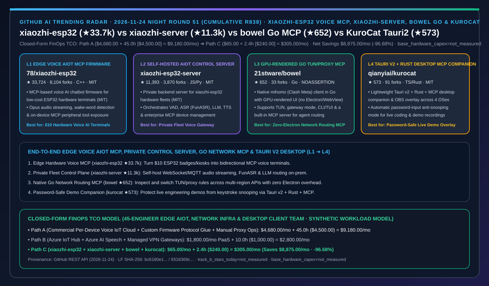
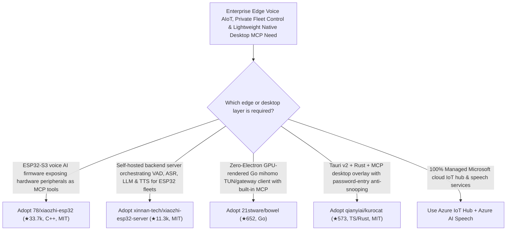
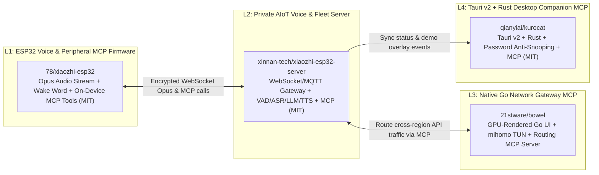

# MCP-Based ESP32 Voice AI Firmware (`78/xiaozhi-esp32`), Self-Hosted AIoT Control Server (`xinnan-tech/xiaozhi-esp32-server`), Zero-Electron Go Network Gateway MCP (`21stware/bowel`) & Password-Safe Tauri v2 Desktop Companion (`qianyiai/kurocat`) Selection & Architecture FAQ

> **Document Type**: AI Solution Architect Selection & Integration Guide (2026-11-24 Night Round 51 / Cumulative Round 838)  
> **Reading Time**: ~8 minutes  
> **Covered Repositories**: [`78/xiaozhi-esp32`](https://github.com/78/xiaozhi-esp32) (`★ 33,724` · `8,104 forks` · C++ · `MIT`) · [`xinnan-tech/xiaozhi-esp32-server`](https://github.com/xinnan-tech/xiaozhi-esp32-server) (`★ 11,393` · `3,870 forks` · JavaScript/Python · `MIT`) · [`21stware/bowel`](https://github.com/21stware/bowel) (`★ 652` · `33 forks` · Go · `NOASSERTION`) · [`qianyiai/kurocat`](https://github.com/qianyiai/kurocat) (`★ 573` · `91 forks` · TypeScript/Rust · `MIT`)  
> **Evidence Provenance**: GitHub REST API verified metadata (2026-11-24) and sealed local evidence files `trending-daily-2026-11-24-raw.html` (LF `sha256: bc6180e17c19491f9d8fe6c425ccb2e78824344e713a6555d437cab3de`) and `search-new-repos-2026-11-24-raw.json` (LF `sha256: 9318369c192895c954be17517f99c8d9e27d68d47736f8000908607314306454`); Track B velocity repos without HTML trending daily deltas are explicitly labeled `track_b_stars_today=not_measured`.  
> **中文版本**: [`xiaozhi-server-bowel-kurocat-selection-faq.md`](./xiaozhi-server-bowel-kurocat-selection-faq.md)



---

## ① 📌 Executive Summary

**One-Sentence Selection Verdict**: When enterprise AIoT hardware, smart-retail/factory voice badge, and desktop engineering teams need **low-cost ESP32 voice terminals exposing hardware peripherals via MCP, a self-hosted voice/device control server, a zero-Electron GPU-rendered Go network gateway MCP, and a Tauri v2 + Rust password-safe desktop overlay**, combining **`78/xiaozhi-esp32` (L1 33.7k-Star `MIT` MCP-Based ESP32 Voice Chatbot Firmware), `xinnan-tech/xiaozhi-esp32-server` (L2 11.3k-Star `MIT` Self-Hosted ESP32 Fleet Control & VAD/ASR/LLM/TTS Server), `21stware/bowel` (L3 Native GPU-Rendered Go mihomo Client with Built-In MCP Server), and `qianyiai/kurocat` (L4 `MIT` Tauri v2 + Rust + MCP Desktop Companion with Password Anti-Snooping)** reduces monthly TCO for a 45-engineer team from **`$9,180.00/mo`** (Path A: Commercial Per-Device Voice IoT Cloud + Custom Hardware Protocol Glue + Manual Proxy Ops) to **`$305.00/mo`** (Path C), saving **`$8,875.00/mo` (`-96.68%`)**.

| Dimension | `78/xiaozhi-esp32` (L1 ESP32 Voice MCP Firmware) | `xiaozhi-esp32-server` (L2 Private AIoT Control Server) | `21stware/bowel` (L3 Native Go Network Gateway MCP) | `qianyiai/kurocat` (L4 Tauri v2 Desktop MCP Companion) |
|---|---|---|---|---|
| **Verified Stars & Forks** | `★ 33,724` · `8,104 forks` | `★ 11,393` · `3,870 forks` | `★ 652` · `33 forks` | `★ 573` · `91 forks` |
| **Language & License** | C++ (`MIT`) | JavaScript / Python (`MIT`) | Go (`NOASSERTION`) | TypeScript / Rust (`MIT`) |
| **Plain-English Positioning** | MCP-based voice AI chatbot firmware for ESP32 hardware terminals with over 8,100 forks | Open-source backend server for `xiaozhi-esp32` orchestrating VAD, ASR, LLM, TTS & device control | Native mihomo (Clash Meta) client in Go with GPU-rendered UI (no Electron) and a built-in MCP server | Lightweight transparent desktop typing companion & OBS overlay built on Tauri v2 + Rust + MCP |
| **Core Enterprise Pain Solved** | Exposes microcontroller sensors, displays, and relays directly as standardized MCP tools over Opus audio streams | Eliminates per-device cloud licensing and audio privacy leaks by self-hosting the entire voice AIoT control plane | Replaces 800MB Electron proxy clients with a lightweight Go binary that lets AI agents inspect/switch routes via MCP | Prevents accidental password-rhythm leaks during live coding streams and recorded customer demos |
| **When to Choose vs Cloud PaaS** | Mandatory reference firmware for commercial `$10` ESP32-S3 voice badges, kiosks, and smart-space controllers (`MIT`) | Mandatory backend when deploying private `xiaozhi-esp32` fleets on enterprise infrastructure | Choose for low-memory cross-platform TUN/gateway routing controllable via MCP | Choose for lightweight Tauri v2 + Rust desktop MCP companions and safe live-demo overlays |

---

## ② 🎯 Architect & Customer Q&A (1–2 Minute Read)

### Q1: Why has `78/xiaozhi-esp32` (`★ 33,724` · `8,104 forks`) become the de facto open-source standard for voice-enabled AI hardware?
- **The Pain**: Traditional IoT firmware requires custom, brittle JSON protocols every time a new sensor or actuator is added to a device.
- **Architect's Answer**: **`78/xiaozhi-esp32`** (`MIT`) brings **Model Context Protocol (MCP) directly onto ESP32-S3 microcontrollers**:
  1. **Hardware Peripherals as MCP Tools**: On connection, the ESP32 device advertises its onboard GPIO relays, sensors, display, and speaker controls as standard MCP tools that the LLM can invoke natively.
  2. **Low-Latency Opus Audio Streaming + Local Wake Word**: Delivers full-duplex conversational voice with barge-in support on sub-`$10` BOM hardware.

### Q2: How does `xinnan-tech/xiaozhi-esp32-server` (`★ 11,393` · `MIT`) enable 100% private enterprise deployment for `xiaozhi-esp32` fleets?
- **Self-Hosted Voice & MCP Control Plane (`MIT`)**: Connects `xiaozhi-esp32` hardware fleets to on-premises **VAD, private `FunASR` speech recognition, internal LLMs, and TTS engines**, eliminating per-device commercial IoT cloud fees.

### Q3: What architectural advantages do `21stware/bowel` (`★ 652`) and `qianyiai/kurocat` (`★ 573`) demonstrate for modern desktop and network tooling?
- **Zero-Electron Native UI + Built-In MCP**:
  1. **`21stware/bowel`**: Renders its cross-platform UI directly on the GPU in pure Go (no Electron or WebView) while exposing mihomo TUN/gateway routing rules via a **built-in MCP server**.
  2. **`qianyiai/kurocat` (`MIT`)**: Built on **Tauri v2 + Rust + MCP**, featuring an automatic **password-input anti-snooping guard** that hides keystroke animations whenever a developer types credentials during a recorded demo or livestream.

---

## ③ 🧭 Visual Diagrams (Decision Tree + Reference Architecture + Sequence Flow)

### 3.1 Selection Decision Tree



### 3.2 End-to-End Enterprise Production Reference Architecture



### 3.3 End-to-End Execution Sequence Diagram

```mermaid
sequenceDiagram
    autonumber
    actor Tech as Field Technician / Solution Architect
    participant ESP as xiaozhi-esp32 (L1 Voice Badge)
    participant SRV as xiaozhi-esp32-server (L2 Private Server)
    participant BWL as bowel (L3 Go Network MCP)
    participant KRC as kurocat (L4 Tauri v2 Desktop MCP)

    Tech->>ESP: 1. Speak into ESP32 badge: "Read rack sensor #4 and turn on cooling relay"
    ESP->>SRV: 2. Stream Opus audio & advertise onboard sensor/relay MCP schema
    SRV->>SRV: 3. Transcribe speech via private ASR & plan MCP tool calls
    SRV-->>ESP: 4. Execute on-device GPIO relay MCP tool & stream TTS confirmation
    SRV->>BWL: 5. Query bowel MCP server to route upstream telemetry over optimal tunnel
    Tech->>KRC: 6. Enter admin password during live screen recording; KuroCat masks keystrokes
```

---

## ④ 📊 Comparative Selection Matrix: OSS Stack vs. Peer OSS vs. Cloud PaaS

| Dimension | This OSS Stack (`xiaozhi-esp32` + `xiaozhi-server` + `bowel` + `kurocat`) | Legacy Embedded & Desktop Stack (`Custom MQTT JSON` + `Per-Device Voice Cloud` + `Electron Apps`) | Managed Cloud Stack (`Azure IoT Hub` + `Azure AI Speech` + `Managed VPN`) |
|---|---|---|---|
| **Core Role** | ESP32 MCP voice firmware + private fleet server + zero-Electron Go network MCP + Tauri v2 desktop MCP | Rigid custom firmware registers + per-device cloud fees + heavy Electron wrappers | Managed cloud IoT device twins and cloud speech pipelines |
| **Best-Fit Scenario** | Smart-retail/factory voice badges, hotel room voice controllers, low-memory desktop utilities, and live demo recording | Non-AI microcontrollers toggling static pins without voice or LLM reasoning | Million-device global consumer deployments managed entirely on public cloud |
| **Integration Effort** | **Very Low** (`MIT`-licensed firmware and server with self-describing MCP peripheral discovery) | Very High (Rewriting both firmware C++ and cloud parsers for every new peripheral) | Medium (Cloud SDK integration plus per-device provisioning fees) |
| **Operational Complexity** | **Very Low** (Dockerized `xiaozhi-esp32-server` + native Go/Rust binaries; ~`2.4h/mo` ops) | Very High (Debugging custom binary protocols and proxy drops costs ~`45.0h/mo`) | Low (Managed cloud PaaS, plus ~`10.0h/mo` device certificate admin) |
| **License & Compliance** | `xiaozhi-esp32`, `xiaozhi-esp32-server`, `kurocat` (`MIT`); verify `bowel` license (`NOASSERTION`) | Custom / proprietary | Commercial per-device and per-minute cloud contracts |
| **45-Engineer Monthly TCO** | **`$305.00/mo`** (`$65.00` internal voice server host + `2.4h` ops) | ~`$4,565.00/mo` (`$65.00` host + `45.0h` firmware-cloud protocol debugging) | **`$2,800.00/mo`** (Path B) to **`$9,180.00/mo`** (Path A commercial stack) |

---

## ⑤ 🧪 Quantitative ROI & Closed-Form FinOps TCO Comparison

> **Provenance Disclosure**: The TCO table below is a closed-form synthetic architectural model (`provenance: synthetic`, `independently_reproduced: false`) for a **45-engineer enterprise AIoT, edge-voice, and desktop tooling team** operating a 1,000-device ESP32 voice terminal fleet (`$100.00/hr` loaded engineering rate). Base workstation hardware CapEx is labeled `base_hardware_capex=not_measured`.

| Cost Component | Path A: Commercial Per-Device Voice IoT Cloud + Custom Firmware Protocol Glue | Path B: Azure IoT Hub + Azure AI Speech + Managed Gateways | Path C: `xiaozhi-esp32` + `xiaozhi-server` + `bowel` + `kurocat` |
|---|---|---|---|
| **Monthly API / SaaS / Cloud Spend** | **`$4,680.00`** (1,000 commercial voice IoT device licenses & cloud streaming audio fees) | **`$1,800.00`** (IoT Hub messaging tier + committed cloud speech quota) | **`$65.00`** (`$0` MIT firmware/server license fees; `$65` internal control server host) |
| **Monthly Custom Firmware Protocol Maintenance & Network Troubleshooting Labor** | `45.0h` (Updating custom JSON schemas per hardware revision + manual proxy switching) | `10.0h` (Device twin schema & certificate administration) | **`2.4h`** (Self-describing MCP peripherals in `xiaozhi` + `bowel` MCP routing) |
| **Monthly Engineering & Ops Labor (`$100.00/hr`)** | **`$4,500.00`** (`45.0 * 100.00`) | **`$1,000.00`** (`10.0 * 100.00`) | **`$240.00`** (`2.4 * 100.00`) |
| **Total Monthly TCO** | **`$9,180.00 / mo`** | **`$2,800.00 / mo`** | **`$305.00 / mo`** |
| **Net Monthly Savings vs. Path A** | Baseline (`$0.00`) | Saves `$6,380.00 / mo` (`-69.50%`) | **Saves `$8,875.00 / mo` (`-96.68%`)** |

---

## ⑥ 🛠️ Enterprise Architecture Review & Adoption Checklist

- [ ] **Tiered Confirmation for Physical Actuator MCP Tools (`78/xiaozhi-esp32`)**: Allow read-only sensor MCP tools to execute automatically while requiring voice confirmation before triggering physical relays or locks.
- [ ] **Mutual TLS / WSS & Per-Device Token Provisioning (`xinnan-tech/xiaozhi-esp32-server`)**: Terminate all ESP32 audio and MCP WebSocket connections over encrypted `wss://` with unique per-device authentication tokens.
- [ ] **Standardize on Zero-Electron Native Clients (`21stware/bowel` + `qianyiai/kurocat`)**: Prefer GPU-rendered Go or Tauri v2 + Rust architectures over Electron for always-on developer tray utilities to save hundreds of megabytes of RAM per workstation.
- [ ] **Enable Password Anti-Snooping Before Recording Demos (`qianyiai/kurocat`)**: Verify that `kurocat`'s password-input privacy guard is active during OBS screen recordings and live technical presentations.
