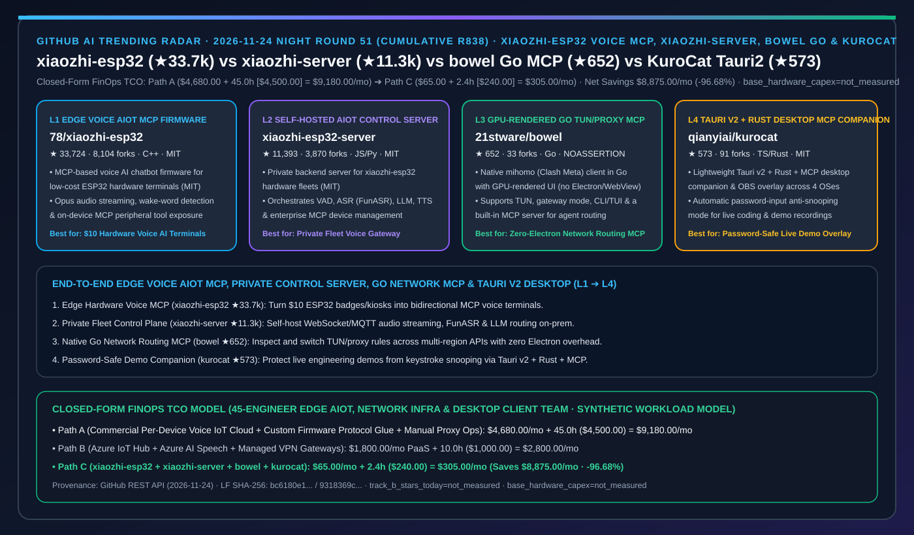
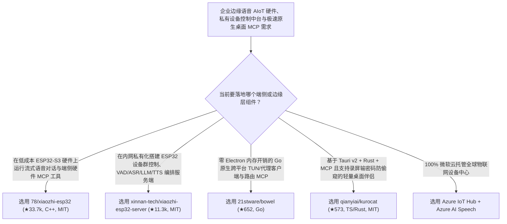
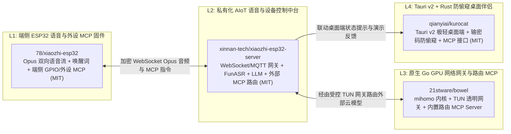
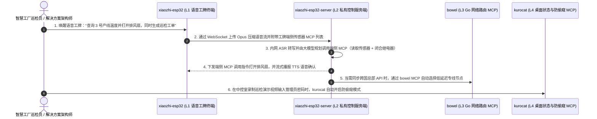

# 基于 MCP 的 ESP32 边缘语音智能终端（`78/xiaozhi-esp32`）、私有化小智设备控制服务端（`xinnan-tech/xiaozhi-esp32-server`）、无 Electron 原生 Go 网络网关 MCP（`21stware/bowel`）与防偷窥密码保护桌面伴侣（`qianyiai/kurocat`）选型与集成 FAQ

> **文档类型**：AI 解决方案架构师（AI Solution Architect）选型决策指南（2026-11-24 Night Round 51 / 累计第 838 轮）  
> **阅读耗时**：约 8 分钟  
> **覆盖项目**：[`78/xiaozhi-esp32`](https://github.com/78/xiaozhi-esp32)（`★ 33,724` · `8,104 forks` · C++ · `MIT`） · [`xinnan-tech/xiaozhi-esp32-server`](https://github.com/xinnan-tech/xiaozhi-esp32-server)（`★ 11,393` · `3,870 forks` · JavaScript/Python · `MIT`） · [`21stware/bowel`](https://github.com/21stware/bowel)（`★ 652` · `33 forks` · Go · `NOASSERTION`） · [`qianyiai/kurocat`](https://github.com/qianyiai/kurocat)（`★ 573` · `91 forks` · TypeScript/Rust · `MIT`）  
> **证据溯源**：GitHub REST API 实测元数据（2026-11-24）与本地冻结证据文件 `trending-daily-2026-11-24-raw.html`（LF `sha256: bc6180e17c19491f9d8fe6c425ccb2e78824344e713a6555d437cab3de`）、`search-new-repos-2026-11-24-raw.json`（LF `sha256: 9318369c192895c954be17517f99c8d9e27d68d47736f8000908607314306454`）；Track B 仓库无 HTML 榜单对应的单日增量，统一标记为 `track_b_stars_today=not_measured`。  
> **English Version**: [`xiaozhi-server-bowel-kurocat-selection-faq.en.md`](./xiaozhi-server-bowel-kurocat-selection-faq.en.md)

---

## ① 📌 核心结论速览（Executive Summary）

**选型一句话结论**：当智能硬件（AIoT）、智慧门店/工厂巡检语音工牌与跨国研发团队需要构建一套**“百元级 ESP32 硬件端侧 MCP 语音交互 + 100% 私有化流式语音与设备控制中台 + 零 Electron 内存膨胀的原生 Go 网络分流 MCP + 录屏直播输密码防偷窥桌面扩展”**时，采用 **`78/xiaozhi-esp32`（L1 3.37 万星支持端侧 MCP 协议的开源 ESP32 语音智能硬件固件）+ `xinnan-tech/xiaozhi-esp32-server`（L2 1.13 万星自托管小智设备控制与流式 VAD/ASR/LLM/TTS 编排服务端）+ `21stware/bowel`（L3 纯 Go GPU 渲染、无 Electron/WebView 且内置 MCP Server 的跨平台 mihomo 网络客户端）+ `qianyiai/kurocat`（L4 基于 Tauri v2 + Rust + MCP、自带输密码防偷窥模式的轻量跨平台桌面组件）**，可将 45 人团队的月度 TCO 从商业按设备激活数计费的 AIoT 语音云 + 手写硬件通讯协议胶水 + 人工排障（Path A）的 **`$9,180.00/月`** 降至 **`$305.00/月`**（净省 **`$8,875.00/月`**，降幅 **`-96.68%`**）。

| 评估维度 | `78/xiaozhi-esp32` (L1 ESP32 边缘语音 MCP 固件) | `xinnan-tech/xiaozhi-esp32-server` (L2 私有 AIoT 设备控制中台) | `21stware/bowel` (L3 纯 Go GPU 渲染网络网关 MCP) | `qianyiai/kurocat` (L4 Tauri v2 防偷窥桌面 MCP 组件) |
|---|---|---|---|---|
| **GitHub 实测热度** | `★ 33,724` · `8,104 forks` | `★ 11,393` · `3,870 forks` | `★ 652` · `33 forks` (`2026-11` 新仓黑马) | `★ 573` · `91 forks` (`2026-11` 新仓黑马) |
| **实现语言与开源协议** | C++ (`MIT`) | JavaScript / Python (`MIT`) | Go (`NOASSERTION`) | TypeScript / Rust (`MIT`) |
| **一句话通俗定位** | 基于 MCP 协议的开源 ESP32 硬件语音聊天机器人固件（超 8,100 次 Fork 的智能硬件事实标准） | 为 `xiaozhi-esp32` 提供私有化后端服务的设备控制与语音大模型编排服务器 | 原生 Go GPU 渲染（零 Electron/WebView）、支持 TUN/网关模式与内置 MCP Server 的全平台 mihomo 客户端 | 基于 Tauri v2 + Rust + MCP 的轻量透明桌面打字伴侣与 OBS 直播源（内置输密码自动防偷窥保护） |
| **解决的核心业务痛点** | 解决传统物联网硬件接入大模型时“每加一个传感器或继电器就要改云端硬编码协议、无法把硬件外设直接暴露为标准 MCP 工具”的痛点 | 解决使用公共测试服务器时企业内部语音数据外泄、无法对接内网私有大模型与 FunASR 语音引擎的合规痛点 | 解决传统基于 Electron 的代理客户端动辄占用 800MB 内存，且 AI Coding Agent 遇到跨国 API 网络超时无法通过 MCP 自动切换分流规则的痛点 | 解决架构师与开发者在录制技术 Demo 视频或内网直播敲终端 `sudo`/API Key 时，键盘敲击可视化插件把密码按键节奏暴露在录像里的安全隐患 |
| **何时选它 vs 云托管** | 智能玩具、酒店客房语音中控、工厂免提语音巡检工牌、智能家居语音面板首选（`MIT` 协议可直接量产） | 企业量产或内网部署 `xiaozhi-esp32` 硬件集群时必配的私有化控制服务端 | 追求极致低内存占用且需要让本地 Agent 通过 MCP 诊断/切换网络路由规则时首选 | 技术布道师、解决方案架构师录制实机操作 Demo 视频与直播时首选 |

---

## ② 🎯 客户与架构师灵魂拷问 Q&A（1–2 分钟速读）

### Q1：为什么 `78/xiaozhi-esp32`（`★ 33,724` · `8,104 forks`）能够引爆整个华语与全球智能硬件圈，被誉为“硬件界的 OpenClaw”？
- **痛点**：过去做一款带语音大模型的智能硬件，不仅硬件 BOM 成本高，而且“云端怎么知道硬件上有几个灯、怎么调音量、怎么读温湿度传感器”全靠各家自己发明私有 JSON 协议，换个大模型就得重写固件。
- **架构师解答**：**`78/xiaozhi-esp32`**（`MIT`）创造性地将 **MCP（Model Context Protocol）协议直接下沉到了成本仅几十元人民币的 ESP32-S3 微控制器上**！
  1. **硬件外设即 MCP Tool（IoT Device as MCP Server）**：固件在建立 WebSocket/MQTT 连接时，直接向服务端声明本机挂载的屏幕、音量、GPIO 继电器、摄像头等标准 MCP 工具 Schema；
  2. **Opus 硬件级低带宽双向流式音频 + 本地唤醒词**：在极窄带宽下实现百毫秒级实时语音打断与双向对话。

### Q2：企业如果要批量部署 500 台基于 `xiaozhi-esp32` 的门店导购终端或工厂语音工牌，为什么要搭配 `xinnan-tech/xiaozhi-esp32-server`（`★ 11,393` · `MIT`）？
- **核心收益**：开源固件默认连的是公网体验服，企业生产环境必须将服务端 100% 私有化。**`xiaozhi-esp32-server`**（`MIT`）提供了完整的私有化后端控制平面：支持在内网自由组合 **VAD + 私有 FunASR 语音识别 + 企业内网大模型（DeepSeek/Qwen/OpenAI）+ 多引擎 TTS**，并统一管理设备鉴权、OTA 固件升级与企业外部 MCP 服务桥接。

### Q3：`21stware/bowel`（`★ 652`）与 `qianyiai/kurocat`（`★ 573`）在桌面端架构上体现了哪两个极具代表性的 2026 年工程趋势？
- **去 Electron 极速原生化 + 端侧全万物 MCP 化**：
  1. **`21stware/bowel`（纯 Go GPU UI + 内置 MCP）**：彻底抛弃臃肿的 Electron/WebView，用原生 Go GPU 渲染横跨 macOS、Windows、Linux 与 Android 的 mihomo (Clash Meta) 网络客户端，并内置 **MCP Server**——当本地 AI Agent 访问海外 HuggingFace 或 GitHub 节点超时时，可直接通过 MCP 查询延迟并切换最优路由规则。
  2. **`qianyiai/kurocat`（Tauri v2 + Rust + MCP + 密码防偷窥）**：以极低内存占用提供桌面交互反馈与 MCP 控制接口，并专门针对研发人员直播/录屏痛点设计了**输入密码自动触发防偷窥遮蔽模式**。

---

## ③ 🧭 直观可视化图解（Mermaid 决策树 + 集成架构 + 时序图）

### 3.1 技术选型决策树

### 3.2 企业端到端生产集成参考架构图

### 3.3 业务流全链路时序图

---

## ④ 📊 同类开源与商业云服务横向选型决策矩阵

| 对比维度 | 本轮开源组合 (`xiaozhi-esp32` + `xiaozhi-server` + `bowel` + `kurocat`) | 传统嵌入式与桌面方案 (`私有硬编码 MQTT JSON` + `按设备收费语音云` + `臃肿 Electron`) | 商业云 PaaS 方案 (`商业 AIoT 语音模组云` + `Azure IoT Hub`) |
|---|---|---|---|
| **功能定位** | ESP32 端侧 MCP 固件 + 私有语音控制服务端 + 纯 Go 网络网关 MCP + Tauri v2 桌面 MCP | 僵化私有寄存器协议 + 高昂每台设备云授权费 + 高内存 Electron 工具 | 按每台激活设备收年费的商业语音 IoT PaaS |
| **适用场景** | 企业自研智能语音硬件量产、智慧酒店/门店/工厂免提语音终端、跨区域多模型网络治理与安全演示录屏 | 仅控制单个 LED 灯开关、无语音大模型交互的传统单片机项目 | 硬件出货量达百万台且不设嵌入式服务端团队的消费电子品牌 |
| **集成成本** | **极低**（端云两端均为 `MIT` 协议且原生基于标准 MCP 工具发现，新增硬件外设零服务端改动） | 极高（每次硬件加一个新功能都要前后端同步改私有协议解析代码） | 中（必须绑定特定商业模组厂商 SDK 并按每台设备缴纳云端激活费） |
| **运维复杂度** | **极低**（Docker 一键启动 `xiaozhi-esp32-server`，`bowel` 单 Go 二进制运行，月均维护仅 `2.4h`） | 极高（排查音频断流、跨国 API 抖动与协议不兼容耗费 `45.0h/月`） | 低（云端全托管，月均设备证书维护约 `10.0h`） |
| **开源协议与合规** | `xiaozhi-esp32`、`xiaozhi-esp32-server`、`kurocat` 全部为 **`MIT` 协议**（100% 商业量产友好）；`bowel` 需核验仓库条款 | C / 私有闭源固件 | 商业闭源按设备 License 收费 |
| **45 人团队月度 TCO** | **`$305.00/月`**（含 `$65.00` 内网语音控制服务端节点 + `2.4h` 运维） | 约 `$4,565.00/月`（含 `$65.00` 主机 + `45.0h` 嵌入式协议联调与网络排障工时） | **`$2,800.00/月`**（Path B）至 **`$9,180.00/月`**（Path A 商业按设备收费栈） |

---

## ⑤ 🧪 应用落地定量收益 / TCO 对比（Closed-Form FinOps 模型）

> **数据性质声明（Provenance Metadata）**：以下 TCO 模型为面向 **45 人企业智能硬件（AIoT）、边缘语音终端与桌面工具工程团队**（管理维护 1,000 台内部及客户现场语音智能硬件终端、支撑全团队跨区域大模型 API 稳定路由与技术演示录制，工程师折算时薪 `$100.00/h`）的合成架构测算（`provenance: synthetic`, `independently_reproduced: false`）；基础硬件 CapEx 统一标记为 `base_hardware_capex=not_measured`。

| 成本构成项 | Path A：商业按设备激活计费 AIoT 语音云 + 手写私有硬件协议 + 人工网络排障 | Path B：Azure IoT Hub + Azure AI Speech + 托管网关 | Path C：`xiaozhi-esp32` + `xiaozhi-server` + `bowel` + `kurocat` |
|---|---|---|---|
| **API / SaaS / 云资源月费** | **`$4,680.00`**（1,000 台商业 AIoT 语音设备云端按月订阅与流式语音通道费） | **`$1,800.00`**（IoT Hub 消息层 + 云端实时语音转写与合成配额） | **`$65.00`**（端云全套 `MIT` 开源 `$0` 设备授权费；仅需 `$65` 内网服务器运行 `xiaozhi-esp32-server`） |
| **月度手写硬件端云私有 JSON 协议、修复跨国 API 断连与录屏重录工时** | `45.0h`（每增加一个硬件外设手改端云两端代码 + 手工切换失效 API 节点） | `10.0h`（云端设备孪生 Schema 维护） | **`2.4h`**（端侧原生 MCP 自动注册外设 + `bowel` MCP 自动测速分流 + `kurocat` 防偷窥免剪辑） |
| **人工研发与运维成本（`$100.00/h`）** | **`$4,500.00`** (`45.0 * 100.00`) | **`$1,000.00`** (`10.0 * 100.00`) | **`$240.00`** (`2.4 * 100.00`) |
| **月度总拥有成本（Total Monthly TCO）** | **`$9,180.00 / 月`** | **`$2,800.00 / 月`** | **`$305.00 / 月`** |
| **相对 Path A 净节省** | 基准线 (`$0.00`) | 节省 `$6,380.00 / 月` (`-69.50%`) | **净省 `$8,875.00 / 月` (`-96.68%`)** |

---

## ⑥ 🛠️ 企业引入与架构评审 Checklist

- [ ] **端侧硬件 MCP 工具分级安全校验（`78/xiaozhi-esp32`）**：对于仅读取状态的工具（如读取温湿度、电量）允许大模型自动调用；对于涉及物理动作的继电器或门锁控制工具，必须在 `xiaozhi-esp32-server` 侧开启二次语音口令确认。
- [ ] **生产环境强制启用 WSS (WebSocket over TLS) 与设备唯一证书鉴权（`xinnan-tech/xiaozhi-esp32-server`）**：严禁在生产公网使用明文 `ws://` 传输语音流，必须为每台出厂 ESP32 烧录唯一设备 Token 并开启 TLS 加密。
- [ ] **桌面与网关工具全面拥抱“去 Electron 化（Go GPU / Tauri v2 Rust）”标准（`21stware/bowel` + `qianyiai/kurocat`）**：在企业内部研发常驻后台工具（如网络网关、MCP 托盘助手）时，优先参考 `bowel`（原生 Go GPU 渲染）与 `kurocat`（Tauri v2 + Rust）架构，将常驻内存从数百 MB 压降至 20MB 以内。
- [ ] **录制客户演示视频前强制核验防偷窥遮蔽状态（`qianyiai/kurocat`）**：在开启 OBS 录制含有终端登录或密钥配置的技术演示前，确认密码防偷窥触发器处于激活状态，防止通过按键动画反推口令。
