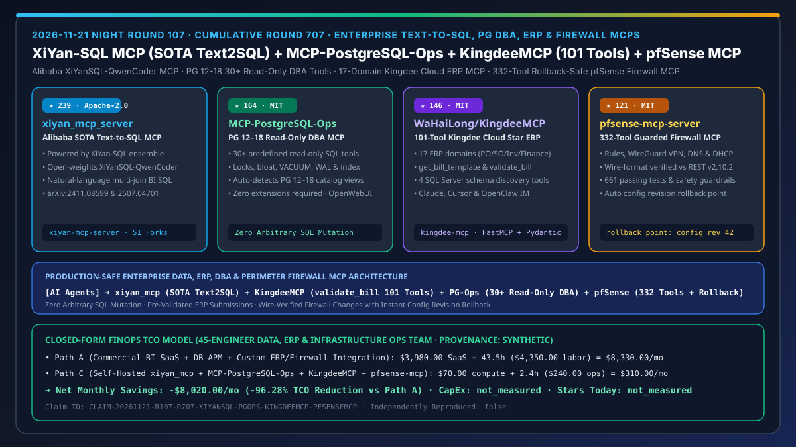
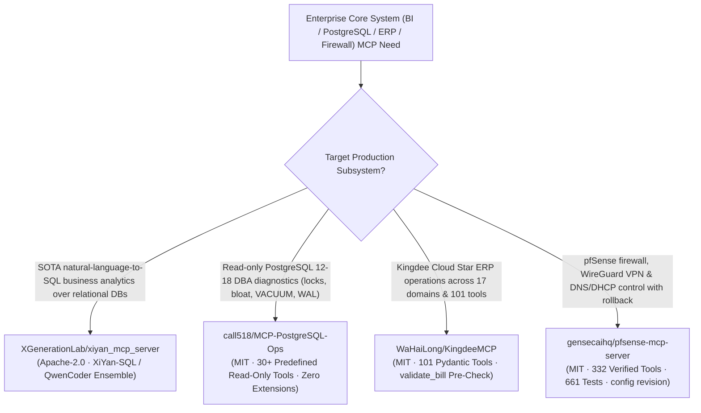
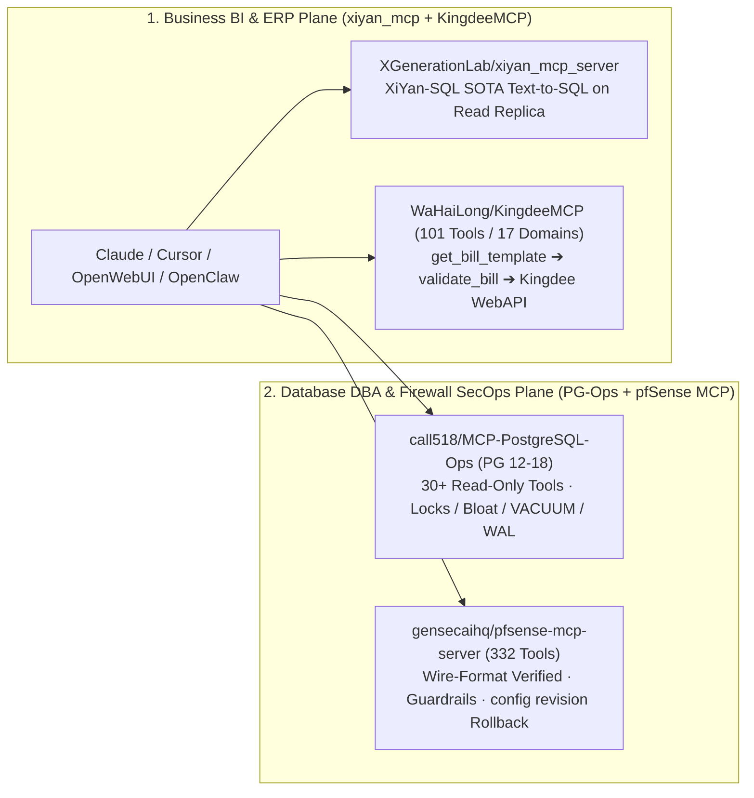
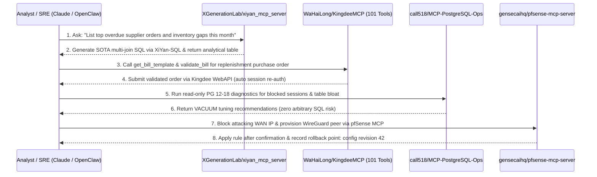

# SOTA Text-to-SQL Database MCP (`XGenerationLab/xiyan_mcp_server`), Read-Only PostgreSQL 12–18 DBA MCP (`call518/MCP-PostgreSQL-Ops`), 101-Tool Kingdee Cloud ERP MCP (`WaHaiLong/KingdeeMCP`) & 332-Tool Rollback-Safe pfSense Firewall MCP (`gensecaihq/pfsense-mcp-server`) Selection & Architecture FAQ

> **Document Type**: Enterprise AI Solution Architect Selection & Integration Guide (GitHub Trending AI Radar — 2026-11-21 Night Round 107 / Cumulative Round 707)
> **Covered Repositories**: [`XGenerationLab/xiyan_mcp_server`](https://github.com/XGenerationLab/xiyan_mcp_server) (`★ 239`, `51 forks`, `Apache-2.0` — Alibaba XGenerationLab's SOTA Text-to-SQL database MCP server powered by `XiYan-SQL` / `XiYanSQL-QwenCoder`) · [`call518/MCP-PostgreSQL-Ops`](https://github.com/call518/MCP-PostgreSQL-Ops) (`★ 164`, `28 forks`, `MIT` — 30+ predefined read-only PostgreSQL 12–18 DBA tools for slow queries, locks, bloat, VACUUM, replication & WAL without extensions) · [`WaHaiLong/KingdeeMCP`](https://github.com/WaHaiLong/KingdeeMCP) (`★ 146`, `47 forks`, `MIT` — 101-tool / 17-domain Kingdee Cloud Star ERP MCP server with `validate_bill` pre-validation & Pydantic type safety) · [`gensecaihq/pfsense-mcp-server`](https://github.com/gensecaihq/pfsense-mcp-server) (`★ 121`, `25 forks`, `MIT` — 332 wire-format-verified tools for pfSense REST API `v2.10.2` with 661 passing tests, safety guardrails & automatic `config revision` rollback points)
> **Core Scenario**: How enterprise solution architects connect AI assistants to **four mission-critical production systems—analytical databases (Text-to-SQL BI), PostgreSQL 12–18 database operations (DBA diagnostics), Kingdee Cloud Star ERP (procurement, sales, inventory, finance), and pfSense perimeter firewalls (rules, WireGuard VPNs, diagnostics)**—while guaranteeing **read-only DBA safety, pre-validated ERP forms, and instant firewall revision rollback**.

---

## 1. 📌 Executive Summary (One-Line Selection Verdict)

1. **Need state-of-the-art (SOTA) natural-language-to-SQL database querying over MCP backed by a multi-generator ensemble and dedicated `XiYanSQL-QwenCoder` models** ➔ Choose **[`XGenerationLab/xiyan_mcp_server`](https://github.com/XGenerationLab/xiyan_mcp_server) (`★ 239`, `51 forks`, `Apache-2.0`)**.
   - **Plain-English Mechanism**: Built by Alibaba's XGenerationLab (`xiyan-mcp-server` on PyPI, backed by `arXiv:2411.08599` & `2507.04701`), this MCP server pairs schema understanding with the top-ranked **XiYan-SQL** ensemble and open-weights **XiYanSQL-QwenCoder** models to translate complex multi-join business questions into accurate SQL queries.
2. **Need read-only PostgreSQL 12–18 DBA observability (slow queries, blocked sessions, table/index bloat, `VACUUM` tuning, replication lag, WAL) with zero risk of arbitrary SQL mutations** ➔ Choose **[`call518/MCP-PostgreSQL-Ops`](https://github.com/call518/MCP-PostgreSQL-Ops) (`★ 164`, `28 forks`, `MIT`)**.
   - **Plain-English Mechanism**: Exposes **30+ predefined, strictly read-only DBA diagnostic tools** that automatically adapt to version-specific catalog views across **PostgreSQL 12 through 18**. Core monitoring works immediately with zero extensions installed (while `pg_stat_statements` and `pg_stat_monitor` unlock deeper query analytics), running via `uvx`, Docker (`call518/mcp-server-postgresql-ops`), or HTTP MCP for OpenWebUI and Claude.
3. **Need natural-language querying, creation, validation, and approval across 17 enterprise ERP domains (101 tools) in Kingdee Cloud Star (金蝶云星空)** ➔ Choose **[`WaHaiLong/KingdeeMCP`](https://github.com/WaHaiLong/KingdeeMCP) (`★ 146`, `47 forks`, `MIT`)**.
   - **Plain-English Mechanism**: Built on FastMCP and Pydantic (`kingdee-mcp` on PyPI), it provides **101 typed tools across 17 ERP modules** (procurement, sales, inventory, production, cost, assets, finance, subcontracting, attachments, reports), plus dynamic metadata tools (`get_bill_template`, `validate_bill`, `refresh_metadata`, `kingdee_list_forms`, `kingdee_get_fields`) and 4 SQL Server schema discovery tools over Kingdee's official `ValidateUser` WebAPI with automatic session re-login.
4. **Need natural-language pfSense firewall, WireGuard VPN, DNS, and DHCP management with 332 wire-format-verified tools and automatic `config revision` rollback points** ➔ Choose **[`gensecaihq/pfsense-mcp-server`](https://github.com/gensecaihq/pfsense-mcp-server) (`★ 121`, `25 forks`, `MIT`)**.
   - **Plain-English Mechanism**: Exposes **332 tools contract-tested against the pfSense REST API (`v2.10.2`) schema** with **661 passing CI tests**. Every destructive action requires explicit human confirmation through a multi-layer guardrail pipeline and records the exact **`config revision`** rollback point on every applied change.

---

## 2. 🎯 Architect & Customer Deep-Dive Q&A

### Q1: Why is giving an AI agent a generic SQL client or raw REST tool dangerous for PostgreSQL DBA work, ERP orders, and production firewalls?

- **Three Production Failure Modes & Domain-Specific MCP Safeguards**:
  1. **Analytical Text-to-SQL vs Read-Only DBA Catalog Diagnostics (`xiyan_mcp_server` + `MCP-PostgreSQL-Ops`)**: Business BI queries require SOTA Text-to-SQL (`xiyan_mcp_server` on a read replica), whereas DBA troubleshooting requires version-aware queries across `pg_locks`, `pg_stat_activity`, bloat ratios, and autovacuum thresholds without allowing arbitrary `DROP`/`UPDATE` statements (`MCP-PostgreSQL-Ops`).
  2. **ERP Form Validation Before Submission (`WaHaiLong/KingdeeMCP`)**: Enterprise ERP bills contain dozens of mandatory cross-referenced fields. `KingdeeMCP` provides `get_bill_template` and `validate_bill` so the agent validates every sales/purchase/inventory payload against cached Kingdee metadata before committing.
  3. **Wire-Format Verification & Instant Firewall Rollback (`gensecaihq/pfsense-mcp-server`)**: A malformed firewall API call can sever network access. `pfsense-mcp-server` validates all 332 tools against the pfSense REST schema, enforces confirmation guardrails, and logs `rollback point: config revision N` after every change.
- **When to Choose Managed Cloud Services (Path B)**:
  - If your enterprise runs 100% on Microsoft Dynamics 365 + Azure Database for PostgreSQL + Azure Firewall, **Microsoft Copilot for Dynamics 365 + Azure Copilot** provides native cloud integration.

### Q2: How do we wire an end-to-end enterprise operations & business architecture combining all four MCP servers?

1. **Executive BI & Text-to-SQL Analytics Layer (`XGenerationLab/xiyan_mcp_server`)**:
   - Connect `xiyan_mcp_server` (backed by self-hosted `XiYanSQL-QwenCoder`) to read-only analytical replicas so analysts can query multi-table KPIs in plain language.
2. **17-Domain ERP Execution Layer (`WaHaiLong/KingdeeMCP`)**:
   - Connect Claude Desktop, Cursor, or OpenClaw (WeChat/WhatsApp/Telegram) to `KingdeeMCP` (`101 tools`) so operations staff can query inventory, run `get_bill_template` + `validate_bill`, and submit/approve procurement and sales orders.
3. **PostgreSQL 12–18 Read-Only DBA Observability Layer (`call518/MCP-PostgreSQL-Ops`)**:
   - Attach `MCP-PostgreSQL-Ops` (`30+ read-only tools`) to production PostgreSQL 12–18 clusters so SREs can diagnose blocked sessions, table bloat, unused indexes, and WAL/replication lag with zero write risk.
4. **pfSense Perimeter Firewall & VPN Guarded Control Layer (`gensecaihq/pfsense-mcp-server`)**:
   - Connect SecOps/NetOps MCP clients to `pfsense-mcp-server` (`332 tools`) to run WAN/LAN diagnostics, provision WireGuard peers, and block malicious IPs with automatic `config revision` rollback checkpoints.

### Q3: What are the boundaries and trade-offs of this stack?

- **Key Strengths**:
  - **100% Permissive Open Source (`Apache-2.0` & `MIT`)**: All four MCP servers run on-premises inside your private network.
  - **Built-In Domain Guardrails**: Read-only DBA queries, `validate_bill` ERP pre-checks, and `config revision` firewall rollbacks prevent catastrophic agent mistakes.
- **Operational Scope**:
  - `KingdeeMCP` targets Kingdee Cloud Star (K/3 Cloud) deployments; `pfsense-mcp-server` requires the pfSense REST API (`v2.10.2`) package installed on the firewall.

---

## 3. 🧭 Visual Architecture & Decision Diagrams

### 3.1 Solution Architect Selection Decision Tree

### 3.2 End-to-End Enterprise Reference Architecture

### 3.3 BI Analytics, ERP Pre-Validated Order, PG Bloat Triage & Guarded Firewall Rollback Sequence

---

## 4. 📊 Peer Open-Source vs Commercial Cloud Selection Matrix

| Dimension | `XGenerationLab/xiyan_mcp_server` (`★ 239`) | `call518/MCP-PostgreSQL-Ops` (`★ 164`) | `WaHaiLong/KingdeeMCP` (`★ 146`) | `gensecaihq/pfsense-mcp-server` (`★ 121`) | Commercial Text2SQL + DB APM + ERP Consulting (Path A) | Cloud Dynamics + Azure Copilot (Path B) |
| :--- | :--- | :--- | :--- | :--- | :--- | :--- |
| **Core Role** | SOTA Text-to-SQL database query MCP server | PG 12–18 read-only 30+ tool DBA diagnostic MCP | 101-tool / 17-domain Kingdee Cloud Star ERP MCP | 332-tool wire-verified pfSense firewall MCP | Commercial GBI SaaS + commercial DB APM + custom ERP/firewall scripts | Dynamics 365 Copilot + Azure Copilot |
| **Safety & Determinism** | Open-weights `XiYanSQL-QwenCoder` + multi-generator | **Strictly read-only (no arbitrary SQL) across PG 12–18** | **Pydantic schemas + `validate_bill` pre-validation** | **Wire-format verified + 661 tests + `config revision` rollback** | Raw SQL MCPs risk accidental mutations; costly ERP consulting | Does not support Kingdee ERP or on-prem pfSense appliances |
| **License** | `Apache-2.0` | `MIT` | `MIT` | `MIT` | Proprietary SaaS | Proprietary Cloud PaaS |
| **Monthly TCO (45-Eng Team)** | **`$310.00/mo` combined** (`$70.00` compute + `2.4h` ops) | Included in `$310.00/mo` stack | Included in `$310.00/mo` stack | Included in `$310.00/mo` stack | **`$8,330.00/mo`** (`$3,980.00` SaaS + `43.5h` labor) | `~$2,850.00/mo` (requires full cloud ERP migration) |

---

## 5. 🧪 Quantitative ROI / FinOps TCO Model & 7-Card Report

> **📊 Provenance & Closed-Form Audit Declaration**:
> - **Provenance**: `synthetic` (45-engineer enterprise data, ERP & infrastructure operations workload model; `independently_reproduced = false`; `base_hardware_capex = not_measured`; `track_b_stars_today = not_measured`).
> - **Closed-Form Equations**:
>   - **Path A (Commercial Text-to-SQL BI SaaS + Commercial PostgreSQL DBA APM Seats + Custom ERP API Integration & Manual Firewall Rule Auditing)**: Monthly SaaS subscriptions **`$3,980.00`** + manual DBA/ERP/NetOps engineering labor **`43.5h × $100.00/h = $4,350.00`** = **`$8,330.00/mo`**.
>   - **Path C (Self-Hosted `XGenerationLab/xiyan_mcp_server` + `call518/MCP-PostgreSQL-Ops` + `WaHaiLong/KingdeeMCP` + `gensecaihq/pfsense-mcp-server`)**: Shared container & local model compute **`$70.00`** + MCP configuration & guardrail maintenance **`2.4h × $100.00/h = $240.00`** = **`$310.00/mo`**.
>   - **Net Savings vs Path A**: **`-$8,020.00/mo`** (**`96.28%`** cost reduction).

| Architecture Option | API / SaaS / Compute | Engineering & Ops Labor (`$100/h`) | Total Monthly TCO | Net Savings vs Path A | Key Architectural Outcome |
| :--- | :---: | :---: | :---: | :---: | :--- |
| **Path A: Commercial BI SaaS + DB APM + Custom ERP/Net Scripts** | `$3,980.00` | `43.5h` (`$4,350.00`) | **`$8,330.00`** | Baseline | Brittle custom ERP/firewall glue; high per-seat APM costs |
| **Path B: Full Cloud ERP + Cloud Firewall Copilot Migration** | `$1,650.00` | `12.0h` (`$1,200.00`) | **`$2,850.00`** | `-$5,480.00` (`-65.79%`) | Prohibitive migration cost for existing Kingdee & pfSense estates |
| **Path C: `xiyan_mcp` + `PG-Ops` + `KingdeeMCP` + `pfsense-mcp`** | **`$70.00`** | **`2.4h` (`$240.00`)** | **`$310.00`** | **`-$8,020.00` (`-96.28%`)** | **SOTA Text-to-SQL + 30+ read-only PG tools + 101 ERP tools + 332 firewall tools** |

- 🔗 **7-Card 4:5 Visual Report**: [`workshops/github-trending-radar/cards.en.html`](../cards.en.html) · [`cards.html`](../cards.html)

---

## 6. 🛠️ Enterprise Adoption & Architecture Review Checklist

- [ ] **1. Bind `XGenerationLab/xiyan_mcp_server` to Read-Only Database Replicas**: Deploy `xiyan-mcp-server` with `XiYanSQL-QwenCoder` against analytical read replicas so Text-to-SQL queries never contend with OLTP write transactions.
- [ ] **2. Roll Out `call518/MCP-PostgreSQL-Ops` for PG 12–18 Clusters**: Connect the 30+ predefined read-only tools (via Docker or `uvx`) to PostgreSQL 12–18 instances for instant lock, bloat, VACUUM, and WAL diagnostics without granting write permissions.
- [ ] **3. Enforce `validate_bill` Pre-Checks in `WaHaiLong/KingdeeMCP`**: Configure least-privilege Kingdee `ValidateUser` credentials and require agents to invoke `get_bill_template` and `validate_bill` before creating or approving ERP documents across the 17 domains.
- [ ] **4. Enable Guardrails & Revision Rollback in `gensecaihq/pfsense-mcp-server`**: Connect the 332 wire-verified tools to pfSense REST API `v2.10.2`, keep explicit confirmation enabled for destructive operations, and log every `config revision` rollback point.
