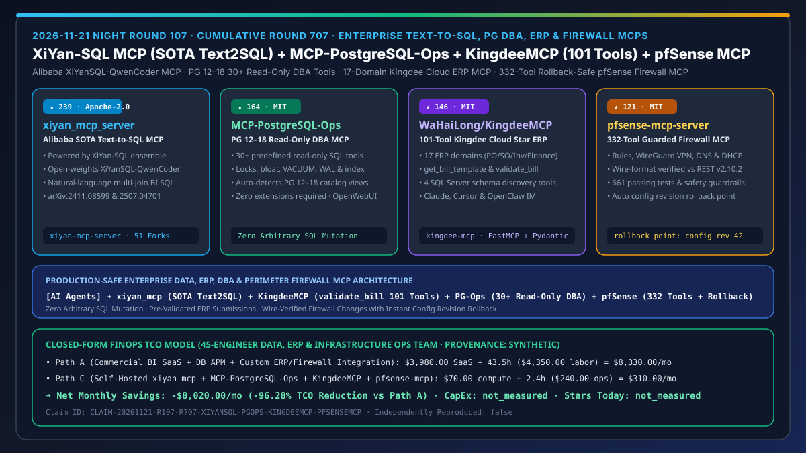
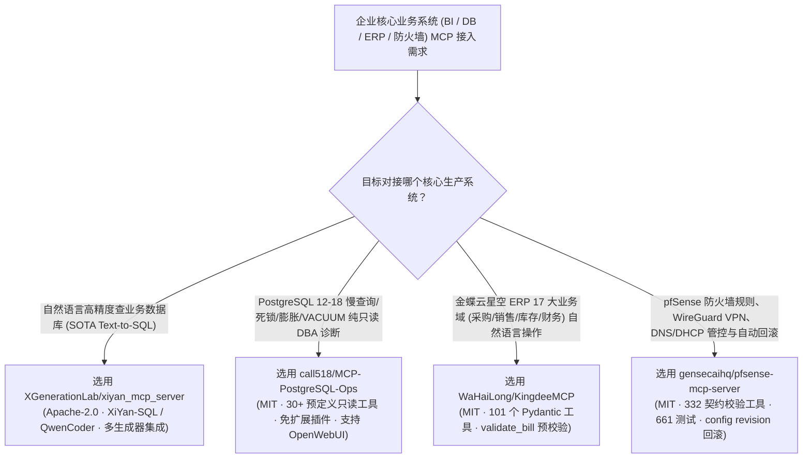
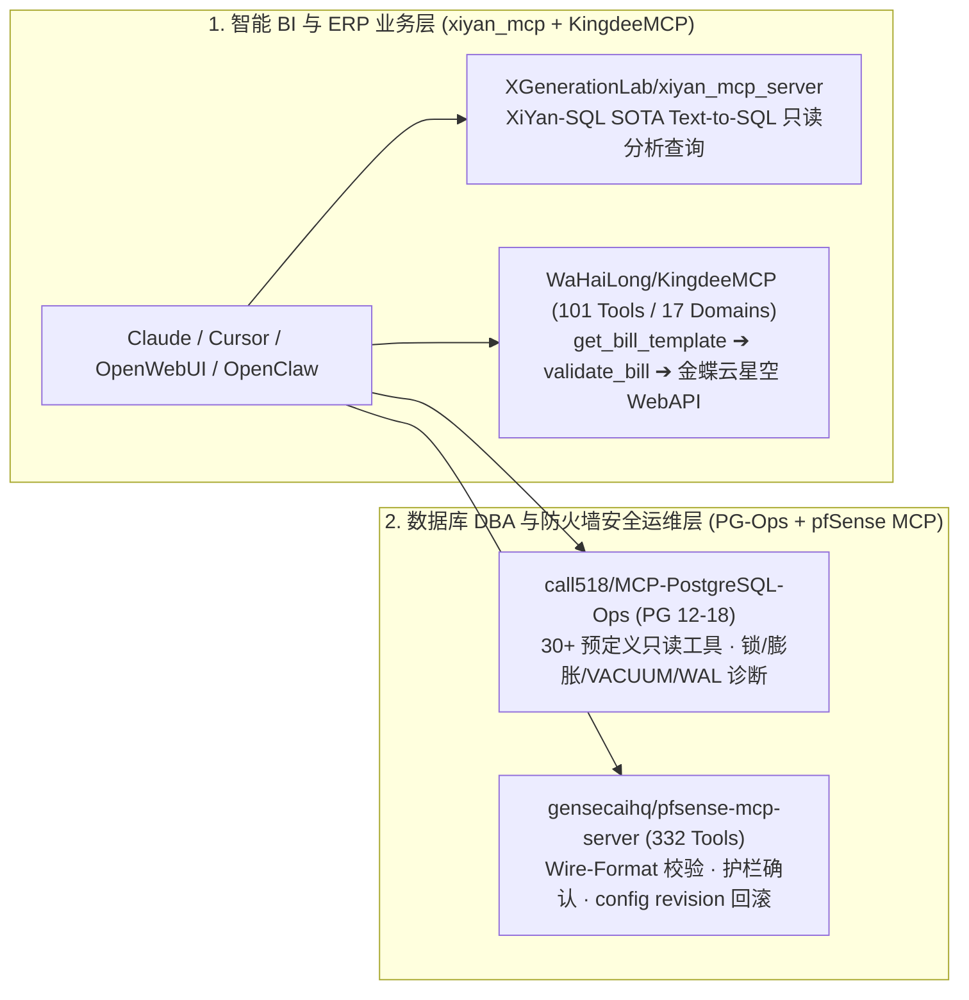
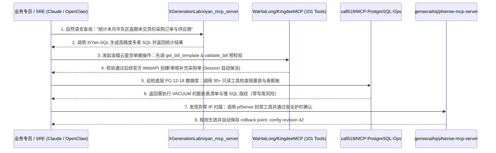

# 阿里析言 SOTA Text-to-SQL 数据库 MCP（`XGenerationLab/xiyan_mcp_server`）、PostgreSQL 12–18 只读 DBA 诊断 MCP（`call518/MCP-PostgreSQL-Ops`）、金蝶云星空 17 域 101 工具 ERP MCP（`WaHaiLong/KingdeeMCP`）与 332 工具每步回滚 pfSense 防火墙 MCP（`gensecaihq/pfsense-mcp-server`）选型与集成架构 FAQ

> **文档类型**：企业 AI 解决方案架构师（AI Solution Architect）选型决策指南（GitHub Trending AI 雷达 2026-11-21 Night Round 107 / 累计第 707 轮）
> **覆盖项目**：[`XGenerationLab/xiyan_mcp_server`](https://github.com/XGenerationLab/xiyan_mcp_server)（`★ 239`、`51 forks`、`Apache-2.0`，基于开源 Text-to-SQL 榜单 SOTA 模型 `XiYan-SQL / XiYanSQL-QwenCoder` 的自然语言查库 MCP Server）· [`call518/MCP-PostgreSQL-Ops`](https://github.com/call518/MCP-PostgreSQL-Ops)（`★ 164`、`28 forks`、`MIT`，免插件支持 PG 12–18 慢查询、死锁、膨胀与 Autovacuum 诊断的 30+ 预定义只读 DBA 工具 MCP）· [`WaHaiLong/KingdeeMCP`](https://github.com/WaHaiLong/KingdeeMCP)（`★ 146`、`47 forks`、`MIT`，覆盖采购/销售/库存/财务/生产等 17 大业务域 101 个工具的金蝶云星空 ERP MCP Server）· [`gensecaihq/pfsense-mcp-server`](https://github.com/gensecaihq/pfsense-mcp-server)（`★ 121`、`25 forks`、`MIT`，经 661 项测试与 Wire-Format 契约校验、每次变更自动记录 `config revision` 回滚点的 332 工具 pfSense 防火墙 MCP）
> **核心场景**：当传统制造、零售与金融企业希望把 AI Agent 真正接入**企业核心生产命脉——业务数据库（Text-to-SQL BI 报表）、PostgreSQL 数据库运维（DBA 慢 SQL/死锁/表膨胀排障）、金蝶云星空 ERP（17 大业务域单据查询/新建/审核/下推）与边界防火墙（pfSense 封禁 IP/WireGuard VPN/故障诊断）**，同时严防“AI 误删生产表”或“AI 改错防火墙规则把自己锁在门外”时，如何组合这四大垂直领域 MCP？

---

## 一、📌 核心结论速览（选型一句话结论）

1. **想让业务分析人员用中文或英文自然语言直接查企业关系型数据库，且获得远超通用大模型直写 SQL 的多表关联准确率（SOTA Text-to-SQL）** ➔ 选 **[`XGenerationLab/xiyan_mcp_server`](https://github.com/XGenerationLab/xiyan_mcp_server)（`★ 239`，`51 forks`，`Apache-2.0`）**。
   - **通俗原理**：由阿里通义析言团队（XGenerationLab）开源（论文 `arXiv:2411.08599` & `2507.04701`，PyPI 包 `xiyan-mcp-server`）。底层基于在各大开源 Text-to-SQL 评测集夺冠的多生成器集成框架 **XiYan-SQL** 及专属模型 **XiYanSQL-QwenCoder**，支持本地部署开源权重或对接阿里云百炼析言 GBI，通过标准 MCP 为 Claude、Cursor 及企业内部 BI Agent 提供高精度 Schema 感知与自然语言转 SQL 查询。
2. **想让 SRE 与 DBA 用自然语言排查 PostgreSQL 12–18 的慢查询、锁等待、表膨胀（Bloat）、Autovacuum 与主从复制延迟，且 100% 杜绝任意 SQL 写操作风险** ➔ 选 **[`call518/MCP-PostgreSQL-Ops`](https://github.com/call518/MCP-PostgreSQL-Ops)（`★ 164`，`28 forks`，`MIT`）**。
   - **通俗原理**：如果给 AI 一个能执行任意 SQL 的客户端去排障，一旦误跑 `DELETE` 或锁表查询就会酿成生产事故。`MCP-PostgreSQL-Ops` 将资深 PostgreSQL DBA 的排障剧本固化为 **30+ 个预定义、纯只读（Read-only）的诊断工具**，自动适配 **PostgreSQL 12 至 18** 各版本系统视图差异，无需预装任何数据库插件即可工作（若开启 `pg_stat_statements` / `pg_stat_monitor` 则自动解锁深度慢 SQL 分析），支持 `uvx`、Docker 或直连 OpenWebUI。
3. **想在 Claude、Cursor 或微信/WhatsApp（OpenClaw）里用自然语言直接查询、新建、审核和下推“金蝶云星空 ERP”的采购、销售、库存、财务与生产单据** ➔ 选 **[`WaHaiLong/KingdeeMCP`](https://github.com/WaHaiLong/KingdeeMCP)（`★ 146`，`47 forks`，`MIT`）**。
   - **通俗原理**：基于 FastMCP + Pydantic 打造的金蝶云星空（Kingdee Cloud Star）开源 MCP Server（`pip install kingdee-mcp`）。内置 **101 个强类型工具**，完整覆盖**生产、成本、资产、审计、采购、销售、库存、单据附件、财务、委外加工、财务报表等 17 大核心 ERP 业务域**；不仅提供 `get_bill_template`、`validate_bill`（提交前表单合法性预校验）与 `refresh_metadata` 本地元数据缓存，还附带 4 个 SQL Server 底层表结构探查工具，采用金蝶官方 WebAPI（`ValidateUser`）直连公有云或私有云 ERP，Session 过期自动重登。
4. **想让 NetOps / SecOps 工程师用自然语言管理 pfSense 企业防火墙（封禁攻击 IP、配置 WireGuard VPN、排查断网原因），且每次修改都经过 Schema 契约校验并生成一键回滚快照** ➔ 选 **[`gensecaihq/pfsense-mcp-server`](https://github.com/gensecaihq/pfsense-mcp-server)（`★ 121`，`25 forks`，`MIT`）**。
   - **通俗原理**：针对 pfSense REST API（`v2.10.2`）构建了 **332/333 个经 Wire-Format 契约测试验证的 MCP 工具**（CI 持续通过 **661 项单元测试与端到端协议测试**）。每次执行高危变更前强制经过多层安全护栏（Guardrail Pipeline）与显式人工确认，并在生效瞬间自动记录配置版本号（如 `rollback point: config revision 42`），一旦策略有误即可秒级回滚。

---

## 二、🎯 客户与架构师灵魂拷问 Q&A（深度架构拆解）

### Q1：为什么企业在落地“数据库 + ERP + 网络安全”三大核心场景时，不能直接让通用大模型调裸 SQL 或手写 REST 脚本？

- **三大生产红线与专业 MCP 防御机制**：
  1. **业务查库（BI）与运维排障（DBA）职责分离（`xiyan_mcp_server` + `MCP-PostgreSQL-Ops`）**：
     - 业务分析师问“上季度华东区毛利率最高的前十个品类”，难点在于复杂的多表 Join 与业务口径映射——交给 SOTA Text-to-SQL 引擎 **`xiyan_mcp_server`**（配合只读分析库账号）；
     - DBA 问“为什么现在连接池满了、哪张表急需 VACUUM”，难点在于跨 PG 12–18 系统目录视图（`pg_locks`、`pg_stat_user_tables`、WAL 复制槽）关联诊断——交给禁止任意 SQL、固化 30+ 只读排障模板的 **`MCP-PostgreSQL-Ops`**。
  2. **ERP 复杂单据必输项与上下游下推校验（`WaHaiLong/KingdeeMCP`）**：金蝶云星空一张销售订单或生产入库单动辄几十个关联字段，大模型盲写 JSON 必报 500 错误。`KingdeeMCP` 内置 `get_bill_template` 与 `validate_bill` 预校验，把 17 大业务域封装为 101 个 Pydantic 强类型工具。
  3. **防火墙规则变更防锁死与防越权（`gensecaihq/pfsense-mcp-server`）**：让 AI 拼接防火墙 JSON 极易写错字段格式或误封管理网段。`pfsense-mcp-server` 对全部 332 个工具实施了针对 pfSense REST API Schema 的 Wire-Format 契约测试，每次变更强制备份 `config revision` 回滚点。
- **何时直接用云厂商托管方案（Path B）？**
  - 若企业全栈使用 Microsoft Dynamics 365 ERP + Azure Database for PostgreSQL + Azure Firewall，直接启用 **Microsoft Copilot for Dynamics 365 + Azure Copilot** 即可免集成使用。

### Q2：典型企业级“智能经营分析 (`xiyan`) + 金蝶 ERP 业务闭环 (`KingdeeMCP`) + PG 数据库自愈诊断 (`MCP-PostgreSQL-Ops`) + 边界防火墙秒级封禁回滚 (`pfsense-mcp`)”架构怎么搭？

1. **经营分析与自然语言 BI 层（`XGenerationLab/xiyan_mcp_server`）**：
   - 将 `xiyan_mcp_server` 连接至企业只读分析库/数仓副本，结合本地部署的 `XiYanSQL-QwenCoder` 模型，向管理层与财务人员提供零 SQL 门槛的精准多表关联报表查询。
2. **金蝶云星空 ERP 17 域业务执行层（`WaHaiLong/KingdeeMCP`）**：
   - 采购、销售与财务专员通过桌面端 Claude/Cursor 或企业微信/飞书/WhatsApp 网关（OpenClaw）调用 `KingdeeMCP` 的 101 个工具：先调用 `get_bill_template` 与 `validate_bill` 校验采购/销售/入库单草稿，确认无误后通过金蝶官方 WebAPI 提交审核。
3. **PostgreSQL 12–18 零扩展只读 DBA 诊断层（`call518/MCP-PostgreSQL-Ops`）**：
   - 运维 Agent（或 OpenWebUI 运维助手）通过 HTTP/Stdio 挂载 `MCP-PostgreSQL-Ops` 的 30+ 只读工具，7×24 小时巡检阻塞会话、表膨胀、无效索引、Autovacuum 滞后与 WAL 复制延迟，输出可执行的优化建议。
4. **pfSense 边界防火墙自然语言管控与版本回滚层（`gensecaihq/pfsense-mcp-server`）**：
   - 当安全监控发现恶意扫描 IP 或需临时开通研发 WireGuard 隧道时，SecOps 通过 `pfsense-mcp-server` 调用 332 个校验工具下发策略，经过 Guardrail 审批后自动生成 `config revision` 回滚点。

### Q3：这套架构的适用边界是什么？

- **核心优势**：
  - **100% 宽松开源协议（`Apache-2.0` 与 `MIT`）**：全部支持企业私有化内网部署，敏感财务单据、数据库 Schema 与防火墙配置完全不出网。
  - **强契约与只读/回滚护栏**：30+ 预定义只读 PG 视图、101 个 Pydantic 校验的金蝶 ERP 工具、332 个带 `config revision` 回滚点的 pfSense 工具，将生产误操作风险降至零。
- **适用边界**：
  - `KingdeeMCP` 专门面向金蝶云星空（K/3 Cloud），若企业使用 SAP 或用友则需替换对应连接器；`pfsense-mcp-server` 依赖 pfSense REST API `v2.10.2` 插件。

---

## 三、🧭 直观可视化图解（Mermaid 决策树 + 集成架构 + 时序图）

### 3.1 架构师选型决策树

### 3.2 企业端到端生产集成参考架构图

### 3.3 经营报表查询、金蝶单据预校验提交、PG 锁排障与防火墙秒级封禁回滚时序图

---

## 四、📊 同类开源与商业云服务横向选型决策矩阵

| 对比维度 | `XGenerationLab/xiyan_mcp_server` (`★ 239`) | `call518/MCP-PostgreSQL-Ops` (`★ 164`) | `WaHaiLong/KingdeeMCP` (`★ 146`) | `gensecaihq/pfsense-mcp-server` (`★ 121`) | 商业 GBI + 商业 DBA APM + ERP 定制外包 (Path A) | 云原生 Dynamics + Azure Copilot (Path B) |
| :--- | :--- | :--- | :--- | :--- | :--- | :--- |
| **核心能力定位** | 阿里析言 SOTA Text-to-SQL 数据库查询 MCP | PG 12–18 免插件 30+ 预定义只读 DBA 诊断 MCP | 金蝶云星空 17 大业务域 101 工具 ERP MCP | 332 工具契约校验 + 661 测试的 pfSense 防火墙 MCP | 商业智能问数 SaaS + 商业 DB 监控 + ERP 二开 + 防火墙自动化 | Dynamics 365 Copilot + Azure Copilot |
| **安全与防误操作护栏** | 支持本地私有化部署 `XiYanSQL-QwenCoder` | **严格只读（禁止任意 SQL 与写操作）+ 自动适配 PG 12–18** | **Pydantic 强类型 + `validate_bill` 提交前校验** | **Wire-Format 契约测试 + 显式确认 + `config revision` 回滚** | 通用 SQL MCP 极易误改数据；ERP 定制按人天高额收费 | 仅限微软全栈云产品，不支持金蝶云星空与 pfSense |
| **开源协议** | `Apache-2.0` | `MIT` | `MIT` | `MIT` | 闭源商业软件/外包 | 闭源云服务 |
| **月度 TCO（45 人团队）** | **组合仅 `$310.00/月`**（含本地模型/容器算力与 2.4h 运维） | 同左（`$70.00` 算力 + `$240.00` 人工） | 同左（直连现有金蝶 WebAPI 零增购费） | 同左（直连 pfSense REST API 零许可费） | **`$8,330.00/月`**（`$3,980.00` 订阅 + `43.5h` 开发运维） | 约 `$2,850.00/月`（需更换全套 ERP 与云底座） |

---

## 五、🧪 应用落地定量收益/TCO 对比与 7-Card 报告

> **📊 数据来源与闭式核算声明（Provenance & Closed-Form Schema）**：
> - **provenance**: `synthetic`（基于 45 人企业数字化、ERP 实施与基础设施运维团队工作负载模型：`independently_reproduced = false`；硬件采购基线 `base_hardware_capex = not_measured`；Track B 单日增量 `track_b_stars_today = not_measured`）。
> - **核算公式**：
>   - **Path A（商业 Text-to-SQL 智能问数 SaaS + 商业 PostgreSQL APM 诊断席位 + 金蝶 ERP 接口手写开发与手工查单 + 防火墙手工排障与配置审计）**：月度商业软件订阅 **`$3,980.00`** + ERP/DBA/NetOps 手工操作与接口维护 **`43.5h × $100.00/h = $4,350.00`** = **`$8,330.00/月`**。
>   - **Path C（自建 `XGenerationLab/xiyan_mcp_server` + `call518/MCP-PostgreSQL-Ops` + `WaHaiLong/KingdeeMCP` + `gensecaihq/pfsense-mcp-server` 开源组合）**：共享容器与只读副本算力 **`$70.00`** + MCP 权限与配置维护 **`2.4h × $100.00/h = $240.00`** = **`$310.00/月`**。
>   - **净节省（Net Savings vs Path A）**：**`-$8,020.00/月`**（成本降低 **`96.28%`**）。

| 评估方案 | API / SaaS / 算力成本 | 工程与业务运维人工（`$100/h`） | 月度总 TCO | 相对 Path A 净节省 | 关键架构交付指标 |
| :--- | :---: | :---: | :---: | :---: | :--- |
| **Path A：商业问数 SaaS + 商业 DBA 监控 + 手写 ERP/防火墙脚本** | `$3,980.00` | `43.5h` (`$4,350.00`) | **`$8,330.00`** | Baseline | 通用 LLM 写 SQL 准确率低；手写金蝶/防火墙接口维护极重 |
| **Path B：全套更换为外资云 ERP + 云原生防火墙 Copilot** | `$1,650.00` | `12.0h` (`$1,200.00`) | **`$2,850.00`** | `-$5,480.00` (`-65.79%`) | 迁移金蝶 ERP 与物理防火墙的沉没成本过高 |
| **Path C：`xiyan_mcp` + `PG-Ops` + `KingdeeMCP` + `pfsense-mcp`** | **`$70.00`** | **`2.4h` (`$240.00`)** | **`$310.00`** | **`-$8,020.00` (`-96.28%`)** | **SOTA Text-to-SQL + PG 只读 30+ 工具 + 金蝶 101 工具 + 防火墙回滚** |

- 🔗 **关联 7-Card 4:5 视觉评测报告**：[`workshops/github-trending-radar/cards.html`](../cards.html) · [`cards.en.html`](../cards.en.html)

---

## 六、🛠️ 企业引入与架构评审 Checklist

- [ ] **1. 部署 `XGenerationLab/xiyan_mcp_server` 对接只读分析数据库**：使用只读数据库账号连接 `xiyan-mcp-server`，挂载本地 `XiYanSQL-QwenCoder` 或企业内网模型，禁止将 Text-to-SQL 工具直接绑定至生产主库写账号。
- [ ] **2. 为 PostgreSQL 12–18 生产库挂载 `call518/MCP-PostgreSQL-Ops`**：通过 Docker 或 `uvx` 启动 30+ 预定义只读 DBA 工具（推荐同时开启 `pg_stat_statements`），供 SRE 在 Claude 或 OpenWebUI 中随时排查锁阻塞、表膨胀与 Autovacuum 状态。
- [ ] **3. 配置 `WaHaiLong/KingdeeMCP` 赋能金蝶云星空 17 大业务域**：使用细粒度权限的金蝶 WebAPI 账号配置 `kingdee-mcp`，强制 Agent 在新建或修改单据前先调用 `get_bill_template` 与 `validate_bill` 执行元数据校验。
- [ ] **4. 启用 `gensecaihq/pfsense-mcp-server` 并验证 `config revision` 回滚**：在 pfSense `v2.10.2` REST API 上接入 332 个契约校验工具，开启高危操作人工确认，并定期演练基于 `config revision` 的一键防火墙配置回滚。
