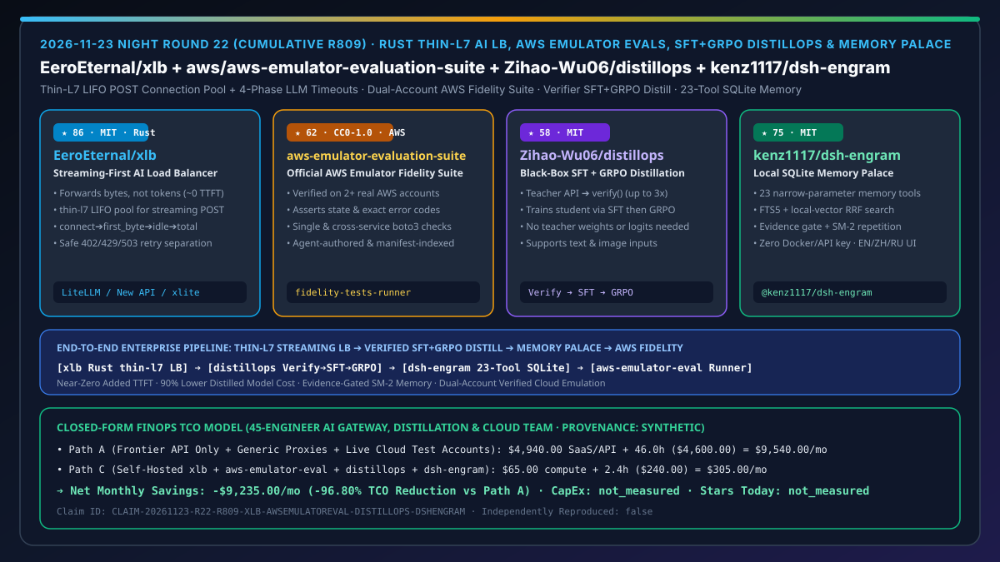
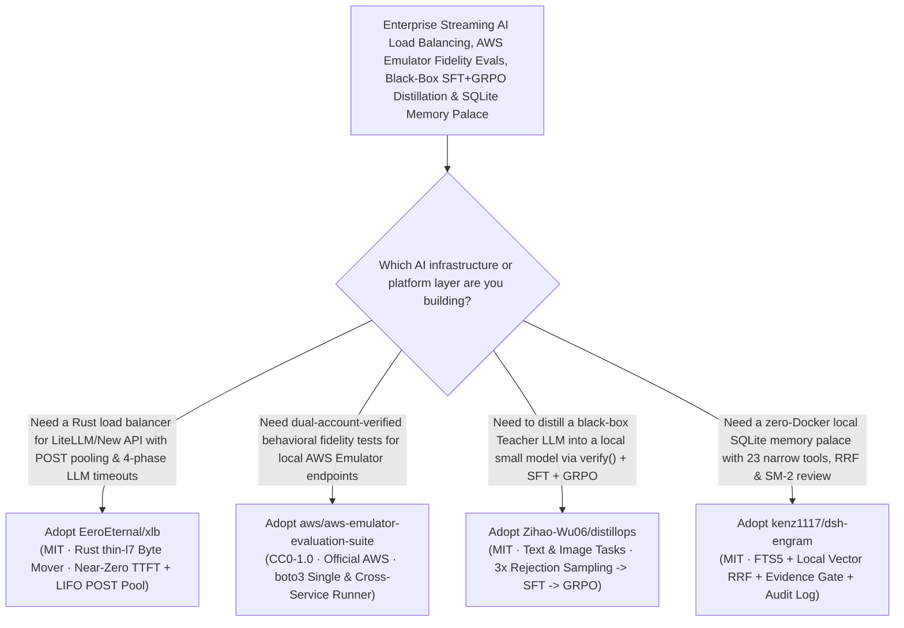
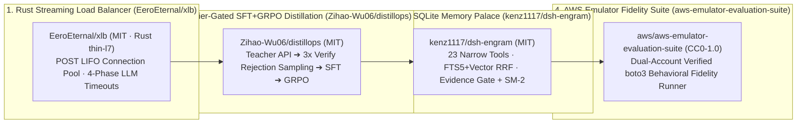

# Streaming-First `thin-l7` AI Load Balancer (`EeroEternal/xlb`), Official AWS Dual-Account Verified Emulator Evaluation Suite (`aws/aws-emulator-evaluation-suite`), Verifier-Gated Black-Box SFT+GRPO Distillation (`Zihao-Wu06/distillops`) & 23-Tool Local SQLite Memory Palace (`kenz1117/dsh-engram`) Selection & Architecture FAQ

> **Document Type**: Enterprise AI Solution Architect Selection & Integration Guide (GitHub Trending AI Radar · 2026-11-23 Night Round 22 / Cumulative Round 809)
> **Covered Repositories**: [`EeroEternal/xlb`](https://github.com/EeroEternal/xlb) (`★ 86`, `9 forks`, `MIT`: Rust streaming-first load balancer for AI gateways—LiteLLM, New API, xlite, AISIX—and inference clusters that **"forwards bytes, not tokens"** in `thin-l7` mode to pool backend connections across long-lived streaming `POST`s with near-zero added TTFT, 4-phase LLM timeouts `connect ➔ first_byte ➔ idle ➔ total`, and status-aware retry boundaries) · [`aws/aws-emulator-evaluation-suite`](https://github.com/aws/aws-emulator-evaluation-suite) (`★ 62`, `10 forks`, `CC0-1.0`, by AWS: official agent-maintained behavioral fidelity test suite and runner `uv run fidelity-tests-runner` for **AWS Emulator**, where every `boto3` single- and cross-service test is verified against **at least two sandboxed AWS accounts**) · [`Zihao-Wu06/distillops`](https://github.com/Zihao-Wu06/distillops) (`★ 58`, `4 forks`, `MIT`: black-box LLM distillation pipeline `Teacher API ➔ Rejection Sampling (up to 3 retries via verify) ➔ SFT ➔ GRPO` for text and image tasks, requiring only the teacher's verified text answers and never its weights or logits) · [`kenz1117/dsh-engram`](https://github.com/kenz1117/dsh-engram) (`★ 75`, `10 forks`, `MIT`: zero-Docker, zero-API-key local SQLite **"Memory Palace"** plugin `@kenz1117/dsh-engram` with **23 narrow-parameter tools, hybrid FTS5 + local-vector RRF search, evidence gates, full audit trails, and SM-2 spaced repetition**)
> **Core Scenario**: When enterprise AI platform and infrastructure teams scale streaming inference gateways, local cloud emulators, task-specific model distillation, and cross-session agent memory, how do you solve **"traditional proxies refusing to pool non-idempotent streaming `POST` connections or dropping reasoning models during long thinking pauses, local cloud emulators diverging silently from real AWS resource states and error codes, paying frontier LLM prices forever on repetitive verifiable tasks, and flat vector memories polluting context with unverified claims"** by combining **`xlb` + `aws-emulator-evaluation-suite` + `distillops` + `dsh-engram`**?

---

## 1. 📌 Executive Summary (Single-Sentence Selection Verdict)

1. **Need an HAProxy-style Rust load balancer in front of LiteLLM, New API, xlite, or AISIX that forwards bytes (not tokens) for near-zero added TTFT, pools backend sockets across non-idempotent streaming `POST`s (`thin-l7`), and enforces 4-phase LLM timeouts (`connect ➔ first_byte ➔ idle ➔ total`)** ➔ Choose **[`EeroEternal/xlb`](https://github.com/EeroEternal/xlb) (`★ 86`, `9 forks`, `MIT`, Rust)**.
   - **Plain-Language Mechanism**: Traditional HTTP proxies avoid pooling connections across clients for non-idempotent `POST /v1/chat/completions` calls, while L4 proxies pin clients to one backend. `xLB`'s `thin-l7` mode inspects only HTTP/1.1 framing boundaries (`Content-Length` / chunked end) to return every finished stream socket to a shared LIFO pool immediately, models LLM prefill (`first_byte`) and reasoning pauses (`idle`) separately, and separates safe pre-execution retry codes (`402`/`404`/`429`/`503`) from post-acceptance errors (`500`/`502`/`504`).
2. **Need an official AWS behavioral fidelity test suite (`uv run fidelity-tests-runner`) where every `boto3` single-service and cross-service (`a__b`) test is verified against at least two real sandboxed AWS accounts to validate local AWS Emulator deployments** ➔ Choose **[`aws/aws-emulator-evaluation-suite`](https://github.com/aws/aws-emulator-evaluation-suite) (`★ 62`, `10 forks`, `CC0-1.0`, by AWS)**.
   - **Plain-Language Mechanism**: Authored and maintained by AI agents at AWS, each `behavioral/<service>/check_<name>.py` test drives a real `boto3` workflow and asserts both final resource state and exact AWS error codes/messages—ensuring that infrastructure agents tested against a local emulator encounter real AWS semantics.
3. **Need to distill a hosted or local Teacher LLM into a small open model you own on any verifiable text or image task (`Teacher API ➔ verify() up to 3x ➔ SFT ➔ GRPO`) using only the teacher's text answers and never its weights or logits** ➔ Choose **[`Zihao-Wu06/distillops`](https://github.com/Zihao-Wu06/distillops) (`★ 58`, `4 forks`, `MIT`)**.
   - **Plain-Language Mechanism**: Define a Python `Task` with a deterministic `verify()` check: `distillops` queries the teacher model, keeps only answers that pass verification (retrying up to 3 times), trains a student model with SFT on those verified rows, and refines it with **GRPO reinforcement learning** using your task score as the reward.
4. **Need a zero-Docker, zero-API-key local SQLite cross-session memory system organized as a spatial Memory Palace (`directory = room, path = route`) with 23 narrow tools, FTS5 + local-vector RRF hybrid search, evidence gates, and SM-2 spaced repetition** ➔ Choose **[`kenz1117/dsh-engram`](https://github.com/kenz1117/dsh-engram) (`★ 75`, `10 forks`, `MIT`)**.
   - **Plain-Language Mechanism**: `@kenz1117/dsh-engram` replaces vague catch-all memory tools with 23 narrow-parameter operations, requires an **Evidence Gate** before persisting facts, logs full audit trails, schedules memory consolidation via the **SM-2 spaced-repetition algorithm**, and includes a trilingual (EN/ZH/RU) web management console.

---

## 2. 🎯 Key Architectural Q&A (Deep-Dive Breakdown)

### Q1: Why pair `EeroEternal/xlb` and `Zihao-Wu06/distillops` in an enterprise AI inference platform?

- **High-Throughput Streaming Ingress + Verifier-Gated Model Downsizing**:
  1. **Zero-TTFT-Overhead `POST` Connection Pooling (`EeroEternal/xlb`)**: Keeps LiteLLM / New API gateway clusters resilient under long-lived streaming `POST` loads with 4-phase timeout awareness (`connect`, `first_byte`, `idle`, `total`).
  2. **90%+ Inference Cost Reduction on Repetitive Tasks (`Zihao-Wu06/distillops`)**: Distills expensive teacher APIs into small local student models via verified rejection sampling + SFT + GRPO, which are then served behind `xLB`.
  3. **Verified Cloud Emulation (`aws/aws-emulator-evaluation-suite`) + Audited Memory Palace (`kenz1117/dsh-engram`)**: Ensures cloud automation scripts match dual-account-verified AWS behavior while storing operational lessons behind evidence gates in local SQLite.
- **When to Choose Managed Cloud Services (Path B)**:
  - For small cloud-only workloads on a single provider, use **Azure API Management + Azure AI Foundry Distillation**; for multi-gateway `thin-l7` streaming load balancing, black-box SFT+GRPO local distillation, dual-account-verified AWS Emulator testing, and local SQLite memory palaces, deploy this 4-repo open-source stack (Path C).

### Q2: How do these four components integrate into an enterprise AI infrastructure architecture?

1. **Streaming-First `thin-l7` Load Balancing Layer (`EeroEternal/xlb`)**:
   - Terminate client streaming `POST` traffic, pool backend connections in LIFO order, and enforce 4-stage LLM timeouts in front of LiteLLM/New API/vLLM.
2. **Black-Box SFT + GRPO Distillation Layer (`Zihao-Wu06/distillops`)**:
   - Collect teacher outputs that pass `verify()`, train compact local student models via SFT + GRPO, and register them as fast backend targets behind `xLB`.
3. **Evidence-Gated SQLite Memory Palace Layer (`kenz1117/dsh-engram`)**:
   - Persist verified architectural and operational knowledge via 23 narrow tools, FTS5 + local-vector RRF retrieval, and SM-2 spaced repetition.
4. **Cloud Emulator Fidelity Verification Layer (`aws/aws-emulator-evaluation-suite`)**:
   - Run `uv run fidelity-tests-runner` against local AWS Emulator endpoints to certify behavioral parity before executing infrastructure agent workflows.

### Q3: What are the key production guardrails?

- **Architect Guardrails**:
  1. **Restrict Automatic Retries in `xlb` to Pre-Execution Statuses (`402`/`404`/`429`/`503`)**: Avoid blind retries on `500`/`502`/`504` unless idempotency is guaranteed, preventing duplicate backend generation bills.
  2. **Enforce Strict Deterministic Verifiers in `distillops`**: Ensure `Task.verify()` checks exact domain constraints so hallucinated teacher responses never enter the SFT/GRPO training set.

---

## 3. 🧭 Visual Architecture & Decision Diagrams (Mermaid)



### 3.1 Solution Architect Selection Decision Tree



### 3.2 End-to-End Enterprise Production Reference Architecture



### 3.3 `thin-l7` Streaming Routing, Black-Box SFT+GRPO Distillation, Evidence-Gated Memory & Emulator Fidelity Sequence

```mermaid
sequenceDiagram
    participant Infra as AI Platform & Infra Architect
    participant Xlb as EeroEternal/xlb (Rust thin-l7)
    participant Dst as Zihao-Wu06/distillops
    participant Eng as kenz1117/dsh-engram (Memory Palace)
    participant Aws as aws/aws-emulator-evaluation-suite

    Infra->>Xlb: 1. Route streaming POST /v1/chat/completions via thin-l7 LIFO pool & 4-phase timeouts
    Xlb->>Dst: 2. Sample teacher responses; filter via verify() (up to 3 tries) & train student via SFT + GRPO
    Dst-->>Xlb: 3. Register distilled local student model behind xLB for high-volume verifiable tasks
    Infra->>Eng: 4. Commit verified operational facts into local SQLite Memory Palace via 23 narrow tools
    Infra->>Aws: 5. Run fidelity-tests-runner against local AWS Emulator to verify real AWS behavior parity
```

---

## 4. 📊 Comparative Selection Matrix (Open-Source vs. Commercial SaaS)

| Dimension | `EeroEternal/xlb` (`★ 86`) | `aws/aws-emulator-evaluation-suite` (`★ 62`) | `Zihao-Wu06/distillops` (`★ 58`) | `kenz1117/dsh-engram` (`★ 75`) | Frontier-LLM-Only Production + Commercial L7 Proxies + Live Cloud Sandbox Testing (Path A) | Default Nginx Proxy Tuning + Unverified SFT Data + Flat Unaudited Vector Memory (Path B) |
| :--- | :--- | :--- | :--- | :--- | :--- | :--- |
| **Core Role** | Rust streaming-first `thin-l7` load balancer for AI gateways | Official AWS behavioral fidelity suite for AWS Emulator | Black-box `verify()` ➔ SFT ➔ GRPO distillation pipeline | Local SQLite Memory Palace with 23 narrow tools, RRF & SM-2 | High frontier token bills, payload-parsing TTFT overhead & live cloud test charges | Dropped reasoning streams, hallucination-polluted SFT & noisy memory |
| **Key Differentiator** | **Forwards bytes not tokens + LIFO `POST` pool + 4-phase timeouts** | **Every `boto3` check verified against 2+ real AWS accounts** | **Needs only teacher text answers (no weights/logits) + SFT & GRPO** | **Spatial palace paths + FTS5/vector RRF + Evidence Gate + SM-2** | Payload-inspecting proxies add latency; running all tasks on frontier APIs costs 10× more | Unfiltered SFT learns teacher errors; generic proxies drop long reasoning pauses |
| **License** | `MIT` | `CC0-1.0` (AWS Official) | `MIT` | `MIT` | Proprietary SaaS | Custom scripts |
| **Monthly TCO (45-Eng Team)** | **Combined `$305.00/mo`** (`$65.00` Rust LB & distilled student host + `2.4h` ops) | Included (validates local emulators for free) | Included (cuts routine task API spend by 90%+) | Included (zero-Docker, zero-key local SQLite) | **`$9,540.00/mo`** (`$4,940.00` frontier API bills, commercial gateways & live cloud test accounts + `46.0h` stream timeout & data curation labor) | ~`$3,390.00/mo` (frequent streaming 504 debugging, emulator drift rework & SFT retraining) |

---

## 5. 🧪 Quantitative ROI / TCO Comparison & 7-Card Benchmark Report

> **📊 Data Provenance & Closed-Form Schema Declaration**:
> - **provenance**: `synthetic` (45-person enterprise AI inference gateway, model optimization, and cloud infrastructure engineering team monthly workload model: `independently_reproduced = false`; hardware baseline `base_hardware_capex = not_measured`; Track B 24h delta `track_b_stars_today = not_measured`).
> - **Closed-Form Formula**:
>   - **Path A (Routing all high-volume verifiable workloads to expensive frontier teacher APIs + commercial cloud sandbox testing bills + manual engineering hours spent debugging streaming `POST` timeouts on generic proxies, manually curating distillation datasets, and fixing cloud emulator discrepancies)**: Monthly frontier LLM API, commercial gateway, and live cloud sandbox bills **`$4,940.00`** + streaming timeout debugging, manual distillation dataset cleaning, and cloud test troubleshooting labor **`46.0h × $100.00/h = $4,600.00`** = **`$9,540.00/mo`**.
>   - **Path C (Self-hosted `EeroEternal/xlb` + `aws/aws-emulator-evaluation-suite` + `Zihao-Wu06/distillops` + `kenz1117/dsh-engram` open-source stack)**: Shared Rust `xLB` load balancer and distilled local student model compute **`$65.00`** + verifier rule and gateway configuration maintenance labor **`2.4h × $100.00/h = $240.00`** = **`$305.00/mo`**.
>   - **Net Monthly Savings vs. Path A**: **`-$9,235.00/mo`** (**`96.80%`** TCO reduction).

| Evaluation Path | Frontier API / Cloud Sandbox / Gateway Cost | Proxy Triage, Data Curation & Cloud QA Labor (`$100/h`) | Monthly Total TCO | Net Savings vs. Path A | Key Architectural Delivery Metrics |
| :--- | :---: | :---: | :---: | :---: | :--- |
| **Path A: Frontier APIs Only + Generic L7 Proxies + Live Cloud Sandboxes** | `$4,940.00` | `46.0h` (`$4,600.00`) | **`$9,540.00`** | Baseline | High frontier token bills; dropped connections during reasoning pauses |
| **Path B: Hand-Tuned Nginx + Unverified SFT + Unchecked Emulators** | `$1,490.00` | `19.0h` (`$1,900.00`) | **`$3,390.00`** | `-$6,150.00` (`-64.47%`) | No `POST` connection pooling; emulator behavior drift vs. real AWS |
| **Path C: `xlb` + `aws-emulator-eval` + `distillops` + `dsh-engram`** | **`$65.00`** | **`2.4h` (`$240.00`)** | **`$305.00`** | **`-$9,235.00` (`-96.80%`)** | **`thin-l7` LIFO POST pool + AWS fidelity suite + SFT/GRPO distill + Memory Palace** |

- 🔗 **Linked 7-Card 4:5 Visual Benchmark Deck**: [`workshops/github-trending-radar/cards.en.html`](../cards.en.html) · [`cards.html`](../cards.html)

---

## 6. 🛠️ Enterprise Adoption & Architecture Review Checklist

- [ ] **1. Place `EeroEternal/xlb` in Front of LiteLLM / New API / Inference Clusters**: Enable `thin-l7` mode for shared LIFO `POST` connection pooling and configure 4-stage timeouts (`connect`, `first_byte`, `idle`, `total`).
- [ ] **2. Validate Local AWS Emulators with `aws/aws-emulator-evaluation-suite`**: Run `uv run fidelity-tests-runner` to verify dual-account-checked `boto3` resource state and error-code fidelity before running cloud agents.
- [ ] **3. Distill High-Volume Verifiable Tasks with `Zihao-Wu06/distillops`**: Implement deterministic `Task.verify()` gates (up to 3 teacher retries) and run SFT followed by GRPO to produce compact self-hosted student models.
- [ ] **4. Equip Coding Agents with `kenz1117/dsh-engram` Memory Palace**: Use its 23 narrow tools, FTS5 + local-vector RRF hybrid search, evidence gates, and SM-2 spaced repetition for audited local SQLite memory.
