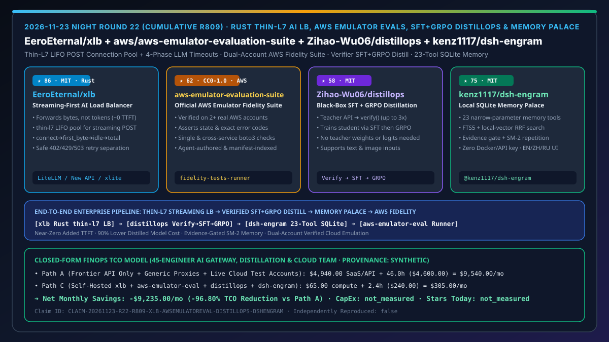
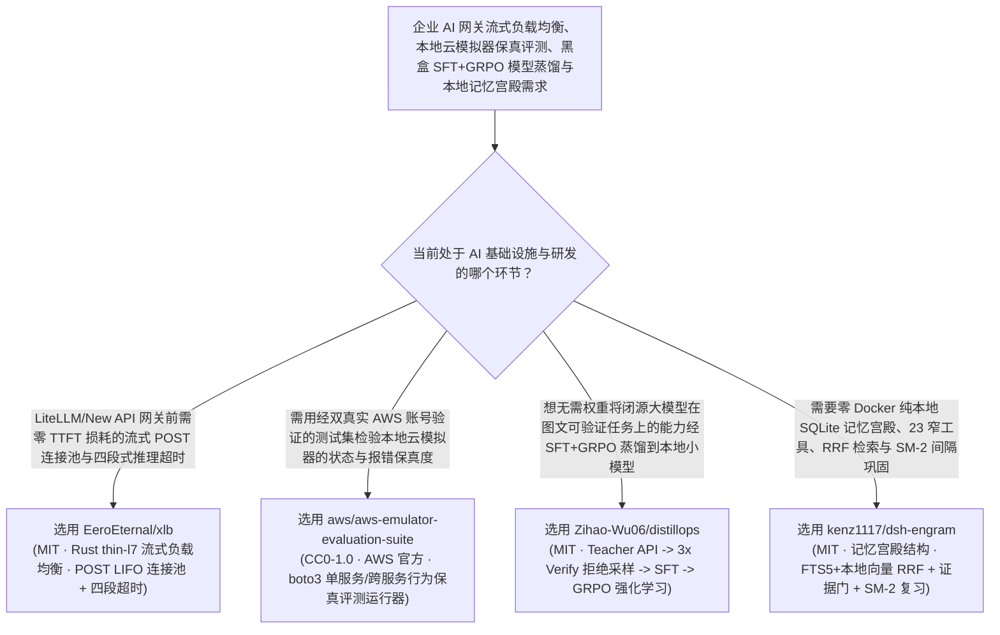
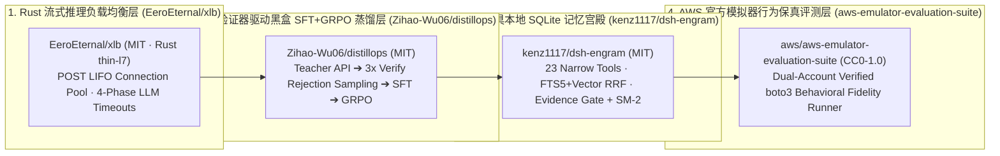
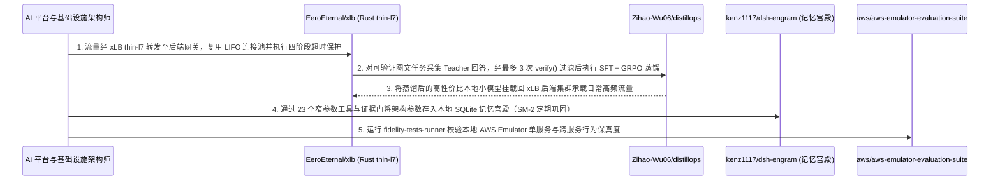

# 专为流式推理网关设计的 Rust `thin-l7` 零 TTFT 损耗负载均衡器（`EeroEternal/xlb`）、AWS 官方双真实账号校验的云模拟器行为保真评测套件（`aws/aws-emulator-evaluation-suite`）、经确定性校验门与 SFT+GRPO 将闭源大模型蒸馏为本地小模型的流水线（`Zihao-Wu06/distillops`）与含 23 个窄工具/RRF 混合检索/证据门/SM-2 间隔复习的本地记忆宫殿（`kenz1117/dsh-engram`）选型与集成架构 FAQ

> **文档类型**：企业 AI 解决方案架构师（AI Solution Architect）选型决策指南（GitHub Trending AI 雷达 2026-11-23 Night Round 22 / 累计第 809 轮）
> **覆盖项目**：[`EeroEternal/xlb`](https://github.com/EeroEternal/xlb)（`★ 86`、`9 forks`、`MIT`：专为 LiteLLM、New API、xlite、AISIX 等 AI 网关与推理集群打造的 **Rust 流式优先负载均衡器**，以“只转发字节、不解析 Token”的 `thin-l7` 模式实现**长连接流式 `POST /v1/chat/completions` 跨客户端 LIFO 连接池复用**、近乎零额外 TTFT 延迟，以及贴合大模型推理四阶段 `connect ➔ first_byte ➔ idle (思考停顿) ➔ total` 的精细超时与非幂等重试区分）· [`aws/aws-emulator-evaluation-suite`](https://github.com/aws/aws-emulator-evaluation-suite)（`★ 62`、`10 forks`、`CC0-1.0`：AWS 官方开源并由 AI 智能体持续编写维护的 **AWS Emulator 行为保真度测试套件与运行器** `uv run fidelity-tests-runner`，每一条 `boto3` 单服务与跨服务测试均在**至少两个真实沙箱 AWS 账号**上交叉验证过资源状态与精确错误码）· [`Zihao-Wu06/distillops`](https://github.com/Zihao-Wu06/distillops)（`★ 58`、`4 forks`、`MIT`：支持文本与图像输入的**黑盒大模型到私有小模型蒸馏流水线** `Teacher API ➔ 最多 3 次 Verify 拒绝采样 ➔ SFT ➔ GRPO`，无需教师模型权重或 Logits，仅用通过确定性校验的正确回答训练自有小模型）· [`kenz1117/dsh-engram`](https://github.com/kenz1117/dsh-engram)（`★ 75`、`10 forks`、`MIT`：零外部服务、零 API Key、零 Docker 的纯本地 SQLite **“记忆宫殿（目录即房间、路径即路线）”跨会话长期记忆插件**，配备 **23 个窄参数工具、FTS5 + 本地向量 RRF 混合检索、证据门（Evidence Gate）、全链路审计与 SM-2 间隔重复复习算法**）
> **核心场景**：当企业 AI 平台与基础架构团队构建高并发推理网关、云基础设施自动化测试、高频垂直任务降本蒸馏与智能体跨会话记忆时，面对**“传统 Nginx/HAProxy 对非幂等流式 `POST` 不敢复用后端连接或因模型长思考停顿（Reasoning Pause）误杀长连接、云运维 Agent 在本地模拟器跑通的脚本一上真实云就因错误码差异崩溃、高频单据抽取/脱敏任务长期调昂贵闭源大模型成本难降、以及常规平面向量记忆缺乏空间结构、证据门禁与间隔巩固机制”**四大工程痛点，如何通过 **xLB + AWS-Emulator-Eval + DistillOps + DSH-Engram** 打造高吞吐、高保真、低成本的企业 AI 底座？

---

## 一、📌 核心结论速览（选型一句话结论）

1. **想在 LiteLLM / New API / vLLM 集群前面放一层像 HAProxy 一样稳如磐石、专门针对大模型长连接流式 `POST` 优化的 Rust 负载均衡器，既要实现跨客户端 LIFO 连接池复用与接近零的额外 TTFT，又要防止 DeepSeek/o1 等推理模型在长思考停顿时被网关当成僵尸连接误杀** ➔ 选 **[`EeroEternal/xlb`](https://github.com/EeroEternal/xlb)（`★ 86`，`9 forks`，`MIT`）**。
   - **通俗原理**：传统负载均衡器（如 HAProxy 默认 `http-reuse safe`）不敢在多客户端间复用非幂等的 `POST` 连接，而四层代理又会把整个客户端生命周期绑死在单台后端。`xLB` 首创 **`thin-l7` 帧边界感知模式**：只解析 HTTP/1.1 帧头尾（不解析 JSON 正文与 Token），每当一条流式 `POST` 结束立刻将后端 Socket 归还共享 LIFO 连接池；更内置专属于 LLM 的**四段式超时层级**（建连 `connect` ➔ 首字节预填充 `first_byte` ➔ 推理思考停顿 `idle` ➔ 总时长 `total`），并精准区分“尚未执行的安全拒绝码（`402`/`404`/`429`/`503`）”与“执行状态存疑码（`500`/`502`/`504`）”以杜绝重复计费重试。
2. **想在让云运维 Agent 自动编写或变更云基础设施前，先用一套经至少两个真实 AWS 沙箱账号对标验证过的行为级测试套件，严格检验本地云模拟器（AWS Emulator）在单服务与跨服务调用上的状态变更与错误码保真度** ➔ 选 **[`aws/aws-emulator-evaluation-suite`](https://github.com/aws/aws-emulator-evaluation-suite)（`★ 62`，`10 forks`，`CC0-1.0`，AWS 官方）**。
   - **通俗原理**：许多本地云模拟器看似能跑通 Happy Path，但在边界条件（如 DynamoDB 列表更新顺序、跨服务联动报错码）上与真实云大相径庭。AWS 官方开源的这套由 AI 智能体维护的 `fidelity-tests-runner`，将每项检查封装为独立的 `behavioral/<service>/check_<name>.py`（通过 `manifest.jsonl` 索引全部操作与标签），确保本地预演环境的资源最终状态与报错行为 100% 贴合真实云。
3. **想把某个闭源旗舰大模型（Teacher API）在企业特定可验证任务（如字段提取、PII 隐私识别、数学核算、图文单据读取）上的高超能力，在“完全拿不到教师模型权重或 Logits”的前提下，通过“最多 3 次校验拒绝采样 + SFT + GRPO 强化学习”蒸馏进你自己机器上的轻量开源小模型** ➔ 选 **[`Zihao-Wu06/distillops`](https://github.com/Zihao-Wu06/distillops)（`★ 58`，`4 forks`，`MIT`）**。
   - **通俗原理**：只需定义一个包含 `verify()` 校验函数的 `Task` 类（支持纯文本或图像输入）：`distillops` 先驱动教师模型回答，只有通过你业务代码严格检验的答案（失败最多重试 3 次）才会进入已验证训练集；随后自动先跑 SFT 监督微调，再以同一个业务评测指标作为奖励函数跑 **GRPO 强化学习**，用极低成本锻造出专属本地小模型。
4. **想给编码智能体装上一座零外部依赖、零 API Key、零 Docker 的纯本地 SQLite“记忆宫殿（目录即房间、路径即路线）”，用 23 个窄参数工具、FTS5 + 本地向量 RRF 混合检索、写入证据门（Evidence Gate）与 SM-2 间隔重复复习算法管理跨会话记忆** ➔ 选 **[`kenz1117/dsh-engram`](https://github.com/kenz1117/dsh-engram)（`★ 75`，`10 forks`，`MIT`）**。
   - **通俗原理**：传统大一统 `memory_search` 工具参数宽泛、极易写入未经证实的猜测。`dsh-engram` 将记忆按空间宫殿结构组织（位置当索引、固定路线定顺序、骨架长期复用），拆分为 **23 个职责单一的窄参数工具**，写入时必须通过**证据门（Evidence Gate）**并记录全链路审计日志，更引入经典的 **SM-2 记忆曲线算法**对高频关键知识做间隔巩固，附带中/英/俄三语 Web 管理面板。

---

## 二、🎯 客户与架构师灵魂拷问 Q&A（深度架构拆解）

### Q1：为什么在 LiteLLM 或 New API 等 AI 网关前面，用传统 Nginx / HAProxy 默认配置做负载均衡会导致流式推理连接频繁断流或长尾延迟飙升？

- **传统 Web 代理 vs `EeroEternal/xlb` AI 流式专用负载均衡器的三大代差**：
  1. **非幂等 `POST` 连接池失效**：AI 推理几乎 100% 是 `POST /v1/chat/completions`，传统代理为防非幂等冲突不敢跨客户端复用后端连接，导致每次请求都要重新握手；`xLB` 的 `thin-l7` 仅看帧边界即可安全放回共享 LIFO 连接池。
  2. **推理模型“深度思考停顿（Reasoning Pause）”被误判为死连接**：当模型进入长达数十秒的内部思维链停顿时，普通网关的统一 `read_timeout` 会直接掐断连接；`xLB` 独立拆分出 `first_byte`（Prefill 等待）与 `idle`（思考间隙）四段超时。
  3. **结合 `distillops` 将高频确定性流量从大网关分流至蒸馏小模型**：通过 `distillops`（SFT + GRPO）将高频结构化提取任务蒸馏为本地小模型，再由 `xLB` 统一承载流式转发，算力成本立降 90% 以上。
- **何时直接选用全托管商业云服务（Path B）？**
  - 若企业流量极小且全部使用单一云厂商托管端点，可直接使用 **Azure API Management (APIM) + Azure AI Foundry Model Distillation**；若需在多套自建 AI 网关（LiteLLM/New API/xlite）前部署零 TTFT 损耗的 Rust `thin-l7` 负载均衡器、运行跨图文任务的黑盒 SFT+GRPO 本地蒸馏、用 AWS 官方保真套件校验本地云模拟器、或启用带证据门与 SM-2 算法的本地记忆宫殿，则采用本轮四合一开源栈（Path C）。

### Q2：典型企业级“流式负载均衡 (`xlb`) ➔ 黑盒校验蒸馏 (`distillops`) ➔ 记忆宫殿沉淀 (`dsh-engram`) ➔ 云模拟器保真核验 (`aws-emulator-evaluation-suite`)”架构怎么搭？

1. **零 TTFT 损耗流式负载均衡接入层（`EeroEternal/xlb`）**：
   - 前置部署于企业 LiteLLM / New API 集群前，启用 `thin-l7` POST 连接池复用、四阶段推理超时与 `429`/`503` 安全重试路由。
2. **验证器门禁驱动的黑盒 SFT+GRPO 模型蒸馏层（`Zihao-Wu06/distillops`）**：
   - 将高成本教师模型的输出经业务 `verify()` 过滤（最多 3 次重试），通过 SFT 与 GRPO 蒸馏为可由 `xLB` 本地调度的专用轻量模型。
3. **带证据门与 SM-2 复习的本地记忆宫殿层（`kenz1117/dsh-engram`）**：
   - 通过 23 个窄参数工具、FTS5 + 本地向量 RRF 检索与全链路审计保存架构与运维经验。
4. **双真实账号背书的云模拟器保真验证层（`aws/aws-emulator-evaluation-suite`）**：
   - 在智能体执行云资源变更前，使用 `fidelity-tests-runner` 验证本地 AWS Emulator 在目标服务上的行为与报错保真度。

### Q3：这套架构的落地红线与注意事项是什么？

- **架构师落地红线**：
  1. **在 `xlb` 中严禁对 `500`/`502`/`504` 默认开启无条件非幂等重试**：只有明确未进入执行阶段的 `402`/`404`/`429`/`503` 才可安全自动重试，防止后端已开始计费生成却被双倍重发。
  2. **`distillops` 的 `verify()` 函数必须具备确定性判别力**：绝不能用宽松的非空检查充当验证器，否则教师模型的幻觉样本会直接污染 SFT 与 GRPO 奖励信号。

---

## 三、🧭 直观可视化图解（Mermaid 决策树 + 集成架构 + 时序图）

### 3.1 架构师选型决策树

### 3.2 企业端到端生产集成参考架构图

### 3.3 流式 `POST` 连接池转发、黑盒验证蒸馏、记忆宫殿证据入库与云模拟器保真校验时序图

---

## 四、📊 同类开源与商业云服务横向选型决策矩阵

| 对比维度 | `EeroEternal/xlb` (`★ 86`) | `aws/aws-emulator-evaluation-suite` (`★ 62`) | `Zihao-Wu06/distillops` (`★ 58`) | `kenz1117/dsh-engram` (`★ 75`) | 全量长调昂贵闭源大模型 + 商业 L7 API 网关 + 直接在真实公有云盲跑 Agent 测试 (Path A) | 默认 Nginx 反代流式断流 + 无校验盲目 SFT 微调 + 无证据门平面记忆 (Path B) |
| :--- | :--- | :--- | :--- | :--- | :--- | :--- |
| **核心能力定位** | 面向 AI 网关的 Rust 流式优先 `thin-l7` 负载均衡器 | AWS 官方双真实账号验证的云模拟器行为保真测试集 | 基于确定性校验门与 SFT+GRPO 的黑盒蒸馏流水线 | 含 23 窄工具、证据门与 SM-2 复习的本地 SQLite 记忆宫殿 | 居高不下的闭源旗舰模型 Token 账单、连接中断重试浪费与真实云测试资源污染 | 流式长思考频繁 504 断流、被错误样本污染的微调小模型与混乱记忆 |
| **核心技术突破** | **只转字节不解 Token + `POST` LIFO 连接池 + 四段式推理超时** | **每条 `boto3` 测试均经 2+ 真实 AWS 账号验证状态与精确错误码** | **无需教师权重，仅靠文本回答经 `verify()` 过滤跑通 SFT+GRPO** | **目录即房间空间索引 + FTS5/向量 RRF + 证据门 + SM-2 间隔巩固** | 传统网关解析全量 JSON 导致 TTFT 激增；高频简单任务全调旗舰大模型贵 10 倍以上 | 拿未经 `verify()` 过滤的教师回答直接 SFT 会把错误逻辑一起学进去 |
| **开源协议** | `MIT` | `CC0-1.0`（AWS 官方公有领域奉献） | `MIT` | `MIT` | 闭源商业服务 | 内部脆弱脚本 |
| **月度 TCO（45 人团队）** | **组合仅 `$305.00/月`**（`$65.00` Rust 负载均衡与蒸馏后小模型宿主机 + `2.4h` 维护） | 同左（本地模拟器高保真预演零云账单） | 同左（小模型推理成本降低 90%+） | 同左（零 Docker/零 API Key 本地 SQLite） | **`$9,540.00/月`**（`$4,940.00` 全量旗舰大模型 API 与真实云测试沙箱账单 + `46.0h` 流式断流排障与手工洗蒸馏数据） | 约 `$3,390.00/月`（大量 Nginx 流式超时调优、云模拟器行为不一致返工与微调重训工时） |

---

## 五、🧪 应用落地定量收益/TCO 对比与 7-Card 报告

> **📊 数据来源与闭式核算声明（Provenance & Closed-Form Schema）**：
> - **provenance**: `synthetic`（基于 45 人企业 AI 推理网关运维、模型蒸馏优化与云基础设施自动化团队月度工作负载模型：`independently_reproduced = false`；硬件采购基线 `base_hardware_capex = not_measured`；Track B 单日增量 `track_b_stars_today = not_measured`）。
> - **核算公式**：
>   - **Path A（高频可验证业务全量长期调用高价闭源教师大模型 API + 商业云沙箱真机测试开销 + 工程师耗费大量时间排查传统反向代理流式 `POST` 断流/重连、手工清洗微调数据与修复云模拟器行为偏差）**：月度闭源大模型 API、商业网关与云沙箱账单 **`$4,940.00`** + 流式网关排障、手工蒸馏数据清洗与云自动化调试人工 **`46.0h × $100.00/h = $4,600.00`** = **`$9,540.00/月`**。
>   - **Path C（自建 `EeroEternal/xlb` + `aws/aws-emulator-evaluation-suite` + `Zihao-Wu06/distillops` + `kenz1117/dsh-engram` 开源全栈）**：Rust `xLB` 负载均衡器与蒸馏后轻量小模型推理容器分摊开销 **`$65.00`** + 蒸馏任务 `verify()` 规则与网关例行维护人工 **`2.4h × $100.00/h = $240.00`** = **`$305.00/月`**。
>   - **净节省（Net Savings vs Path A）**：**`-$9,235.00/月`**（成本降低 **`96.80%`**）。

| 评估方案 | 闭源大模型 API / 云测试沙箱 / 网关成本 | 流式断流排障、数据清洗与模拟器联调（`$100/h`） | 月度总 TCO | 相对 Path A 净节省 | 关键架构交付指标 |
| :--- | :---: | :---: | :---: | :---: | :--- |
| **Path A：全量调闭源教师大模型 + 传统反代 + 真机云沙箱测试** | `$4,940.00` | `46.0h` (`$4,600.00`) | **`$9,540.00`** | Baseline | 高频任务长期烧旗舰模型 API；长思考流式请求易断流 |
| **Path B：手工调优 Nginx + 无校验盲目微调 + 未验证云模拟器** | `$1,490.00` | `19.0h` (`$1,900.00`) | **`$3,390.00`** | `-$6,150.00` (`-64.47%`) | 非幂等 `POST` 无法复用连接池；模拟器与真实 AWS 报错不一致 |
| **Path C：`xlb` + `aws-emulator-eval` + `distillops` + `dsh-engram`** | **`$65.00`** | **`2.4h` (`$240.00`)** | **`$305.00`** | **`-$9,235.00` (`-96.80%`)** | **Rust `thin-l7` 流式负载均衡 + 双账号云保真评测 + SFT/GRPO 黑盒蒸馏 + 记忆宫殿** |

- 🔗 **关联 7-Card 4:5 视觉评测报告**：[`workshops/github-trending-radar/cards.html`](../cards.html) · [`cards.en.html`](../cards.en.html)

---

## 六、🛠️ 企业引入与架构评审 Checklist

- [ ] **1. 在 LiteLLM / New API / 推理集群前部署 `EeroEternal/xlb`**：开启 `thin-l7` 模式实现流式 `POST` 跨客户端 LIFO 连接池复用，并按模型特性配置 `connect`、`first_byte`、`idle` 与 `total` 四阶段超时。
- [ ] **2. 使用 `aws/aws-emulator-evaluation-suite` 校验本地云仿真环境**：在让基础设施 Agent 对接本地 AWS Emulator 前，运行 `uv run fidelity-tests-runner` 确认目标服务的单服务与跨服务行为保真度。
- [ ] **3. 通过 `Zihao-Wu06/distillops` 将高频可验证任务蒸馏为本地小模型**：编写严格的确定性 `verify()` 函数执行最多 3 次拒绝采样，通过 SFT + GRPO 将昂贵教师模型能力迁移至自有轻量模型。
- [ ] **4. 为研发智能体配置 `kenz1117/dsh-engram` 本地记忆宫殿**：利用 23 个窄参数工具、FTS5 + 本地向量 RRF 混合检索、证据门与 SM-2 间隔重复机制实现零外部依赖的高可信跨会话记忆。
