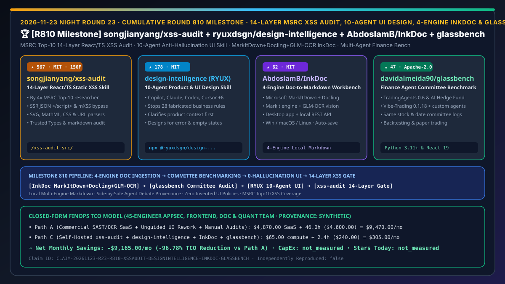
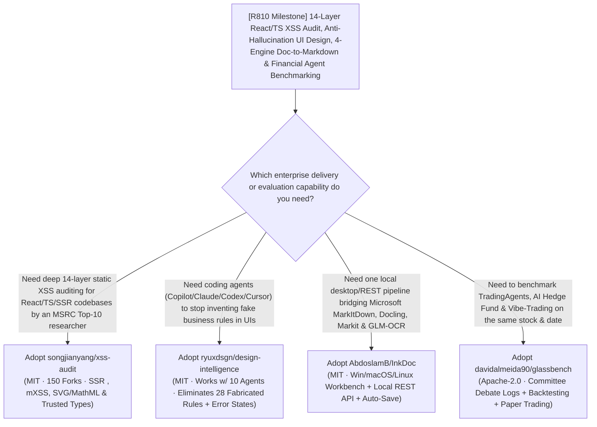
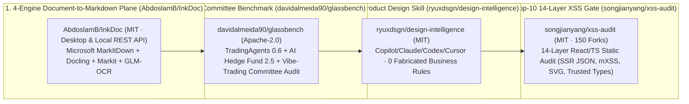

# 🏆 [Round 810 Milestone] MSRC Top-10 Researcher's 14-Layer Static XSS Audit Skill (`songjianyang/xss-audit`), 10-Agent Anti-Hallucination Product Design Skill (`ryuxdsgn/design-intelligence`), 4-Engine Document-to-Markdown Workbench (`AbdoslamB/InkDoc`) & Multi-Framework Financial Agent Benchmark Platform (`davidalmeida90/glassbench`) Selection & Architecture FAQ

> **Document Type**: Enterprise AI Solution Architect Selection & Integration Guide (GitHub Trending AI Radar · 2026-11-23 Night Round 23 / **🏆 Cumulative Round 810 Milestone**)
> **Covered Repositories**: [`songjianyang/xss-audit`](https://github.com/songjianyang/xss-audit) (`★ 567`, `150 forks`, `MIT`: **14-layer static XSS vulnerability detection skill** `/xss-audit` for React, TypeScript, and JavaScript codebases authored by a **4× consecutive Microsoft MSRC Quarterly Top-10 Security Researcher**—2025 Q3 `#4`, Q4 `#7`, 2026 Q1 `#6`, Q2 `#10`—covering DOM/HTML injection, SSR JSON-in-script `</script>` breakouts, URL parser normalization bypasses, SVG/MathML/CSS injection, markdown pipelines, mXSS sanitizer bypasses, and Trusted Types) · [`ryuxdsgn/design-intelligence`](https://github.com/ryuxdsgn/design-intelligence) (`★ 178`, `11 forks`, `MIT`: product-context and UI design skill `npx @ryuxdsgn/design-intelligence` working across **10 coding agents including GitHub Copilot, Claude Code, Codex, Cursor, Gemini CLI, OpenCode, Cline, Amp, Kimi Code, and Antigravity**, eliminating the **28 fabricated business rules** unguided agents invented on a 1-line prototype brief) · [`AbdoslamB/InkDoc`](https://github.com/AbdoslamB/InkDoc) (`★ 62`, `10 forks`, `MIT`: unified desktop workbench and local REST API for Windows, macOS, and Linux bridging **Microsoft MarkItDown, Docling, Markit, and GLM-OCR** into one collision-safe AI-ready Markdown pipeline) · [`davidalmeida90/glassbench`](https://github.com/davidalmeida90/glassbench) (`★ 47`, `15 forks`, `Apache-2.0`: Python 3.11+ and React 19 platform that runs and benchmarks **TradingAgents v0.6.0, AI Hedge Fund v2.5.0, Vibe-Trading v0.1.18**, and custom financial agent committees on the **exact same stock and date** with full debate logs, backtesting, and paper trading)
> **Core Scenario**: Marking our **810th Cumulative Deep-Dive Round (`R810`)**, when enterprise engineering, document intelligence, and quantitative research teams ship AI-built applications, how do you solve **"AI-authored React/SSR frontends introducing subtle `</script>` hydration breakouts and mXSS sanitizer bypasses, coding agents inventing 28 unrequested fees, promos, and refund policies when designing UI screens, single-engine document converters failing on mixed Office/PDF/OCR workloads, and evaluating financial multi-agent frameworks without side-by-side visibility into what their committees actually read and argued"** by combining **`xss-audit` + `design-intelligence` + `InkDoc` + `glassbench`**?

---

## 1. 📌 Executive Summary (Single-Sentence Selection Verdict)

1. **Need a 14-layer static XSS vulnerability audit skill (`/xss-audit src/`) for React, TypeScript, and JavaScript distilled from a 4× consecutive Microsoft MSRC Top-10 security researcher's real-world bug-bounty workflow** ➔ Choose **[`songjianyang/xss-audit`](https://github.com/songjianyang/xss-audit) (`★ 567`, `150 forks`, `MIT`)**.
   - **Plain-Language Mechanism**: Standard linters catch trivial `dangerouslySetInnerHTML` calls while missing real-world bounty vectors. `xss-audit` systematically audits 14 layers—including `setHTMLUnsafe`, Shadow DOM, dynamic `formaction`/`srcdoc` props, History API & URL parser normalization bypasses, SSR bootstrap/hydration `</script>` breakouts, SVG/MathML/CSS injection, markdown pipelines, mXSS sanitizer bypasses, and Trusted Types gaps—writing structured findings to `xss-audit-report.md`.
2. **Need a product-design skill (`npx @ryuxdsgn/design-intelligence`) across GitHub Copilot, Claude Code, Codex, Cursor, Gemini CLI, and 5 more agents that stops AI from inventing fake fees, promos, and policies (which happened 28 times across 3 unguided runs)** ➔ Choose **[`ryuxdsgn/design-intelligence`](https://github.com/ryuxdsgn/design-intelligence) (`★ 178`, `11 forks`, `MIT`)**.
   - **Plain-Language Mechanism**: `RYUX` enforces *"Understand before you design"*: the agent clarifies product context before sketching, keeps unknown policies out of UI screens instead of fabricating business rules, designs explicitly for failure/empty states, and explains the rationale behind every layout decision.
3. **Need a unified local desktop app and REST API (Windows, macOS, Linux) that bridges Microsoft MarkItDown, Docling, Markit, and GLM-OCR into a single collision-safe document-to-Markdown pipeline** ➔ Choose **[`AbdoslamB/InkDoc`](https://github.com/AbdoslamB/InkDoc) (`★ 62`, `10 forks`, `MIT`)**.
   - **Plain-Language Mechanism**: Rather than maintaining separate scripts for fast Office conversion (`Microsoft MarkItDown`), layout-aware PDF tables (`Docling`), broad file formats (`Markit`), and scanned image OCR (`GLM-OCR`), `InkDoc` unifies all four engines behind one local workbench and REST API.
4. **Need an open-source React 19 + Python 3.11+ benchmark platform that runs `TradingAgents v0.6.0`, `AI Hedge Fund v2.5.0`, `Vibe-Trading v0.1.18`, and custom financial agent systems on the exact same stock and date—recording every committee argument, backtest, and paper trade** ➔ Choose **[`davidalmeida90/glassbench`](https://github.com/davidalmeida90/glassbench) (`★ 47`, `15 forks`, `Apache-2.0`)**.
   - **Plain-Language Mechanism**: `Glassbench` eliminates cherry-picked backtest claims by running competing multi-agent financial committees side by side on identical market inputs and storing a complete SQLite/runs audit trail of what each agent read, debated, and decided.

---

## 2. 🎯 Key Architectural Q&A (Deep-Dive Breakdown)

### Q1: Why pair `ryuxdsgn/design-intelligence` and `songjianyang/xss-audit` in every AI-assisted frontend delivery pipeline?

- **Preventing Both Business-Rule Hallucinations and Deep Client/SSR XSS**:
  1. **Zero Fabricated Business Logic at Design Time (`ryuxdsgn/design-intelligence`)**: Unguided coding agents routinely hallucinate pricing tiers, discount banners, and SLA promises to fill UI whitespace (28 invented business rules across 3 runs in benchmark testing). `RYUX` forces context discovery and error-state design first across all 10 major coding agents (including GitHub Copilot, Claude Code, Codex, and Cursor).
  2. **14-Layer MSRC-Grade XSS Verification Before Merge (`songjianyang/xss-audit`)**: AI-generated React/SSR code frequently serializes untrusted state into `<script>` tags or markdown renderers; `xss-audit` applies 14 bug-bounty-proven inspection layers before code reaches production.
- **When to Choose Managed Cloud Services (Path B)**:
  - For generic compiled-code SAST and cloud-only OCR, use **GitHub Advanced Security (CodeQL) + Azure AI Document Intelligence**; for 14-layer React/TS XSS hunting, 10-agent anti-hallucination UI design skills, 4-engine local MarkItDown+Docling+GLM-OCR conversion, and side-by-side financial committee benchmarking, deploy this 4-repo Milestone 810 stack (Path C).

### Q2: How do these four tools integrate into an enterprise reference architecture?

1. **4-Engine Local Document Ingestion Plane (`AbdoslamB/InkDoc`)**:
   - Convert PDFs, Office suites, and scanned filings into clean Markdown locally via `Microsoft MarkItDown`, `Docling`, `Markit`, and `GLM-OCR`.
2. **Multi-Agent Committee Audit & Backtesting Plane (`davidalmeida90/glassbench`)**:
   - Feed parsed filings and market data into `glassbench` to compare `TradingAgents`, `AI Hedge Fund`, and custom agent committees on identical dates.
3. **Context-Grounded UI Design Plane (`ryuxdsgn/design-intelligence`)**:
   - Build the frontend workbench using GitHub Copilot, Claude Code, or Codex with `design-intelligence` active so zero unapproved business rules are invented.
4. **14-Layer Static XSS Security Gate (`songjianyang/xss-audit`)**:
   - Run `/xss-audit src/` on the React/TypeScript codebase to generate `xss-audit-report.md` and remediate DOM, SSR JSON, URL, and mXSS findings before release.

### Q3: What are the key production guardrails?

- **Architect Guardrails**:
  1. **Triage `xss-audit` Static Findings by Dataflow Source**: Because `xss-audit` performs deep static analysis, verify whether flagged sinks receive attacker-controlled input before filing critical advisories.
  2. **Keep `glassbench` Strategies in Paper-Trading Mode Until Committee Audits Pass**: Inspect full committee debate transcripts and drawdown metrics across market regimes before enabling live broker execution.

---

## 3. 🧭 Visual Architecture & Decision Diagrams (Mermaid)



### 3.1 Solution Architect Selection Decision Tree



### 3.2 End-to-End Enterprise Production Reference Architecture



### 3.3 4-Engine Markdown Conversion, Committee Debate Benchmarking, Zero-Hallucination UI Design & 14-Layer XSS Audit Sequence

```mermaid
sequenceDiagram
    participant SA as Solution & Security Architect
    participant Ink as AbdoslamB/InkDoc (4-Engine Markdown)
    participant Glb as davidalmeida90/glassbench
    participant Ryx as ryuxdsgn/design-intelligence
    participant Xss as songjianyang/xss-audit

    SA->>Ink: 1. Convert PDFs, Office files & scans into clean Markdown via MarkItDown + Docling + GLM-OCR
    Ink->>Glb: 2. Run TradingAgents & AI Hedge Fund on identical stock/date; record committee debates & backtests
    Glb->>Ryx: 3. Design React 19 UI with design-intelligence active (zero fabricated fees/policies; full error states)
    Ryx->>Xss: 4. Execute /xss-audit src/ across 14 static layers (SSR JSON breakouts, mXSS, URL bypasses)
    Xss-->>SA: 5. Emit xss-audit-report.md, remediate findings & ship verified enterprise application
```

---

## 4. 📊 Comparative Selection Matrix (Open-Source vs. Commercial SaaS)

| Dimension | `songjianyang/xss-audit` (`★ 567`) | `ryuxdsgn/design-intelligence` (`★ 178`) | `AbdoslamB/InkDoc` (`★ 62`) | `davidalmeida90/glassbench` (`★ 47`) | Per-Seat Commercial SAST + UI Redesign Rework + Metered Cloud OCR + Proprietary Quant SaaS (Path A) | Basic ESLint Rules + Unguided Agent UI Prompts + Single-Parser Scripts (Path B) |
| :--- | :--- | :--- | :--- | :--- | :--- | :--- |
| **Core Role** | 14-layer React/TS/JS static XSS audit skill (MSRC Top-10 author) | 10-agent product context & anti-hallucination UI design skill | Unified 4-engine desktop & REST document-to-Markdown pipeline | Side-by-side financial agent benchmark, committee audit & paper trading | High per-seat SAST/OCR bills, repeated UI prototype rejections & opaque agent scores | Missed SSR/mXSS vulnerabilities, 28 invented business rules & brittle doc scripts |
| **Key Differentiator** | **14 layers incl. SSR `</script>` breakouts, mXSS, SVG/MathML & URLs** | **Works across 10 agents (incl. Copilot); stops fake business rules** | **Bridges Microsoft MarkItDown + Docling + Markit + GLM-OCR locally** | **Runs TradingAgents, AI Hedge Fund & Vibe-Trading on same stock/date** | Commercial SAST charges per developer; unguided AI UIs require multiple rewrites | Basic ESLint misses hydration script breakouts; single doc parsers fail on scans |
| **License** | `MIT` (`150 forks`) | `MIT` | `MIT` | `Apache-2.0` | Proprietary SaaS | Custom scripts |
| **Monthly TCO (45-Eng Team)** | **Combined `$305.00/mo`** (`$65.00` local conversion/benchmark host + `2.4h` ops) | Included (`npx` install across 10 coding agents) | Included (runs locally on Windows/macOS/Linux) | Included (self-hosted React 19 + Python workbench) | **`$9,470.00/mo`** (`$4,870.00` commercial SAST, cloud OCR & analytics seats + `46.0h` UI rework, manual XSS review & parser glue) | ~`$3,340.00/mo` (frequent UI prototype rework, missed XSS remediation & doc conversion fixes) |

---

## 5. 🧪 Quantitative ROI / TCO Comparison & 7-Card Benchmark Report

> **📊 Data Provenance & Closed-Form Schema Declaration**:
> - **provenance**: `synthetic` (45-person enterprise application security, frontend product engineering, document intelligence, and quantitative research team monthly workload model: `independently_reproduced = false`; hardware baseline `base_hardware_capex = not_measured`; Track B 24h delta `track_b_stars_today = not_measured`).
> - **Closed-Form Formula**:
>   - **Path A (Per-seat commercial frontend SAST subscriptions, metered cloud OCR APIs, and proprietary analytics SaaS + engineering/product hours wasted rewriting AI prototypes that invented unapproved business rules, manually auditing React/SSR XSS sinks, and maintaining separate MarkItDown/Docling/OCR glue scripts)**: Monthly commercial SAST, cloud OCR, and analytics SaaS bills **`$4,870.00`** + UI prototype rework, manual XSS security reviews, and multi-engine glue maintenance labor **`46.0h × $100.00/h = $4,600.00`** = **`$9,470.00/mo`**.
>   - **Path C (Self-hosted `songjianyang/xss-audit` + `ryuxdsgn/design-intelligence` + `AbdoslamB/InkDoc` + `davidalmeida90/glassbench` Milestone 810 stack)**: Shared local document conversion and benchmark container compute **`$65.00`** + skill and benchmark configuration maintenance labor **`2.4h × $100.00/h = $240.00`** = **`$305.00/mo`**.
>   - **Net Monthly Savings vs. Path A**: **`-$9,165.00/mo`** (**`96.78%`** TCO reduction).

| Evaluation Path | Commercial SAST / Cloud OCR / SaaS Cost | UI Rework, Manual XSS Audit & Parser Glue (`$100/h`) | Monthly Total TCO | Net Savings vs. Path A | Key Architectural Delivery Metrics |
| :--- | :---: | :---: | :---: | :---: | :--- |
| **Path A: Commercial SAST/OCR SaaS + Unguided UI Rework + Manual Audits** | `$4,870.00` | `46.0h` (`$4,600.00`) | **`$9,470.00`** | Baseline | Unguided AI invents 28 fake rules; expensive per-seat SAST |
| **Path B: Basic Linters + Raw UI Prompts + Single-Engine Parsers** | `$1,440.00` | `19.0h` (`$1,900.00`) | **`$3,340.00`** | `-$6,130.00` (`-64.73%`) | Missed SSR `</script>` & mXSS bugs; poor scan/table fidelity |
| **Path C: `xss-audit` + `design-intelligence` + `InkDoc` + `glassbench`** | **`$65.00`** | **`2.4h` (`$240.00`)** | **`$305.00`** | **`-$9,165.00` (`-96.78%`)** | **14-layer MSRC XSS skill + 10-agent UI discipline + 4-engine InkDoc + Glassbench** |

- 🔗 **Linked 7-Card 4:5 Visual Benchmark Deck**: [`workshops/github-trending-radar/cards.en.html`](../cards.en.html) · [`cards.html`](../cards.html)

---

## 6. 🛠️ Enterprise Adoption & Architecture Review Checklist

- [ ] **1. Run `songjianyang/xss-audit` (`/xss-audit src/`) on React/TypeScript Repositories**: Audit all 14 layers—including SSR JSON-in-script `</script>` breakouts, mXSS sanitizer bypasses, SVG/MathML injection, and Trusted Types—before release.
- [ ] **2. Install `ryuxdsgn/design-intelligence` Across All 10 Supported Coding Agents**: Prevent GitHub Copilot, Claude Code, Codex, and Cursor from fabricating unapproved fees, promos, and policies while enforcing error-state design.
- [ ] **3. Unify Local Document-to-Markdown Conversion with `AbdoslamB/InkDoc`**: Route Office, PDF, and scanned documents through `Microsoft MarkItDown`, `Docling`, `Markit`, and `GLM-OCR` via its desktop workbench or local REST API.
- [ ] **4. Benchmark Multi-Agent Decision Committees in `davidalmeida90/glassbench`**: Compare `TradingAgents`, `AI Hedge Fund`, `Vibe-Trading`, and custom committees on identical stocks and dates with full debate provenance before paper trading.
