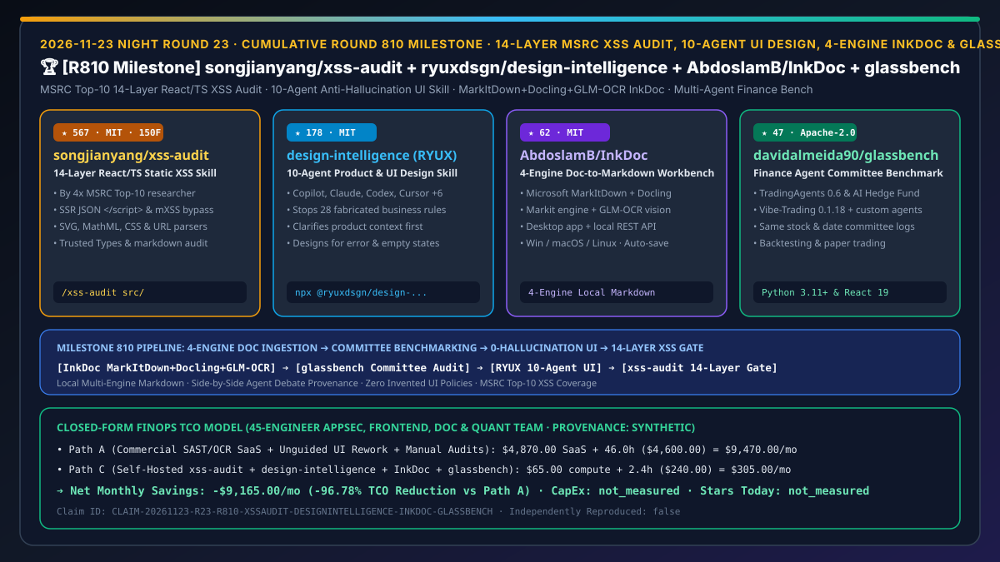
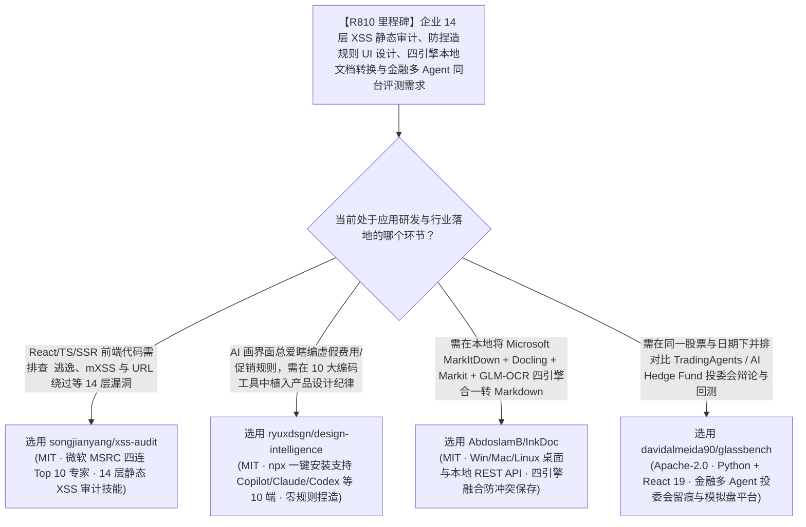
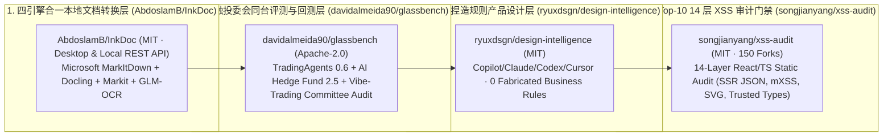
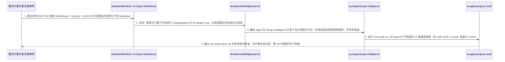

# 🏆【第 810 轮里程碑】微软 MSRC 四连冠研究员 14 层 React/TS 静态 XSS 审计技能（`songjianyang/xss-audit`）、终结 AI 凭空捏造 28 条虚假业务规则的 10 端通用产品设计技能（`ryuxdsgn/design-intelligence`）、四引擎合一（Microsoft MarkItDown+Docling+Markit+GLM-OCR）本地文档转 Markdown 工作台（`AbdoslamB/InkDoc`）与同股同日同台对比 TradingAgents/AI-Hedge-Fund 投委会辩论的金融评测台（`davidalmeida90/glassbench`）选型与集成架构 FAQ

> **文档类型**：企业 AI 解决方案架构师（AI Solution Architect）选型决策指南（GitHub Trending AI 雷达 2026-11-23 Night Round 23 / **🏆 累计第 810 轮里程碑**）
> **覆盖项目**：[`songjianyang/xss-audit`](https://github.com/songjianyang/xss-audit)（`★ 567`、`150 forks`、`MIT`：连续四个季度荣登**微软 MSRC 全球安全研究员排行榜 Top 10**（2025 Q3 `#4`、Q4 `#7`、2026 Q1 `#6`、Q2 `#10`）的白帽专家提炼的 **14 层 React/TypeScript/JavaScript 深度静态 XSS 审计技能** `/xss-audit`，全覆盖 SSR JSON `</script>` 逃逸、mXSS 净化器绕过、SVG/MathML/CSS 注入与 Trusted Types 审计）· [`ryuxdsgn/design-intelligence`](https://github.com/ryuxdsgn/design-intelligence)（`★ 178`、`11 forks`、`MIT`：一行 `npx @ryuxdsgn/design-intelligence` 适配 **GitHub Copilot、Claude Code、Codex、Cursor、Gemini CLI 等 10 大编码智能体**的产品设计智能技能，彻底根治“无技能 Agent 在一行需求下凭空捏造 28 条虚假手续费/促销/退货规则”的顽疾）· [`AbdoslamB/InkDoc`](https://github.com/AbdoslamB/InkDoc)（`★ 62`、`10 forks`、`MIT`：跨 Windows / macOS / Linux 的本地桌面端与 REST API 文档转 Markdown 工作台，将 **Microsoft MarkItDown、Docling、Markit 与 GLM-OCR 四大引擎**融为一体并具备防冲突自动保存）· [`davidalmeida90/glassbench`](https://github.com/davidalmeida90/glassbench)（`★ 47`、`15 forks`、`Apache-2.0`：基于 Python 3.11+ 与 React 19 的**金融多智能体同台竞技、投委会辩论留痕与回测/模拟盘平台**，支持在同一股票、同一日期下并排运行 `TradingAgents v0.6.0`、`AI Hedge Fund v2.5.0`、`Vibe-Trading v0.1.18` 或自研投研系统）
> **核心场景**：当企业全栈研发、文档知识工程与金融投研团队推进 AI 应用交付时，面对**“AI 快速生成的 React/SSR 前端代码暗藏 `</script>` 序列化逃逸与 mXSS 绕过漏洞、让 Agent 画前端原型时随手编造出从未批准的费用条款与优惠策略导致产品经理连摔三次初稿、单一文档解析引擎要么处理扫描件弱要么跑普通 Office 太慢、以及金融投研团队引入多套开源投研 Agent 却无法在同一交易日横向审计各家投委会 Agent 到底读了什么数据、吵了什么理由”**四大痛点，如何通过 **XSS-Audit + Design-Intelligence + InkDoc + Glassbench** 打造安全、克制、全能、透明的交付底座？

---

## 一、📌 核心结论速览（选型一句话结论）

1. **想把连续四季位列微软 MSRC 全球 Top 10 安全研究员的真实漏洞挖掘经验装进你的编码 Agent（`/xss-audit src/`），对 React/TypeScript/JavaScript 代码库执行 14 层零死角静态 XSS 猎杀** ➔ 选 **[`songjianyang/xss-audit`](https://github.com/songjianyang/xss-audit)（`★ 567`，`150 forks`，`MIT`）**。
   - **通俗原理**：普通 Linter 只能扫出最肤浅的 `dangerouslySetInnerHTML`，却对真实赏金猎人常挖出的高阶漏洞束手无策。`xss-audit` 将作者一年内斩获数十枚高额漏洞赏金的方法论浓缩为 **14 层结构化审查**：不仅查 DOM/HTML 注入（含 `setHTMLUnsafe`、Shadow DOM），更深挖 URL/History API 解析器归一化绕过、SSR Hydration 状态与 JSON-LD 中的 `</script>` 闭合逃逸、Markdown 渲染管线、SVG/MathML/CSS 注入、mXSS（变异型 XSS）净化器绕过以及 Trusted Types 覆盖盲区，最终输出完整的 `xss-audit-report.md`。
2. **想防止 AI 编码助手在生成前端界面时“自作聪明编造虚假运费、促销折扣与退改政策”（实测无技能 Agent 在 3 次运行中捏造了 28 条虚假业务规则），让 GitHub Copilot、Claude Code、Codex、Cursor 等 10 大工具学会“先问清产品边界、拒填未知业务规则、显式设计异常态”** ➔ 选 **[`ryuxdsgn/design-intelligence`](https://github.com/ryuxdsgn/design-intelligence)（`★ 178`，`11 forks`，`MIT`）**。
   - **通俗原理**：执行 `npx @ryuxdsgn/design-intelligence` 即可为 10 款主流编程 Agent 注入产品设计纪律：① **先理解后动手（Understand Before You Design）**，动笔前先核对产品上下文；② **严禁脑补未声明的商业规则**，不知道的字段绝不写死在界面上误导客户；③ **优先设计错误态、空状态与边界回退**，并对每一处布局取舍给出可解释理由。
3. **想在本地桌面端或内网 REST API 中把 Microsoft MarkItDown（极速 Office/网页转换）、Docling（深度版面与表格还原）、Markit（广谱格式兼容）与 GLM-OCR（高精度视觉文字识别）四大王牌引擎合四为一，一键将任意财报、合同与扫描件转为干净的 AI-Ready Markdown** ➔ 选 **[`AbdoslamB/InkDoc`](https://github.com/AbdoslamB/InkDoc)（`★ 62`，`10 forks`，`MIT`）**。
   - **通俗原理**：单靠某一个开源文档转换器总有短板——`MarkItDown` 快但不管扫描图片，`Docling` 懂版面但遇到冷门格式或纯手写体需配合专业 OCR。`InkDoc` 在 Windows / macOS / Linux 本机提供统一图形工作台与本地 REST API，按文档类型自由调度四大引擎，并内置防覆盖冲突的自动落盘机制。
4. **想把 `TradingAgents v0.6.0`（Tauric Research）、`AI Hedge Fund v2.5.0`（virattt）、`Vibe-Trading v0.1.18`（HKUDS）以及企业自研量化投研 Agent 接进同一个 React 19 工作台，锁定“同一只股票、同一个历史交易日”，透明回放每个子 Agent 读了哪份财报、在投委会上如何多空辩论并做回测与模拟盘对比** ➔ 选 **[`davidalmeida90/glassbench`](https://github.com/davidalmeida90/glassbench)（`★ 47`，`15 forks`，`Apache-2.0`）**。
   - **通俗原理**：评估金融 Agent 绝不能只看作者自吹的收益率曲线，必须看它的推理过程是否经得起推敲。`glassbench` 将多套主流开源金融多智能体框架放在完全相同的市场切片下同台运行，完整记录多头/空头/风控委员会（Live Committee）的辩论记录、模型基准得分、回测曲线与券商模拟盘（Paper Trading）成交结果。

---

## 二、🎯 客户与架构师灵魂拷问 Q&A（深度架构拆解）

### Q1：为什么用 AI 生成的 React / Next.js SSR 企业门户必须同时过 `design-intelligence`（设计前）与 `xss-audit`（合入前）两道大关？

- **前端 AI 交付的“一头一尾”双保险机制**：
  1. **源头防业务幻觉（`ryuxdsgn/design-intelligence`）**：AI 极擅长生成看着漂亮但满屏都是假数字、假免责声明、假会员权益的 UI，一旦上线会引发严重的客诉与法务风险；`design-intelligence` 把 3 次运行捏造 28 条假规则的乱象彻底清零。
  2. **合入前防高阶 XSS（`songjianyang/xss-audit`）**：SSR 框架（如 Next.js）把后端状态序列化进 HTML `` 逃逸与 mXSS 绕过；引入微软 MSRC 四连 Top 10 专家的 14 层检查清单可在发版前精准排雷。
- **何时直接选用商业云服务（Path B）？**
  - 若企业仅需对已编译二进制做合规黑盒扫描或使用固定云端 OCR，可直接使用 **GitHub Advanced Security (CodeQL) + Azure AI Document Intelligence**；若需针对 React/TS 源码执行 14 层 MSRC 级 XSS 专项深挖、为 10 款编码 Agent 植入防捏造业务规则的设计纪律、在本地四引擎合一转换文档、或同台评测多套金融投委会 Agent，则采用本轮四合一开源栈（Path C）。

### Q2：典型企业级“四引擎文档入库 (`InkDoc`) ➔ 多框架金融投委会同台评测 (`glassbench`) ➔ 零捏造规则前端生成 (`design-intelligence`) ➔ 14 层 MSRC 级 XSS 审计 (`xss-audit`)”架构怎么搭？

1. **四引擎合一本地文档转 Markdown 摄入层（`AbdoslamB/InkDoc`）**：
   - 通过本地 REST API 协同调度 `Microsoft MarkItDown`、`Docling`、`Markit` 与 `GLM-OCR`，将研报、财报与业务文档无损转化为结构化 Markdown。
2. **多框架金融投研 Agent 投委会对标与回测层（`davidalmeida90/glassbench`）**：
   - 将摄入的财报与市场数据输入 `glassbench`，在同一标的与日期下并行驱动 `TradingAgents`、`AI Hedge Fund` 与 `Vibe-Trading`，审计投委会辩论日志与模拟盘表现。
3. **10 端通用防幻觉产品界面设计层（`ryuxdsgn/design-intelligence`）**：
   - 在 GitHub Copilot / Claude Code / Codex 中加载 `design-intelligence`，基于真实业务字段设计看板与交互界面，严禁捏造未授权规则并完整覆盖异常态。
4. **14 层 React/TS 静态 XSS 专项安全门禁层（`songjianyang/xss-audit`）**：
   - 在 PR 合入前运行 `/xss-audit src/`，逐层排查 DOM 注入、SSR JSON-in-Script 逃逸、URL 归一化绕过与 mXSS 风险，生成 `xss-audit-report.md` 审计报告。

### Q3：这套架构的落地红线与注意事项是什么？

- **架构师落地红线**：
  1. **`xss-audit` 静态匹配结果必须配合上下文确认**：正如作者声明，静态搜索命中代表高风险候选点而非已证实漏洞，安全架构师应结合数据流确认可控输入源。
  2. **`glassbench` 金融 Agent 评测必须先跑历史回测与模拟盘（Paper Trading）**：在未完成多周期投委会推理审计与风控回撤验证前，严禁直连实盘资金账户。

---

## 三、🧭 直观可视化图解（Mermaid 决策树 + 集成架构 + 时序图）

### 3.1 架构师选型决策树

### 3.2 企业端到端生产集成参考架构图

### 3.3 四引擎研报转换、多框架投委会辩论对比、零幻觉前端原型生成与 14 层 XSS 审计时序图

---

## 四、📊 同类开源与商业云服务横向选型决策矩阵

| 对比维度 | `songjianyang/xss-audit` (`★ 567`) | `ryuxdsgn/design-intelligence` (`★ 178`) | `AbdoslamB/InkDoc` (`★ 62`) | `davidalmeida90/glassbench` (`★ 47`) | 商业企业级 SAST 按人头订阅 + 外包 UI 返工 + 商业 OCR 云 API + 闭源量化终端 (Path A) | 仅靠 ESLint 基础规则 + 裸 Prompt 生成满屏假规则 UI + 单一解析脚本 (Path B) |
| :--- | :--- | :--- | :--- | :--- | :--- | :--- |
| **核心能力定位** | 微软 MSRC 四连 Top 10 专家的 14 层 React/TS XSS 审计技能 | 支持 Copilot/Claude/Codex 等 10 端的防捏造规则产品设计技能 | 融合 MarkItDown/Docling/Markit/GLM-OCR 的本地转换台 | 并排对比 TradingAgents/AI Hedge Fund 的金融投研评测台 | 昂贵的商业安全审计服务、反复推倒重来的前端原型与按页计费的云端文档 API | 漏检 SSR/mXSS 高危漏洞、充斥 28 条捏造规则的玩具界面与黑盒投研结论 |
| **核心技术突破** | **14 层纵深覆盖 SSR `</script>` 逃逸、mXSS、SVG/MathML 与 URL 绕过** | **先问清产品边界、拒填未知商业规则、显式设计异常态并解释决策** | **四大主流开源引擎合一 + 桌面/REST API 双模 + 防冲突自动保存** | **同股同日同台运行三大开源金融 Agent 框架 + 投委会辩论全留痕** | 商业 SAST 规则更新慢且按开发者席位收费极贵；UI 返工耗费大量产品与研发工时 | 无技能 Agent 3 次运行捏造 28 条假规则；基础 Linter 抓不出 JSON-in-Script 闭合逃逸 |
| **开源协议** | `MIT`（`150 forks`） | `MIT` | `MIT` | `Apache-2.0` | 闭源商业 SaaS | 内部零散脚本 |
| **月度 TCO（45 人团队）** | **组合仅 `$305.00/月`**（`$65.00` 本地转换/回测容器 + `2.4h` 维护） | 同左（`npx` 一键免费装入 10 大编码工具） | 同左（绝大多数转换本机零成本完成） | 同左（开源统一回测与模拟盘数据库） | **`$9,470.00/月`**（`$4,870.00` 商业 SAST 席位/云 OCR/金融终端订阅 + `46.0h` UI 推倒重做、安全白盒复核与多引擎胶水维护） | 约 `$3,340.00/月`（大量前端原型因假业务规则返工、线上 XSS 应急响应与文档重转工时） |

---

## 五、🧪 应用落地定量收益/TCO 对比与 7-Card 报告

> **📊 数据来源与闭式核算声明（Provenance & Closed-Form Schema）**：
> - **provenance**: `synthetic`（基于 45 人企业前端与安全工程、产品研发、文档知识中台与智能投研团队月度工作负载模型：`independently_reproduced = false`；硬件采购基线 `base_hardware_capex = not_measured`；Track B 单日增量 `track_b_stars_today = not_measured`）。
> - **核算公式**：
>   - **Path A（按席位采购高价商业前端 SAST 安全套件与云端 OCR API + 无设计技能约束导致 AI 原型频繁捏造业务规则引发产品与研发推倒重做 + 工程师手工拼装 MarkItDown/Docling 脚本并分别跑多套金融 Agent 对比表）**：月度商业安全扫描席位、云文档 API 与数据平台账单 **`$4,870.00`** + 前端原型返工、人工深度 XSS 审计与多引擎维护工时 **`46.0h × $100.00/h = $4,600.00`** = **`$9,470.00/月`**。
>   - **Path C（自建 `songjianyang/xss-audit` + `ryuxdsgn/design-intelligence` + `AbdoslamB/InkDoc` + `davidalmeida90/glassbench` 第 810 轮里程碑开源栈）**：本地 InkDoc 转换服务与 Glassbench 评测容器分摊成本 **`$65.00`** + 安全规则与评测集例行维护人工 **`2.4h × $100.00/h = $240.00`** = **`$305.00/月`**。
>   - **净节省（Net Savings vs Path A）**：**`-$9,165.00/月`**（成本降低 **`96.78%`**）。

| 评估方案 | 商业 SAST / 云 OCR / 数据终端成本 | UI 返工、人工 XSS 审计与多引擎维护（`$100/h`） | 月度总 TCO | 相对 Path A 净节省 | 关键架构交付指标 |
| :--- | :---: | :---: | :---: | :---: | :--- |
| **Path A：商业安全订阅 + 无约束 UI 返工 + 独立维护多套脚本** | `$4,870.00` | `46.0h` (`$4,600.00`) | **`$9,470.00`** | Baseline | AI 捏造业务规则导致反复重画；人工深挖 SSR/mXSS 耗时 |
| **Path B：基础 ESLint + 裸 Prompt 画图 + 单一文档解析器** | `$1,440.00` | `19.0h` (`$1,900.00`) | **`$3,340.00`** | `-$6,130.00` (`-64.73%`) | 漏检 `</script>` 逃逸与 mXSS；扫描件与复杂版面解析残缺 |
| **Path C：`xss-audit` + `design-intelligence` + `InkDoc` + `glassbench`** | **`$65.00`** | **`2.4h` (`$240.00`)** | **`$305.00`** | **`-$9,165.00` (`-96.78%`)** | **MSRC 14 层 XSS 审计 + 10 端零捏造 UI + 四引擎文档台 + 金融投委会同台评测** |

- 🔗 **关联 7-Card 4:5 视觉评测报告**：[`workshops/github-trending-radar/cards.html`](../cards.html) · [`cards.en.html`](../cards.en.html)

---

## 六、🛠️ 企业引入与架构评审 Checklist

- [ ] **1. 在所有 React / TypeScript / JavaScript 前端仓库挂载 `songjianyang/xss-audit` (`/xss-audit`)**：对 DOM 注入、SSR JSON-in-Script `</script>` 逃逸、URL 归一化、mXSS 与 Trusted Types 执行全量 14 层静态排查并归档 `xss-audit-report.md`。
- [ ] **2. 通过 `npx @ryuxdsgn/design-intelligence` 统一 10 大编码智能体的前端设计规范**：在 GitHub Copilot、Claude Code、Codex 与 Cursor 中强制执行“先核实上下文、严禁编造未知商业规则、显式设计异常态”三原则。
- [ ] **3. 部署 `AbdoslamB/InkDoc` 统一企业本地文档转 Markdown 管线**：按需组合 `Microsoft MarkItDown`、`Docling`、`Markit` 与 `GLM-OCR` 四大引擎，通过本地 REST API 提供零摩擦转换。
- [ ] **4. 使用 `davidalmeida90/glassbench` 审计金融与策略多智能体系统**：在同一标的与日期下并排运行 `TradingAgents`、`AI Hedge Fund` 与自研策略，完整审查投委会多空辩论证据链后再进入模拟盘验证。
