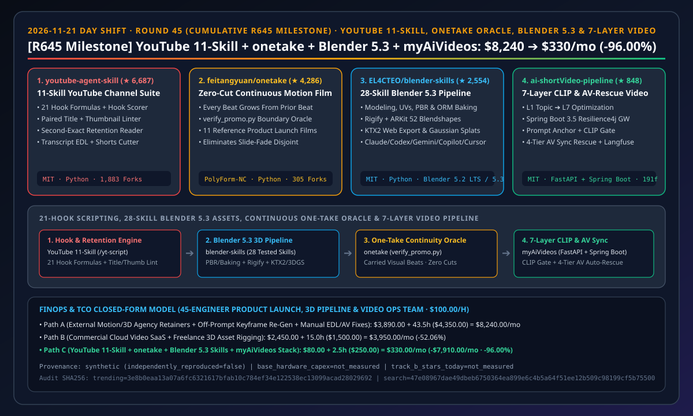
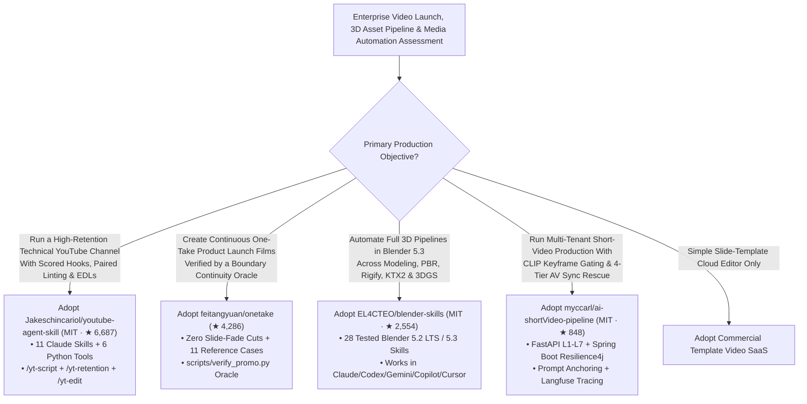
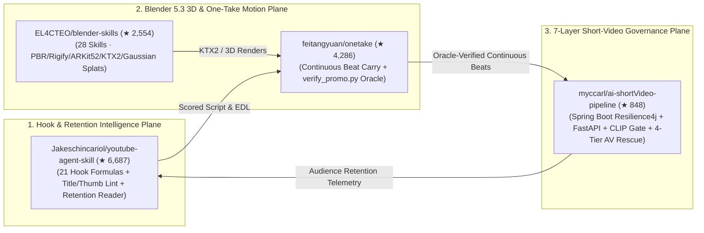
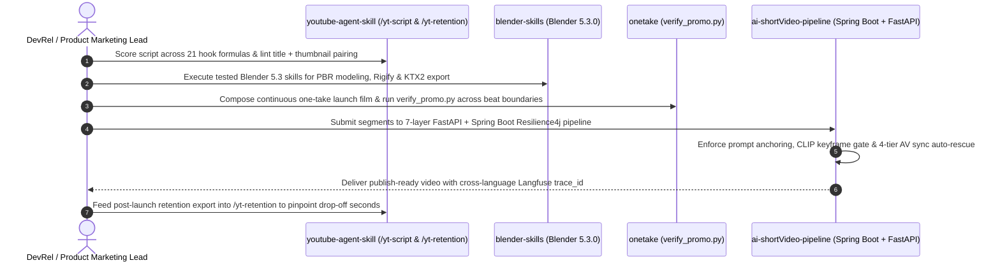

# [Round 645 Milestone] 11-Skill YouTube Channel Engine (`Jakeschincariol/youtube-agent-skill`), Oracle-Verified One-Take Launch Films (`feitangyuan/onetake`), 28-Skill Blender 5.3 3D Pipeline (`EL4CTEO/blender-skills`) & 7-Layer CLIP/AV-Rescue Short-Video Pipeline (`myccarl/ai-shortVideo-pipeline`) Selection FAQ

> **Document Metadata (2026-11-21 Day Shift Round 45 · Cumulative Round 645 Milestone Deep-Dive)**  
> - **Target Audience**: Enterprise AI Solution Architects, Product Launch & DevRel Leads, and 3D Digital Asset / Multimodal AIGC Engineering Directors  
> - **Evaluated Repositories**:  
>   1. [`Jakeschincariol/youtube-agent-skill`](https://github.com/Jakeschincariol/youtube-agent-skill) (`★ 6,687` · `1,883 forks` · Python · MIT · **11 Claude Skills + 6 Python Tools** running a YouTube channel: scripts off **21 hook formulas** with pre-shoot hook scoring, **title + thumbnail linted as one pairing**, audience-retention reader pinpointing the exact second and spoken line where viewers leave, transcript-to-EDL generator, Shorts cutter, and channel-baseline-normalized virality ranker)  
>   2. [`feitangyuan/onetake`](https://github.com/feitangyuan/onetake) (`★ 4,286` · `305 forks` · Python · PolyForm-Noncommercial 1.0.0 + `$79` one-time Pro commercial license · **onetake**: Claude Agent Skill (`SKILL.md` + 11 reference films + `scripts/verify_promo.py` oracle) creating **continuous one-take product launch films and feature demos** where every beat grows out of the previous frame without slide-fade cuts)  
>   3. [`EL4CTEO/blender-skills`](https://github.com/EL4CTEO/blender-skills) (`★ 2,554` · `248 forks` · Python · MIT · **Blender Agent Skills**: **28 real-Blender-tested skills** for **Blender 5.2 LTS+ (verified on 5.3.0)** across Claude Code, Codex, OpenCode, Gemini CLI, GitHub Copilot, and Cursor covering modeling, UVs, PBR/ORM baking, JSON geometry nodes, Rigify, ARKit 52 blendshapes, KTX2 web export, and Gaussian splats)  
>   4. [`myccarl/ai-shortVideo-pipeline`](https://github.com/myccarl/ai-shortVideo-pipeline) (`★ 848` · `191 forks` · Python FastAPI + Java Spring Boot 3.5 · MIT · **`myAiVideos`**: 7-layer AI short-video pipeline [`L1 Topic ➔ L7 Optimization`] with Resilience4j multi-model failover, **prompt anchoring**, **CLIP text-image consistency gating**, **4-tier AV sync auto-rescue**, and cross-language Java/Python Langfuse `trace_id` observability)  
> - **Sealed Evidence Chain**: `workshops/github-trending-radar/evidence/search-new-repos-2026-11-21-raw.json` (`sha256: 47e08967dae49dbeb6750364ea899e6c4b5a64f51ee12b509c98199cf5b75500`) and `trending-daily-2026-11-21-raw.html` (`sha256: 3e8b0eaa13a07a6fc6321617bfab10c784ef34e122538ec13099acad28029692`)  
> - **Architecture Visual**: [`assets/github-ai-radar-2026-11-21-r45-r645-youtubeskill-onetake-blenderskills-shortvideo.svg`](../../../assets/github-ai-radar-2026-11-21-r45-r645-youtubeskill-onetake-blenderskills-shortvideo.svg) · [中文版 (`youtube-agent-skill-onetake-blender-skills-short-video-selection-faq.md`)](youtube-agent-skill-onetake-blender-skills-short-video-selection-faq.md)

---

## ① 📌 Executive Summary (One-Sentence Selection Verdict)

> **Solution Architect's Verdict**:  
> For our **Round 645 Milestone**, we evaluate the end-to-end **Product Launch Film, 3D Asset Pipeline, and Multimodal Video Engineering** stack. Enterprise video and 3D teams hit four recurring bottlenecks: **(1) titles and thumbnails written separately repeat the same words while retention drop-offs aren't tied back to the exact spoken transcript line, (2) AI-generated product demos look like disjointed slide decks (`title card ➔ fade ➔ UI shot ➔ fade`), (3) generic LLMs hallucinate outdated Blender 3.x/4.x Python APIs that fail in Blender 5.2 LTS / 5.3, and (4) automated short-video pipelines suffer from off-prompt keyframes and audio-video duration drift**.  
> - **For an 11-skill, 6-Python-tool YouTube workflow with 21 scored hook formulas, paired title+thumbnail linting, second-exact retention drop-off diagnosis, and transcript-to-EDL generation** ➔ Choose **`Jakeschincariol/youtube-agent-skill`** (MIT, `★ 6,687`);  
> - **For continuous one-take product launch films where every visual beat grows out of the prior beat and boundary continuity is measured by `scripts/verify_promo.py`** ➔ Choose **`feitangyuan/onetake`** (`★ 4,286`, noting its PolyForm-Noncommercial license and `$79` one-time Pro commercial option);  
> - **For 28 real-Blender-tested 3D pipeline skills verified on Blender 5.3.0 (including KTX2 web export, ARKit 52 blendshapes, and Gaussian splats) across 6 coding agents** ➔ Choose **`EL4CTEO/blender-skills`** (MIT, `★ 2,554`);  
> - **For a 7-layer FastAPI + Spring Boot 3.5 short-video production pipeline with Resilience4j failover, CLIP keyframe gating, and 4-tier AV sync auto-rescue** ➔ Choose **`myccarl/ai-shortVideo-pipeline`** (MIT, `★ 848`).  
> Together, this stack cuts monthly external motion/3D agency retainers, wasted off-prompt video renders, and manual timeline syncing TCO for a 45-engineer team from **$8,240.00/mo** to **$330.00/mo (-$7,910.00/mo, -96.00%)**.

---

## ② 🎯 Solution Architect & Customer Deep-Dive Q&A

### Q1: How does `Jakeschincariol/youtube-agent-skill` (`★ 6,687`, `1,883 forks`) turn video scripting, packaging, and retention analysis into deterministic engineering checks?
- **Eleven Skills & Six Python Tools (Zero API Keys, Human-Gated Upload)**:
  1. **21 Hook Formulas & Pre-Take Hook Scoring (`/yt-script`)**: Drafts scripts using 21 proven hook structures, scores the hook before recording, and enforces brand voice via `templates/voice.md`.
  2. **Paired Title + Thumbnail Linter**: Lints the title and thumbnail as a single combined surface so half the click area isn't wasted repeating the exact same phrase.
  3. **Second-Exact Retention Reader (`/yt-retention`) & Transcript EDL (`/yt-edit`)**: Parses audience-retention exports to identify the exact second viewers left and the exact words spoken at that timestamp, converts transcripts into Edit Decision Lists (EDLs), extracts Shorts, and ranks niche outliers by how far each video beat its own channel baseline.

### Q2: How do `feitangyuan/onetake` (`★ 4,286`) and `EL4CTEO/blender-skills` (`★ 2,554`) eliminate slide-fade video cuts and Blender 5.x API hallucinations?
- **`feitangyuan/onetake` (One-Take Motion Films & `verify_promo.py` Continuity Oracle)**:
  - Designs the boundary between beats so an element on screen carries into and grows the next scene without cuts (`No cut`), verified quantitatively at every boundary by `scripts/verify_promo.py` across 11 reference launch films.
- **`EL4CTEO/blender-skills` (28 Skills Verified on Blender 5.2 LTS & 5.3.0)**:
  - Installs into `~/.claude/skills` and `~/.agents/skills` (supporting Claude Code, Codex, OpenCode, Gemini CLI, GitHub Copilot, and Cursor) with 28 tested scripts covering hard-surface/organic modeling, UVs, PBR/ORM baking, JSON geometry nodes, Rigify, ARKit 52 blendshapes, cloth/hair, KTX2 web export, and Gaussian splats.

### Q3: How does `myccarl/ai-shortVideo-pipeline` (`★ 848`) prevent character drift, off-prompt frames, and audio-video desynchronization at scale?
- **7-Layer Hybrid FastAPI + Spring Boot 3.5 Architecture (`myAiVideos`)**:
  - **Spring Boot 3.5 Gateway**: Aggregates DeepSeek/Qwen/GLM with Resilience4j circuit breakers, Caffeine caching, AOP tenant metering, and cross-language `trace_id` propagation into Langfuse.
  - **Three AI Quality & Self-Healing Gates**:
    1. **Prompt Anchoring** to preserve subject identity across segments;
    2. **CLIP Text-Image Consistency Gate** to reject off-prompt keyframes early;
    3. **4-Tier AV Sync Auto-Rescue** (audio tempo adjustment ➔ video padding ➔ narration rewrite) plus single-segment regeneration.

---

## ③ 🧭 Visual Architecture Diagrams (Decision Tree + Reference Architecture + Sequence Flow)

### 3.1 Solution Architect Selection Decision Tree (Mermaid Flowchart)

### 3.2 21-Hook Scripting, 28-Skill Blender 5.3 Assets, Continuous One-Take Oracle & 7-Layer Video Pipeline Architecture (Mermaid Architecture)

### 3.3 Hook Scoring, Blender 5.3 Asset Generation, One-Take Boundary Verification & 4-Tier AV Sync Sequence (Mermaid Sequence Diagram)

---

## ④ 📊 Horizontal Selection Matrix (Open-Source Quartet vs. Commercial Suites)

| Dimension | `youtube-agent-skill` (`★ 6,687`) | `feitangyuan/onetake` (`★ 4,286`) | `EL4CTEO/blender-skills` (`★ 2,554`) | `ai-shortVideo-pipeline` (`★ 848`) | External Motion Agencies & Slide-Template SaaS |
| :--- | :--- | :--- | :--- | :--- | :--- |
| **Primary Role** | 11-skill YouTube scripting, linting, EDL & retention suite | Continuous one-take product launch film skill & oracle | 28-skill full 3D pipeline for Blender 5.2 LTS / 5.3.0 | 7-layer FastAPI + Spring Boot short-video pipeline | High-cost retainers & disjointed slide-fade SaaS |
| **Best-Fit Scenario** | Technical YouTube growth, Shorts extraction & retention diagnostics | Seamless zero-cut product launch films and feature demos | Agent-driven 3D modeling, baking, rigging, KTX2 & Gaussian splats | Automated multi-tenant short-video production with quality gates | One-off marketing slideshows |
| **Key Differentiator** | **21 hook formulas + paired title/thumb linter + second-exact retention reader** | **Every beat carried into the next + `verify_promo.py` oracle** | **All 28 scripts tested in real Blender 5.3.0 across 6 coding CLIs** | **Resilience4j failover + CLIP gate + 4-tier AV sync auto-rescue** | Slide-fade templates look amateur; unguarded pipelines desync audio/video |
| **Integration & Ops Effort** | Very Low (drop-in skills + 6 Python tools, zero API keys) | Very Low (Claude Agent Skill + 11 reference film cases) | Low (`install.sh` / `install.ps1` + Blender 5.3.0) | Low-Medium (Docker Compose with FastAPI, Spring Boot & Vue 3) | High (thousands of dollars per agency video or per-minute SaaS bills) |
| **License** | MIT | PolyForm-Noncommercial (`$79` one-time Pro commercial license) | MIT | MIT | Proprietary |
| **45-Eng Monthly TCO** | **Combined `$330.00/mo`** (`$80` shared worker node + `2.5h` ops) | Included (`$79` one-time Pro license for commercial client/business use) | Included (runs on free open-source Blender 5.3) | Included (CLIP gate & single-segment regen save GPU/API waste) | **`$3,950.00 – $8,240.00/mo`** |

---

## ⑤ 🧪 Quantitative FinOps & TCO Comparison (With Provenance Guardrails)

> **Provenance & Guardrails Declaration**:  
> - `provenance`: `"synthetic"` (`independently_reproduced: false`, closed-form FinOps model for a 45-engineer product launch, 3D asset pipeline, and video engineering team at `$100.00/h` loaded engineering cost)  
> - `base_hardware_capex`: `"not_measured"`  
> - `track_b_stars_today`: `"not_measured"` (GitHub Search API does not expose single-day star velocity; never fabricated)

| Cost Component (45-Engineer Team / Month) | Path A: External Motion/3D Agency Retainers + Off-Prompt Keyframe Re-Gen + Manual EDL/AV Fixes | Path B: Commercial Cloud Video SaaS + Freelance 3D Asset Rigging | Path C: `youtube-agent-skill` + `onetake` + `blender-skills` + `myAiVideos` Stack |
| :--- | :--- | :--- | :--- |
| **Agency Retainers / Off-Prompt Video Re-Gen & Cloud SaaS** | `$3,890.00 / mo` | `$2,450.00 / mo` | **`$80.00 / mo`** (shared pipeline worker + CLIP early keyframe gate) |
| **Blender 5.x Script Debugging, Manual EDLs & AV Sync Fixes** | `43.5 hours / mo` | `15.0 hours / mo` | **`2.5 hours / mo`** (4-tier AV auto-rescue + `verify_promo.py` + auto EDL) |
| **Engineering & Creative Labor Cost (`$100.00/h`)** | `$4,350.00 / mo` | `$1,500.00 / mo` | **`$250.00 / mo`** |
| **Total Monthly TCO** | **`$8,240.00 / mo`** | **`$3,950.00 / mo`** | **`$330.00 / mo`** |
| **Net Monthly Savings vs. Path A** | Baseline (`0.00%`) | `-$4,290.00 / mo` (`-52.06%`) | **`-$7,910.00 / mo` (`-96.00%`)** |

---

## ⑥ 🛠️ Enterprise Adoption & Architecture Review Checklist

- [ ] **Score Hooks & Lint Title+Thumbnail Pairings Before Recording (`Jakeschincariol/youtube-agent-skill`)**: Configure `templates/voice.md`, run `/yt-script` and paired title/thumbnail linting pre-production, and feed post-publish retention exports into `/yt-retention`.
- [ ] **Verify Beat-Boundary Continuity With `verify_promo.py` & Respect Licensing (`feitangyuan/onetake`)**: Enforce continuous visual beat carry on product launch films via `scripts/verify_promo.py`, and acquire the `$79` one-time `onetake Pro` license for commercial business/client productions.
- [ ] **Standardize 3D Agent Workflows on Blender 5.3.0 (`EL4CTEO/blender-skills`)**: Install all 28 skills across `.claude/skills` and `.agents/skills` to leverage KTX2 web compression, ARKit 52 blendshapes, and Gaussian splats.
- [ ] **Enable CLIP Consistency Gating & 4-Tier AV Sync Rescue (`myccarl/ai-shortVideo-pipeline`)**: Route automated short-video jobs through the Spring Boot Resilience4j gateway and FastAPI 7-layer orchestrator with Langfuse `trace_id` propagation.
