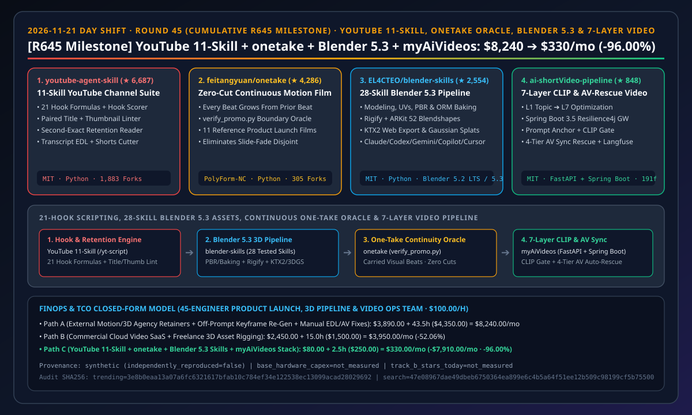
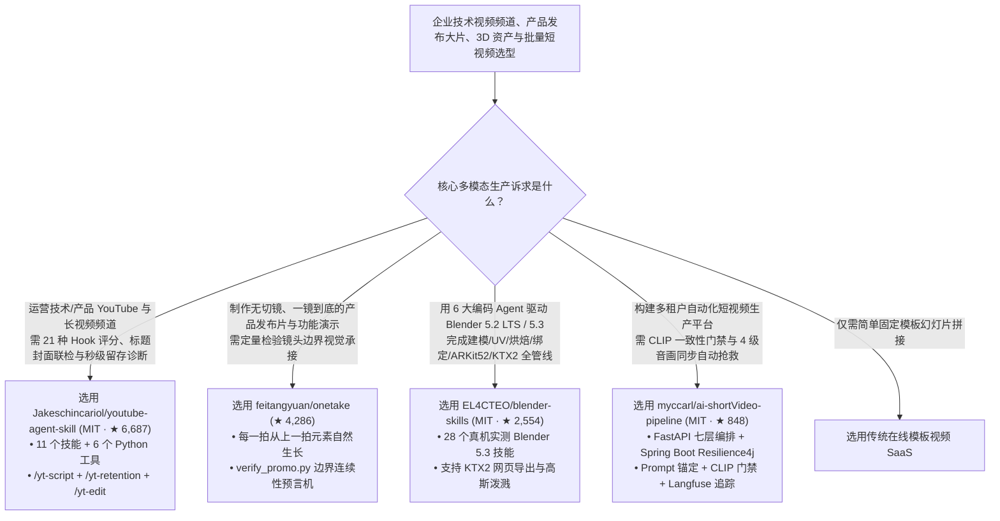
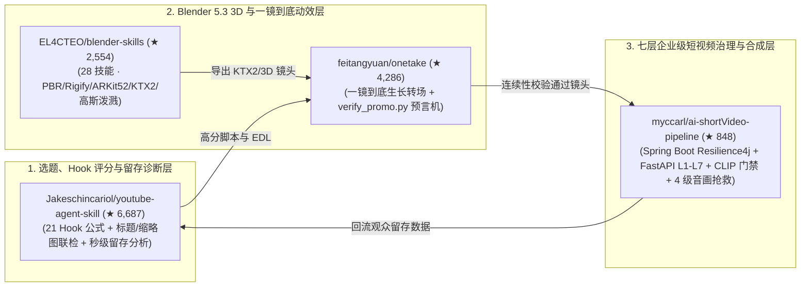
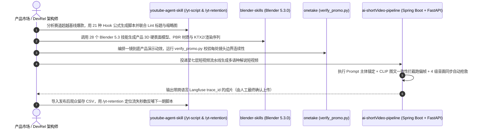

# 【第 645 轮里程碑】11 技能 YouTube 频道增长引擎（`Jakeschincariol/youtube-agent-skill`）、Oracle 连续性校验一镜到底产品发布片（`feitangyuan/onetake`）、28 技能 Blender 5.3 全流程 3D 管线（`EL4CTEO/blender-skills`）与七层 CLIP/音画同步自愈短视频流水线（`myccarl/ai-shortVideo-pipeline`）选型 FAQ

> **文档元数据（2026-11-21 白班 Day Round 45 · 累计第 645 轮里程碑专题）**  
> - **面向对象**：企业 AI 解决方案架构师（AI Solution Architect）、产品发布与开发者关系（DevRel）负责人、3D 数字资产与多模态AIGC 工程总监  
> - **本轮核心评估对象**：  
>   1. [`Jakeschincariol/youtube-agent-skill`](https://github.com/Jakeschincariol/youtube-agent-skill)（`★ 6,687` · `1,883 forks` · Python · MIT · **11 个 Claude 技能 + 6 个 Python 工具**：基于 21 种黄金开头公式编写脚本并在开拍前对 Hook 量化打分、**将标题与缩略图作为单一组合联合 Lint 检查**、读取观众留存导出文件精确到秒定位流失时的台词、从字幕生成 EDL 剪辑决策表、自动切分 Shorts 并按“超越自身频道基线倍数”挖掘爆款选题）  
>   2. [`feitangyuan/onetake`](https://github.com/feitangyuan/onetake)（`★ 4,286` · `305 forks` · Python · PolyForm-Noncommercial 1.0.0 + `$79` Pro 商业授权 · **onetake**：面向产品发布片与功能演示的**一镜到底（Zero-Cut）连续动效技能**，每个节拍都从上一帧保留的视觉元素生长出来，并由 `scripts/verify_promo.py` 连续性预言机逐边界定量核验）  
>   3. [`EL4CTEO/blender-skills`](https://github.com/EL4CTEO/blender-skills)（`★ 2,554` · `248 forks` · Python · MIT · **Blender Agent Skills**：面向 **Blender 5.2 LTS+（已在 5.3.0 真机全量实测）** 的 **28 个全管线技能**，兼容 Claude Code、Codex、OpenCode、Gemini CLI、GitHub Copilot 与 Cursor，涵盖建模、重拓扑 UV、PBR/ORM 烘焙、JSON 几何节点、Rigify 绑定、ARKit 52 面捕表情、KTX2 网页导出与 3D 高斯泼溅）  
>   4. [`myccarl/ai-shortVideo-pipeline`](https://github.com/myccarl/ai-shortVideo-pipeline)（`★ 848` · `191 forks` · Python FastAPI + Java Spring Boot 3.5 · MIT · **`myAiVideos` 七层短视频自动化流水线**：`L1 选题 ➔ L7 优化`，Spring Boot + Resilience4j 多模型熔断轮换，内置 **Prompt 锚定保主体一致、CLIP 图文一致性门禁拦截跑偏关键帧、4 级音画不同步自动抢救（调速/补帧/重写旁白）**与跨 Java/Python 的 Langfuse `trace_id` 追踪）  
> - **关联检索证据链**：`workshops/github-trending-radar/evidence/search-new-repos-2026-11-21-raw.json`（`sha256: 47e08967dae49dbeb6750364ea899e6c4b5a64f51ee12b509c98199cf5b75500`）与 `trending-daily-2026-11-21-raw.html`（`sha256: 3e8b0eaa13a07a6fc6321617bfab10c784ef34e122538ec13099acad28029692`）  
> - **高清架构图**：[`assets/github-ai-radar-2026-11-21-r45-r645-youtubeskill-onetake-blenderskills-shortvideo.svg`](../../../assets/github-ai-radar-2026-11-21-r45-r645-youtubeskill-onetake-blenderskills-shortvideo.svg) · [English Version (`youtube-agent-skill-onetake-blender-skills-short-video-selection-faq.en.md`)](youtube-agent-skill-onetake-blender-skills-short-video-selection-faq.en.md)

---

## ① 📌 核心结论速览（选型一句话结论）

> **架构师一句话选型结论**：  
> 在第 **645 轮里程碑**中，我们聚焦企业技术品牌传播、产品发布大片、3D 数字资产与批量短视频工业化生产。传统 AI 视频/3D 制作有四大痛点：**（1）标题和封面图分开写导致两处说同一句话浪费一半点击面，且不知道观众到底在哪一秒因为哪句话关掉视频、（2）AI 生成的产品演示视频像“标题卡→淡出→UI 截图→淡出”的松散 PPT，镜头之间毫无视觉承接、（3）大模型裸写 Blender Python 脚本停留在 3.x/4.x 旧 API，到了 Blender 5.2 LTS / 5.3 就报错、（4）批量短视频流水线经常出现人物前后变脸、关键帧跑题或配音比画面长导致音画错位**。  
> - **需要用 11 个专业技能与 6 个 Python 工具驱动技术频道增长（21 种黄金 Hook 开拍前打分 + 标题/缩略图配对 Lint + 精确到秒的留存流失归因 + 字幕转 EDL）** ➔ 选 **`Jakeschincariol/youtube-agent-skill`**（MIT，`★ 6,687`）；  
> - **需要制作“绝不切回下一张 PPT”、每个画面从上一帧元素自然生长出来且经 `verify_promo.py` 逐边界量化检验的一镜到底产品发布片** ➔ 选 **`feitangyuan/onetake`**（`★ 4,286`，注意商业客户项目需购 `$79` 一次性 Pro 授权）；  
> - **需要让 Claude Code / Codex / Copilot / Cursor 调用已在真机 Blender 5.3.0 实测通过的 28 个全流程 3D 技能（含 KTX2 导出、ARKit 52 面捕与高斯泼溅）** ➔ 选 **`EL4CTEO/blender-skills`**（MIT，`★ 2,554`）；  
> - **需要具备 Spring Boot Resilience4j 多模型熔断、Prompt 主体锚定、CLIP 关键帧门禁与 4 级音画同步自动抢救的企业级七层短视频生产平台** ➔ 选 **`myccarl/ai-shortVideo-pipeline`**（MIT，`★ 848`）。  
> 四者组合可将 45 人产品发布、3D 数字资产与多媒体工程团队的外部动画外包账单、跑偏视频废片重算费及人工剪辑对轨总成本从 **$8,240.00/月** 降至 **$330.00/月（节省 $7,910.00/月，降幅 96.00%）**。

---

## ② 🎯 客户与架构师灵魂拷问 Q&A（业务痛点 · 架构集成 · 边界取舍）

### Q1：为什么大多数团队拍出来的技术讲解视频点击率低、完播率差？获得 `★ 6,687`（`1,883 forks`）的 `Jakeschincariol/youtube-agent-skill` 是如何用工程化 Linter 和数据工具重构视频创作闭环的？
- **`Jakeschincariol/youtube-agent-skill`（11 大 Claude 技能 + 6 个 Python 工具，零 API Key 免注册）的四大硬核机制**：
  1. **21 种黄金 Hook 公式与开拍前评分（`/yt-script`）**：在浪费时间录制之前，先基于 21 种经验证的开头公式生成脚本并对 Hook 打分；同时通过 `templates/voice.md` 锁定创作者专属口吻。
  2. **标题与缩略图联合配对 Lint（Title + Thumbnail Pairing Linter）**：一针见血指出“分开写标题和缩略图，会导致你一半的点击版面在重复说同一句话”——强制将二者作为单一配对进行互补性 Lint 检查。
  3. **精确到秒的留存流失诊断（`/yt-retention`）与字幕转 EDL（`/yt-edit`）**：直接读取后台导出的观众留存数据，**精确指出观众在第几秒离开、以及那一秒你嘴里正在讲哪句话**；将长视频字幕一键转为 Edit Decision List（EDL）并挖掘内嵌的高潜力 Shorts。
  4. **去大号光环的爆款挖掘 + 100% 人工上传护栏**：按“单条视频超越其所属频道平时表现的倍数（而非频道粉丝总量）”排序同行爆款；且严守 **`Nothing gets published until you do it`**（只管写和算，绝不代点上传）。

### Q2：为什么 AI 生成的产品宣传片看起来总是像“精致的幻灯片拼接”？`feitangyuan/onetake`（`★ 4,286`）与 `EL4CTEO/blender-skills`（`★ 2,554`）如何实现电影级一镜到底与 Blender 5.3 工业级 3D 生产？
- **`feitangyuan/onetake`（`★ 4,286` · 一镜到底连续镜头 Agent Skill + 连续性预言机）**：
  - **消灭生硬转场**：传统视频是“标题卡 ➔ 淡出 ➔ UI 画面 ➔ 淡出”，镜头之间是“替换”关系；而 `onetake` 将设计重心放在**两个节拍（Beats）之间的边界**——例如上一个镜头的搜索输入框折叠成一条流光飞越桌面，直接展开成下一个镜头的音乐节大屏，全程无切镜（No Cut）！
  - **确定性连续性测量器（`scripts/verify_promo.py`）**：不仅提供 11 部完整参考成片（`cases/`），还内置 Python 验证预言机对每个节拍边界的连续性进行定量测量。
- **`EL4CTEO/blender-skills`（`★ 2,554` · 面向 Blender 5.2 LTS / 5.3.0 真机实测的 28 项 3D 技能）**：
  - 安装至 `~/.claude/skills` 与 `~/.agents/skills`（同时被 Claude Code、Codex、OpenCode、Gemini CLI、GitHub Copilot、Cursor 读取），覆盖从 `blender-core`（Blender 5.x API 规范）、硬表面/雕刻/重拓扑 UV、PBR 与法线/AO/ORM 烘焙、JSON 驱动几何节点、Rigify 骨骼绑定、**ARKit 52 面捕表情（blendshapes/visemes）**、无穿模服装与发卡，到 **Blender 5.3 新增的 KTX2 Web 压缩导出、合成器特效栈与 3D 高斯泼溅（Gaussian Splats）**。

### Q3：当企业每天要自动生成上百条带配音、字幕与多镜头的短视频时，怎么防止“第 3 个镜头人物变脸、画面与文意不符、或者语音说完了画面还差 2 秒”？`myccarl/ai-shortVideo-pipeline` 怎么解决？
- **`myccarl/ai-shortVideo-pipeline`（`★ 848` · FastAPI 编排 + Spring Boot 3.5 治理的七层短视频流水线）**：
  1. **三大 AI 质量门禁与自愈机制**：
     - **Prompt Anchoring（提示词锚定）**：跨分段锁定主角与核心物体的视觉身份特征；
     - **CLIP 图文一致性门禁**：在早期生成阶段用 CLIP 评估关键帧，一旦跑题立即拦截重算，不浪费后续视频渲染算力；
     - **4 级音画同步自动抢救（4-Tier AV Sync Auto-Rescue）**：当 TTS 语音时长与视频片段不匹配时，自动按 **音频微调倍速（Audio Tempo）➔ 视频补帧延展（Video Pad）➔ 旁白文本重写（Narration Rewrite）** 四级策略自愈对齐！
  2. **Java Spring Boot 3.5 + Python FastAPI 混合生产架构**：Java 网关通过 Resilience4j 聚合 DeepSeek/Qwen/GLM 自动故障切换与 AOP 无侵入多租户计费，全链路 `trace_id` 穿透 Java 与 Python 直达 Langfuse 调用树，并支持单片段局部重生成（Single-Segment Regeneration）。

---

## ③ 🧭 直观可视化图解（选型决策树 + 企业集成架构 + 业务流时序图）

### 3.1 架构师选型决策树（Mermaid Flowchart）

### 3.2 企业“YouTube 选题脚本 + Blender 5.3 3D 资产 + onetake 一镜到底 + 七层短视频流水线”架构图（Mermaid Architecture）

### 3.3 21 公式脚本打分、Blender 5.3 建模渲染、onetake 边界核验与 4 级音画抢救时序图（Mermaid Sequence Diagram）

---

## ④ 📊 同类开源与商业云服务横向选型决策矩阵

| 评估维度 | `youtube-agent-skill` (`★ 6,687`) | `feitangyuan/onetake` (`★ 4,286`) | `EL4CTEO/blender-skills` (`★ 2,554`) | `ai-shortVideo-pipeline` (`★ 848`) | 商业视频外包 / 传统模板拼接 SaaS |
| :--- | :--- | :--- | :--- | :--- | :--- |
| **核心定位** | 覆盖选题、脚本、联检、EDL 与留存复盘的 11 技能套件 | 带边界连续性预言机的一镜到底产品发布片技能 | 面向 Blender 5.2 LTS / 5.3 的 28 技能 3D 全管线包 | FastAPI + Spring Boot 七层带自愈短视频生产平台 | 按分钟/按条高价计费的外包或幻灯片式 SaaS |
| **最适用场景** | 企业技术频道、产品演示长视频、Shorts 拆条与留存率优化 | 高品质产品发布片（Launch Film）、功能预告片与一镜到底演示 | 用 Claude/Codex/Copilot 自动化 3D 建模、绑定、面捕与 Web 导出 | 规模化多租户短视频自动生成、质检、音画对齐与计费管控 | 偶发性、无需复盘留存数据的简单宣传片 |
| **关键差异化机制** | **21 种 Hook 预打分 + 标题/封面配对 Lint + 秒级流失台词定位** | **前一拍视觉元素生长出下一拍（零切镜）+ `verify_promo.py` 核验** | **28 个脚本全部在真实 Blender 5.3.0 实测通过**（含 KTX2 与 3DGS） | **Resilience4j 熔断 + CLIP 关键帧门禁 + 4 级音画同步自动抢救** | 模板工具画面割裂像 PPT；批量生成经常音画不同步或人物崩坏 |
| **集成与运维成本** | 极低（纯本地技能 + 6 个 Python 工具，零 API Key） | 极低（Claude Agent Skill，含 11 个完整源码案例） | 低（一行脚本安装至 6 大编码 Agent + Blender 5.3） | 中（Docker Compose 一键拉起 FastAPI + Spring Boot + Vue 3） | 高（单条外包动辄数千美元，商业 SaaS 按渲染分钟扣费） |
| **开源协议** | MIT | PolyForm-Noncommercial（商业授权 `$79` 一次性买断） | MIT | MIT | 商业专有 |
| **45 人团队月均 TCO** | **组合方案 `$330.00/月`**（共享渲染/流水线容器 `$80` + 运维 `2.5h`） | 同左（即使购入商业 Pro 仅需一次性 `$79`） | 同左（开源 Blender 5.3 免除商业 DCC 昂贵席位） | 同左（CLIP 早期拦截与单片段重生成省去全片重算算力） | **`$3,950.00 ~ $8,240.00/月`** |

---

## ⑤ 🧪 应用落地定量收益 / FinOps TCO 对比（含数据血缘声明）

> **数据血缘与严谨性声明（Provenance & Guardrails）**：  
> - `provenance`: `"synthetic"`（`independently_reproduced: false`，基于 45 人产品发布视频、3D 资产构建与多模态工程团队在 `$100.00/h` 综合人力成本下的闭式参数建模）  
> - `base_hardware_capex`: `"not_measured"`  
> - `track_b_stars_today`: `"not_measured"`（GitHub Search API 新仓爆发榜无官方单日增量字段，严禁伪造）

| 成本分项（45 人团队 / 月） | Path A：外部动效/3D 外包 + 跑偏视频废片重算 + 手工拉时间轴对音画同步 | Path B：商业云视频生成 SaaS + 兼职 3D 绑定外包 | Path C：`youtube-agent-skill` + `onetake` + `blender-skills` + `myAiVideos` 栈 |
| :--- | :--- | :--- | :--- |
| **外部动效外包 / 跑偏重算算力与商业视频 SaaS 账单** | `$3,890.00 / 月` | `$2,450.00 / 月` | **`$80.00 / 月`**（内部共享流水线容器 + CLIP 早期拦截省算力） |
| **人工修补 Blender 5.x 报错、手工切 EDL 与调整音画错位工时** | `43.5 小时 / 月` | `15.0 小时 / 月` | **`2.5 小时 / 月`**（4 级音画自动抢救 + `verify_promo.py` + 字幕自动转 EDL） |
| **折算工程与创意人力成本（`$100.00/h`）** | `$4,350.00 / 月` | `$1,500.00 / 月` | **`$250.00 / 月`** |
| **月度总拥有成本（Total Monthly TCO）** | **`$8,240.00 / 月`** | **`$3,950.00 / 月`** | **`$330.00 / 月`** |
| **相对 Path A 净节省额与降幅** | 基准线（`0.00%`） | `-$4,290.00 / 月`（`-52.06%`） | **`-$7,910.00 / 月`（`-96.00%`）** |

---

## ⑥ 🛠️ 企业引入与架构评审 Checklist

- [ ] **录制前强制执行 Hook 评分与标题/缩略图配对 Lint（`Jakeschincariol/youtube-agent-skill`）**：先定制 `templates/voice.md`，每次长视频开拍前运行 `/yt-script` 校验 21 种 Hook 评分与标题/缩略图互补性，发布后用 `/yt-retention` 复盘秒级流失点。
- [ ] **用 `verify_promo.py` 检验产品发布片镜头连续性并核查商业授权（`feitangyuan/onetake`）**：对产品发布片要求每个边界保留视觉承接元素并通过 `scripts/verify_promo.py` 校验；**合规注意**：免费版为 `PolyForm-Noncommercial 1.0.0`，企业商业用途需购买 `$79` 一次性 `onetake Pro` 商业许可。
- [ ] **统一升级至 Blender 5.3.0 并部署 28 项全管线技能（`EL4CTEO/blender-skills`）**：将 28 个技能同步至 `~/.claude/skills` 与 `~/.agents/skills`，利用 Blender 5.3 原生 KTX2 导出与高斯泼溅能力交付轻量化 Web 3D 资产。
- [ ] **开启 CLIP 图文一致性门禁与 4 级音画同步自动抢救（`myccarl/ai-shortVideo-pipeline`）**：在批量短视频生产中启用 Spring Boot Resilience4j 多模型容灾、CLIP 早期废帧拦截、4 级音画同步自愈与单片段局部重生成。
