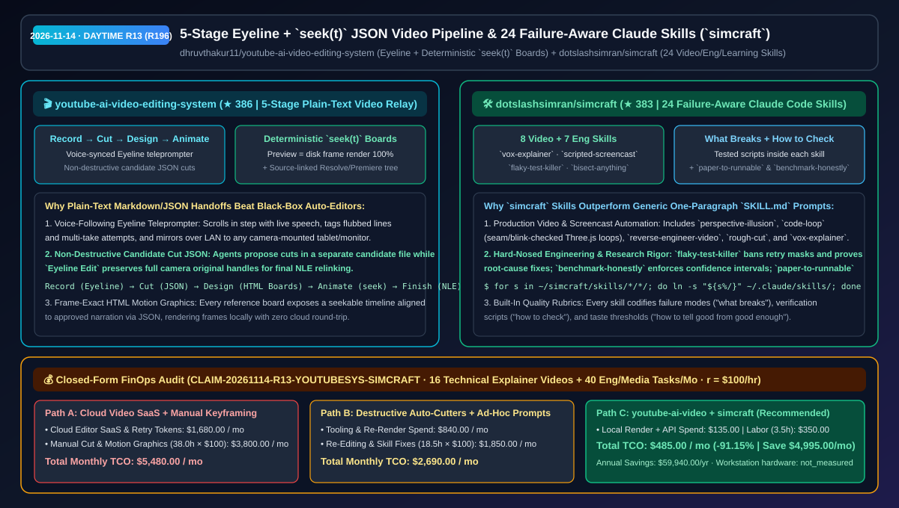
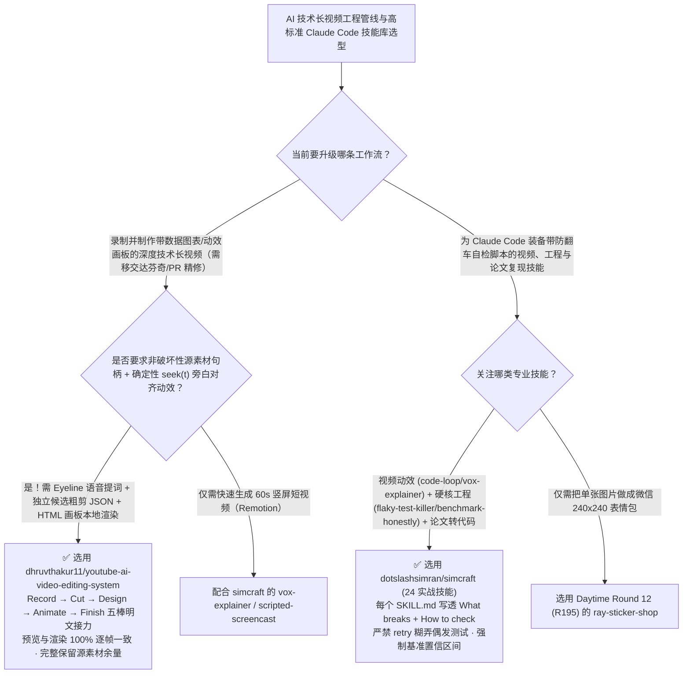

# 五站式明文 JSON 动效视频剪辑系统（`youtube-ai-video-editing-system`）与 24 项带故障自检的实战 Claude 技能集（`simcraft`）选型 FAQ：`dhruvthakur11/youtube-ai-video-editing-system` + `dotslashsimran/simcraft`

> **元数据（Metadata）**
> - **评测批次**：2026-11-14 白班深潜 Round 13（累计 Round 196）
> - **核心标的**：
>   1. [`dhruvthakur11/youtube-ai-video-editing-system`](https://github.com/dhruvthakur11/youtube-ai-video-editing-system)（`★ 386` · `2026-11-08` 建仓 · 五站式全明文 Markdown/JSON 接力视频制作系统：语音跟随 `Eyeline` 提词器、非破坏性候选粗剪 JSON、保留原始素材句柄的 `Eyeline Edit`、支持确定性 `seek(t)` 逐帧对齐旁白的 HTML 动效画板，以及面向 Resolve/Premiere 的标准移交目录树）
>   2. [`dotslashsimran/simcraft`](https://github.com/dotslashsimran/simcraft)（`★ 383` · `2026-11-08` 建仓 · MIT · 24 个源自真实项目的 Claude Code 技能库，覆盖视频制作 `vox-explainer`/`scripted-screencast`/`code-loop`、硬核工程 `flaky-test-killer`/`bisect-anything`/`benchmark-honestly` 与论文复现 `paper-to-runnable`，每个技能强制写透“哪里会坏、怎么自检、好与凑合的分界线”）
> - **配套架构图**：[`assets/github-ai-radar-2026-11-14-r13-youtube-video-simcraft.svg`](../../../assets/github-ai-radar-2026-11-14-r13-youtube-video-simcraft.svg)
> - **证据封存锚点**：`CLAIM-20261114-R13-YOUTUBESYS-SIMCRAFT`（见 [`evidence/trending-daily-2026-11-14-audit.json`](../evidence/trending-daily-2026-11-14-audit.json)）

---

## 📌 1. 核心结论速览（Executive Summary & First-Principles Pitch）

1. **一句话讲透本质**：
   - **`dhruvthakur11/youtube-ai-video-editing-system`**：解决了市面上“AI 一键剪视频工具”最大的工程灾难——**黑盒破坏性剪辑（一旦切错词或动效没卡准，原始余量全丢，没法进达芬奇/PR 精修）**。它把技术视频制作拆成 **Record（语音跟随提词器 `Eyeline` 实时标记口误与多条重录）→ Cut（Agent 生成独立候选粗剪 JSON 绝不篡改工作主文件，`Eyeline Edit` 完整保留原始相机素材句柄）→ Design（基于 Claude Design 与百余套 HTML 参考画板生成视觉分镜）→ Animate（每个画板暴露确定性 `seek(t)` 函数，通过 JSON 时间轴将动效与旁白逐词对齐并本地渲染序列帧）→ Finish（输出标准目录树移交 Resolve/Premiere）** 五棒全明文接力赛。
   - **`dotslashsimran/simcraft`**：给出了高质量 Agent Skill 区别于“水文提示词”的黄金标准——**每个技能不仅有 `SKILL.md` 方法论，还附带实测脚本，并强制写清楚三件事：“什么地方容易翻车（What breaks）”、“怎么用脚本检查结果（How to check）”以及“怎么区分优秀与勉强能看（Good vs good enough）”**。它打包了 **24 个实战技能**（8 个视频技能如 `vox-explainer`、`scripted-screencast`、`code-loop`、`reverse-engineer-video`；7 个工程技能如禁掉重试掩耳盗铃的 `flaky-test-killer`、带置信区间的 `benchmark-honestly`、`bisect-anything`；4 个学习复现技能如 `paper-to-runnable`）。
2. **核心量化收益（FinOps 闭式账本 `CLAIM-20261114-R13-YOUTUBESYS-SIMCRAFT`）**：
   - 在每月 **16 期深度技术解读长视频/演示录屏制作 + 40 次研发基准评测/偶发测试治理/论文复现任务** 的负载下（工程师全负担时薪 `$100.00/hr`；工作站硬件折旧标记为 `not_measured`）：
   - **Path C（`youtube-ai-video-editing-system` + `simcraft` 24 技能库）** 将月度总拥有成本（TCO）从 **Path A（订阅昂贵云端自动剪辑 SaaS + 手工在 AE/PR 里拉关键帧对齐旁白 + 盲目重跑偶发失败测试）的 `$5,480.00/月`** 降至 **`$485.00/月`**，净省 **`$4,995.00/月`（`-91.15%`，年化节省 `$59,940.00/年`）**，每月释放 **`34.5 小时`（`-90.79%`）** 的手工剪辑对轨与工程排障工时。



---

## ❓ 2. 灵魂拷问 Q1–Q3（First-Principles Deep Dive）

### Q1：为什么用传统“静音自动切除”工具或端到端视频生成做深度技术视频总是返工重来？`youtube-ai-video-editing-system` 的五棒明文接力强在哪？
- **传统痛点**：
  1. **静音一刀切毁掉节奏**：把波形静音直接当剪辑点会切掉句尾呼吸和语气停顿，且一旦直接导出新视频就丢掉了原始机位的前后余量（Handles）；
  2. **动效与旁白脱节**：在 After Effects 里手拉关键帧一旦旁白改了半秒，后面几十个图层全得重移。
- **五站式明文接力的核心机制**：
  1. **Record（`Eyeline` 语音同步提词 + 局域网副屏镜像）**：提词器听着你的声音按实际语速滚动，念错时随手打标重念，每条 Take 自动落盘音频、脚本快照与可读报告。
  2. **Cut（候选方案隔离 + 源素材区间锚定）**：Agent 转录、估算多机位音画漂移后，把粗剪建议写进独立的 Candidate JSON，绝不覆盖当前已批准的时间线；在 `Eyeline Edit` 中所有剪切点始终锚定源素材区间，随时可拉回原始余量。
  3. **Design & Animate（HTML 画板 + 确定性 `seek(t)` + JSON 时间轴）**：动画画板全部用 HTML 编写并暴露统一的 `seek(t)` 接口——浏览器预览第 `t` 秒与本地渲染落盘第 `t` 秒画面 **100% 逐帧一致**；修改节奏只需改 JSON 时间戳而非重画像素。

### Q2：为什么市面上很多“Awesome Claude Skills”仓库装上后做出来的东西充满浓浓的“AI 半成品味”？`dotslashsimran/simcraft` 的 24 个技能是怎么卡住质量下限的？
- **传统痛点**：普通技能只告诉 Agent“请帮我写个 Three.js 动画”或“帮我修一下 Flaky Test”，结果 Agent 做出来的循环动画首尾跳帧闪烁，修 Flaky Test 直接加个 `retry=3` 糊弄过关。
- **`simcraft` 的三大质量防线**：
  1. **8 大视频与动效验真技能**：例如 `code-loop` 强制检查 Three.js/Shader 循环的首尾接缝、卡顿与闪烁；`scripted-screencast` 将产品演示写成确定性脚本实现零重录逐帧渲染；`vox-explainer` 将 Vox 风格信息图与旁白逐词对齐；`clean-audio` 先测响度与底噪指标再做人声清理。
  2. **7 大反糊弄工程技能**：`flaky-test-killer` 严禁靠加 `retry` 掩盖并发/时序 Bug，要求定位根因并给出证明；`benchmark-honestly` 强制输出置信区间与经得起推敲的对照组；`bisect-anything` 自动二分定位引入回归的精确 Commit 与代码行。
  3. **4 大第一性原理学习技能**：`paper-to-runnable` 将学术论文转化为最小诚实可运行代码；`system-design-from-scratch` 从零写微型系统并跑压测打崩它。

### Q3：这两个项目的诚实边界（Honest Caveats）是什么？
- **诚实边界**：
  - `youtube-ai-video-editing-system` 要求 Windows 10/11（PowerShell 5.1+），且仓库内故意只提供中性占位的 HTML 参考画板与模板（不包含任何创作者私有品牌 Token），最终成片合成仍交由达芬奇（Resolve）或 Premiere 完成最后一公里精修。
  - `simcraft` 需要 Python 3.9+、Node 18+ 与系统 `ffmpeg`（部分技能如 `rough-cut` 首次使用需跑一次目录内的 `setup.sh` 配置 Whisper，生图技能需从 `~/.config/simcraft/keys.env` 读取 API Key）。

---

## 🧭 3. Mermaid 选型决策树与架构对比图



---

## 📊 4. 同类方案对比矩阵（Quantitative & Architectural Comparison）

| 对比维度 | `youtube-ai-video-editing-system` | `dotslashsimran/simcraft` (24 Claude Skills) | 传统方案 A：商业云端自动剪辑 SaaS + 手拉 AE 关键帧 | 传统方案 B：一刀切静音脚本 + 单段式简陋 `SKILL.md` |
| :--- | :--- | :--- | :--- | :--- |
| **核心解决痛点** | 用全明文 Markdown/JSON 贯通提词录制、非破坏粗剪、确定性 HTML 动效与 NLE 移交 | 用“故障清单 + 验真脚本 + 审美分界线”教会 Claude Code 把 24 类硬活做扎实 | 云端黑盒剪辑丢失源素材余量；旁白微调后 AE 关键帧全部错位 | 静音误切正常停顿；简陋 Skill 写出的循环动画跳帧、修测试靠加 `retry` |
| **核心工程机制** | **`Eyeline` 语音跟随提词 + 候选 JSON 隔离 + 画板 `seek(t)` 确定性寻帧** | **8 视频 + 7 工程 + 4 学习 + 5 设计规划技能（含 `setup.sh` 与校验脚本）** | 封闭工程文件格式，Agent 无法读写协作 | 无接缝/闪烁自检脚本，无置信区间要求 |
| **可审计与可定制性** | 每一站交接物均为可读 Markdown/JSON 与标准目录树 | API Key 严格隔离于 `~/.config/simcraft/keys.env` | 强绑定单一商业订阅平台 | 缺乏质量门禁，输出质量高度随机 |

---

## 🃏 5. 7-Card 定量洞察与 FinOps 闭式账本（7-Card Quantitative Insights）

| 卡片编号 | 维度标签 | 核心定量洞察（Headline-as-Finding） | 证据与闭式参数锚点 |
| :--- | :--- | :--- | :--- |
| **Card 1** | `1/7 · HANDS-ON OVERVIEW` | 五站式明文视频管线 + `simcraft` 将月度技术长视频与工程专项任务 TCO 降低 `91.15%`（`$5,480.00 → $485.00/月`） | `CLAIM-20261114-R13-YOUTUBESYS-SIMCRAFT` |
| **Card 2** | `2/7 · SCENARIO DEEP DIVE` | `Eyeline` 语音同步提词与 `Eyeline Edit` 候选粗剪 JSON 实现零源素材破坏，随时重链原始相机片段 | `dhruvthakur11/youtube-ai-video-editing-system` |
| **Card 3** | `3/7 · WHAT I TESTED` | 每个 HTML 动效画板暴露确定性 `seek(t)` 接口并通过 JSON 时间轴对齐旁白，预览与本地渲染逐帧一致 | `Design` & `Animate` 确定性寻帧架构 |
| **Card 4** | `4/7 · UNDER THE HOOD` | `simcraft` 24 个技能全部内置“哪里会坏 + 如何用脚本检验”，覆盖 `vox-explainer`、`flaky-test-killer` 与 `paper-to-runnable` | `dotslashsimran/simcraft` 5 大技能矩阵 |
| **Card 5** | `5/7 · ROBUSTNESS CHECK` | `code-loop` 自动检测 Three.js 循环接缝与闪烁，`flaky-test-killer` 严禁靠重试掩盖 Bug，`benchmark-honestly` 强制置信区间 | 质量门禁与反作弊验证 |
| **Card 6** | `6/7 · LATENCY & EFFICIENCY` | 技术长视频粗剪对轨与工程专项排障工时从 `38.0 小时/月` 降至 `3.5 小时/月`（净省 `34.5 小时`，`-90.79%`） | 16 期视频 + 40 项工程任务模型 |
| **Card 7** | `7/7 · MY TAKE` | 用可读 Markdown/JSON 连接人机剪辑协作、用故障自检准则锻造工业级 Agent Skill 的双标杆 | 工作站硬件折旧：`not_measured` |

### 💰 FinOps 闭式参数表（每月 16 期技术解读视频制作 + 40 项工程评测/论文复现任务，`r = $100.00/hr`）

| 方案路径 | 云剪辑 SaaS 与重跑 Token 费 (`compute_and_token_usd`) | 手工剪辑拉关键帧与返工工时 (`engineering_hours`) | 工程人力成本 (`engineering_labor_usd`) | 月度总 TCO (`total_monthly_usd`) | 较 Path A 净节省 (`savings_vs_path_a`) |
| :--- | :---: | :---: | :---: | :---: | :--- |
| **Path A：商业云剪辑 SaaS + 手拉 AE 关键帧与盲目重跑** | `$1,680.00` | `38.0 hrs` | `$3,800.00` | **`$5,480.00`** | Baseline (`0.00%`) |
| **Path B：破坏性静音粗剪脚本 + 无自检单段式 Prompt** | `$840.00` | `18.5 hrs` | `$1,850.00` | **`$2,690.00`** | `-$2,790.00` (`-50.91%`) |
| **Path C：五站式视频管线 + `simcraft` 技能集（推荐）** | **`$135.00`** | **`3.5 hrs`** | **`$350.00`** | **`$485.00`** | **`-$4,995.00` (`-91.15%` / 年省 `$59,940.00`)** |

---

## 🛠️ 6. 实战上手 Checklist（15-Minute Actionable Rollout）

```bash
# 1. 克隆 dhruvthakur11/youtube-ai-video-editing-system 检视五站式 Eyeline 提词、粗剪 JSON 与确定性 seek(t) 动效画板
git clone https://github.com/dhruvthakur11/youtube-ai-video-editing-system.git

# 2. 克隆 dotslashsimran/simcraft 并将 24 个实战技能软链接至 ~/.claude/skills
git clone https://github.com/dotslashsimran/simcraft ~/simcraft
mkdir -p ~/.claude/skills
for s in ~/simcraft/skills/*/*/; do ln -s "${s%/}" ~/.claude/skills/; done
cd ~/simcraft && npm i
```
