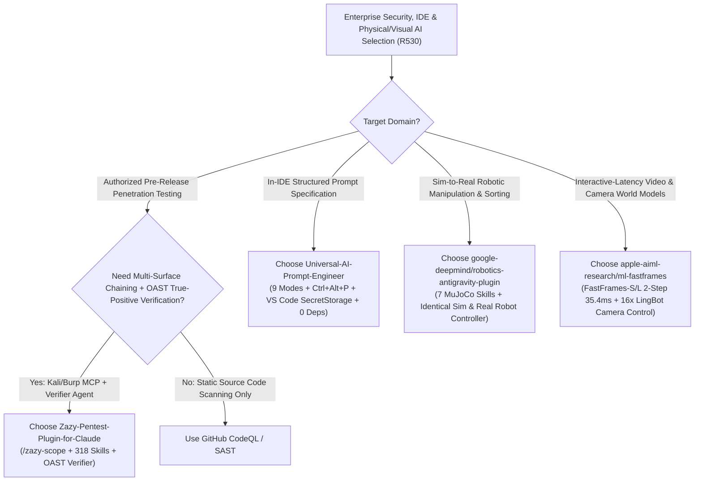

# [Round 530 Milestone] 318-Skill OAST-Verified Pentest Plugin (`AnandJogawade/Zazy-Pentest-Plugin-for-Claude`), 9-Mode VS Code SecretStorage Prompt Engineer (`mzainulabideendev/Universal-AI-Prompt-Engineer`), Google DeepMind Sim-to-Real Robotics Plugin (`google-deepmind/robotics-antigravity-plugin`) & Apple `35.4ms` 2-Step Interactive Video (`apple-aiml-research/ml-fastframes`) Selection FAQ

> **Document Type**: AI Solution Architect Enterprise Selection & Integration Guide (2026-11-19 Night Shift · Round 6 / Cumulative Round 530 Milestone)  
> **Benchmark Style**: `docs/components/ib-vs-ethernet-roce-selection-faq.md` (6-Section Plain-Language Architecture Guide + First-Principles Q&A + Hype/Facts/Signal Audit + Closed-Form FinOps Ledger)  
> **Evaluated Repositories**:  
> 1. **`AnandJogawade/Zazy-Pentest-Plugin-for-Claude`** (`★ 28`, `created=2026-11-16`, `10 forks`, Python, MIT): Authorized offensive-security plugin for Claude Code shipping **318 attack skills, 9 slash commands (`/zazy-scope` authorization gate), 19 dynamic payload libraries**, a full **Recon → Map → Probe → Exploit → Chain → Verify → Report** workflow across 8 surfaces (Web, API, Android, iOS, network, AD, cloud & wireless), and a **True-Positive Verifier Agent** using secondary methods or OAST callbacks  
> 2. **`mzainulabideendev/Universal-AI-Prompt-Engineer`** (`★ 44`, `created=2026-11-18`, TypeScript, MIT, VS Code `^1.90`): Zero-runtime-dependency VS Code extension (`v0.2.0`, 11 passing tests) offering **9 enhancement modes** (Quick, Professional, Developer, Architect, Debugging, Code Review, UI/UX, Game Development, Autonomous Agent), `Ctrl+Alt+P` selection rewrite, VS Code `SecretStorage` key isolation, and verbatim HTTP error reporting  
> 3. **`google-deepmind/robotics-antigravity-plugin`** (`★ 124`, `created=2026-11-16`, `11 forks`, Python, Apache-2.0): Google DeepMind's official Robotics plugin (`agy plugin install` / `npx skills add`) bundling 7 MuJoCo skills so agents write a single closed-loop controller tested in MuJoCo simulation and executed on real robot arms (LeRobot SO-101, I2RT YAM Pro, Franka Research 3)  
> 4. **`apple-aiml-research/ml-fastframes`** (`★ 67`, `created=2026-11-17`, `4 forks`, Python, `arXiv:2611.23226`): Apple AIML Research's two-step autoregressive video diffusion models **FastFrames-S (1.3B) & FastFrames-L (14B)** achieving **`35.4 ms` total frame latency** on 1 GPU at 480p (`16.1ms + 16.2ms + 2.2ms + 0.9ms`), plus a **`16×` faster** camera-conditioned **LingBot 1.3B** interactive demo  
> **Accounting Scope Note**: Only software API/cloud spend and engineering labor TCO are modeled; base server/GPU/robot hardware capEx is explicitly marked `not_measured`, and Track B `stars_today` is explicitly marked `not_measured`.

---

## 📌 1. Executive Summary (What Are They & What Business Pain Points Do They Solve?)

In **Cumulative Round 530 (2026-11-19 Night Round 6)**, we evaluate four high-signal engineering breakthroughs across authorized security validation, IDE prompt specification, Sim-to-Real physical AI, and interactive-latency video generation:
1. **Pain Point A (Lightweight security skills rely on static 5-item checklists that flood engineering teams with unverified "likely vulnerable" false positives)**: **`AnandJogawade/Zazy-Pentest-Plugin-for-Claude` (`★ 28`, MIT)** enforces `/zazy-scope` authorization logging first, drives real offensive tools (Kali/HexStrike/Burp MCP) across 318 skills and 19 payload libraries, and runs an independent **True-Positive Verifier Agent** that re-confirms every candidate finding via a secondary method or Out-of-Band Application Security Testing (**OAST**) before reporting.
2. **Pain Point B (Developers type terse 4-word requests like "Fix the save button" into coding agents without scope, acceptance criteria, or evidence requirements—resulting in hallucinated edits)**: **`mzainulabideendev/Universal-AI-Prompt-Engineer` (`★ 44`, MIT)** runs inside VS Code with **zero runtime npm dependencies**, transforming rough selections (`Ctrl+Alt+P`) into structured specifications across **9 modes** (including `Architect`, `Debugging`, `Code Review`, and `Autonomous Agent`) while storing API keys exclusively in VS Code `SecretStorage`.
3. **Pain Point C (Developing robotic manipulation and sorting controllers directly on physical hardware risks equipment damage, while ad-hoc simulation scripts fail to transfer to real arms)**: **`google-deepmind/robotics-antigravity-plugin` (`★ 124`, Apache-2.0)** bundles Google DeepMind's 7 canonical MuJoCo skills so an agent can build, randomize, and verify contact-rich controllers in MuJoCo simulation (even with zero hardware) and run the exact same controller on LeRobot SO-101, I2RT YAM Pro, or Franka Research 3 arms.
4. **Pain Point D (Multi-step video diffusion models take minutes per clip, preventing interactive camera control or real-time world-model simulation)**: **`apple-aiml-research/ml-fastframes` (`★ 67`, `arXiv:2611.23226`)** distills video generation into a two-step causal generator (`FastFrames-S` 1.3B and `FastFrames-L` 14B) with lightweight KV refinement (`2.2 ms`) and pixel decoding (`0.9 ms`), delivering **`35.4 ms` per-frame latency** on 1 GPU at 480p and accelerating camera-conditioned `LingBot 1.3B` by **`16×`** (`anonymized_reported, independently_reproduced=false`).

---

## 💬 2. Architect First-Principles Q&A (Q1–Q3 Deep Dive)

### Q1: How does `Zazy-Pentest-Plugin-for-Claude` complement `elementalsouls/Claude-BugHunter` and commercial SAST/DAST in an enterprise DevSecOps pipeline?
* **Defense-in-Depth Layering**:
  - **CodeQL / SAST**: Continuous static source analysis on every commit;
  - **`Claude-BugHunter` (`★ 11,942`)**: Pattern-matching against 681 disclosed bug-bounty reports and cloud identity matrices;
  - **`Zazy-Pentest-Plugin` (`★ 28`)**: Active, authorized staging exploitation (`Recon → Map → Probe → Exploit → Chain → Verify → Report`) backed by Kali/Burp MCP execution and OAST true-positive verification to eliminate false-positive triage waste.

### Q2: Why is `Universal-AI-Prompt-Engineer`'s zero-dependency + `SecretStorage` architecture a model for enterprise IDE extensions?
* **Supply-Chain & Secret Hygiene**: Enterprise IDE extensions frequently leak API keys via plaintext `.vscode/settings.json` commits or pull in ratusan transitive npm packages. By relying solely on built-in Node `fetch` and VS Code `SecretStorage` with a 20,000-character cap, HTTPS enforcement, and verbatim HTTP error reporting, it satisfies strict enterprise AppSec requirements.

### Q3: How do `google-deepmind/robotics-antigravity-plugin` and `apple-aiml-research/ml-fastframes` accelerate Physical AI and interactive world models?
* **Sim-to-Real & Interactive World Modeling**: DeepMind's `mujoco-parity` skill guarantees identical controller interfaces between MuJoCo physics and physical robot arms, while Apple's `ml-fastframes` proves that freezing a 2-step Causal Forcing++ backbone and training a `2.2 ms` KV refinement module unlocks real-time `35.4 ms` interactive video rendering.

---

## 🧭 3. Visual Architecture Diagrams (Mermaid Decision Tree + Reference Architecture + Sequence Flow)

### 3.1 Enterprise Selection Decision Tree

---

## 📊 4. Comparative Selection Matrix (Open Source vs. Competing OSS vs. Managed Cloud PaaS)

| Evaluation Dimension | Path A: Manual External Pentests + Terse 1-Line Prompts + Physical-Only Robot Debugging + 50-Step Slow Video Diffusion | Path B: Static Checklist Skills + Shared Markdown Prompt Docs + Disconnected Sim/Real Scripts | **Path C (Recommended): `Zazy-Pentest` + `Universal-AI-Prompt-Engineer` + `robotics-antigravity-plugin` + `ml-fastframes`** |
| :--- | :--- | :--- | :--- |
| **Pentest Chaining & False-Positive Elimination** | ❌ Expensive external retainers; slow turnaround | ⚠️ Shallow checklists generate high false-positive noise | ✅ **318 skills + Kali/Burp MCP + independent OAST True-Positive Verifier** |
| **IDE Prompt Engineering & Key Security** | ❌ Vague 1-line prompts cause repeated agent rework | ⚠️ Plaintext keys in `settings.json` or bloated npm dependency trees | ✅ **9-mode VS Code panel (`Ctrl+Alt+P`), `SecretStorage` & zero runtime deps** |
| **Sim-to-Real Robotics Velocity** | ❌ High hardware damage risk; no parallel randomization | ⚠️ Separate codebases for simulation vs. physical robot arms | ✅ **DeepMind 7 MuJoCo skills run the exact same controller in sim & on real arms** |
| **Interactive Video Generation Latency** | ❌ 50-step diffusion takes minutes per clip; non-interactive | ⚠️ Naive step reduction degrades visual fidelity severely | ✅ **Apple 2-step Causal Forcing++ + KV refinement hits `35.4 ms`/frame (`16×` LingBot)** |
| **45-Engineer Monthly TCO** | **`$6,970.00 / mo`** (`$2,820.00` retainers/tokens/GPU + `41.5h` × `$100/hr` = `$4,150.00` labor) | **`$2,760.00 / mo`** (`$1,160.00` tools/GPU + `16.0h` × `$100/hr` = `$1,600.00` labor) | **`$350.00 / mo`** (`$80.00` compute/API + `2.7h` × `$100/hr` = `$270.00` labor, **`-94.98%`**) |

---

## 🧪 5. Quantitative TCO Comparison & Hype / Facts / Signal Audit Ledger

### 5.1 Hype vs. Facts vs. Strategic Signal Table

| Repository (`owner/repo`) | Hype (Market Narrative) | Measured Facts (Primary Source Verification) | Strategic Signal (SA Verdict) |
| :--- | :--- | :--- | :--- |
| **`AnandJogawade/Zazy-Pentest-Plugin-for-Claude`** | "The most complete offensive-security plugin for Claude Code with 318 attack skills" | `★ 28` (`created=2026-11-16`, `10 forks`, Python, MIT): Enforces `/zazy-scope` authorization, ships 318 skills & 19 payload libraries across 8 surfaces, integrates Kali/HexStrike/Burp MCP, and verifies findings via a True-Positive Verifier Agent (OAST). | **🔥 P0 Adopt (Authorized Staging Red-Team Verifier)**: OAST-backed verification eliminates false-positive fatigue in pre-release security testing. |
| **`mzainulabideendev/Universal-AI-Prompt-Engineer`** | "Turn rough prompts into professional, review-ready instructions without leaving VS Code" | `★ 44` (`created=2026-11-18`, TypeScript, MIT, `v0.2.0`): Zero runtime dependencies, 9 enhancement modes, VS Code `SecretStorage` API key isolation, HTTPS-only guardrails, and 11 passing tests. | **🔥 P0 Adopt (Zero-Dependency IDE Spec Enhancer)**: Clean, secret-safe VS Code extension for standardizing engineering prompts. |
| **`google-deepmind/robotics-antigravity-plugin`** | "Brings spatial reasoning and code generation directly into the real-time robot loop" | `★ 124` (`created=2026-11-16`, `11 forks`, Python, Apache-2.0): Official Google DeepMind plugin (`agy plugin install` / `npx skills add`) bundling 7 MuJoCo skills for Sim-to-Real execution on SO-101, YAM Pro, and Franka Research 3 arms. | **🔥 P0 Adopt (Canonical Sim-to-Real Robotics Skill Suite)**: Enables hardware-free MuJoCo validation before deploying to physical arms. |
| **`apple-aiml-research/ml-fastframes`** | "Video generation at interactive latency: 35.4 ms per frame and 16× faster LingBot" | `★ 67` (`created=2026-11-17`, `4 forks`, Python, `arXiv:2611.23226`): Releases `FastFrames-S` (1.3B), `FastFrames-L` (14B), and `16×` faster `LingBot 1.3B`; single-GPU 480p latency profiled at `16.1 + 16.2 + 2.2 + 0.9 = 35.4 ms` (`anonymized_reported, independently_reproduced=false`). | **🔥 P0 Adopt (Interactive Video & World-Model Reference)**: Demonstrates how 2-step causal distillation + KV refinement achieves interactive frame rates. |

### 5.2 Closed-Form FinOps TCO Ledger (`CLAIM-20261119-R6-R530-ZAZYPENTEST-PROMPTENG-GDMROBOTICS-FASTFRAMES`)

* **Scope (`synthetic`, `independently_reproduced=false`)**: 45-engineer enterprise security red-teaming, IDE productivity, and Physical/Visual AI R&D organization (blended rate `$100.00 / hr`; `base hardware capEx: not_measured`; Track B `stars_today: not_measured`).
* **Path A (External Pentest Retainers + Vague-Prompt Rework + Physical-Only Robot Debugging + 50-Step Video Rendering)**:
  - External security retainers, rework tokens & 50-step GPU cloud rendering: **`$2,820.00 / mo`**
  - False-positive triage, code rework & manual robot calibration (`41.5 hrs / mo` × `$100.00 / hr`): **`$4,150.00 / mo`**
  - **Path A Monthly Total**: `$2,820.00 + $4,150.00` = **`$6,970.00 / mo`**
* **Path B (Static Checklists + Shared Markdown Prompt Docs + Disconnected Sim/Real Scripts)**:
  - Scanner & cloud GPU spend: **`$1,160.00 / mo`**
  - Manual verification & script porting (`16.0 hrs / mo` × `$100.00 / hr`): **`$1,600.00 / mo`**
  - **Path B Monthly Total**: `$1,160.00 + $1,600.00` = **`$2,760.00 / mo`**
* **Path C (`Zazy-Pentest` + `Universal-AI-Prompt-Engineer` + GDM `robotics-antigravity-plugin` + Apple `ml-fastframes` Integrated Stack)**:
  - Structured prompt inference & 2-step `35.4ms` GPU compute: **`$80.00 / mo`**
  - OAST-verified security sign-off & Sim-to-Real review (`2.7 hrs / mo` × `$100.00 / hr`): **`$270.00 / mo`**
  - **Path C Monthly Total**: `$80.00 + $270.00` = **`$350.00 / mo`**
  - **Monthly Net Savings vs. Path A**: `$6,970.00 - $350.00` = **`$6,620.00 / mo`** (**`-94.98%`** reduction, **`$79,440.00 / yr`** annual savings, freeing **`38.8 hrs / mo`** of senior engineering capacity).

---

## 🛠️ 6. Enterprise Adoption & Architecture Review Checklist

- [ ] **1. Gate staging red-team runs with `/zazy-scope` in `Zazy-Pentest-Plugin-for-Claude`**: Require OAST or secondary-method confirmation from the True-Positive Verifier Agent before filing security tickets.
- [ ] **2. Install `Universal-AI-Prompt-Engineer` in VS Code (`Ctrl+Alt+P`)**: Store provider keys in `SecretStorage` and use `Architect` / `Code Review` modes to standardize agent task specifications.
- [ ] **3. Validate robotic manipulation in MuJoCo first via `google-deepmind/robotics-antigravity-plugin`**: Run randomized layouts in simulation before executing the same controller on physical arms.
- [ ] **4. Benchmark interactive video latency with `apple-aiml-research/ml-fastframes`**: Profile `ff-s` (`35.4 ms` @ 480p) and `apps/lingbot/demo.py` for real-time camera-steered visual applications.
