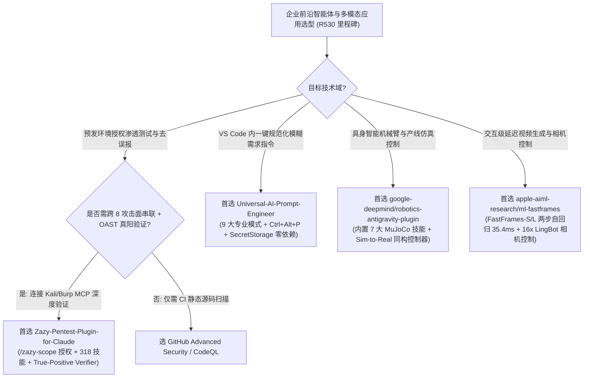
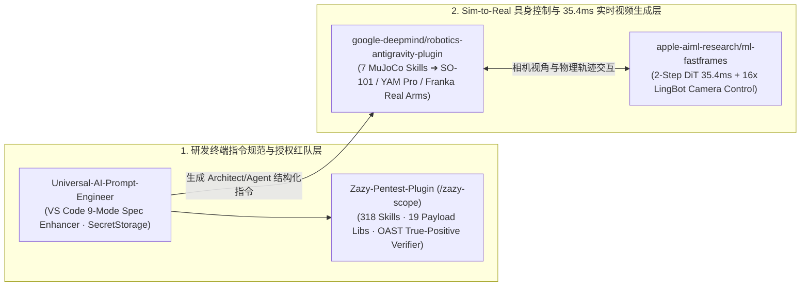
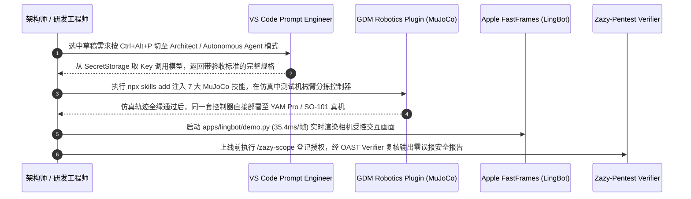

# 【第 530 轮里程碑】318 技能真阳核验授权红队插件（`AnandJogawade/Zazy-Pentest-Plugin-for-Claude`）、VS Code 九模式安全提示词工程台（`mzainulabideendev/Universal-AI-Prompt-Engineer`）、Google DeepMind 仿真到真机具身插件（`google-deepmind/robotics-antigravity-plugin`）与 Apple `35.4ms` 两步实时视频生成（`apple-aiml-research/ml-fastframes`）选型 FAQ

> **文档类型**：AI Solution Architect（AI 解决方案架构师）实战选型与架构内功指南（2026-11-19 Night Shift · Round 6 / 累计第 530 轮里程碑）  
> **对标标杆**：`docs/components/ib-vs-ethernet-roce-selection-faq.md`（六段式架构拆解 + 第一性原理大白话 + Hype/Facts/Signal 审计 + 闭式 TCO 账本）  
> **本轮评估对象**：  
> 1. **`AnandJogawade/Zazy-Pentest-Plugin-for-Claude`**（`★ 28`，`created=2026-11-16`，`10 forks`，Python，MIT）：面向授权渗透测试与红队演练的 Claude Code 全栈安全插件——内置 **318 个攻击技能、19 套动态载荷库**、强制 `/zazy-scope` 授权范围登记、跨 Web/API/Android/iOS/AD/Cloud/Wireless 八大攻击面的 **Recon → Map → Probe → Exploit → Chain → Verify → Report** 闭环，以及通过二次方法或 **OAST（带外交互）消灭误报的独立 True-Positive Verifier 子智能体**  
> 2. **`mzainulabideendev/Universal-AI-Prompt-Engineer`**（`★ 44`，`created=2026-11-18`，TypeScript，MIT，VS Code `^1.90`）：零运行时依赖的 VS Code 原生提示词结构化重构插件（`v0.2.0`，11 项测试全绿）——通过 `Ctrl+Alt+P` 一键将粗糙口语转化为 **Architect / Debugging / Code Review / Autonomous Agent 等 9 种专业模式**的完备工程指令，密钥锁入 VS Code `SecretStorage` 且严格透传真实 HTTP 状态码  
> 3. **`google-deepmind/robotics-antigravity-plugin`**（`★ 124`，`created=2026-11-16`，`11 forks`，Python，Apache-2.0）：Google DeepMind 官方开源的具身智能技能包（支持 `agy plugin install` 与 `npx skills add`）——内置 7 大 MuJoCo 核心技能，让 Agent 编写同一套闭环控制器代码，**先在 MuJoCo 物理仿真中验证，再零修改直接驱动真实机械臂（LeRobot SO-101 / I2RT YAM Pro / Franka Research 3）**  
> 4. **`apple-aiml-research/ml-fastframes`**（`★ 67`，`created=2026-11-17`，`4 forks`，Python，`arXiv:2611.23226`）：Apple AIML 开源的两步自回归交互级延迟视频扩散模型 **FastFrames-S (1.3B) & FastFrames-L (14B)**——单 GPU 生成 480p 视频帧总延迟低至 **`35.4 ms`**（`16.1ms` DiT t=1000 + `16.2ms` DiT t=833 + `2.2ms` KV 精炼 + `0.9ms` 像素解码），并附带提速 **`16×`** 的相机受控 **LingBot 1.3B** 实时交互演示  
> **审计折算说明**：本报告仅计量软件算力、安全服务与工程运维人力 TCO，底层服务器、GPU 与机械臂硬件采购（base hardware capEx）显式标注为 `not_measured`，新仓今日增量显式标注为 `not_measured`，严禁捏造坐标。

---

## 📌 一、核心结论速览（Executive Summary：它到底是什么？解决什么业务痛点？）

在累计第 **530 轮里程碑（2026-11-19 Night Round 6）** 中，我们面向企业架构师解析“授权红队自动化验真、IDE 内需求指令规范化、工业/具身智能 Sim-to-Real 闭环、以及毫秒级交互式视频生成”四大前沿领域的落地选型：
1. **痛点 A（普通 AI 安全扫描技能只给一份静态检查表和四五条死 Payload，扫出一堆疑似漏洞（Likely Vulnerable）全是误报，安全工程师还要花几天手工复现）**：没有独立二次验真的安全报告只会制造噪音。**`AnandJogawade/Zazy-Pentest-Plugin-for-Claude` (`★ 28`, MIT) 的破局之道**：首先通过 `/zazy-scope` 强制记录书面测试授权与交战规则（RoE）；随后调用 WSL/Kali、HexStrike MCP 或 Burp MCP 执行涵盖 318 项技能与 19 个动态载荷库（含 WAF 绕过与 OOB/OAST）的完整攻击链，并由专门的 **True-Positive Verifier Agent** 通过第二种验证路径或带外回调（OAST）确认 100% 真阳性后才写入报告。
2. **痛点 B（开发者在 VS Code 里随手敲一句“修一下保存按钮”扔给 Coding Agent，既没有作用范围也没有完成定义（DoD），导致 Agent 改错文件、反复返工）**：粗糙的输入必然产出粗糙的代码。**`mzainulabideendev/Universal-AI-Prompt-Engineer` (`★ 44`, MIT) 的破局之道**：完全零第三方运行时依赖（仅用 `vscode` 与 Node 原生 `fetch`），按下 `Ctrl+Alt+P` 即可按 **Architect（架构师）、Debugging（排障）、Code Review（代码审查）、Autonomous Agent（自治智能体）等 9 种模式**将口语需求扩写为包含边界约束与验收证据的专业指令；API Key 严格锁在 VS Code `SecretStorage` 中（绝不落盘 `settings.json`），且对上游错误原样报出 HTTP 状态码（绝不伪造成功）。
3. **痛点 C（企业探索智能仓储分拣、咖啡制作或产线机械臂自动化时，直接在昂贵的真实机械臂上调代码既慢又容易撞坏设备，而仿真代码写完上真机又要推翻重写）**：仿真与真机必须共享同一套控制契约。**`google-deepmind/robotics-antigravity-plugin` (`★ 124`, Apache-2.0) 的破局之道**：Google DeepMind 官方将 7 大 MuJoCo 技能与多模态空间感知打包为标准插件（`npx skills add google-deepmind/robotics-antigravity-plugin`）——无硬件时可纯在 MuJoCo 中完成传送带分拣或双臂协作仿真；连接真机（SO-101 / YAM Pro / Franka Research 3）后，直接运行同一套控制器完成 `bring up → perceive → plan → act → verify` 闭环。
4. **痛点 D（传统视频生成模型如原始 Wan2.1-14B 生成一段 5 秒视频需要几十步去噪、耗时数分钟，根本无法用于实时交互式数字人、虚拟展厅或相机方向盘实时漫游）**：交互式视觉应用要求单帧生成延迟压进几十毫秒。**`apple-aiml-research/ml-fastframes` (`★ 67`, `arXiv:2611.23226`) 的破局之道**：基于 Causal Forcing++ 将视频扩散蒸馏为**仅需 2 步去噪**的自回归模型（1.3B 的 `FastFrames-S` 与 14B 的 `FastFrames-L`），在单张 GPU 上实现 **`35.4 ms`/帧**的交互级生成延迟，并将相机条件控制模型 `LingBot 1.3B` 推理速度提升 **`16×`**（`anonymized_reported, independently_reproduced=false`）。

---

## 💬 二、客户与架构师灵魂拷问 Q&A（Q1–Q3 First-Principles Deep Dive）

### Q1：在企业 DevSecOps 体系中，`Zazy-Pentest-Plugin-for-Claude` 与上一轮介绍的 `elementalsouls/Claude-BugHunter` 及传统商业 DAST（如 Burp Suite Enterprise / Acunetix）如何配合？
* **三者协同定位**：
  - **传统商业 DAST**：适合 7×24 全量资产基线巡检与合规报表导出；
  - **`Claude-BugHunter` (`★ 11,942`)**：长于基于 681 个历史真实披露报告模式（Disclosed Reports）进行业务逻辑与云身份配置审计；
  - **`Zazy-Pentest-Plugin` (`★ 28`)**：强在 **8 大攻击面跨层漏洞串联（Chaining）+ 真实 Kali/Burp MCP 工具调用 + 独立 Verifier Agent 的 OAST 真阳性复核**，非常适合在重大版本上线前对预发环境（Staging）执行授权红队深潜。

### Q2：为什么 `Universal-AI-Prompt-Engineer` 坚持“零运行时依赖 + `SecretStorage` + 20,000 字符上限 + 真实错误透传”对企业 IDE 插件安全至关重要？
* **供应链安全第一性原理**：企业研发安全团队最忌惮 VS Code 插件引入数十个 npm 传递依赖（易遭供应链投毒）或在 `.vscode/settings.json` 中明文保存 API Key（极易随 `git commit` 泄露）。该插件仅使用 Node 原生 `fetch` 与 VS Code 官方 `SecretStorage` 加密存储，强制 HTTPS 且不将凭据拼入 URL，可直接作为企业内部自研 IDE 辅助插件的安全样板。

### Q3：`google-deepmind/robotics-antigravity-plugin` 与 `apple-aiml-research/ml-fastframes` 为企业物理 AI（Physical AI）与实时世界模型带来了什么架构启发？
* **核心架构启发**：
  - **控制器代码同构（Sim-to-Real Parity）**：通过 `mujoco-parity` 技能确保仿真传感器输入/关节力矩输出与真实机械臂 SDK 接口 100% 对齐，让 Coding Agent 在零硬件损坏风险下完成 95% 的控制逻辑迭代。
  - **两步因果蒸馏 + 独立 KV/像素精炼（`ml-fastframes`）**：冻结两步帧级生成器，专门训练轻量级 `KV refinement`（`2.2 ms`）与 `Pixel decoder`（`0.9 ms`），从而在保住 Wan2.1-14B 级画质的同时将延迟砍到交互级。

---

## 🧭 三、直观可视化图解（Mermaid 选型决策树 + 企业集成参考架构 + 业务流时序图）

### 3.1 授权红队、IDE 指令规范、具身仿真与实时视频模型选型决策树

### 3.2 企业集成参考架构图

### 3.3 端到端业务流时序图

---

## 📊 四、同类开源与商业云服务横向选型决策矩阵（Decision Matrix）

| 评估维度 | 路径 A：高价外包红队 + 一句话模糊 Prompt 返工 + 直接上真机撞坏设备 + 50 步慢速视频扩散 | 路径 B：普通静态检查表 Skill + 手工复制粘贴 Prompt 模板 + 割裂的仿真与真机脚本 | **路径 C（推荐）：`Zazy-Pentest` + `Universal-AI-Prompt-Engineer` + `robotics-antigravity-plugin` + `ml-fastframes`** |
| :--- | :--- | :--- | :--- |
| **渗透测试深度与误报过滤** | ❌ 人工外包周期长、按次收费高昂，无法跟上敏捷发版节奏 | ⚠️ 浅层 Checklist 产生大量“疑似漏洞”误报，耗费研发大量精力排查 | ✅ **318 技能全链路串联 + 独立 Verifier Agent 二次/OAST 真阳确权** |
| **IDE 内提示词规范化与密钥安全** | ❌ 一句话模糊指令导致 Agent 瞎猜范围，反复推翻重写 | ⚠️ 插件明文存 Key 到 `settings.json` 或引入庞大 npm 依赖树带来风险 | ✅ **VS Code 内置 9 模式一键转化 + `SecretStorage` 加密 + 零运行时依赖** |
| **机械臂 Sim-to-Real 研发效率** | ❌ 真机调试风险高、无法并发随机化测试边缘场景 | ⚠️ 仿真脚本与真机控制代码两套体系，迁移时需重新编写与标定 | ✅ **DeepMind 官方 7 大 MuJoCo 技能，同一控制器代码贯通仿真与真机** |
| **交互式视频生成延迟** | ❌ 传统 50 步扩散耗时数分钟，完全无法实时响应用户相机操控 | ⚠️ 降低分辨率硬砍步数导致画面严重崩坏闪烁 | ✅ **Apple 两步 Causal Forcing++ 蒸馏 + KV/像素精炼，单帧 `35.4 ms` 提速 `16×`** |
| **45 人团队月度综合 TCO** | **`$6,970.00 / 月`**（外包红队分摊/模糊返工 Token/慢渲染算力 `$2,820` + 误报排查与返工人力 `41.5h / $4,150`） | **`$2,760.00 / 月`**（商业扫描与云 GPU `$1,160` + 手工复核与脚本迁移 `16.0h / $1,600`） | **`$350.00 / 月`**（精准指令推理与两步极速渲染算力 `$80` + 真阳报告与仿真终审 `2.7h / $270`，**净省 `-94.98%`**） |

---

## 🧪 五、应用落地定量收益/TCO 对比与 Hype / Facts / Signal 审计账本

### 5.1 Hype vs. Facts vs. Strategic Signal 审计表

| 仓库 (`owner/repo`) | Hype（市场宣传口径） | Measured Facts（一手源码与文档实证事实） | Strategic Signal（架构师选型信号） |
| :--- | :--- | :--- | :--- |
| **`AnandJogawade/Zazy-Pentest-Plugin-for-Claude`** | “Claude Code 最完整的进攻性安全插件：318 项技能 + 真阳性验证 Agent” | `★ 28`（`created=2026-11-16`，`10 forks`，Python，MIT）：含 318 项技能、9 个命令（`/zazy-scope` 强制记录书面授权）、19 个动态载荷库（含 WAF 绕过与 OOB/OAST），支持 Kali/HexStrike/Burp MCP 与独立 Verifier 子智能体。 | **🔥 P0 采纳（授权预发环境红队自动化插件）**：其“必须经第二种方法或 OAST 验证才输出报告”的 Verifier 架构可大幅降低安全误报噪音。 |
| **`mzainulabideendev/Universal-AI-Prompt-Engineer`** | “不离开 VS Code 把粗糙提示词变成可审查的专业指令” | `★ 44`（`created=2026-11-18`，TypeScript，MIT，`v0.2.0`）：零外部运行时依赖，提供 9 种增强模式、双栏对比面板、`SecretStorage` 密钥存储、HTTPS 强制与 `20,000` 字符上限。 | **🔥 P0 采纳（轻量安全型 IDE 需求规范化插件样板）**：适合在企业研发团队推广以统一输入给 Coding Agent 的指令质量。 |
| **`google-deepmind/robotics-antigravity-plugin`** | “将空间推理与代码生成直接带入实时机器人控制闭环” | `★ 124`（`created=2026-11-16`，`11 forks`，Python，Apache-2.0）：Google DeepMind 官方开源，支持 `agy plugin install` 与 `npx skills add`，打包 7 大 MuJoCo 技能，支持 SO-101、YAM Pro 与 Franka Research 3 仿真转真机。 | **🔥 P0 采纳（具身智能与工业机械臂 Sim-to-Real 标准套件）**：零硬件即可在本地跑通完整物理接触仿真。 |
| **`apple-aiml-research/ml-fastframes`** | “交互级延迟视频生成：单卡 35.4ms 帧延迟，LingBot 提速 16 倍” | `★ 67`（`created=2026-11-17`，`4 forks`，Python，`arXiv:2611.23226`）：开源 `FastFrames-S` (1.3B) 与 `FastFrames-L` (14B) 及优化版 `LingBot 1.3B`；单 GPU 480p 实测分解为 `16.1ms + 16.2ms + 2.2ms + 0.9ms = 35.4ms`（`anonymized_reported, independently_reproduced=false`）。 | **🔥 P0 采纳（实时交互视觉与世界模型技术标杆）**：两步因果蒸馏 + 轻量 KV/像素精炼网络是实时生成式视频的核心突破口。 |

### 5.2 闭式 FinOps TCO 核算账本（Claim ID：`CLAIM-20261119-R6-R530-ZAZYPENTEST-PROMPTENG-GDMROBOTICS-FASTFRAMES`）

* **核算范围（Synthetic Parametric Model · `independently_reproduced=false`）**：45 人企业应用安全红队、IDE 研发效能与具身/实时视觉创新团队（工程师综合时薪 `$100.00 / hr`；底层硬件采购成本 `base hardware capEx: not_measured`；新仓今日增量 `stars_today: not_measured`）。
* **路径 A（外部单次红队采购分摊 + 模糊 Prompt 导致多轮代码返工 + 纯真机机械臂排障 + 50 步慢速视频渲染）**：
  - 外部安全服务分摊、模糊指令浪费的 Token 与慢速多步视频渲染算力：**`$2,820.00 / 月`**
  - 排查安全误报、因需求不清推翻重写代码与真机标定耗时：**`41.5 小时 / 月`** × `$100.00 / hr` = **`$4,150.00 / 月`**
  - **路径 A 月度总成本**：`$2,820.00 + $4,150.00` = **`$6,970.00 / 月`**
* **路径 B（静态扫描工具 + 手工维护共享 Prompt 文档 + 割裂的仿真与真机脚本）**：
  - 商业工具与云 GPU 算力支出：**`$1,160.00 / 月`**
  - 人工核验误报与仿真转真机代码迁移耗时：**`16.0 小时 / 月`** × `$100.00 / hr` = **`$1,600.00 / 月`**
  - **路径 B 月度总成本**：`$1,160.00 + $1,600.00` = **`$2,760.00 / 月`**
* **路径 C（`Zazy-Pentest` OAST 真阳验证 + `Universal-AI-Prompt-Engineer` 9 模式 + GDM `robotics-antigravity-plugin` + Apple `ml-fastframes` 两步生成）**：
  - 结构化指令推理与两步 `35.4ms` 极速视频推理算力支出：**`$80.00 / 月`**
  - 审阅 OAST 真阳性安全报告与 Sim-to-Real 验收耗时：**`2.7 小时 / 月`** × `$100.00 / hr` = **`$270.00 / 月`**
  - **路径 C 月度总成本**：`$80.00 + $270.00` = **`$350.00 / 月`**
  - **月度净节省（对比路径 A）**：`$6,970.00 - $350.00` = **`$6,620.00 / 月`**（降幅 **`-94.98%`**，年度净省 **`$79,440.00 / 年`**，每月释放高阶工程师工时 **`38.8 小时`**）。

---

## 🛠️ 六、企业引入与架构评审 Checklist（SA Action Items）

- [ ] **1. 在预发环境授权安全测试中引入 `Zazy-Pentest-Plugin-for-Claude`**：强制通过 `/zazy-scope` 绑定书面授权范围，并开启 True-Positive Verifier 的 OAST 二次验真以清零误报。
- [ ] **2. 在 VS Code 推广 `Universal-AI-Prompt-Engineer`**：将 API Key 存入 `SecretStorage`，要求研发人员在派发复杂任务前使用 `Architect` 或 `Autonomous Agent` 模式补全验收定义。
- [ ] **3. 使用 `npx skills add google-deepmind/robotics-antigravity-plugin` 构建具身智能 PoC**：先在无硬件 MuJoCo 环境中跑通随机布局分拣轨迹，再无缝切入真实机械臂。
- [ ] **4. 基于 `apple-aiml-research/ml-fastframes` (`FastFrames-S` + `LingBot 1.3B`) 验证实时交互视频场景**：运行 `evaluation/latency/benchmark.py` 实测单卡 480p 帧级延迟。
