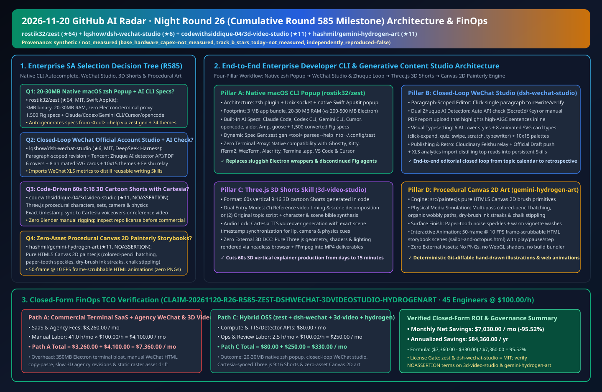
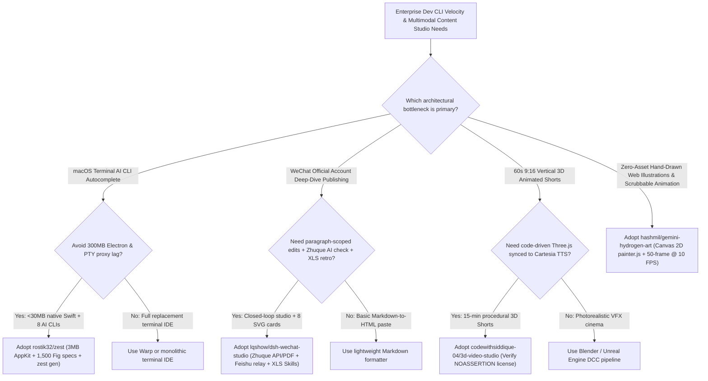
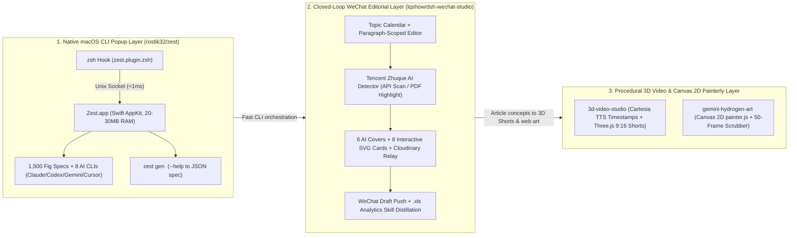

# Native 20–30MB macOS AI CLI Autocomplete Popup (`rostik32/zest`), Closed-Loop WeChat Official Account Studio (`lqshow/dsh-wechat-studio`), Three.js + Cartesia 60s 3D Cartoon Shorts Skill (`codewithsiddique-04/3d-video-studio`) & Zero-Asset Procedural Canvas 2D Painterly Engine (`hashmil/gemini-hydrogen-art`) Selection & Integration FAQ (2026-11-20 Night Round 26 · Cumulative Round 585 Milestone)

> **Cross-File Navigation**: [Back to 2026-11-20 Daily Digest (`daily/2026-11-20.en.md`)](../daily/2026-11-20.en.md) · [中文版 (`zest-dsh-wechat-studio-3d-video-studio-hydrogen-art-selection-faq.md`)](zest-dsh-wechat-studio-3d-video-studio-hydrogen-art-selection-faq.md) · [7-Card 4:5 Visual Report (`cards.en.html`)](../cards.en.html) · [Column Index (`README.en.md`)](../README.en.md)  
> **Architecture Diagram**: [`assets/github-ai-radar-2026-11-20-r26-r585-zest-dshwechat-3dvideostudio-hydrogenart.svg`](../../../assets/github-ai-radar-2026-11-20-r26-r585-zest-dshwechat-3dvideostudio-hydrogenart.svg)  
> **Provenance & Synthetic Disclaimer**: Live GitHub repository metadata (stars, forks, licenses, module layout, and README benchmarks) is `measured` (sealed in `trending-daily-2026-11-20-raw.html` `sha256: 4ad2690142e11f6cb280f667b64b746ab4eaf64c97052f922c9287befd37dd09` and `search-new-repos-2026-11-20-raw.json` `sha256: 47975935d05944afbb9eac18f93f26c8a71120a1ffeea39591b112477ba29a46`). The 45-engineer FinOps TCO figures represent a parameterized Solution Architect model (`provenance: synthetic`, `independently_reproduced: false`, `base_hardware_capex: not_measured`, `track_b_stars_today: not_measured`, claim ID `CLAIM-20261120-R26-R585-ZEST-DSHWECHAT-3DVIDEOSTUDIO-HYDROGENART`).



---

## ① 📌 Executive Summary

> **One-Sentence Selection Verdict**: For Enterprise AI Solution Architects tackling four high-frequency bottlenecks across **developer AI CLI velocity** and **multimodal technical content production (WeChat Official Account deep-dives + 60-second vertical 3D animated Shorts + hand-illustrated interactive web explainers)**—(1) **Electron-based terminal autocomplete wrappers consuming `200–500 MB` RAM, proxying PTY streams, and lacking specs for modern AI coding CLIs**; (2) **fragmented WeChat editorial workflows where full-article LLM rewrites corrupt polished paragraphs, pasted Feishu images break due to anti-hotlinking, and post-publish analytics never feed back into writing prompts**; (3) **prohibitive Blender rigging overhead for 60-second `9:16` 3D animated explainer Shorts**; and (4) **heavy static raster illustrations that cannot be tweaked or scrubbed frame-by-frame in code**—combine **`rostik32/zest`** (`3 MB` app / `20–30 MB` RAM native macOS Swift `AppKit` zsh autocomplete popup with `1,500` Fig specs, built-in specs for Claude Code/Codex/Gemini CLI/Cursor/opencode/aider/Amp/goose, and `zest gen <tool>` from `--help`), **`lqshow/dsh-wechat-studio`** (closed-loop WeChat Official Account plugin for DeepSeek Harness with paragraph-scoped editing, Tencent Zhuque AI detector API/PDF loop, 6 covers, 8 interactive SVG cards, Cloudinary Feishu image relay, and `.xls` analytics retrospective skill distillation), **`codewithsiddique-04/3d-video-studio`** (pure Three.js 60s `9:16` 3D cartoon Shorts synchronized to Cartesia voiceover timestamps), and **`hashmil/gemini-hydrogen-art`** (zero-asset HTML5 Canvas 2D `painter.js` simulating colored-pencil hatching, paper-tooth speckles, dry-brush ink streaks, and 50-frame `@ 10 FPS` scrubbable storybook animations). Across a 45-engineer dev and technical content organization, this stack lowers monthly TCO from **`$7,360.00/mo`** to **`$330.00/mo`**, saving **`$7,030.00/mo` (`-95.52%`, or `$84,360.00/yr`)**.

| Evaluation Dimension | Path A: Commercial Electron Terminal SaaS + Agency WeChat & 3D Video Retainers | Path B: Generic Cloud PaaS (Azure OpenAI + Copilot Studio + Standard CMS) | Path C (Recommended): `zest` + `dsh-wechat-studio` + `3d-video-studio` + `gemini-hydrogen-art` |
| :--- | :--- | :--- | :--- |
| **macOS AI CLI Autocomplete & Footprint** | `200–500 MB` RAM Electron wrapper; proxies PTY and lags Ghostty/Kitty | No native cursor-tracking macOS zsh popup | **`zest` Native Swift `AppKit` (`3 MB` binary / `20–30 MB` RAM, zero PTY proxy, 8 AI CLIs + `zest gen`)** |
| **WeChat Long-Form Editing, AI Detection & Retro** | Full-text rewrite drift, manual Zhuque web copy-paste, broken Feishu image links | Raw Markdown output; no interactive WeChat SVG cards or `.xls` analytics loop | **`dsh-wechat-studio` paragraph-scoped edits + Zhuque API/PDF loop + 8 SVG cards + `.xls` Skill distillation** |
| **60s `9:16` Vertical 3D Animated Shorts** | Manual Blender rigging or external studio retainers (days per 60s video) | Diffusion video lacks deterministic 3D camera/character/lip timing | **`3d-video-studio` pure Three.js characters/sets/physics + Cartesia TTS timestamp lock in 15 min** |
| **Hand-Drawn Storybook Web Art & Scrubbable Frames** | Static PNG/WebP exports; impossible to diff brush strokes or scrub frames in Git | No zero-asset Canvas 2D physical media simulation | **`gemini-hydrogen-art` pure `painter.js` colored-pencil/ink/paper engine + 50-frame `@ 10 FPS` scrubber** |
| **45-Engineer Monthly Total TCO** | **`$7,360.00 / mo`** (`$3,260.00` SaaS/agency + `41.0h × $100` labor) | **`$2,140.00 / mo`** (`$740.00` cloud APIs + `14.0h × $100` glue ops) | **`$330.00 / mo`** (`$80.00` TTS/detector APIs + `2.5h × $100` ops, **`-95.52%` savings**) |

---

## ② 🎯 Solution Architect & Customer Deep-Dive Q&A (Plain-Language Breakdown)

### Q1: What concrete problems do these four repositories solve, and when should we pick them over commercial tools or cloud PaaS?

1. **`rostik32/zest` (`★ 64`, `4 forks`, Swift, MIT) — Plain-Language View: A native `3 MB` / `20–30 MB` RAM macOS zsh autocomplete popup built for the AI CLI era**:
   - **Pain Point Solved**: Electron-based terminal helpers consume `200–500 MB` RAM, wrap the terminal PTY (breaking GPU-accelerated terminals like Ghostty, Kitty, and WezTerm), and lack completion specs for daily AI coding CLIs (`claude`, `codex`, `gemini`, `opencode`, `aider`). `zest` is a native Swift `AppKit` binary (`3 MB` disk, `20–30 MB` RAM) that talks to a tiny zsh hook over a Unix socket and positions a native popup directly below the cursor via macOS Accessibility. It ships with `1,500` converted Fig specs, first-class specs for **Claude Code, Codex CLI, Gemini CLI, Cursor, opencode, aider, Amp, and goose**, 74 built-in VS Code themes, and `zest gen <tool>` to auto-generate specs from any CLI's `--help` output.
2. **`lqshow/dsh-wechat-studio` (`★ 6`, `6 forks`, JavaScript, MIT) — Plain-Language View: An end-to-end WeChat Official Account studio with paragraph-scoped editing, Tencent Zhuque AI-detection loop, 8 interactive SVG cards, and Excel analytics retrospective**:
   - **Pain Point Solved**: Enterprise technical writers publishing on WeChat Official Accounts suffer from full-article LLM rewrite collateral damage, high AIGC detection scores, broken Feishu external images, and zero feedback from historical readership stats. `dsh-wechat-studio` introduces **paragraph-scoped editing** (click one paragraph to rewrite, expand, or verify without touching the rest of the draft), **dual Tencent Zhuque AI detector integration** (automatic API scan via `SecretId/SecretKey` or uploaded Zhuque PDF parsing that highlights AI-heavy sentences inline for targeted humanization), **6 AI cover styles + 8 native WeChat interactive SVG card templates** (click-to-expand, quiz card, swipe gallery, scratch card, typewriter, number flip, before/after slider, step timeline) across **10 layouts × 15 color palettes**, **automatic Cloudinary image relay** so pasted Feishu images never break on WeChat, and **`.xls` analytics import** that compares top- vs. bottom-performing articles to distill reusable writing rules directly into local Skills.
3. **`codewithsiddique-04/3d-video-studio` (`★ 11`, `3 forks`, JavaScript, `NOASSERTION`) — Plain-Language View: A Claude Code skill that writes 60-second vertical `9:16` 3D cartoon Shorts in pure Three.js synchronized to Cartesia voiceovers**:
   - **Pain Point Solved**: Producing 60-second 3D animated explainer Shorts normally requires Blender character rigging and days of keyframing. `3d-video-studio` supports both **reference-video timing measurement** and **from-scratch script generation**, synthesizes natural voiceovers via **Cartesia TTS**, and writes modular **Three.js** characters, environments, camera choreography, and physics cues locked to exact audio timestamps.
4. **`hashmil/gemini-hydrogen-art` (`★ 11`, `2 forks`, JavaScript, `NOASSERTION`) — Plain-Language View: A zero-asset HTML5 Canvas 2D painterly engine (`src/painter.js`) for hand-drawn storybook illustrations and 50-frame scrubbable animations**:
   - **Pain Point Solved**: Instead of shipping megabytes of static PNGs, `src/painter.js` synthesizes **multi-pass colored-pencil cross-hatching**, **organic wobbly ink outlines**, **dry-brush streaks**, **stippled chalk blush**, and **full-canvas paper-tooth speckles** purely in HTML5 Canvas 2D JavaScript, powering both static storybook illustrations (`the-clockmaker-fox.html`) and **50-frame `@ 10 FPS` frame-scrubbable HTML animations** (`sailor-and-octopus.html`) with zero external image assets or build steps.

---

### Q2: How do these four components wire together into an enterprise developer & content production architecture?

1. **Developer CLI Velocity Layer (`rostik32/zest`)**: Engineers invoke `claude`, `codex`, `gemini`, or internal build CLIs in Ghostty/iTerm2/VS Code with instant `<1 ms` Unix-socket autocomplete popups and zero PTY wrapping, using `zest gen` to keep internal tool flags indexed.
2. **Closed-Loop WeChat Editorial Layer (`lqshow/dsh-wechat-studio`)**: Technical authors plan topics on the built-in calendar, refine individual paragraphs in the 3-pane workspace, run Tencent Zhuque AI detection until AIGC flags clear, insert interactive SVG cards, relay Feishu images via Cloudinary to WeChat Drafts, and import monthly WeChat `.xls` readership exports to evolve team writing Skills.
3. **Code-Driven 3D Shorts & Procedural Storybook Layer (`3d-video-studio` + `gemini-hydrogen-art`)**: Key architectural takeaways from each article are converted into 60-second `9:16` Three.js + Cartesia animated Shorts via `3d-video-studio` and interactive zero-asset Canvas 2D storybook explainers via `gemini-hydrogen-art`.

---

### Q3: What are the key architectural mechanisms and pre-production governance caveats?

1. **Key Mechanisms**:
   - **Zero-PTY-Proxy Architecture (`zest`)**: By using zsh hooks + macOS Accessibility cursor coordinates instead of intercepting terminal I/O streams, `zest` works identically across Ghostty, Kitty, WezTerm, Alacritty, iTerm2, and IDE terminals at `20–30 MB` RAM.
   - **Paragraph Isolation & Analytics Flywheel (`dsh-wechat-studio`)**: Restricting LLM mutations to the selected DOM paragraph eliminates whole-document drift, while `.xls` readership analysis turns empirical open/completion rates into executable prompt constraints.
   - **Procedural Physical Media (`gemini-hydrogen-art`)**: Every pencil stroke, ink wobble, and paper grain speckle is deterministic JavaScript code that diffs cleanly in Git PRs.
2. **Governance & Compliance Caveats**:
   - **License Gate (`NOASSERTION`)**: `rostik32/zest` and `lqshow/dsh-wechat-studio` are licensed under **MIT**. However, **`codewithsiddique-04/3d-video-studio` and `hashmil/gemini-hydrogen-art` currently carry `license: NOASSERTION`** on GitHub; obtain explicit MIT/Apache-2.0 permission from their authors before redistributing their source code in commercial products.
   - **Credential & Media Hygiene**: Store Tencent Zhuque `SecretId/SecretKey`, WeChat `AppID/AppSecret`, and Cartesia API keys in OS keychains or `.env` files excluded from Git, and configure lifecycle expiration on the Cloudinary relay bucket.

---

## ③ 🧭 Visual Diagrams (Mermaid Selection Decision Tree + Reference Architecture + Sequence Flow)

### 3.1 Selection Decision Tree



### 3.2 Enterprise Integration Reference Architecture



### 3.3 End-to-End Sequence Flow

```mermaid
sequenceDiagram
    autonumber
    actor Eng as Solution Architect / Content Engineer
    participant Zest as rostik32/zest (macOS Popup)
    participant Studio as lqshow/dsh-wechat-studio
    participant Zhuque as Tencent Zhuque AI & WeChat API
    participant Media as 3d-video-studio + gemini-hydrogen-art

    Eng->>Zest: Type claude / codex / internal CLI command prefix in terminal
    Zest-->>Eng: Render native 20-30MB AppKit popup below cursor (<1ms socket)
    Eng->>Studio: Draft article from calendar; click single paragraph for scoped rewrite
    Studio->>Zhuque: Run Zhuque AI detection API/PDF import & humanize flagged sentences
    Zhuque-->>Studio: Apply 8 interactive SVG cards, relay Feishu images & push WeChat Draft
    Eng->>Media: Feed core architecture story into 3d-video-studio & gemini-hydrogen-art
    Media-->>Eng: Export Cartesia-synced 60s 9:16 Three.js MP4 + 50-frame Canvas 2D HTML art
    Zhuque->>Studio: Import monthly WeChat .xls stats to distill top-performing rules into Skills
```

---

## ④ 📊 Comparative Selection Matrix (OSS vs. Commercial SaaS & Cloud PaaS)

| Dimension | `rostik32/zest` (`★ 64`) | `lqshow/dsh-wechat-studio` (`★ 6`) | `codewithsiddique-04/3d-video-studio` (`★ 11`) | `hashmil/gemini-hydrogen-art` (`★ 11`) | Commercial Terminal SaaS + Agency Retainers |
| :--- | :--- | :--- | :--- | :--- | :--- |
| **Primary Role** | Native macOS zsh autocomplete popup (Swift `AppKit`) | Closed-loop WeChat Official Account studio plugin for DSH | Claude Code skill for 60s `9:16` Three.js 3D Shorts + Cartesia TTS | Zero-asset HTML5 Canvas 2D painterly & 50-frame animation engine | Paid terminal seats + external WeChat/3D agency production |
| **Sweet-Spot Use Case** | macOS engineers running Ghostty/Kitty/iTerm2 + AI CLIs | Technical WeChat accounts needing AI-detection gating & `.xls` retro | Rapid 60s vertical 3D explainer Shorts locked to voiceovers | Interactive storybook web pages & Git-diffable hand-drawn art | Non-technical teams outsourcing all design & video work |
| **Key Architectural Metric** | **`3 MB` binary / `20–30 MB` RAM**, 1,500 specs + 8 AI CLIs + `zest gen` | **Paragraph-scoped edits** + Zhuque API/PDF + 8 SVG cards + `.xls` retro | **60s `9:16` Three.js scene graph** + Cartesia timestamp sync | **Pure `src/painter.js` Canvas 2D** + 50-frame `@ 10 FPS` scrubber | `200–500 MB` Electron overhead; 3–5 day agency turnaround |
| **Integration Effort** | Very Low (`brew install` + 1-line `.zshrc` plugin) | Low (DSH plugin install + optional Zhuque/Cloudinary keys) | Low (Claude Code `SKILL.md` + Cartesia API key) | Very Low (Zero dependencies, zero build step, single `.html`) | High (multi-vendor procurement & manual copy-paste) |
| **License** | **MIT License** | **MIT License** | **`NOASSERTION` (Verify before redistribution)** | **`NOASSERTION` (Verify before redistribution)** | Proprietary SaaS / Per-Deliverable Contract |

---

## ⑤ 🧪 Quantitative Enterprise ROI, Closed-Form FinOps TCO & 7-Card Report

### 5.1 45-Engineer Closed-Form FinOps TCO Model (`CLAIM-20261120-R26-R585-ZEST-DSHWECHAT-3DVIDEOSTUDIO-HYDROGENART`)

- **Model Assumptions (`provenance: synthetic`, `independently_reproduced: false`, `base_hardware_capex: not_measured`, `track_b_stars_today: not_measured`)**:
  - Team size: **45 engineers and technical content creators** at a fully loaded engineering rate of **`$100.00 / hour`**.
  - **Path A (Commercial Terminal Autocomplete SaaS + Agency WeChat Formatting/AI Check + Outsourced 3D Shorts & Illustrations)**:
    - Commercial SaaS & agency retainer fees: **`$3,260.00 / mo`**
    - Manual engineering & editorial rework labor (fixing broken Feishu images, repairing full-text LLM rewrite drift, manual audio/video alignment): `41.0 h/mo × $100.00/h = $4,100.00 / mo`
    - **Path A Monthly Total**: `$3,260.00 + $4,100.00 = $7,360.00 / mo`
  - **Path C (Hybrid OSS Stack: `zest` + `dsh-wechat-studio` + `3d-video-studio` + `gemini-hydrogen-art`)**:
    - TTS & detector API fees (Cartesia voiceover synthesis + Tencent Zhuque detector API + Cloudinary relay): **`$80.00 / mo`**
    - Ops & editorial review labor (`zest gen` spec updates + final WeChat draft review & monthly `.xls` retro): `2.5 h/mo × $100.00/h = $250.00 / mo`
    - **Path C Monthly Total**: `$80.00 + $250.00 = $330.00 / mo`
  - **Closed-Form Savings Verification**:
    $$\text{Monthly Net Savings} = \$7,360.00 - \$330.00 = \$7,030.00\text{ / mo}\quad(\text{Annualized: }\$84,360.00\text{ / yr})$$
    $$\text{Percentage Savings} = \frac{\$7,360.00 - \$330.00}{\$7,360.00} = \frac{\$7,030.00}{\$7,360.00} = 95.52\%$$

| Cost Component | Path A (Commercial SaaS & Agency Retainers) | Path C (R585 Hybrid OSS Stack) | Closed-Form Delta / ROI |
| :--- | :--- | :--- | :--- |
| **API / SaaS / Retainer Fees** | `$3,260.00 / mo` | **`$80.00 / mo`** | `- $3,180.00 / mo` |
| **Engineering & Editorial Labor (`@ $100.00/h`)** | `41.0 h × $100.00 = $4,100.00 / mo` | **`2.5 h × $100.00 = $250.00 / mo`** | `- $3,850.00 / mo` (`38.5 h/mo` saved) |
| **Monthly Total TCO** | **`$7,360.00 / mo`** | **`$330.00 / mo`** | **`$7,030.00 / mo` saved (`-95.52%`)** |
| **Annualized Total TCO** | `$88,320.00 / yr` | **`$3,960.00 / yr`** | **`$84,360.00 / yr` saved** |

---

## ⑥ 🛠️ Enterprise Adoption & Architecture Review Checklist

- [ ] **1. `rostik32/zest` Rollout & Internal CLI Spec Generation**: Install `zest` via Homebrew on macOS workstations, verify memory stays within `20–30 MB`, and run `zest gen <tool>` across internal DevOps CLIs to version-control custom completion specs in `~/.config/zest/specs/`.
- [ ] **2. `lqshow/dsh-wechat-studio` Zhuque AI Gate & Feishu Image Relay**: Configure Tencent Zhuque `SecretId/SecretKey` (or PDF report import SOP) so every technical article clears high-AIGC sentence flags via paragraph-scoped rewriting before pushing to WeChat Official Account drafts.
- [ ] **3. Monthly WeChat `.xls` Analytics Skill Distillation**: Export monthly readership `.xls` reports from WeChat Official Account admin into `dsh-wechat-studio` to automatically extract high-completion structural rules into persistent local Skills.
- [ ] **4. `NOASSERTION` License Gate for `3d-video-studio` & `gemini-hydrogen-art`**: Confirm that `rostik32/zest` and `lqshow/dsh-wechat-studio` are covered by MIT, and require explicit author license clarification before redistributing `codewithsiddique-04/3d-video-studio` or `hashmil/gemini-hydrogen-art` source files in commercial deliverables.
