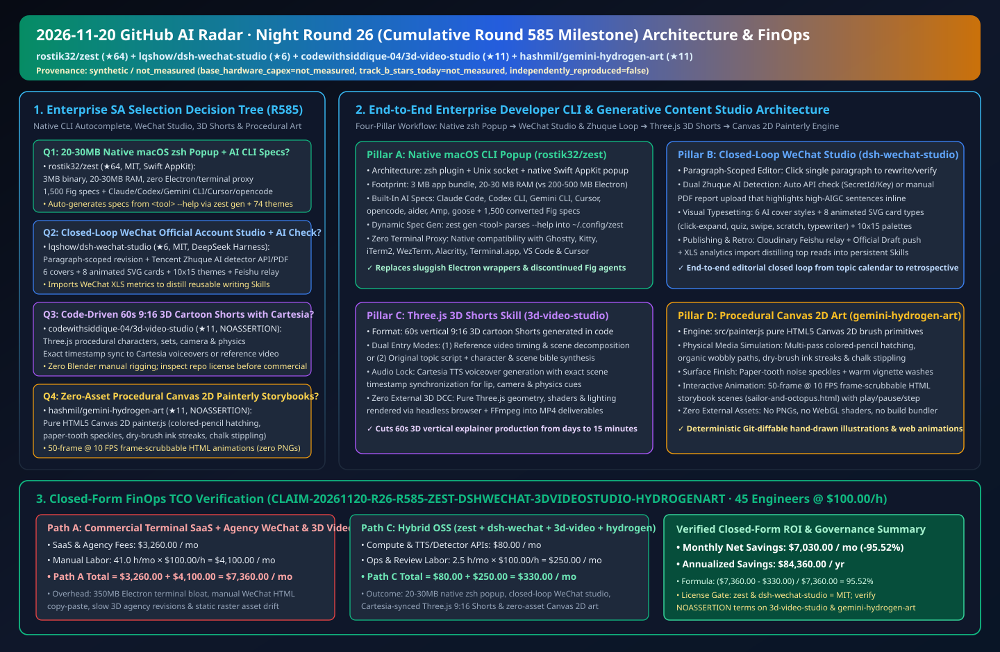
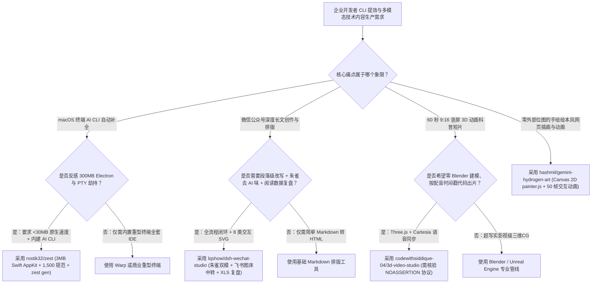
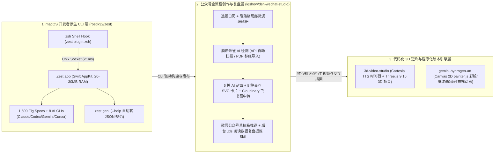
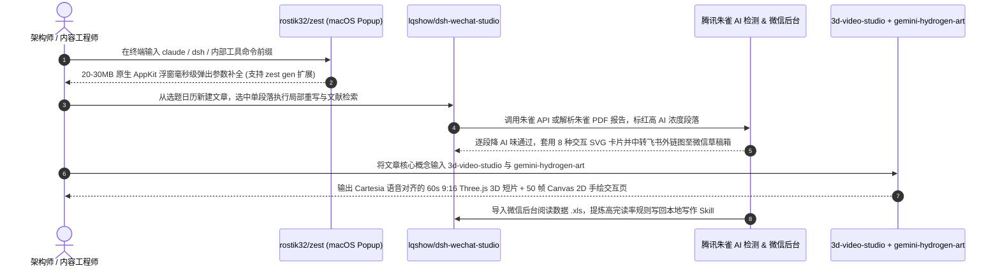

# 20–30MB 原生 macOS AI 终端补全弹窗（`rostik32/zest`）、公众号朱雀去 AI 味全流程工作台（`lqshow/dsh-wechat-studio`）、Three.js + Cartesia 60 秒竖屏 3D 动画工作台（`codewithsiddique-04/3d-video-studio`）与零外部素材 Canvas 2D 手绘绘本引擎（`hashmil/gemini-hydrogen-art`）架构选型与集成 FAQ（2026-11-20 Night Round 26 · 累计 Round 585 Milestone）

> **跨文件导航**：[返回 2026-11-20 当日全景日报 (`daily/2026-11-20.md`)](../daily/2026-11-20.md) · [English Version (`zest-dsh-wechat-studio-3d-video-studio-hydrogen-art-selection-faq.en.md`)](zest-dsh-wechat-studio-3d-video-studio-hydrogen-art-selection-faq.en.md) · [查看 7-Card 4:5 评测报告 (`cards.html`)](../cards.html) · [返回专栏主索引 (`README.md`)](../README.md)  
> **本轮架构大图**：[`assets/github-ai-radar-2026-11-20-r26-r585-zest-dshwechat-3dvideostudio-hydrogenart.svg`](../../../assets/github-ai-radar-2026-11-20-r26-r585-zest-dshwechat-3dvideostudio-hydrogenart.svg)  
> **数据溯源与口径声明（Provenance & Synthetic Disclaimer）**：本报告中实时采集的 GitHub 仓库元数据（Stars、Forks、License、模块架构与 README 基准数据）为 `measured`（证据封存于 `trending-daily-2026-11-20-raw.html` `sha256: 4ad2690142e11f6cb280f667b64b746ab4eaf64c97052f922c9287befd37dd09` 与 `search-new-repos-2026-11-20-raw.json` `sha256: 47975935d05944afbb9eac18f93f26c8a71120a1ffeea39591b112477ba29a46`）；针对 45 人研发与技术内容团队的 FinOps TCO 测算模型参数属于架构师参数化测算模型（`provenance: synthetic`，`independently_reproduced: false`，`base_hardware_capex: not_measured`，`track_b_stars_today: not_measured`，审计契约号 `CLAIM-20261120-R26-R585-ZEST-DSHWECHAT-3DVIDEOSTUDIO-HYDROGENART`）。

---

## ① 📌 核心结论速览（Executive Summary）

> **一句话选型结论**：面向企业 AI 解决方案架构师（SA）在推进**开发者 AI 命令行高频协同**与**技术内容多模态自动化生产（微信公众号深度长文 + 60 秒竖屏 3D 动画短片 + 手绘绘本级交互插画）**时的四大落地痛点——① **Electron 终端补全工具常驻吞噬 `200–500 MB` 内存、劫持伪终端（PTY）拖慢按键响应且缺乏主流 AI CLI 补全规范**；② **企业技术公众号创作陷入“AI 初稿味道重、改单段牵动全文、飞书外链图粘贴微信失效、发布后阅读数据无法反哺写作规范”的割裂循环**；③ **制作 60 秒 `9:16` 竖屏 3D 角色动画解说短片需要动用 Blender 绑定与高昂外包**；④ **产品发布会与互动式技术绘本依赖数十 MB 静态位图，无法在 Git 中按代码审阅笔触与帧序列**——建议将 **`rostik32/zest`**（`3 MB` 二进制 / `20–30 MB` 内存的原生 macOS Swift `AppKit` zsh 补全弹窗，内建 `1,500` 个 Fig 规范与 Claude Code / Codex CLI / Gemini CLI / Cursor / opencode 等 8 大 AI CLI 规范，支持 `zest gen <tool>` 从 `--help` 自动生成规范）、**`lqshow/dsh-wechat-studio`**（DeepSeek Harness 微信公众号全流程插件，支持段落级局部精修、腾讯朱雀 AI 检测 API/PDF 双模闭环、6 种封面 + 8 种交互式 SVG 动画卡片 + 10×15 主题、Cloudinary 飞书图床中转与微信后台 XLS 数据复盘提炼写作规则）、**`codewithsiddique-04/3d-video-studio`**（纯 Three.js 代码驱动 + Cartesia 语音时间戳精确对齐的 60 秒竖屏 3D 卡通短视频生成技能）与 **`hashmil/gemini-hydrogen-art`**（零外部图片依赖、纯 HTML5 Canvas 2D `painter.js` 模拟彩铅排线/纸纹颗粒/干刷墨迹/粉笔点彩与 50 帧 `10 FPS` 可逐帧拖拽动画引擎）组合为**企业开发者终端提效与多模态内容工坊四件套**。在 45 人研发与技术内容团队模型下，该组合可将月度总拥有成本（TCO）从商业终端订阅 + 公众号代运营与 3D 视频外包的 **`$7,360.00/月`** 降至 **`$330.00/月`**，净省 **`$7,030.00/月`（`-95.52%`，年省 `$84,360.00`）**。

| 评估维度 | 方案 A：商业 Electron 终端助手 + 公众号代排版/外包 3D 视频与插画 | 方案 B：云原生托管 PaaS（Azure OpenAI + Copilot Studio + 通用 CMS） | 方案 C（推荐）：`zest` + `dsh-wechat-studio` + `3d-video-studio` + `gemini-hydrogen-art` |
| :--- | :--- | :--- | :--- |
| **终端 AI CLI 补全与资源占用** | Electron 壳常驻 `200–500 MB` RAM，代理 PTY 破坏 Ghostty/Kitty 原生体验 | 无本地 macOS 终端光标跟随补全弹窗 | **`zest` 原生 Swift `AppKit`（`3 MB` 体积 / `20–30 MB` RAM，零 PTY 代理，内建 8 大 AI CLI + `zest gen`）** |
| **公众号长文编辑、去 AI 味与数据复盘** | 手工整篇重写、人工拷贝至朱雀网页检测、飞书图片粘贴微信全挂 | 通用 API 生成 Markdown，无微信原生 SVG 交互卡片或 XLS 阅读复盘 | **`dsh-wechat-studio` 段落级精修 + 朱雀 API/PDF 标红闭环 + 8 类 SVG 交互卡片 + XLS 复盘沉淀 Skill** |
| **60 秒 `9:16` 竖屏 3D 卡通解说短片** | 需 Blender 建模绑定或外部工作室按条收费（单条数千美元、周期数天） | 云端通用文生视频镜头不可控、无精确代码级三维角色/物理调度 | **`3d-video-studio` 纯 Three.js 角色/镜头/物理 + Cartesia TTS 毫秒级时间戳对齐，15 分钟出片** |
| **手绘绘本风技术插画与逐帧交互动画** | 采购商业插画或 Midjourney 静态位图，无法在代码中逐笔调参或逐帧拖拽 | 无零素材 Canvas 2D 物理笔触（彩铅排线/纸纹/干刷墨迹）仿真 | **`gemini-hydrogen-art` 纯 `painter.js` 物理笔触引擎 + 50 帧 `@ 10 FPS` 逐帧可拖拽 HTML 绘本** |
| **45 人团队月度总成本（TCO）** | **`$7,360.00 / 月`**（`$3,260.00` 订阅与外包 + `41.0h × $100` 人工） | **`$2,140.00 / 月`**（`$740.00` 云端 API + `14.0h × $100` 人工胶水维护） | **`$330.00 / 月`**（`$80.00` TTS/检测 API + `2.5h × $100` 审核，**净省 `95.52%`**） |

---

## ② 🎯 客户与架构师灵魂拷问 Q&A（通俗解构）

### Q1：我们这四个开源项目各自解决什么痛点？什么时候该直接用云服务/商业工具，什么时候用这套组合最划算？

1. **`rostik32/zest`（`★ 64`，`4 forks`，Swift，MIT）——用大白话讲：它是给 macOS 程序员打造的“超轻量原生命令行自动补全浮窗（已停服 Fig 的原生开源继任者）”**：
   - **解决什么痛点**：以前很多人用的 Fig（后被 AWS 收购改为 Kiro CLI）或者基于 Electron 的终端插件，动辄吃掉 `200–500 MB` 内存，还会拦截终端输入流导致 Ghostty、Kitty、WezTerm 掉帧卡顿；而且当工程师每天高频敲 `claude`、`codex`、`gemini`、`opencode`、`aider`、`cursor` 等最新 AI 命令行工具时，传统 zsh 根本不知道这些工具的最新子命令和参数。`zest` 用纯原生 Swift + `AppKit` 写成，安装包仅 **`3 MB`**、常驻内存仅 **`20–30 MB`**，不包裹终端进程，而是在光标正下方弹出原生悬浮提示框；除了直接兼容 `1,500` 个 Fig 补全规范外，原生内置了 **Claude Code、Codex CLI、Gemini CLI、Cursor、opencode、aider、Amp、goose** 八大 AI 编程 CLI 规范，并且只要执行一句 `zest gen <tool>`，就能自动解析任意内部 CLI 的 `--help` 输出生成专属补全规范！
2. **`lqshow/dsh-wechat-studio`（`★ 6`，`6 forks`，JavaScript，MIT）——用大白话讲：它是“把选题日历、段落级微调、腾讯朱雀 AI 浓度检测、8 种微信原生 SVG 交互卡片、飞书图床中转和后台阅读量 Excel 复盘合为一体的微信公众号生产力工作台”**：
   - **解决什么痛点**：企业架构师或技术布道团队写微信公众号时最怕四件事：① 让大模型改一句话，结果整篇文章被重写面目全非；② 文章 AI 味太浓被读者反感；③ 从飞书文档复制过来的图片一旦发布到微信就因外链防盗链全部裂开；④ 写了上百篇公众号，却从来没把后台阅读完成率数据转化成下一次写作的硬规则。`dsh-wechat-studio` 提供了**段落级局部操作浮窗**（点哪段改哪段、搜哪段素材）、**腾讯朱雀 AI 检测双通道**（配置腾讯云 `SecretId/SecretKey` 自动扫描，或上传朱雀 PDF 报告自动标红高 AI 浓度句子并针对性降 AI 味）、**6 种 AI 封面 + 8 种公众号原生 SVG 互动卡片**（点击展开、答题卡、左右滑动、刮刮卡、打字机、数字翻牌、前后对比、步骤时间轴）+ **10 套版式 × 15 套配色**、**Cloudinary 飞书外链图一键转存微信图床**，以及最关键的——**导入微信后台导出的 `.xls` 数据表，对比高阅读与低阅读文章差异，自动提炼可复用的写作 Skill 写回本地规则库**！
3. **`codewithsiddique-04/3d-video-studio`（`★ 11`，`3 forks`，JavaScript，`NOASSERTION`）——用大白话讲：它是“不用打开 Blender，直接让 Claude Code 用 Three.js 写出 60 秒竖屏 `9:16` 3D 卡通解说短视频并与 Cartesia 语音严丝合缝对齐的自动化技能”**：
   - **解决什么痛点**：做产品功能科普或技术原理短视频（Shorts / Reels / 视频号）时，传统 3D 动画需要建模、绑骨、K 帧和渲染，单条 60 秒短片就要几天时间。`3d-video-studio` 支持两种模式：**模式 A（参考视频复刻）**先测量参考视频的镜头切分与节奏，再生成自定义角色与场景；**模式 B（零基础原创）**根据主题直接编写剧本、生成 **Cartesia TTS** 高自然度配音，并用纯 **Three.js** 编写 3D 角色、布景、运镜与物理动画，按语音毫秒级时间戳精确触发动作，在浏览器中一键录制合成。
4. **`hashmil/gemini-hydrogen-art`（`★ 11`，`2 forks`，JavaScript，`NOASSERTION`）——用大白话讲：它是“不引用任何一张 PNG/JPG 图片、不装任何打包器，纯靠一段 HTML5 Canvas 2D JavaScript 代码画出手绘彩铅绘本插画与 50 帧可拖拽动画的程序化画笔引擎”**：
   - **解决什么痛点**：技术报告、交互式微课和产品着陆页如果使用 AI 生成的静态位图，不仅体积大、分辨率固定，而且无法针对某个局部元素做代码级微调或交互动画。`gemini-hydrogen-art` 的核心引擎 `src/painter.js` 用纯 Canvas 2D 原语实现了**多遍彩铅交叉排线（Colored-pencil cross-hatching）**、**手绘微抖动有机线条（Organic wobbly linework）**、**干刷墨迹飞白（Dry-brush ink streaks）**、**粉笔点彩腮红（Stippled chalk blush）**与**全画幅纸纹噪点颗粒（Paper-tooth speckles）**，并在 `sailor-and-octopus.html` 中展示了 **50 帧 `@ 10 FPS`（5 秒循环）**、支持播放/暂停/逐帧拖拽与 6 帧胶片条预览的纯 HTML 绘本级动画。
5. **选型边界（何时用云托管 PaaS vs 何时用本套开源方案）**：
   - 若团队完全使用 Windows 终端或只需要云端 GitHub Copilot Chat 对话，直接使用 **GitHub Copilot in CLI / Windows Terminal**；
   - 若团队在 macOS 上高频使用 Ghostty/Kitty/iTerm2 与多款 AI CLI、需要运营高质量技术微信公众号，并制作代码可控的 3D 竖屏解说短片与手绘风交互网页，采用 **`zest` + `dsh-wechat-studio` + `3d-video-studio` + `gemini-hydrogen-art`** 是兼顾极速体验与零外包成本的最佳组合。

---

### Q2：这四个项目在企业研发与技术内容工坊生产环境里怎么串成一套端到端架构？

1. **开发者终端交互层（`rostik32/zest`）**：
   - 工程师在 macOS 终端敲击命令时，`zest.plugin.zsh` 通过本地 Unix Socket 将当前命令行前缀与工作目录毫秒级发送给后台 `Zest.app`（仅占 `20–30 MB` 内存）；
   - `Zest.app` 结合 macOS Accessibility API 定位光标坐标，渲染匹配当前终端配色的原生 `AppKit` 补全弹窗（支持 74 套内置 VS Code 主题或一键导入当前 VS Code/Cursor 主题），并为企业自研 CLI 通过 `zest gen` 自动生成补全规范。
2. **深度图文与去 AI 味公众号流水线（`lqshow/dsh-wechat-studio`）**：
   - 技术作者在选题日历（Calendar）排期后，基于三栏工作台撰写文章，对需要补充案例的段落点击段落浮窗单独调优；
   - 初稿完成后调用**腾讯朱雀 AI 检测接口**（或上传朱雀检测 PDF），对标红的高 AI 概率句段执行针对性人性化改写；
   - 随后插入 8 类微信原生交互 SVG 卡片（如技术架构前后对比滑块、微课答题卡），通过 Cloudinary 自动转存飞书外链图，一键推送到微信公众号草稿箱；每月导入微信后台导出的阅读数据 `.xls`，由复盘分析器自动提取高完读率规律沉淀为团队专属写作 Skill。
3. **代码化 3D 竖屏短片与手绘交互插画流水线（`3d-video-studio` + `gemini-hydrogen-art`）**：
   - 针对公众号核心架构知识点，调用 `3d-video-studio` 生成 Cartesia 语音旁白并驱动 Three.js 渲染 60 秒 `9:16` 3D 角色动画短片同步发往视频号/Shorts；
   - 针对网页端专题与互动长文，嵌入 `gemini-hydrogen-art` 的 `src/painter.js` 程序化彩铅画布与 50 帧可拖拽动画，实现零外部图片依赖的手绘艺术级交互视觉。

---

### Q3：这套架构的核心技术机制与落地上线前必须注意的合规/边界坑点是什么？

1. **核心机制亮点**：
   - **`zest` 的“零 PTY 劫持”架构**：不同于 Fig 早期的伪终端包裹层，`zest` 完全不介入终端的字符渲染管线，仅通过 zsh hook 读取命令行 buffer 并利用 Accessibility API 定位窗口光标，因此即使在 `cat` 几十 MB 日志时也零性能损耗。
   - **`dsh-wechat-studio` 的“段落级上下文隔离 + 数据飞轮”**：普通 AI 编辑器每次修改都把全文塞进 Prompt 导致未被选中的段落也被篡改；`dsh-wechat-studio` 将重写作用域严格锁定在当前选中段落，并通过 `.xls` 后台运营数据闭环真正实现了“越写越懂读者”。
   - **`gemini-hydrogen-art` 的“纯数学物理笔触合成”**：完全不依赖 WebGL 纹理贴图，仅用 Canvas 2D 贝塞尔曲线微扰、分层透明度叠加与伪随机颗粒分布即可复现儿童绘本与复古航海插画质感。
2. **上线前必须规避的边界与合规风险**：
   - **开源许可证门禁（License Gate）**：`rostik32/zest` 与 `lqshow/dsh-wechat-studio` 均为宽松的 **MIT License**，可放心用于商业环境；但 **`codewithsiddique-04/3d-video-studio` 与 `hashmil/gemini-hydrogen-art` 当前 GitHub 仓库未声明标准开源许可证（`license: NOASSERTION`）**，在企业商业产品直接分发其源码前，必须先通过内部法务审计或向作者申请 MIT/Apache-2.0 授权确认！
   - **macOS 辅助功能权限与飞书图床清理**：`zest` 需要 macOS `Accessibility` 权限以获取终端光标位置；`dsh-wechat-studio` 使用 Cloudinary 作为飞书外链图转存微信的中继站，建议配置定时清理策略或切换为企业自管 OSS/COS 临时桶。

---

## ③ 🧭 直观可视化图解（Mermaid 选型决策树 + 集成架构图 + 业务时序图）

### 3.1 选型决策树（Selection Decision Tree）

### 3.2 企业集成参考架构图（Enterprise Reference Architecture）

### 3.3 端到端业务流时序图（End-to-End Sequence Flow）

---

## ④ 📊 同类开源与商业云服务横向选型决策矩阵

| 对比维度 | `rostik32/zest` (`★ 64`) | `lqshow/dsh-wechat-studio` (`★ 6`) | `codewithsiddique-04/3d-video-studio` (`★ 11`) | `hashmil/gemini-hydrogen-art` (`★ 11`) | 商业/重型替代方案（Electron 终端 / 公众号外包 / Blender 外包） |
| :--- | :--- | :--- | :--- | :--- | :--- |
| **核心功能定位** | 原生 macOS zsh 自动补全弹窗（Swift `AppKit`） | DeepSeek Harness 微信公众号全流程创作与数据复盘插件 | Three.js + Cartesia 语音同步的 60s `9:16` 3D 卡通短视频技能 | 零素材 HTML5 Canvas 2D 彩铅/水彩手绘插画与 50 帧动画引擎 | 商业 SaaS 订阅 + 人工美工排版与视频工作室外包 |
| **最佳适用场景** | 高频使用 Claude Code/Codex/Gemini CLI 等工具的 macOS 工程师 | 需要去 AI 味、互动 SVG 卡片与阅读数据复盘的企业技术公众号 | 产品功能解说、技术科普 60 秒竖屏 Shorts / 视频号快速出片 | 交互式技术绘本、产品发布页手绘风插画与可逐帧拖拽演示 | 预算充裕但对交付周期（数天）与内存占用不敏感的传统团队 |
| **关键性能/架构指标** | **`3 MB` 体积 / `20–30 MB` 内存**，1,500 Fig 规范 + 8 大 AI CLI + `zest gen` | **段落级微调** + 朱雀 API/PDF 双模检测 + 8 类 SVG 卡片 + `.xls` 复盘 | **60s `9:16` Three.js 代码生成** + Cartesia 毫秒级时间戳对齐 | **`src/painter.js` 纯 Canvas 2D** + 50 帧 `@ 10 FPS` 逐帧控制器 | Electron 终端占 `200–500 MB` RAM；外包视频单条周期 3–5 天 |
| **集成与运维复杂度** | 极低（`brew install` + 1 行 `.zshrc` 插件引用） | 低（DeepSeek Harness 插件一键加载 + 可选朱雀/Cloudinary 密钥） | 低（加载 Claude Code `SKILL.md` + 配置 Cartesia API Key） | 极低（零构建步骤、零外部图片，浏览器直接打开 `.html` 即可） | 高（多平台账号采购、外包沟通返工、静态位图版本碎片化） |
| **开源协议（License）** | **MIT License** | **MIT License** | **`NOASSERTION`（商用前需核验授权）** | **`NOASSERTION`（商用前需核验授权）** | 商业专有协议（按席位或按件计费） |

---

## ⑤ 🧪 应用落地定量收益 / 闭式 FinOps TCO 对比与 7-Card 报告

### 5.1 45 人研发与技术内容团队闭式 FinOps TCO 模型（`CLAIM-20261120-R26-R585-ZEST-DSHWECHAT-3DVIDEOSTUDIO-HYDROGENART`）

- **测算基准设定（`provenance: synthetic`，`independently_reproduced: false`，`base_hardware_capex: not_measured`，`track_b_stars_today: not_measured`）**：
  - 团队规模：**45 名研发与技术内容工程师**，综合人力工时成本 **`$100.00 / 小时`**。
  - **方案 A（商业终端订阅 + 公众号代排版/AIGC 检测 + 外部 3D 短片与插画外包）**：
    - 商业软件订阅与外包服务费（商业终端席位费 + 公众号 SVG 定制与 3D 短视频/插画外包）：**`$3,260.00 / 月`**
    - 工程师与编辑手工返工工时（修复飞书裂图、全篇重写被破坏段落、手动对齐视频音画）：`41.0 小时/月 × $100.00/小时 = $4,100.00 / 月`
    - **方案 A 月度总计**：`$3,260.00 + $4,100.00 = $7,360.00 / 月`
  - **方案 C（混合开源组合：`zest` + `dsh-wechat-studio` + `3d-video-studio` + `gemini-hydrogen-art`）**：
    - 语音合成与 AI 检测 API 费用（Cartesia TTS 配音 + 腾讯朱雀 API 扫描 + 轻量图床中转）：**`$80.00 / 月`**
    - 运维与终审工时（自定义 CLI `zest gen` 维护 + 公众号终审与月度 `.xls` 数据复盘）：`2.5 小时/月 × $100.00/小时 = $250.00 / 月`
    - **方案 C 月度总计**：`$80.00 + $250.00 = $330.00 / 月`
  - **闭式净节省验算**：
    $$\text{Monthly Net Savings} = \$7,360.00 - \$330.00 = \$7,030.00\text{ / 月}\quad(\text{Annualized: }\$84,360.00\text{ / 年})$$
    $$\text{Percentage Savings} = \frac{\$7,360.00 - \$330.00}{\$7,360.00} = \frac{\$7,030.00}{\$7,360.00} = 95.52\%$$

| 成本分项 | 方案 A（商业订阅与外包人工流） | 方案 C（本轮 R585 开源四件套） | 闭式差额 / 收益 |
| :--- | :--- | :--- | :--- |
| **API / SaaS / 外包费用** | `$3,260.00 / 月` | **`$80.00 / 月`** | `- $3,180.00 / 月` |
| **工程与编辑人工成本（`@ $100.00/h`）** | `41.0 h × $100.00 = $4,100.00 / 月` | **`2.5 h × $100.00 = $250.00 / 月`** | `- $3,850.00 / 月`（节省 `38.5 h/月`） |
| **月度总拥有成本（Monthly Total TCO）** | **`$7,360.00 / 月`** | **`$330.00 / 月`** | **净省 `$7,030.00 / 月`（`-95.52%`）** |
| **年度总拥有成本（Annualized TCO）** | `$88,320.00 / 年` | **`$3,960.00 / 年`** | **年省 `$84,360.00 / 年`** |

---

## ⑥ 🛠️ 企业引入与架构评审 Checklist

- [ ] **1. `rostik32/zest` 原生终端集成与内部 CLI 规范生成**：在 macOS 开发机通过 Homebrew 安装 `zest`，验证常驻内存稳定在 `20–30 MB` 区间；针对团队内部自研运维 CLI 运行 `zest gen <tool>`，将生成的 JSON 补全规范提交至团队共享 dotfiles 仓库。
- [ ] **2. `lqshow/dsh-wechat-studio` 朱雀去 AI 味门禁与图床策略**：配置腾讯云朱雀检测 `SecretId/SecretKey`（或建立人工 PDF 检测报告导入SOP），要求外发技术公众号文章高风险 AI 句段全部完成段落级降 AI 味重写；将飞书外链图转存桶配置定时生命周期清理。
- [ ] **3. 公众号月度 `.xls` 数据飞轮固化**：每月从微信公众号后台导出已群发文章阅读数据 `.xls` 表格并导入 `dsh-wechat-studio` 数据复盘模块，将验证有效的标题结构与段落节奏自动沉淀至团队写作 Skill。
- [ ] **4. `3d-video-studio` 与 `gemini-hydrogen-art` 许可证合规门禁（`NOASSERTION` Gate）**：鉴于 `codewithsiddique-04/3d-video-studio` 与 `hashmil/gemini-hydrogen-art` 当前仓库许可证均为 `NOASSERTION`，在将其仅用于内部内容生成工作流之外、拟随商业软件分发源码前，必须先联系上游作者补齐 MIT/Apache-2.0 许可证声明。
