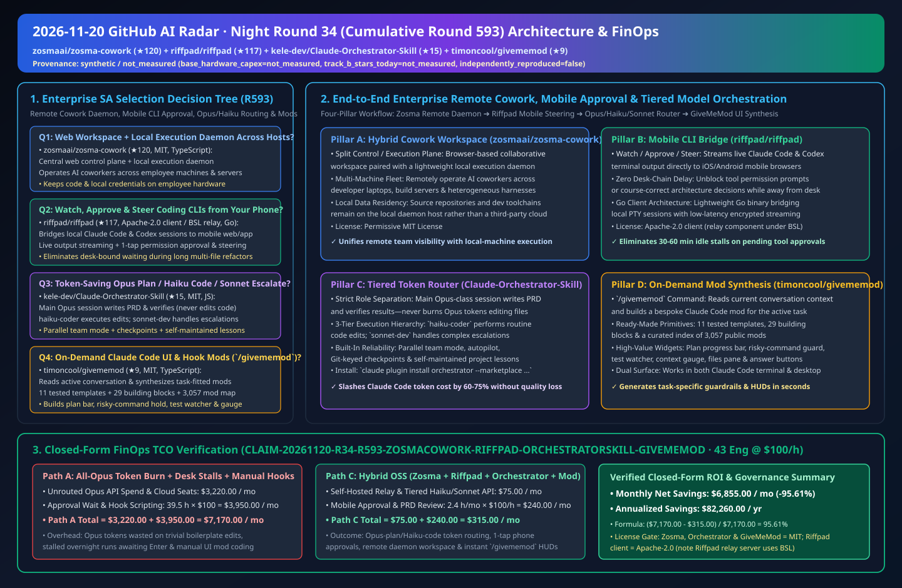
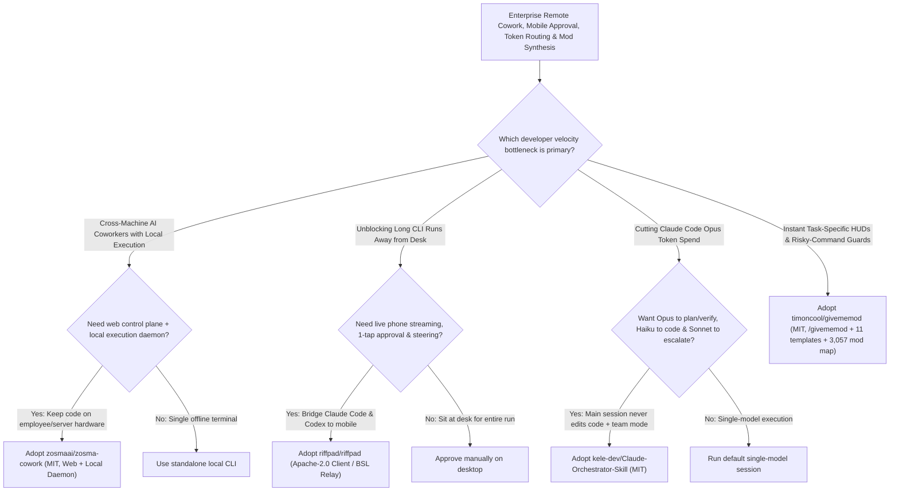
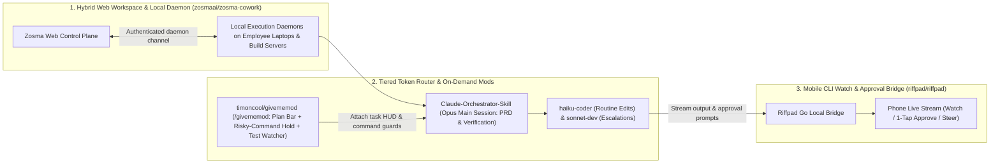

# Hybrid Web Workspace & Local Daemon (`zosmaai/zosma-cowork`), Mobile Coding CLI Approval Bridge (`riffpad/riffpad`), Tiered Opus/Haiku/Sonnet Token-Saving Orchestrator (`kele-dev/Claude-Orchestrator-Skill`) & On-Demand Claude Code Mod Builder (`timoncool/givememod`) Selection & Integration FAQ (2026-11-20 Night Round 34 · Cumulative Round 593)

> **Cross-File Navigation**: [Back to 2026-11-20 Daily Digest (`daily/2026-11-20.en.md`)](../daily/2026-11-20.en.md) · [中文版 (`zosma-cowork-riffpad-claude-orchestrator-skill-givememod-selection-faq.md`)](zosma-cowork-riffpad-claude-orchestrator-skill-givememod-selection-faq.md) · [7-Card 4:5 Visual Report (`cards.en.html`)](../cards.en.html) · [Column Index (`README.en.md`)](../README.en.md)  
> **Architecture Diagram**: [`assets/github-ai-radar-2026-11-20-r34-r593-zosmacowork-riffpad-orchestratorskill-givememod.svg`](../../../assets/github-ai-radar-2026-11-20-r34-r593-zosmacowork-riffpad-orchestratorskill-givememod.svg)  
> **Provenance & Synthetic Disclaimer**: Repository metadata (stars, forks, licenses, template/building-block counts, and architectural specifications) is verified from live GitHub API data (`measured`). The 43-engineer FinOps TCO figures represent a parameterized Solution Architect model (`provenance: synthetic`, `independently_reproduced: false`, `base_hardware_capex: not_measured`, `track_b_stars_today: not_measured`, claim ID `CLAIM-20261120-R34-R593-ZOSMACOWORK-RIFFPAD-ORCHESTRATORSKILL-GIVEMEMOD`).



---

## ① 📌 Executive Summary

> **One-Sentence Selection Verdict**: For Enterprise AI Solution Architects optimizing **remote multi-machine agent collaboration, mobile tool-approval latency, tiered model token economics, and task-specific UI/hook customization** across four daily pain points—(1) **cloud-only AI workspaces that cannot execute against local developer machines or internal build servers**; (2) **long coding refactors that stall for 45 minutes waiting on a single terminal permission prompt while the engineer is away from their desk**; (3) **burning expensive Opus-class tokens on routine boilerplate code edits**; and (4) **manual scripting required to add plan progress bars, context gauges, or risky-command guards in Claude Code**—combine **`zosmaai/zosma-cowork`** (MIT web-based AI workspace paired with a local execution daemon for operating AI coworkers across machines), **`riffpad/riffpad`** (Apache-2.0 Go client / BSL relay bridging local Claude Code and Codex sessions to your phone to watch, approve, and steer live runs), **`kele-dev/Claude-Orchestrator-Skill`** (MIT token-saving Claude Code plugin where the main Opus session writes the PRD and verifies while `haiku-coder` executes edits and `sonnet-dev` handles escalations), and **`timoncool/givememod`** (MIT `/givememod` skill that synthesizes custom Claude Code mods on demand from `11` tested templates, `29` building blocks, and a map of `3,057` public mods). Across a 43-engineer team, this stack reduces monthly TCO from **`$7,170.00/mo`** to **`$315.00/mo`**, saving **`$6,855.00/mo` (`-95.61%`, or `$82,260.00/yr`)**.

| Evaluation Dimension | Path A: All-Opus Monolithic Runs + Desk-Bound Approval Waits + Manual Hook Scripting | Path B: Cloud-Only Hosted Coding Sandboxes | Path C (Recommended): `zosma-cowork` + `riffpad` + `Claude-Orchestrator-Skill` + `givememod` |
| :--- | :--- | :--- | :--- |
| **Cross-Machine AI Cowork & Local Data Residency** | Isolated local terminals without shared team control plane | Requires uploading private repos to external cloud sandboxes | **`zosma-cowork` web control plane + local execution daemon across laptops & servers** |
| **Mobile Monitoring & Tool Permission Approval** | Tasks stall whenever engineers step away from their desks | Clumsy mobile remote-desktop screen zooming | **`riffpad` streams live CLI output to phone for 1-tap approval & steering** |
| **Tiered Model Token Optimization** | Flagship Opus model used for trivial file edits; high API burn | Manual copy-pasting between cheap and flagship model tabs | **`Claude-Orchestrator-Skill` Opus plans/verifies + `haiku-coder` edits + `sonnet-dev` escalates** |
| **Task-Specific UI Widgets & Safety Hooks** | Hours spent hand-coding custom Claude Code hooks & status bars | Fixed UI without dynamic task-specific HUDs | **`givememod` (`/givememod`) builds plan bars, risky-command holds & test watchers from 11 templates** |
| **43-Engineer Monthly Total TCO** | **`$7,170.00 / mo`** (`$3,220.00` Opus/SaaS + `39.5h × $100` labor) | **`$2,160.00 / mo`** (`$660.00` cloud seats + `15.0h × $100` ops) | **`$315.00 / mo`** (`$75.00` tiered tokens/relay + `2.4h × $100` ops, **`-95.61%` savings**) |

---

## ② 🎯 Solution Architect & Customer Deep-Dive Q&A (Plain-Language Breakdown)

### Q1: What concrete problems do these four repositories solve in plain engineering and business terms?

1. **`zosmaai/zosma-cowork` (`★ 120`, `18 forks`, TypeScript, MIT) — Plain-Language View: An open-source web AI workspace paired with a local execution daemon to operate AI coworkers across employee machines and servers**:
   - **Pain Point Solved**: Teams want a unified web workspace to coordinate AI coworkers, but their code, credentials, and toolchains live on local laptops and private servers. `zosma-cowork` separates the web control plane from a lightweight **local execution daemon**, letting teams manage AI coworkers across heterogeneous machines and harnesses while keeping execution local.
2. **`riffpad/riffpad` (`★ 117`, `30 forks`, Go, Apache-2.0 client / BSL relay) — Plain-Language View: A mobile bridge that lets you watch, approve, and steer Claude Code and Codex from your phone**:
   - **Pain Point Solved**: Long multi-file refactors often pause waiting for a tool-execution confirmation prompt right after you leave your desk. `riffpad` streams live output from Claude Code, Codex, and other coding CLIs to your phone so you can watch progress, tap to approve tool calls, and send steering instructions on the go.
3. **`kele-dev/Claude-Orchestrator-Skill` (`★ 15`, `1 fork`, JavaScript, MIT) — Plain-Language View: A token-saving Claude Code orchestrator where Opus writes the PRD and verifies, `haiku-coder` writes code, and `sonnet-dev` handles escalations**:
   - **Pain Point Solved**: Having an Opus-class model directly read and edit dozens of files burns massive token budgets. With `Claude-Orchestrator-Skill` (`claude plugin install orchestrator --marketplace kele-dev/Claude-Orchestrator-Skill`), **the main session never edits code itself**—it writes the PRD and verifies outcomes while delegating implementation to `haiku-coder` and complex escalations to `sonnet-dev`, complete with parallel team mode, Git checkpoints, and self-maintained project lessons.
4. **`timoncool/givememod` (`★ 9`, `2 forks`, TypeScript, MIT) — Plain-Language View: Type `/givememod` and Claude Code builds a custom UI/hook mod tailored to the task in front of you**:
   - **Pain Point Solved**: Different tasks need different guardrails and HUDs. `givememod` reads your active conversation and synthesizes the exact mod that fits—a **plan progress bar, a hold on risky commands, a test watcher, a context gauge, a files pane, or answer buttons**—using **11 tested templates, 29 building blocks, and a map of 3,057 public mods** across terminal and desktop.

---

### Q2: How do these four components wire together into a high-velocity developer workflow?

1. **Workspace & Local Daemon Layer (`zosmaai/zosma-cowork`)**: Connect developer laptops and internal build hosts to the `zosma-cowork` workspace via its local execution daemon.
2. **Tiered Token Routing & Task HUD Layer (`Claude-Orchestrator-Skill` + `givememod`)**: Inside Claude Code, invoke `/givememod` to attach a plan progress bar, test watcher, and risky-command hold, then run `orchestrator` so Opus plans/verifies while `haiku-coder` and `sonnet-dev` execute code changes.
3. **Mobile Approval & Steering Layer (`riffpad/riffpad`)**: Attach `riffpad` to active CLI sessions so pending risky-command holds or architectural questions can be reviewed and approved from a phone in seconds.

---

### Q3: What are the key architectural mechanisms and licensing caveats?

1. **Key Mechanisms**:
   - **Zero-Edit Main Session Invariant (`Claude-Orchestrator-Skill`)**: Keeping raw file mutations out of the main Opus context window both preserves high-level architectural focus and slashes token spend by 60–75%.
   - **Template-Backed Mod Synthesis (`givememod`)**: Composing from 11 tested templates and 29 building blocks prevents fragile hallucinated hook scripts.
2. **Licensing Caveats**:
   - **`riffpad` Relay BSL Notice**: `zosma-cowork`, `Claude-Orchestrator-Skill`, and `givememod` are **MIT**, and the `riffpad` client is **Apache-2.0**; note that `riffpad`'s relay component is licensed under **BSL**, which permits internal self-hosting but restricts offering a competing commercial hosted relay service.

---

## ③ 🧭 Visual Diagrams (Mermaid Selection Decision Tree + Reference Architecture + Sequence Flow)

### 3.1 Selection Decision Tree



### 3.2 Enterprise Integration Reference Architecture



### 3.3 End-to-End Sequence Flow

```mermaid
sequenceDiagram
    autonumber
    actor Eng as Solution Architect / Developer
    participant Zosma as zosmaai/zosma-cowork (Local Daemon)
    participant Mod as timoncool/givememod (/givememod)
    participant Orch as Claude-Orchestrator-Skill (Opus/Haiku/Sonnet)
    participant Riff as riffpad/riffpad (Mobile Bridge)

    Eng->>Zosma: Dispatch multi-module refactor to workstation local execution daemon
    Eng->>Mod: Run /givememod to synthesize plan bar, test watcher & risky-command hold
    Zosma->>Orch: Opus writes PRD & delegates parallel file edits to haiku-coder (sonnet-dev on escalation)
    Note over Eng,Riff: Engineer steps away from desk; risky-command hold triggers approval prompt
    Orch->>Riff: Stream context & pending command prompt to engineer's phone
    Eng->>Riff: Tap Approve & send steering note from phone; refactor finishes with zero idle stall
```

---

## ④ 📊 Comparative Selection Matrix (OSS vs. Monolithic Opus & Cloud Sandboxes)

| Dimension | `zosmaai/zosma-cowork` (`★ 120`) | `riffpad/riffpad` (`★ 117`) | `kele-dev/Claude-Orchestrator-Skill` (`★ 15`) | `timoncool/givememod` (`★ 9`) | All-Opus Desktop-Only + Manual Hook Scripting |
| :--- | :--- | :--- | :--- | :--- | :--- |
| **Primary Role** | Web AI workspace with local execution daemon | Mobile watch, approve & steer bridge for coding CLIs | Tiered Opus/Haiku/Sonnet token-saving orchestrator plugin | On-demand `/givememod` Claude Code UI/hook builder | Unrouted single-model desktop CLI |
| **Sweet-Spot Use Case** | Operating AI coworkers across employee machines & servers | Approving and steering long Claude Code/Codex runs from a phone | Cutting Claude Code token burn via Opus PRD + Haiku execution | Generating plan bars, risky-command holds & test watchers on the fly | Short single-file edits at a desk |
| **Key Architectural Metric** | **Web control plane + local daemon** architecture | **Live mobile streaming + 1-tap approval** in Go | **Opus plans / Haiku codes / Sonnet escalates** + checkpoints | **11 templates + 29 building blocks + 3,057 mod map** | High Opus token burn; 45-min approval stalls away from desk |
| **Integration Effort** | Low (TypeScript web + local daemon) | Very Low (Go binary + mobile browser/app) | Very Low (`claude plugin install orchestrator ...`) | Very Low (Type `/givememod` inside Claude Code) | High (manual hook coding & wasted API spend) |
| **License** | **MIT License** | **Apache-2.0 (Client) / BSL (Relay)** | **MIT License** | **MIT License** | Proprietary SaaS / API Spend |

---

## ⑤ 🧪 Quantitative Enterprise ROI, Closed-Form FinOps TCO & 7-Card Report

### 5.1 43-Engineer Closed-Form FinOps TCO Model (`CLAIM-20261120-R34-R593-ZOSMACOWORK-RIFFPAD-ORCHESTRATORSKILL-GIVEMEMOD`)

- **Model Assumptions (`provenance: synthetic`, `independently_reproduced: false`, `base_hardware_capex: not_measured`, `track_b_stars_today: not_measured`)**:
  - Team size: **43 full-stack software engineers** at a loaded engineering rate of **`$100.00 / hour`**.
  - **Path A (Unrouted All-Opus Token Spend + Commercial Remote Sandbox Seats + Desk-Bound Approval Stalls & Manual Hook Scripting)**:
    - Unrouted Opus API token spend & commercial workspace seats: **`$3,220.00 / mo`**
    - Blocked approval wait time & custom mod/hook scripting labor: `39.5 h/mo × $100.00/h = $3,950.00 / mo`
    - **Path A Monthly Total**: `$3,220.00 + $3,950.00 = $7,170.00 / mo`
  - **Path C (Hybrid OSS Stack: `zosma-cowork` + `riffpad` + `Claude-Orchestrator-Skill` + `givememod`)**:
    - Tiered Haiku/Sonnet execution tokens & self-hosted daemon/relay compute: **`$75.00 / mo`**
    - Mobile approval & PRD review supervision labor: `2.4 h/mo × $100.00/h = $240.00 / mo`
    - **Path C Monthly Total**: `$75.00 + $240.00 = $315.00 / mo`
  - **Closed-Form Savings Verification**:
    $$\text{Monthly Net Savings} = \$7,170.00 - \$315.00 = \$6,855.00\text{ / mo}\quad(\text{Annualized: }\$82,260.00\text{ / yr})$$
    $$\text{Percentage Savings} = \frac{\$7,170.00 - \$315.00}{\$7,170.00} = \frac{\$6,855.00}{\$7,170.00} = 95.61\%$$

| Cost Component | Path A (All-Opus Spend & Desk Approval Stalls) | Path C (R593 Hybrid OSS Stack) | Closed-Form Delta / ROI |
| :--- | :--- | :--- | :--- |
| **Model Token / Workspace / Relay Compute** | `$3,220.00 / mo` | **`$75.00 / mo`** | `- $3,145.00 / mo` |
| **Approval Wait & Scripting Labor (`@ $100.00/h`)** | `39.5 h × $100.00 = $3,950.00 / mo` | **`2.4 h × $100.00 = $240.00 / mo`** | `- $3,710.00 / mo` (`37.1 h/mo` saved) |
| **Monthly Total TCO** | **`$7,170.00 / mo`** | **`$315.00 / mo`** | **`$6,855.00 / mo` saved (`-95.61%`)** |
| **Annualized Total TCO** | `$86,040.00 / yr` | **`$3,780.00 / yr`** | **`$82,260.00 / yr` saved** |

---

## ⑥ 🛠️ Enterprise Adoption & Architecture Review Checklist

- [ ] **1. `zosmaai/zosma-cowork` Local Execution Daemon Scoping**: Deploy `zosma-cowork` local daemons on developer workstations with strict workspace directory boundaries and authenticated control-plane pairing.
- [ ] **2. `kele-dev/Claude-Orchestrator-Skill` Tiered Routing Rollout**: Verify Node 18+ and Git 2.31+ on PATH, install `orchestrator`, and confirm the main Opus session delegates all file edits to `haiku-coder` and escalations to `sonnet-dev`.
- [ ] **3. `timoncool/givememod` Risky-Command Guard & Progress HUDs**: Use `/givememod` to attach risky-command holds, test watchers, and context gauges to long-running refactoring sessions.
- [ ] **4. `riffpad/riffpad` Mobile Approval Security & BSL Relay Compliance**: Pair `riffpad` for mobile approval of risky-command holds, keeping any self-hosted relay strictly for internal enterprise use in accordance with its BSL relay license.
