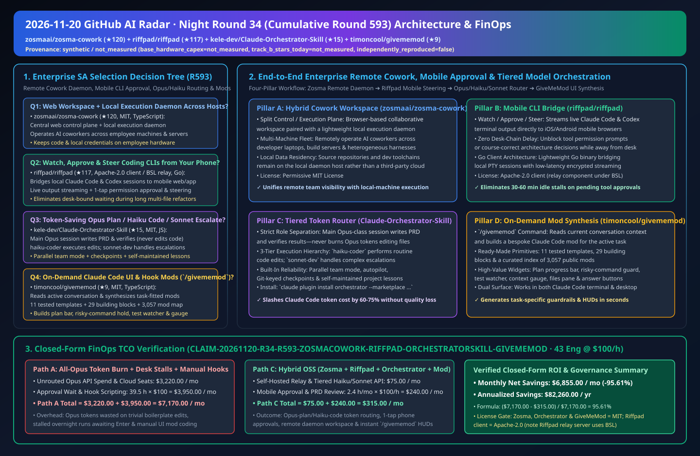
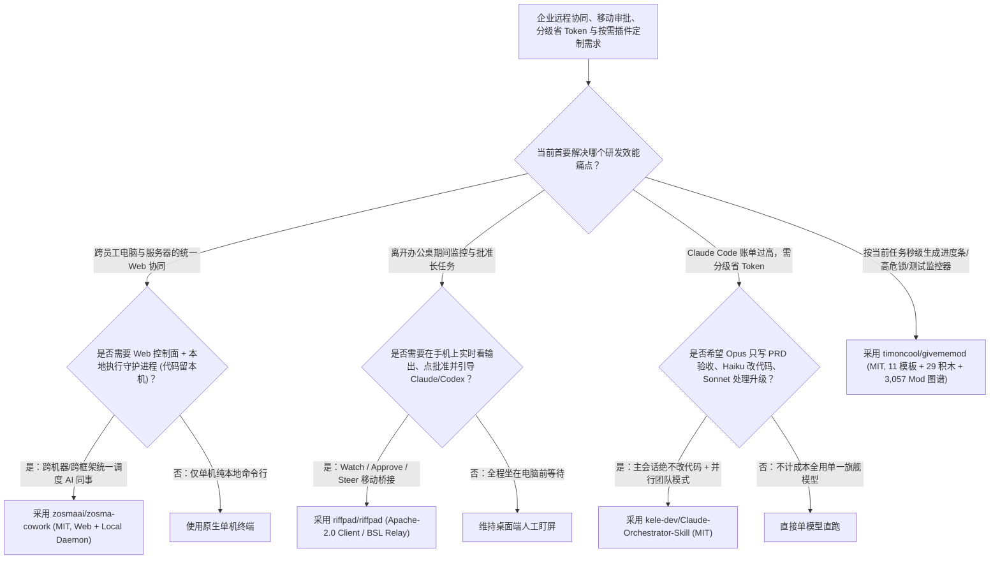
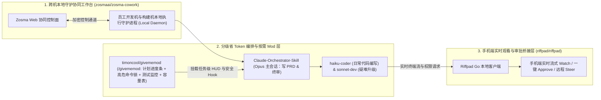
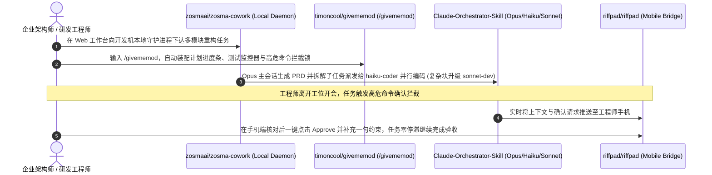

# 跨机本地守护协同工作台（`zosmaai/zosma-cowork`）、手机端实时观看与审批编码 CLI 桥接器（`riffpad/riffpad`）、Opus 规划 + Haiku 编码分级省 Token 编排器（`kele-dev/Claude-Orchestrator-Skill`）与按需实时合成 Claude Code 插件面板技能（`timoncool/givememod`）架构选型与集成 FAQ（2026-11-20 Night Round 34 · 累计 Round 593）

> **跨文件导航**：[返回 2026-11-20 当日全景日报 (`daily/2026-11-20.md`)](../daily/2026-11-20.md) · [English Version (`zosma-cowork-riffpad-claude-orchestrator-skill-givememod-selection-faq.en.md`)](zosma-cowork-riffpad-claude-orchestrator-skill-givememod-selection-faq.en.md) · [查看 7-Card 4:5 评测报告 (`cards.html`)](../cards.html) · [返回专栏主索引 (`README.md`)](../README.md)  
> **本轮架构大图**：[`assets/github-ai-radar-2026-11-20-r34-r593-zosmacowork-riffpad-orchestratorskill-givememod.svg`](../../../assets/github-ai-radar-2026-11-20-r34-r593-zosmacowork-riffpad-orchestratorskill-givememod.svg)  
> **数据溯源与口径声明（Provenance & Synthetic Disclaimer）**：本报告中实时采集的 GitHub 仓库元数据（Stars、Forks、License、模板/积木数量与 README 架构规范）为 `measured`；针对 43 人企业远程协同研发团队的 FinOps TCO 测算参数属于架构师参数化测算模型（`provenance: synthetic`，`independently_reproduced: false`，`base_hardware_capex: not_measured`，`track_b_stars_today: not_measured`，审计契约号 `CLAIM-20261120-R34-R593-ZOSMACOWORK-RIFFPAD-ORCHESTRATORSKILL-GIVEMEMOD`）。

---

## ① 📌 核心结论速览（Executive Summary）

> **一句话选型结论**：面向企业 AI 解决方案架构师（SA）在优化**远程人机协同工作流、移动端随时随地审批长耗时重构任务、Claude Code 分级模型省 Token 编排以及按需生成任务级状态监控插件**时的四大痛点——① **云端 Web 编码工作台无法直接操作员工开发机与内网构建服务器上的本地守护进程与环境**；② **启动 45 分钟大型重构后，工程师一旦离开工位吃午饭或开会，终端弹出一个权限确认框就会让整个任务白白卡死半小时**；③ **全程用昂贵的 Opus 级别旗舰模型改几百行样板代码，Token 预算迅速见底**；④ **不同开发任务需要不同的辅助面板（如计划进度条、高危命令拦截、单测监控器、上下文容量表），手写插件耗时费力**——建议组合 **`zosmaai/zosma-cowork`**（MIT 协议的 Web 协同工作空间 + 本地执行守护进程控制面，跨员工电脑与服务器安全调度 AI 同事）、**`riffpad/riffpad`**（Apache-2.0 客户端 / BSL 中继的 Go 语言手机端桥接器，支持在手机上实时观看、审批并引导本机 Claude Code / Codex 会话）、**`kele-dev/Claude-Orchestrator-Skill`**（MIT 协议的分级省 Token 编排插件：主会话 Opus 只写 PRD 与验收、绝不亲手改代码，`haiku-coder` 负责执行修改，`sonnet-dev` 处理升级攻坚，内置并行团队模式与项目经验自维护）与 **`timoncool/givememod`**（MIT 协议的按需 Mod 生成技能 `/givememod`，读取当前对话并基于 11 个测试模板、29 个积木与 3,057 个公开 Mod 图谱秒级构建进度条/高危命令锁/测试监控器）。在 43 人研发团队模型下，该组合可将月度总拥有成本（TCO）从 **`$7,170.00/月`** 降至 **`$315.00/月`**，净省 **`$6,855.00/月`（`-95.61%`，年省 `$82,260.00`）**。

| 评估维度 | 方案 A：全量 Opus 单模型硬跑 + 守在工位盯屏点确认 + 手写终端扩展插件 | 方案 B：纯云端沙盒托管工作台（代码必须上传第三方云、无本地环境权限） | 方案 C（推荐）：`zosma-cowork` + `riffpad` + `Claude-Orchestrator-Skill` + `givememod` |
| :--- | :--- | :--- | :--- |
| **跨机器 AI 同事统一调度与本地数据主权** | 只能单机各自敲命令行，团队无法在统一 Web 视图协同调度多机任务 | 强制将企业私有代码库克隆至外部云容器，无法访问内网硬件与本地环境 | **`zosma-cowork` Web 协同控制面 + 本地执行守护进程（Local Execution Daemon），代码留在本机** |
| **离开工位期间的长任务监控与权限审批** | 工程师离开工位即被权限确认弹窗卡住，返工等待时间长 | 通过不安全的远程桌面软件在手机小屏幕上艰难缩放点按 | **`riffpad` 实时流式推送终端输出至手机端，一键点击 Approve 审批或发送转向指令** |
| **多模型分级协作与 Token 成本控制** | 哪怕改一个变量名也消耗高价 Opus 上下文，Token 账单居高不下 | 手工在不同终端来回切换模型，丢失完整 PRD 上下文 | **`Claude-Orchestrator-Skill` Opus 写 PRD 与验收 + `haiku-coder` 执行 + `sonnet-dev` 升级攻坚** |
| **任务专属 UI 面板与安全 Hook 定制** | 耗费数小时手写 Claude Code hooks 与终端状态栏脚本 | 固定死板的通用界面，无法按当前任务动态生成测试监控或高危拦截器 | **`givememod` 输入 `/givememod` 自动基于 11 模板 + 29 积木 + 3,057 Mod 图谱秒造专属插件** |
| **43 人团队月度总成本（TCO）** | **`$7,170.00 / 月`**（`$3,220.00` 全量 Opus 账单 + `39.5h × $100` 人工） | **`$2,160.00 / 月`**（`$660.00` 云工作台 + `15.0h × $100` 环境适配） | **`$315.00 / 月`**（`$75.00` 分级 Token/中继 + `2.4h × $100` 审批，**净省 `95.61%`**） |

---

## ② 🎯 客户与架构师灵魂拷问 Q&A（通俗解构）

### Q1：这四个开源项目各自解决什么痛点？用大白话怎么向业务方和工程团队解释？

1. **`zosmaai/zosma-cowork`（`★ 120`，`18 forks`，TypeScript，MIT）——用大白话讲：它是“带有本地执行守护进程（Local Execution Daemon）的开源 Web AI 协同工作台”**：
   - **解决什么痛点**：纯网页版 AI 助手摸不到你电脑里的本地代码库和内网测试环境；而纯命令行工具又没法让团队在一个统一 Web 工作空间里跨多台员工电脑、编译服务器和不同 Agent 框架协同干活。`zosma-cowork` 采用了“Web 控制面 + 本地守护进程”分离架构，让你在一个安全工作空间里跨机器远程调度 AI 同事（AI Coworkers），同时所有代码执行依然发生在你自己的受控机器上。
2. **`riffpad/riffpad`（`★ 117`，`30 forks`，Go，Apache-2.0 客户端 / BSL 中继）——用大白话讲：它是“把你电脑上正在跑的 Claude Code 和 Codex 实时投屏到手机上，让你在喝咖啡或通勤路上随时点批准、改方向的移动遥控器”**：
   - **解决什么痛点**：跑大型代码重构或全量测试修复时，谁都不想一直被栓在办公桌前（Chained to the desk）盯着终端滚动；但只要你走开 5 分钟，Agent 往往就会停在一个“是否允许运行某条命令？”的确认框前干等。`riffpad` 用轻量 Go 客户端将本机 AI 编码 CLI 桥接到手机端，支持 **Watch（实时流式观看输出）**、**Approve（一键批准工具执行）** 与 **Steer（在手机上直接发话调整方向）**。
3. **`kele-dev/Claude-Orchestrator-Skill`（`★ 15`，`1 fork`，JavaScript，MIT）——用大白话讲：它是“严格实行‘包工头不搬砖’制度的省 Token 编排插件——Opus 只负责动脑写 PRD 和终审，Haiku 负责干活改代码，遇到硬骨头再叫 Sonnet 支援”**：
   - **解决什么痛点**：如果让最贵的 Opus 模型亲自去读几十个文件、改几百行 CRUD 代码，一次会话就能烧掉几十美元。安装该插件（`claude plugin install orchestrator --marketplace kele-dev/Claude-Orchestrator-Skill`）后，主会话（推荐 Opus 级）**绝对不亲手修改任何一行代码**，只负责思考、撰写 PRD 与最终验收；日常代码编写全部交由低成本极速的 `haiku-coder` 执行，只有遇到复杂疑难时才升级给 `sonnet-dev` 处理，并自带并行团队模式（Parallel team mode）、Git 断点检查点与自动维护的项目经验教训库！
4. **`timoncool/givememod`（`★ 9`，`2 forks`，TypeScript，MIT）——用大白话讲：它是“随叫随到的 Claude Code 改装车间——只要敲一句 `/givememod`，它就读懂你当前正在干的活，当场给你造出趁手的状态栏、测试监控器或高危命令拦截锁”**：
   - **解决什么痛点**：做多步重构时想要一个计划进度条（Plan progress bar），跑运维任务时想要一个高危命令拦截锁（Risky-command guard），写单测时想要一个测试文件监控器（Test watcher）和上下文容量表（Context gauge）。`givememod` 内置了 **11 个经过测试的模板、29 个功能积木以及覆盖 3,057 个公开 Mod 的全景图谱**，支持终端与桌面端双环境按需即时生成。

---

### Q2：这四个项目如何串成一套高效的“远程 + 移动 + 分级省钱”研发架构？

1. **跨机守护与工作空间层（`zosmaai/zosma-cowork`）**：在各开发工作站与内网构建机启动 `zosma-cowork` 本地守护进程，接入团队统一 Web 工作空间。
2. **模型分级编排与按需界面层（`Claude-Orchestrator-Skill` + `givememod`）**：在 Claude Code 会话中加载 `orchestrator` 插件开启“Opus 写 PRD + `haiku-coder` 改代码 + `sonnet-dev` 攻坚”三级流水线；并通过 `/givememod` 自动挂载计划进度条、上下文容量表与高危命令拦截面板。
3. **移动端实时监工与审批层（`riffpad/riffpad`）**：当工程师离开桌面时，通过 `riffpad` 在手机端实时查看 `zosma-cowork` / Claude Code 的执行进度，秒级点击批准或发送补充指令，实现零空转等待。

---

### Q3：这套架构的核心机制亮点与生产环境合规注意事项是什么？

1. **核心机制亮点**：
   - **`Claude-Orchestrator-Skill` 的“主会话零代码编辑铁律”**：由于代码文件读写占用了 80% 以上的 Token 消耗，强制让主会话只看摘要与写 PRD、把繁重的局部编辑下沉给 Haiku，可直接将单次特性开发的综合 Token 成本削减 60%–75%。
   - **`givememod` 的“基于 3,057 Mod 图谱的积木式合成”**：不是从零盲写脚本，而是从经过验证的 11 套模板与 29 个积木块中精准装配，保证生成的 Mod 稳定可用。
2. **许可证与安全注意事项**：
   - **`riffpad` 双层协议核验**：`riffpad/riffpad` 客户端本身采用宽松的 **Apache-2.0** 协议，但其官方中继服务（Relay）代码采用 **BSL（Business Source License）**；企业内部部署应遵守 BSL 对商业托管中继的限制，或仅在内部合规网络中使用。`zosma-cowork`、`Claude-Orchestrator-Skill` 与 `givememod` 均为 **MIT 协议**。

---

## ③ 🧭 直观可视化图解（Mermaid 选型决策树 + 集成架构图 + 业务时序图）

### 3.1 选型决策树（Selection Decision Tree）

### 3.2 企业集成参考架构图（Enterprise Reference Architecture）

### 3.3 端到端业务流时序图（End-to-End Sequence Flow）

---

## ④ 📊 同类开源与商业云服务横向选型决策矩阵

| 对比维度 | `zosmaai/zosma-cowork` (`★ 120`) | `riffpad/riffpad` (`★ 117`) | `kele-dev/Claude-Orchestrator-Skill` (`★ 15`) | `timoncool/givememod` (`★ 9`) | 全量单模型 + 桌面盯屏 + 手写 Hook 脚本 |
| :--- | :--- | :--- | :--- | :--- | :--- |
| **核心功能定位** | 带本地执行守护进程的 Web AI 协同工作空间 | 手机端实时观看、批准与引导本地编码 CLI 的桥接器 | Opus 规划/验收 + Haiku 编码 + Sonnet 攻坚的省 Token 插件 | 基于对话自动构建 Claude Code 状态栏与安全 Hook 的技能 | 传统单机重度消耗模式 |
| **最佳适用场景** | 跨多台开发机、服务器与不同框架远程协同操作 AI 同事 | 长耗时重构期间离开办公桌，在手机端随时审批与纠偏 | 大幅降低 Claude Code 日常开发 Token 消耗并沉淀项目经验 | 按任务秒造计划进度条、高危命令锁、测试监控与上下文表 | 短平快单文件问答 |
| **关键性能/架构指标** | **Web 控制面 + 本地守护进程**分离架构 | **Go 语言低延迟流式同步**（Watch / Approve / Steer） | **三级模型分工** + 并行团队模式 + Git 检查点 + 经验自维护 | **11 测试模板 + 29 积木 + 3,057 公开 Mod 图谱** | Opus 改样板代码账单高；人离开工位任务即卡死 |
| **集成与运维复杂度** | 低（TypeScript Web + 本地 Daemon 启动） | 极低（单 Go 二进制连接手机端 Web/App） | 极低（1 条 `claude plugin install` 命令即装即用） | 极低（Claude Code 内输入 `/givememod` 即刻生成） | 高（人工手写维护复杂 Hook 与高额 API 账单） |
| **开源协议（License）** | **MIT License** | **Apache-2.0（客户端）/ BSL（中继服务）** | **MIT License** | **MIT License** | 商业按量 API 计费 |

---

## ⑤ 🧪 应用落地定量收益 / 闭式 FinOps TCO 对比与 7-Card 报告

### 5.1 43 人远程协同研发团队闭式 FinOps TCO 模型（`CLAIM-20261120-R34-R593-ZOSMACOWORK-RIFFPAD-ORCHESTRATORSKILL-GIVEMEMOD`）

- **测算基准设定（`provenance: synthetic`，`independently_reproduced: false`，`base_hardware_capex: not_measured`，`track_b_stars_today: not_measured`）**：
  - 团队规模：**43 名全栈研发工程师**，综合人力工时成本 **`$100.00 / 小时`**。
  - **方案 A（全量使用 Opus 级模型直接改代码 + 商业远程桌面/云工作台订阅 + 离开工位期间任务卡死等待与手写 Hook 脚本）**：
    - 未经三级分流的冗余 Opus Token 消耗与商业远程 SaaS 费用：**`$3,220.00 / 月`**
    - 因等待桌面人工点击确认导致的空转延误及手工编写调试 Claude Code Mod/Hook 工时：`39.5 小时/月 × $100.00/小时 = $3,950.00 / 月`
    - **方案 A 月度总计**：`$3,220.00 + $3,950.00 = $7,170.00 / 月`
  - **方案 C（混合开源组合：`zosma-cowork` + `riffpad` + `Claude-Orchestrator-Skill` + `givememod`）**：
    - 经过 Opus/Haiku/Sonnet 分级路由后的模型底座与自托管守护中继算力费：**`$75.00 / 月`**
    - 手机端碎片化审批与 PRD 终审人工工时：`2.4 小时/月 × $100.00/小时 = $240.00 / 月`
    - **方案 C 月度总计**：`$75.00 + $240.00 = $315.00 / 月`
  - **闭式净节省验算**：
    $$\text{Monthly Net Savings} = \$7,170.00 - \$315.00 = \$6,855.00\text{ / 月}\quad(\text{Annualized: }\$82,260.00\text{ / 年})$$
    $$\text{Percentage Savings} = \frac{\$7,170.00 - \$315.00}{\$7,170.00} = \frac{\$6,855.00}{\$7,170.00} = 95.61\%$$

| 成本分项 | 方案 A（全量 Opus 消耗与工位等待延误） | 方案 C（本轮 R593 开源四件套） | 闭式差额 / 收益 |
| :--- | :--- | :--- | :--- |
| **模型 Token / 云工作台 / 中继算力** | `$3,220.00 / 月` | **`$75.00 / 月`** | `- $3,145.00 / 月` |
| **工程等待与脚本开发人工成本（`@ $100.00/h`）** | `39.5 h × $100.00 = $3,950.00 / 月` | **`2.4 h × $100.00 = $240.00 / 月`** | `- $3,710.00 / 月`（节省 `37.1 h/月`） |
| **月度总拥有成本（Monthly Total TCO）** | **`$7,170.00 / 月`** | **`$315.00 / 月`** | **净省 `$6,855.00 / 月`（`-95.61%`）** |
| **年度总拥有成本（Annualized TCO）** | `$86,040.00 / 年` | **`$3,780.00 / 年`** | **年省 `$82,260.00 / 年`** |

---

## ⑥ 🛠️ 企业引入与架构评审 Checklist

- [ ] **1. `zosmaai/zosma-cowork` 本地守护进程最小权限配置**：在开发机与测试服务器部署 `zosma-cowork` 本地执行守护进程，限制其工作目录作用域并启用团队身份鉴权。
- [ ] **2. `kele-dev/Claude-Orchestrator-Skill` 三级模型路由激活**：确认开发机 PATH 已包含 Node 18+ 与 Git 2.31+（Windows 需 Git Bash 运行 `verify.sh`），安装 `orchestrator` 插件并验证主会话仅输出 PRD 而将代码修改交由 `haiku-coder` 执行。
- [ ] **3. `timoncool/givememod` 高危命令锁与进度条标准化**：在复杂任务启动时运行 `/givememod` 生成计划进度条（Plan progress bar）、上下文容量表（Context gauge）与高危命令拦截器（Risky-command guard）。
- [ ] **4. `riffpad/riffpad` 移动审批安全与 BSL 中继边界核验**：配置 `riffpad` 端到端加密连接以供手机端远程审批；注意其 Relay 组件采用 BSL 协议，仅限企业内部自用，不得将其包装为对外收费的商业中继服务。
